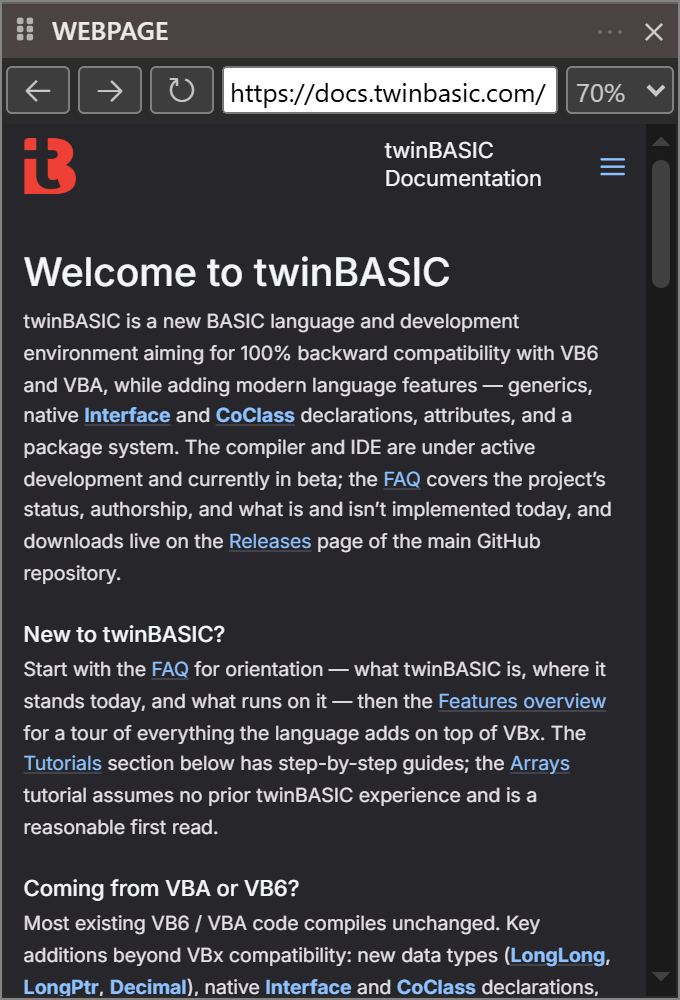

# Webpage

The **WEBPAGE** pane shows a web page inside the IDE, so that you can read online content without opening a browser. **View → WEBPAGE** opens it. It is not in either built-in panel layout.

{:width="340" height="500"}

**Back**, **Forward** and **Refresh**
: The three buttons at the left. They have no default keys; the commands are `tbWebpage_GoBack`, `tbWebpage_GoForward` and `tbWebpage_Reload`.

The address box
: Shows the address of the page, and follows the page as it changes. Type an address and press <kbd>Enter</kbd> to go there. An address with no colon in it gets `https://` in front of it.

**Zoom**
: Scales the page, from 50% to 150% in steps of ten. It starts at 70%.

**Use Mobile Mode**
: The one item of the **...** menu at the right of the pane's title bar. While it is ticked, the pane presents itself to websites as a browser on an Android phone, so a site that has a layout for phones sends that one.

The pane keeps its address, zoom and mobile mode from one session to the next. The first address it shows is `https://www.google.com`.

While a menu, a dialog, a floating message or another floating panel overlaps the pane, the pane shows a still picture of the page. The live page comes back when nothing overlaps it.
