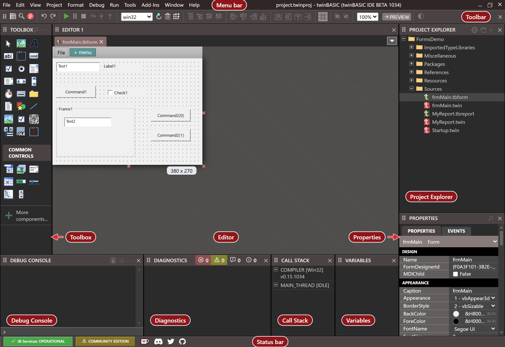

# The twinBASIC IDE

The twinBASIC IDE is one window that holds everything you need to write a program, run it, debug it and build it. This page goes round the window, then follows a project from start to finish, and says at each step which chapter explains it.

{:width="1280" height="880"}

The picture shows the IDE in its default layout, with a project open and one of its forms in the designer. With no project open, there is no compiler, so the panels are empty and the two badges in the status bar are red. They change once a project is open.

## Around the window

**The menu bar** runs along the top, in the title bar. The [menu reference](IDE/Reference/Menu) lists every command with its key.

**The toolbar** is under it. It has the buttons for saving and finding, the buttons that start, pause, stop and step a program, the build configuration box that chooses 32-bit or 64-bit, and the buttons that arrange the controls on a form. See [Toolbar](IDE/Reference/Toolbar).

**The Editor** fills the middle. A file opens in it, in a tab: a code file in the [code editor](IDE/Code/Editor), a form in the [form designer](IDE/Forms/), and a report in the [report designer](IDE/Reports/). The code editor gives you completion lists, hints and live diagnostics while you type; [Writing code](IDE/Code/) describes them.

**The Toolbox**, at the left, lists the controls that you can drop onto a form. See [Toolbox](IDE/Forms/Toolbox).

**The Project Explorer**, at the top right, shows the files of the open project, or the objects in its code. See [Project Explorer](IDE/Projects/Project-Explorer).

**Properties**, under it, shows and edits the properties of the control or form that is selected. See [Properties](IDE/Forms/Properties).

**The row along the bottom** holds four panels:

- [**DEBUG CONSOLE**](IDE/Debugging/Debug-Console) shows what a program prints and what the compiler reports, and runs a line of code that you type.
- [**DIAGNOSTICS**](IDE/Code/Diagnostics) lists the errors and warnings that the compiler finds as you type.
- [**CALL STACK**](IDE/Debugging/Inspecting#call-stack) and [**VARIABLES**](IDE/Debugging/Inspecting#variables) show where a paused program is, and what its variables hold.

**The status bar**, at the foot of the window, shows the state of the compiler's services and your licence, and, on the right, the name of the command under the pointer. See [Status Bar](IDE/Reference/StatusBar).

More panels open from the **View** menu: [**Outline**](IDE/Code/Navigating#outline), [**Open Editors**](IDE/Code/Navigating#open-editors), [**History**](IDE/Code/Navigating#history), [**Find / Replace**](IDE/Code/Finding), [**Watches**](IDE/Debugging/Inspecting#watches), [**Memory**](IDE/Debugging/Memory) and the [**Webpage**](IDE/Reference/Webpage) pane. Every panel can be moved, floated or closed, and [Panel layouts](IDE/Customising/Panel-Layouts) says how to save an arrangement.

## From a project to a program

1. **Start a project.** The IDE opens on the **New / Open Project** dialog, which makes a project from a template or opens one you have, a `.vbp` file from VB6 included. [Starting a project](IDE/Starting/) describes the first start, the dialog and the samples.
2. **Add to it.** The **Project** menu and the Project Explorer add forms, modules, classes and other files. [Projects and files](IDE/Projects/) describes how to add, change and save them, and [Project Settings](IDE/Project-Settings) describes each setting of a project.
3. **Write the code and draw the forms.** See [Writing code](IDE/Code/), [Designing forms](IDE/Forms/) and [Designing reports](IDE/Reports/).
4. **Run it.** <kbd>F5</kbd> runs the program inside the IDE, with no build. You can stop it, look at its variables and step through its code. See [Running and debugging](IDE/Debugging/).
5. **Build it.** **File → Build** writes the executable, the DLL or the package. See [Building](IDE/Building/).

## Everything else

- [**Customising the IDE**](IDE/Customising/) --- options, themes, panel layouts, keyboard shortcuts and the language.
- [**Add Ins**](IDE/AddIns/) --- add-ins that extend the IDE with commands and tool windows, and how to write your own.
- [**When something goes wrong**](IDE/Troubleshooting/) --- what the IDE shows when the compiler's services fail, a save cannot write or a file of the install is missing, and the tools for finding out why.
- [**IDE Reference**](IDE/Reference) --- the menus, the toolbar, the status bar and the keyboard shortcuts, one control at a time.
