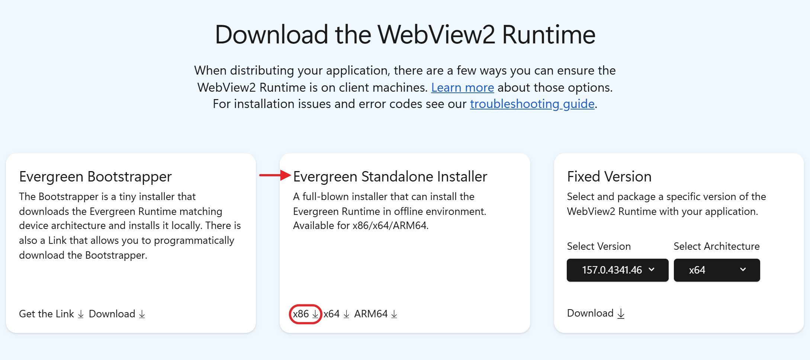
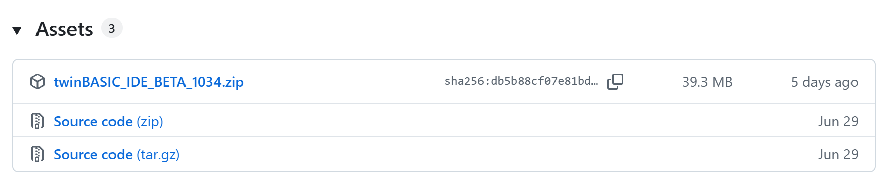
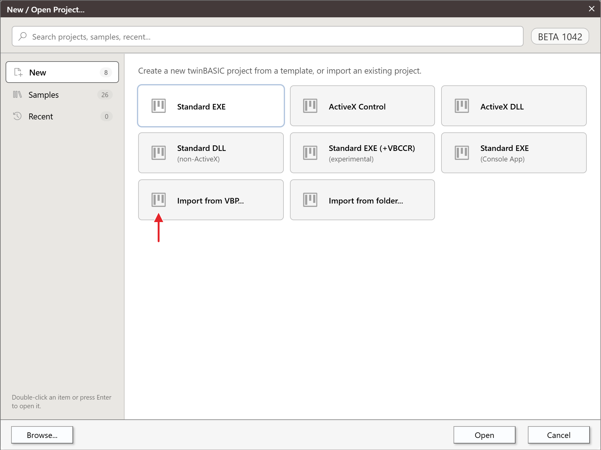
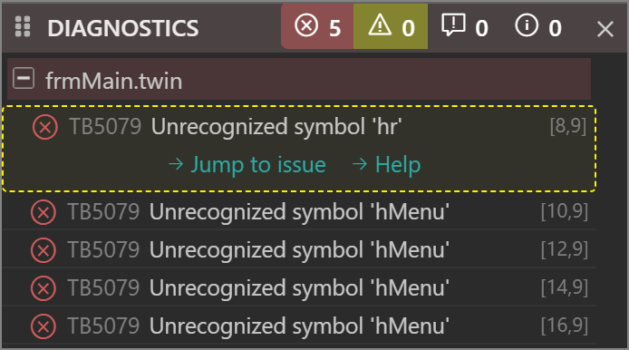
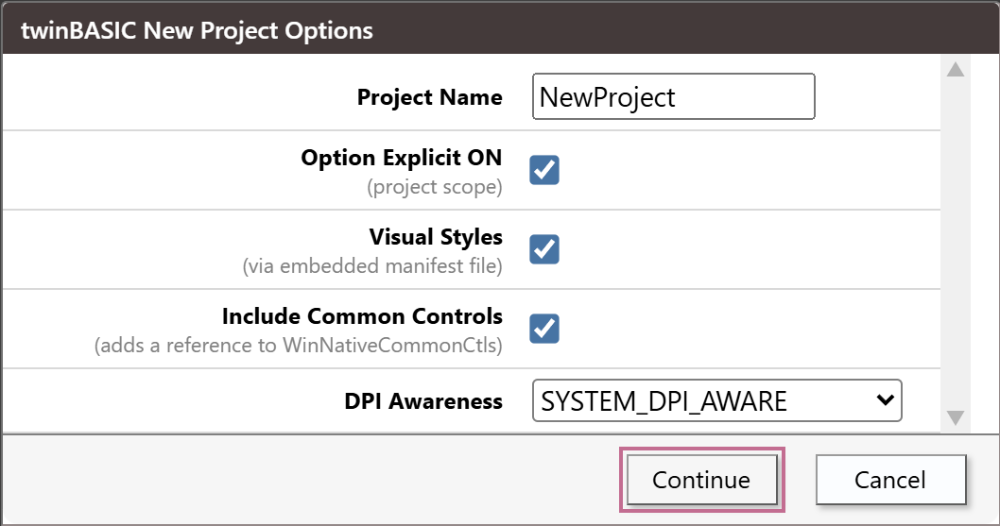
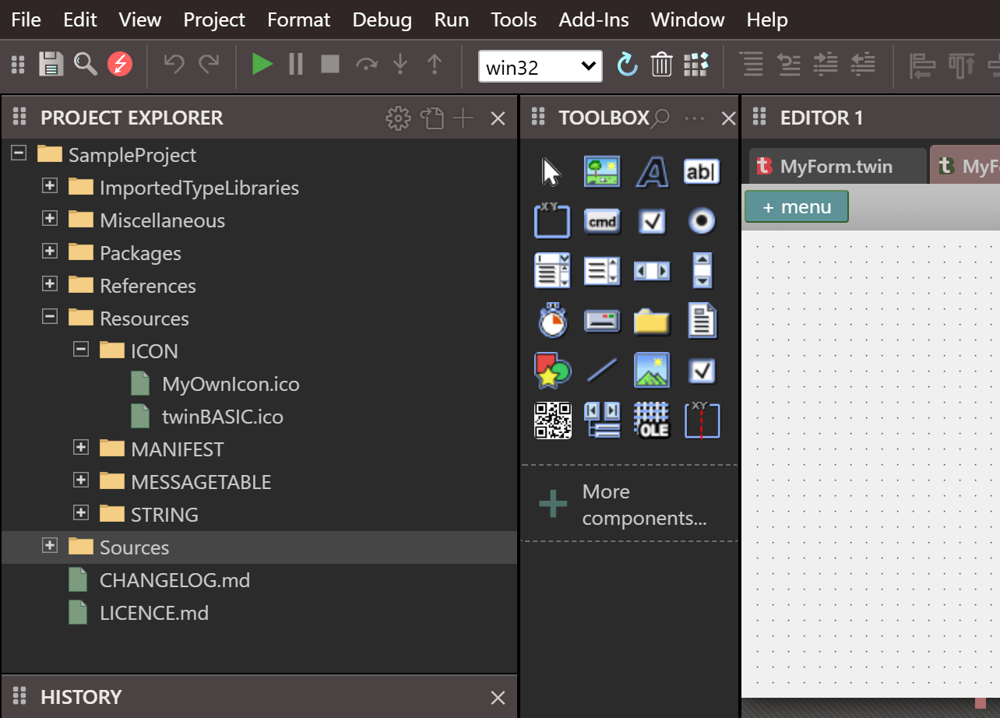

# Frequently Asked Questions

**[General](#general)** - **[Installation](#install-section)** - **[Using twinBASIC](#using-twinbasic)**

## General

<details open>
<summary markdown=span id="what-is-twinbasic"><b>What is twinBASIC?</b></summary>

twinBASIC is a new BASIC language and development environment (IDE) aiming to be 100% backwards compatible with VB6/VBA. 

</details>

<details open>
<summary markdown=span id="authors"><b>Who is behind twinBASIC?</b></summary>

twinBASIC is developed by [TWINBASIC LTD](https://twinbasic.com/about), a family-run software company registered in England and Wales. It is led by Wayne Phillips, who created twinBASIC, and Louise Phillips. Wayne ran the business as a sole trader until TWINBASIC LTD took it over on 10 November 2025 ([announcement](https://twinbasic.com/news/twinbasic-incorporation)). In July 2026 the company took its first outside investment, led by RepSoft, LLC ([announcement](https://twinbasic.com/news/twinbasic-investment-july2026)).

Wayne is also known for [Everything Access](https://www.everythingaccess.com/), a well-established provider of professional tools and services for Microsoft Access and VBA, including the popular vbWatchdog software. Everything Access is now a brand of TWINBASIC LTD.

</details>

<details open>
<summary markdown=span id="where-to-get"><b>Where can I get twinBASIC?</b></summary>

The latest version can be downloaded from the [Releases section](https://github.com/twinbasic/twinbasic/releases) of the [main twinBASIC GitHub repository](https://github.com/twinbasic/twinbasic). See [How do I install twinBASIC](#installation) for more information on installation.

</details>

<details>
<summary markdown=span id="current-status"><b>What is the current status of the project?</b></summary>

twinBASIC is currently late into the **Beta** stage: it is under active development, with a new build published almost every day, and not yet at a stable 1.0 release. The [twinBASIC Roadmap](https://twinbasic.com/roadmap) plans a release candidate for 16 November 2026 and version 1.0 for 14 December 2026; both dates are tentative, and the release may come later.

Nearly all of the VB6/VBA7 syntax and intrinsic functions have been implemented. All of the basic controls have been implemented except the [OLE](tB/Packages/VB/OLE/) container control, which is a placeholder, and so have eight of the fourteen Microsoft Common Controls, in the [WinNativeCommonCtls](tB/Packages/WinNativeCommonCtls/) package. It supports Forms, Classes, and UserControls --- both as compiled OCX/DLL controls and as in-project code (i.e. like .ctl files). However, not all features of these, such as properties, events, and methods, have been completed. Additionally, ActiveX EXEs and VBG project group support are not yet implemented (to share code between projects, one project can use another as a [linked package](Features/Packages/Linked)), and there's a fair number of bugs remaining.

However, **tB can already run many existing projects**, even fairly complex and large ones. Many community members have managed to get their apps and other open source apps up and running with little to no difficulty, and created new projects from scratch. Check out these examples for a good real-world demonstration of how far along the project is:

Krool's [VBCCR](https://github.com/Kr00l/VBCCR) and [VBFlexGrid](https://github.com/Kr00l/VBFLXGRD) controls, Ben Clothier's [TwinBasicSevenZip](https://github.com/bclothier/TwinBasicSevenZip), Carles PV's [Lemmings](https://github.com/fafalone/Lems64), Don Jarrett's [basicNES](https://github.com/fafalone/basicNES) Nintendo emulator, and Jon Johnson's [ucShellBrowse/ucShellTree](https://github.com/fafalone/ShellControls), [FileActivityMon ETW Event Tracer](https://github.com/fafalone/EventTrace), [cTaskDialog](https://github.com/fafalone/cTaskDialog64), and [many more](https://github.com/fafalone).

</details>

<details>
<summary markdown=span id="feature-timeline"><b>Is there an estimated timeline for when expected features will become available?</b></summary>

Yes, see the [twinBASIC Roadmap](https://twinbasic.com/roadmap) on the twinBASIC website for the latest update to the timeline. This roadmap only covers major components; smaller features are implemented in a less formal manner, usually when the related part of the codebase is being worked on.

</details>

<details>
<summary markdown=span id="new-features"><b>What new features does twinBASIC have compared to VB6?</b></summary>

**Many!** It has 64bit compilation (using VBA7x64 compatible syntax), generics, overloading, [multithreading](Features/Advanced/Multithreading) (through the API for now; built-in syntax is on the roadmap for 2027), inheritance, ability to define interfaces and coclasses in your project using BASIC-style syntax, Unicode support in all controls and the editor (.twin files only), support for modern image formats, numerous enhancements to *Implements*, ability to create standard DLLs and kernel mode drivers, ability to set UDT packing alignment, and dozens of others, all available *right now*, with many more planned in the future. Since BETA 1018 it can also build a type library on its own, a `.tlb` file, from the interfaces, coclasses, enumerations and types a project declares in BASIC: the [**TypeLibrary TLB**](tB/IDE/Project-Settings#build-type) build type, which is still experimental.

For a full list of all the new features available right now, see the [Features](Features/) section of this documentation. Since BETA 1023 the IDE also has an [Object Browser](tB/IDE/Code/Object-Browser), which <kbd>F2</kbd> opens, as in VB6.

</details>

<details>
<summary markdown=span id="to-learn-more"><b>Where can I learn more about twinBASIC, find documentation, and participate in the community?</b></summary>

[twinBASIC Home Page](https://twinbasic.com)

twinBASIC GitHub: [Main section](https://github.com/twinbasic/twinbasic) \| [Issues](https://github.com/twinbasic/twinbasic/issues) \| [Discussions](https://github.com/twinbasic/twinbasic/discussions) \| [Language Design](https://github.com/twinbasic/lang-design) \| [Language Specification](https://github.com/twinbasic/lang-spec) \| [Documentation](https://docs.twinbasic.com)

[twinBASIC Discord](https://discord.gg/UaW9GgKKuE)

[twinBASIC Forum on VBForums](https://www.vbforums.com/forumdisplay.php?108-TwinBASIC)

</details>

<details>
<summary markdown=span id="open-source"><b>Is twinBASIC Open Source?</b></summary>

No. twinBASIC has been a closed-source, commercial project from the start, and neither the compiler nor the IDE is open source. Wayne Phillips [has said](https://github.com/twinbasic/twinbasic/issues/1472#issuecomment-1411092862) that he would like to see it open-sourced eventually. To address some of the major concerns a closed-source tool presents, once tB hits its first major release, the source code will be placed in escrow, to be released to the community in the event the author disappears or is unable to continue working on it due to death or serious illness/injury.

</details>

<details>
<summary markdown=span id="cost"><b>How much does twinBASIC cost?</b></summary>

There are 4 basic editions of twinBASIC: The Community Edition is FREE, including for commercial use. The 64-bit programs it builds show a brief twinBASIC startup notice, and it has no [optimized (LLVM) compilation](LLVM/Getting-Started#availability), but there are no restrictions on core language features or royalties imposed. Subscriptions are available for the Personal, Professional and Ultimate editions. The Personal Edition removes the startup notice but does not allow commercial use, and its LLVM compilation covers only the built-in packages. Cross-platform compilation, planned for version 2, will be in the Ultimate Edition only. There are also VIP editions that come with perpetual licenses. For more details on what's included with each edition, and to see current pricing, [see this page](https://twinbasic.com/licensing).

> [!NOTE]
> You can change the subscription level at any time and the Community Edition is always available. There will be no lockout (see [the previous statement regarding escrow](#open-source)) so you will always have the ability to develop, test and compile. 

</details>

<details>
<summary markdown=span id="perpetual-license"><b>Can I pay a one-time fee for a perpetual license?</b></summary>

Due to the need for continuing income to be able to develop twinBASIC, subscriptions are the primary model for premium versions, which [are available](https://twinbasic.com/licensing) on a month-to-month or yearly basis. However, until the 1.0 release, buy-once perpetual licenses are available as the [VIP Silver and VIP Gold editions](https://twinbasic.com/licensing). VIP Silver covers versions 1.x through 5.x, betas included; VIP Gold is a lifetime license covering all future versions. Both come with additional benefits available only to people who purchase them.

</details>

<details>
<summary markdown=span id="commercial-use"><b>Can twinBASIC be used to develop commercial products, and are royalties owed?</b></summary>

All versions of twinBASIC except the Personal Edition can be used to develop commercial products, on a ROYALTY FREE basis, including the free Community Edition. Nothing is owed for selling programs or other products created with twinBASIC editions allowing commercial use. The twinBASIC software itself, however, may not be redistributed without appropriate license.

</details>

<details>
<summary markdown=span id="backwards-compatibility"><b>What does '100% backwards compatible' mean, technically?</b></summary>

Backwards compatibility refers to matching all publicly documented syntax, included controls, component and control behavior, and control appearance. It does not include undocumented, proprietary internal implementation details. So for example all language keywords, functions, and methods are present and should give the same results, and Forms/Classes/UserControls should implement all the same publicly documented interfaces, but twinBASIC exe files are not internally structured in the same way, and there isn't compatibility with the undocumented VB project info structures in the exe, whose contents have been reverse engineered over the years by the community. 

Currently, all basic controls have reimplementations in twinBASIC that support Unicode and 64bit compilation except the OLE control; and eight of the Common Controls have also been reimplemented. Eventually, all controls shipped with VB6 Enterprise Edition will be reimplemented: the [roadmap](https://twinbasic.com/roadmap) plans the remaining ones, such as Winsock, MAPI, Adodc, DataGrid and MSCOMM, from 2027. Until that time, the original controls will still work in 32bit builds, and community members provide some alternatives, for example Krool's VBCCR controls and VBFlexGrid control all work and have 64bit-compatible twinBASIC versions.

</details>

<details>
<summary markdown=span id="when-it-does-not-work"><b>So some of my projects won't work?</b></summary>

Most projects do not use these reverse engineered internals, but some do: most commonly, for self-subclassing and callbacks inside Forms/Classes/UserControls; and also for multithreading and inline assembly. These routines have native support in twinBASIC without requiring internals hacks, so replacing these small parts of a few programs is very simple: `AddressOf` is supported on class members, so you can use regular subclassing and callback methods as you would if they were in a .bas module. `CreateThread` can be called without any special steps. And tB supports [statically linked](Features/Advanced/Static-Linking) .obj files allowing incorporation of code from other languages (still experimental, and only for code that needs nothing from the C runtime), inline assembly in the form of `Emit()`/`EmitAny()` to insert instructions, and further support is planned in the future.

Additionally, twinBASIC redirects the most common msvbvm60.dll (also msvbvm50.dll/vbe6.dll/vbe7.dll) functions used as `Declare` statements by users, all of which also work in x64, if you add the `PtrSafe` keyword like any other DLL definition. The following functions currently have redirects: `VarPtr, GetMem1, GetMem2, GetMem4, GetMem8, PutMem1, PutMem2, PutMem4, PutMem8, __vbaObjSet, __vbaObjSetAddRef, __vbaObjAddRef, __vbaCastObj, __vbaCopyBytes, __vbaCopyBytesZero, __vbaRefVarAry`, and `__vbaAryMove`. You may continue to use these with `Declare` statements to support the particular signatures you prefer. Further, declares for olepro32.dll are redirected to identical functions in oleaut32.dll, as olepro32 was deprecated by NT4 and doesn't have a 64bit version.

Other than those special cases, it's exceedingly rare for projects to depend on reverse engineered internals. So the vast majority of projects run with zero modification. 

</details>

<details>
<summary markdown=span id="bug-reporting"><b>How do I report bugs or other problems?</b></summary>

The best way is to [create an issue](https://github.com/twinbasic/twinbasic/issues) in the twinBASIC GitHub repository.

You can also create a post in the #bugs channel of the [twinBASIC Discord server](https://discord.gg/UaW9GgKKuE).

A bug can be fixed only once it can be reproduced, so a report needs:

- the twinBASIC version, which **Help → About twinBASIC...** shows as *twinBASIC IDE BETA* and a number, and the version of Windows;
- the smallest project that shows the problem, ready to run: attach the `.twinproj` file, or paste the code;
- the steps that make the problem appear, what you expected, and what happened instead.

For a program that crashes, also attach a trace log. In Project Settings, tick every box under [Trace Flags](tB/IDE/Project-Settings#trace-flags) except **Buffered Trace Log File Writing**, which is not for tracing a crash, and set [Trace Output](tB/IDE/Project-Settings#trace-output) to the path of a file that includes `${SESSIONID}`. Then run the program until it crashes. With `${DEBUG}` as the trace output, the log goes to the DEBUG CONSOLE instead. [The trace logger](tB/IDE/Debugging/Debug-Console#the-trace-logger) describes the log.

</details>

<details>
<summary markdown=span id="localization"><b>Is the twinBASIC IDE available in other languages?</b></summary>

Yes. Most of the front-end UI can be localized, with translations supplied by members of the community. The IDE ships with language packs for 18 languages besides the base British English. Choose one under **Window → Language**. [The language of the IDE](tB/IDE/Customising/#the-language-of-the-ide) lists the packs as the menu shows them, says what stays in English, and says how to write a pack: a pack is a UTF-8 text file in a `locale` folder, and the IDE reads the packs when it starts. Translators share new and updated packs in [#langpacks on the tB Discord server](https://discord.com/channels/927638153546829845/1329533568376115282).

Since BETA 1034 a pack can also translate the compiler's warnings and errors, though no pack that ships with the IDE does yet; `en-gb.lang` holds the English text of the warnings. The hover information cannot be translated yet.

</details>

## Installation
{: #install-section }

<details>
<summary markdown=span id="system-requirements"><b>What are the system requirements for twinBASIC?</b></summary>

The twinBASIC IDE is supported on Windows 7 through Windows 11. The installation is portable; you need only to extract the downloaded zip file then run; there's no installer. 

WebView2 is required. This is normally preinstalled on newer versions of Windows, and is installed along with Edge if you've installed that browser. For Windows 10 and 11, you can also obtain it from [Microsoft's website](https://developer.microsoft.com/en-us/microsoft-edge/webview2?form=MA13LH#download-section). Select the Standalone Evergreen x86 version:

{:width="1089" height="485"}

See the next entry for Windows 7.

</details>

<details>
<summary markdown=span id="invalid-entry-point"><b>How do I install twinBASIC on Windows 7?</b></summary>

To be used on Windows 7, ideally the OS must be fully updated; you may encounter an error from one or more missing updates including "missing entry point" errors or WebView2 errors. Run Windows Update to make sure you have all recent updates installed.

You can also manually configure Windows 7 with the proper updates. First, make sure you have Windows 7 Service Pack 1 installed. You can then install update [KB3080149](https://www.microsoft.com/en-us/download/details.aspx?id=48636). After you restarted to complete that update, you need an offline installer for the WebView2 Runtime, for the last version supported by Windows 7, v109.0.1518.78, a copy of which can be found here on the Internet Archive: [Microsoft Edge Web View 2 Runtime Installer v109.0.1518.78](https://archive.org/details/microsoft-edge-web-view-2-runtime-installer-v109.0.1518.78). You must install the x86 version. After these two items have been installed, both the twinBASIC IDE and the twinBASIC WebView2 Package should run.

</details>

<details>
<summary markdown=span id="missing-files"><b>The IDE reports missing files when I try to launch it.</b></summary>


If, when launching the twinBASIC IDE, you are notified of missing files, the most likely reason is that the anti-virus software installed on your PC has quarantined some of the files needed by twinBASIC, mistakenly thinking that they contain a virus or other malware. Such erroneous detections are common with newly released software, so please be assured this is just a false-positive detection --- see also [Is twinBASIC safe?](#false-scanner-alerts) below for context.

To get the twinBASIC IDE to launch successfully, configure your anti-virus software to disregard the twinBASIC executable files (EXEs and DLLs) within the root folder, and the `bin` subfolder. This usually means adding the root folder and the `bin` subfolder to an 'exception list' in your anti-virus software.

After restoring the missing EXE and DLL files, you should find that launching the IDE via the `twinBASIC.exe` file works as expected.

Please direct all negative emotions to your overactive anti-virus vendor :)

</details>

<details>
<summary markdown=span id="installation"><b>How do I install twinBASIC?</b></summary>

tB does not require a full installation process, you need only extract the ZIP file. Download the latest version from the [Releases page](https://github.com/twinbasic/twinbasic/releases), named `twinBASIC_IDE_BETA_xxx.zip` (where xxx is a version number; click on 'Assets' to expand the file list if it's not already visible).

{:width="891" height="183"}

Download the zip and extract it to an **empty** folder. Do not simply overwrite a previous version; either delete everything in the folder or use a different one. Odd errors have been known to occur otherwise.  It will run from this folder; some settings will be placed in AppData.

If Windows refuses to delete some of the old files, a twinBASIC process is still running. By default the LLVM cache process, `bin\twinBASIC_win64.exe`, stays alive after the IDE closes: end it in Task Manager, or turn off **LLVM - Keep cache process alive after exiting the IDE** in [IDE Options](tB/IDE/Customising/IDE-Options#compiler-and-llvm).

</details>

<details>
<summary markdown=span id="installation-size"><b>How big is the twinBASIC installation?</b></summary>

The IDE is quite small: it's currently about a 40 MB download and about 120 MB extracted, and the LLVM libraries are almost half of that.

</details>

<details>
<summary markdown=span id="ide-data-storage"><b>Where is twinBASIC IDE data stored?</b></summary>

In addition to the directory you extract the IDE to, twinBASIC stores files and settings in several locations:

- `%LOCALAPPDATA%\twinBASIC`

- `%LOCALAPPDATA%\twinBASIC_Admin`

- `%LOCALAPPDATA%\twinBASIC_WebPanel`

- `%LOCALAPPDATA%\twinBASIC_WebPanel_Admin`

  (WebView2 user folders, this is for the IDE itself and not directly related to files/settings you interact with. Some of these folders may not exist.)

- `%APPDATA%\twinBASIC`
  
  (storage of themes, language packs, linked packages, add-ins and other files that you want to keep when deleting previous installs)
  
- and in the registry under `HKEY_CURRENT_USER\Software\VB and VBA Program Settings\twinBASIC_IDE`

  (current IDE configuration info; recent project list, panel layouts, license info, selected theme, keyboard shortcuts, etc. [Customising the IDE](tB/IDE/Customising/#where-the-ide-keeps-its-settings) says which value holds what)

</details>

<details>
<summary markdown=span id="false-scanner-alerts"><b>Is twinBASIC safe? (Some scanner) says it's malicious.</b></summary>

Anyone who has ever tested their own programs against a wide variety of AV engines knows that unless your exe is 64bit and signed with a high-level certificate (and maybe not even then, until it's manually added to a trust list), false positives in a small number are simply a way of life. twinBASIC's IDE and compiler executables, like all apps in its position, may trigger a small number of positives on services like VirusTotal, particularly 32bit apps. These are almost always not from major vendors and/or "AI" based algorithmic detection.

Every executable and DLL of the IDE is signed with TWINBASIC LTD's code-signing certificate. The **Digital Signatures** tab of a file's **Properties** shows the signature.

</details>

## Using twinBASIC

<details>
<summary markdown=span id="vb6-import"><b>How do I import my VB6 project into twinBASIC?</b></summary>

The easiest way is through the import wizard. When you first start the twinBASIC IDE, you're presented with the New / Open Project dialog --- its **New** section has an **Import from VBP...** card:

{:width="970" height="728"}

You can import individual files, from VB projects of any type, through the Import option on the Add menu, under Project or by right clicking the desired folder in the Project Explorer pane:

{:width="754" height="626"}

> [!NOTE]
> You can select .bas/.cls files individually, but to import Forms, UserControls, Property Pages, and Resource Files you must currently select the .vbp file they're associated with. You'll then be shown a list of files you can import (with their new twinBASIC extensions .tbform/.twin and so on --- make sure to import both, e.g. for Form1.frm you'll see Form1.frm.tbform and Form1.frm.twin:

{:width="469" height="401"}

Importing a .vbp also carries over its [startup object](tB/IDE/Project-Settings#startup-object) and its [icon form](tB/IDE/Project-Settings#icon-form). A VB6 project that was linked as a console program --- its `LinkSwitches` line contains `/SUBSYSTEM:CONSOLE`, written in capitals --- becomes a [console application](tB/IDE/Project-Settings#is-console-application). No other linker switch is carried over.

**What happens to the `Attribute` lines.** The import keeps every `Attribute` line as VB6 wrote it, and turns none of them into a twinBASIC attribute such as `[Description]`. twinBASIC reads the lines itself when it compiles. **Import from VBP...** and **File → Open Project...** both import a project this way:

- A `.bas` or `.cls` file is imported unchanged, because twinBASIC compiles these files as they are.
- A `.frm`, `.ctl` or `.pag` file becomes two files. The designer file (`.tbform`, `.tbcontrol` or `.tbppage`) holds the properties from the file's `Begin` block. The `.twin` file holds a **Class** with the module's code, its `Attribute` lines included. The import puts the attributes `[FormDesignerId]`, `[ClassId]`, `[InterfaceId]` and `[EventInterfaceId]` in front of the class, with new GUIDs, and `[COMControl]` in front of a UserControl. None of them comes from an `Attribute` line: a form keeps its `Attribute VB_PredeclaredId = True` line and gets no `[PredeclaredId]`.
- A UserControl's **PropertyPages** list, which VB6 keeps in the `.ctx` file, goes into the `PropertyPages` entry of the `.tbcontrol` file. The `VB_ProcData` lines that tie a property to a property page or a category stay in the class as they were.

In a built ActiveX DLL, these lines have the same effect as the twinBASIC attribute beside them:

| VB6 line | Effect in the type library | twinBASIC attribute |
|---|---|---|
| `VB_Description`, `VB_VarDescription` | The help string of the class, member, public field or event. | [`[Description]`](tB/Core/Attributes#description) |
| `VB_UserMemId = 0` | The default member. | [`[DefaultMember]`](tB/Core/Attributes#defaultmember) |
| `VB_UserMemId = -4` | The enumerator that **For Each** uses. | [`[Enumerator]`](tB/Core/Attributes#enumerator) |
| `VB_UserMemId` with another value | The member's dispatch ID. | [`[DispId]`](tB/Core/Attributes#dispid) |
| `VB_VarUserMemId` | The public field's dispatch ID. | None: `[DispId]` is not accepted on a field. |
| `VB_MemberFlags = "40"` | The member is hidden. | [`[Hidden]`](tB/Core/Attributes#hidden) |
| `VB_MemberFlags = "400"` | The member is nonbrowsable. | [`[NonBrowsable]`](tB/Core/Attributes#nonbrowsable) |
| `VB_PredeclaredId = True` | The class has a predeclared instance. | [`[PredeclaredId]`](tB/Core/Attributes#predeclaredid) |

`VB_Name` is the name of the module or class. A class with `VB_Exposed = False` is left out of the type library. A class with `VB_Creatable = False` is not marked creatable there, and a class with `VB_GlobalNameSpace = True` is marked as an application object (`appobject`).

<!-- Checked on BETA 1034 by test/ide/vb6-import.test.mjs (ide-test.bat --only vb6-import): it imports test/ide/probes/vb6-import with Import from VBP..., checks the converted files, then builds the project with project.dllRegisterAfterBuild false and reads the DLL's type library. The twinBASIC-attribute column: a class written with those attributes built into the same DLL gave the same help strings, dispatch IDs and flags (scratch probe, 2026-10-14). The WARNING below is the BUGS-TO-REPORT entry "Some VB6 attribute lines have no effect in a built type library". -->

> [!WARNING] BETA 1034
> Some `Attribute` lines have no effect, and nothing says so. `VB_HelpID` and `VB_VarHelpID` give no help context ID. `VB_VarMemberFlags` leaves a public field neither hidden nor nonbrowsable. `VB_MemberFlags = "200"` (the user-interface default) and `"14"` (the data-binding flags `bindable` and `displaybind`) set no flag. A component moved from VB6 loses these when it is built again. In a `.twin` file, `[Hidden]` on a public field does hide it.
</details>

<details>
<summary markdown=span id="unrecognized-variables"><b>Why do I see a lot of errors saying my variables are unrecognized?</b></summary>

{:width="347" height="193"}

While use is strongly recommended and considered a best practice, twinBASIC **does not** require `Option Explicit`. If you're seeing these errors, you may have overlooked a new feature of twinBASIC: automatically enabling `Option Explicit` project-wide. When you import a VB6 project, or create a new one, a small dialog pops up:

{:width="529" height="279"}

If you leave "Option Explicit ON" checked, that means it will be enforced project-wide, regardless of whether `Option Explicit` is used in the form/module/etc itself. If you uncheck it, you won't get any errors for it, just a warning: "This variable has been auto-declared by the compiler due to Option Explicit being OFF". If you want, you can disable that warning in the **Compiler Warnings** group of Project Settings, by choosing **IGNORE** for TB0002 in its drop-down:

{:width="997" height="689"}

For an existing project, the Project Scope Option Explicit can be turned on or off from the **Option Explicit On** setting in the **Compiler** group of Project Settings:

{:width="1202" height="298"}

</details>

<details>
<summary markdown=span id="binary-compatibility"><b>How do I keep an ActiveX DLL or control binary compatible with its VB6 build?</b></summary>

twinBASIC has no **Binary Compatibility** setting like VB6's. A program that uses a COM component finds its type library and its classes by their GUIDs, so a twinBASIC build that is to replace the VB6 one must have the same GUIDs. Unless the project gives them, every build generates new ones.

- Give each public class the GUIDs of the VB6 class: [`[ClassId]`](tB/Core/Attributes#classid) for the class, [`[InterfaceId]`](tB/Core/Attributes#interfaceid) for its interface and [`[EventInterfaceId]`](tB/Core/Attributes#eventinterfaceid) for its event interface. Give each public **Enum** its GUID with [`[EnumId]`](tB/Core/Attributes#enumid); without it, the enumeration has no GUID in the type library.
- Set [Project ID](tB/IDE/Project-Settings#project-id) to the GUID of the VB6 type library, and [Use Project ID for type library ID](tB/IDE/Project-Settings#use-project-id-for-type-library-id) to **Yes**. With **No**, the default, the type library gets a new GUID at every build. Set its version too, under [Type Library Version](tB/IDE/Project-Settings#type-library-version).

```tb check_build
[ClassId("6F1B2D4A-3C5E-4A7B-9D2F-1E3C5A7B9D01")]
[InterfaceId("6F1B2D4A-3C5E-4A7B-9D2F-1E3C5A7B9D02")]
[EventInterfaceId("6F1B2D4A-3C5E-4A7B-9D2F-1E3C5A7B9D03")]
Public Class Customer
    [EnumId("6F1B2D4A-3C5E-4A7B-9D2F-1E3C5A7B9D04")]
    Public Enum CustomerKind
        ckPerson = 1
        ckCompany = 2
    End Enum

    Public Event Changed()

    Public Kind As CustomerKind
End Class
```

The OLE/COM Object Viewer of the Windows SDK (`oleview.exe`) shows the GUIDs of the VB6 build: **File → View TypeLib...** opens the type library of its DLL or OCX.

The attributes go in front of the `Class` line, which only a `.twin` file has: in a `.cls` file a `[ClassId]` line is a syntax error, TB5182. So move each public class of a `.cls` file into a `.twin` file, between `Class` and `End Class` lines. The UserControls and property pages of an imported project are already in `.twin` files, where the import gave them new GUIDs: replace those with the VB6 ones.

</details>

<details>
<summary markdown=span id="vb6-ocx"><b>Can I use VB6's own ActiveX controls, such as MSCOMCTL.OCX?</b></summary>

Yes, in a 32-bit build. The controls that ship with VB6 are 32-bit, and a 64-bit program cannot load them, except through [Fusion](Features/Fusion), which hosts some 32-bit controls in a helper process. The [WinNativeCommonCtls](tB/Packages/WinNativeCommonCtls/) package has 64-bit versions of eight of the Common Controls.

Each control must be registered on the computer. On 64-bit Windows, VB6 puts its controls in `C:\Windows\SysWOW64`, and a 32-bit control is registered from there, from a command prompt run as administrator:

```batch
C:\Windows\SysWOW64\regsvr32.exe C:\Windows\SysWOW64\MSCOMCTL.OCX
```

Then add the control's library to the project as a COM reference, as [Add ActiveX controls and components](tB/IDE/Forms/Toolbox#add-activex-controls-and-components) describes, and its controls are in the Toolbox.

Most of VB6's controls are licensed: a development environment can put one on a form only when the control's design-time licence is in the registry. Installing VB6 installs the licences, so without VB6 the twinBASIC form designer cannot create the controls. The licences are on the VB6 or Visual Studio 6 CD, as `.srg` files in its `OS\SYSTEM` folder, most of them named like the control's file; **MSFLXGRD.OCX**'s is `VSDBFLEX.SRG`. An `.srg` file is a registry file without its first line. Add the line `Windows Registry Editor Version 5.00` and an empty line at its top, save it with the extension `.reg`, and open it to add the licence to the registry.

A program built with these controls needs them registered on every computer it runs on, as a VB6 program does.

</details>

<details>
<summary markdown=span id="addins"><b>Does twinBASIC support addins?</b></summary>

Addins for VB6 and VBA are not supported by the twinBASIC IDE. However, tB has its own addin infrastructure based on modern web technologies. See Samples 10 through 16, the cards named *twinBASIC IDE Addin*, alone or with a variant in brackets, in the **Samples** section of the New Project dialog:

{:width="970" height="728"} 

twinBASIC supports **creating** addins for VBA. It's currently the only tool that supports creating these addins for 64bit Office using a language with 100% compatible syntax. See Sample 4 and Sample 5.

There are two locations that the addins can be installed to. Each has a `win32` folder for 32-bit addins and a `win64` folder for 64-bit ones, and an addin goes in one of those: a DLL placed directly in `addins\` is not loaded.

1. `%appdata%\twinBASIC\addins\win32\` or `...\win64\` --- the preferred location, as the twinBASIC distribution itself is not modified, and the addins won't get lost when upgrading to a newer version.
2. `<twinbasic unzip folder>\addins\win32\` or `...\win64\` --- if you want to modify your twinBASIC installation. This is not generally recommended.

The IDE loads the addins in the folder that matches the project's build target: `win32`, unless the project is set to build for win64. An addin that should load either way needs a build of each. See [Add Ins](tB/IDE/AddIns/) for more.

This documentation has an addin of its own, the [Help Add-In](tB/IDE/AddIns/Help): press <kbd>F1</kbd> on a name in the code editor, and the page that documents the name opens in a pane of the IDE. [Getting the add-in](tB/IDE/AddIns/Help#getting-the-add-in) says how to build and install it.

</details>

<details>
<summary markdown=span id="packages-reviewed"><b>Are the packages in the Available Packages list reviewed or endorsed?</b></summary>

The packages that ship with twinBASIC show `[BUILT-IN]` as their publisher in the [list](tB/IDE/Projects/References-and-Packages#available-packages). Every other package there is published on TWINSERV by its author, and anyone with a TWINSERV account can publish one, as [Creating a TWINPACK Package](Features/Packages/Creating-TWINPACK) describes. Those packages are not part of twinBASIC. The list shows who published a package, and nothing in it marks a package as reviewed or endorsed.

A package is not compiled code but twinBASIC source, so you can read all of it before you build: a package that the project embeds has a folder under **Packages** in the [Project Explorer](tB/IDE/Projects/Project-Explorer). Its code runs as part of your program. A [`[RunAfterBuild]`](tB/Core/Attributes#runafterbuild) procedure in a package does not run, so building a project runs nothing from its packages. A [`[RunBeforeStartupObject]`](tB/Core/Attributes#runbeforestartupobject) procedure in a package does run, in the built program, before the startup object, even when nothing in the project calls the package.

This documentation describes a number of the packages under [Contributed Packages](tB/Packages/Contributed/), each with its defects, and lists the ones that do not compile or have defects a program would meet under [Experimental Packages](tB/Packages/Experimental/).

</details>

<details>
<summary markdown=span id="resources"><b>How do I use resources in twinBASIC?</b></summary>

Currently tB does not have a dedicated resource editor; instead, resources are managed through the Project Explorer. In the tree, you'll see a Resources folder; by default, it will include ICON in a Standard EXE, and MANIFEST, if you've chosen to enable Visual Styles. The project in the picture below also has a STRING and a MESSAGETABLE folder:

{:width="940" height="426"}

You can create additional folders here, using their standard names. For example a BITMAP group could be added, then used with `LoadResImage`. Unlike its predecessor, tB does not restrict the type of resources: you can create any type of folder you want, and import binary data into it. For example, some community projects have inserted `UIFILE` resources for Ribbon controls and `DIALOG` resources for property sheets. Resources can be imported by right-clicking the folder you want them in, and selecting **Add → Import...** from the menu.

If you're importing a project, the resources in a linked .res file will be imported automatically.

### Strings

String table resources are currently treated specially; they're edited in the IDE as JSON. If you import from VBP with a .res, string resources will be automatically converted. If you right click the 'Resources' folder, and go to the 'Add' submenu, at the bottom, you'll find **Add Resource: String Table**, which adds one populated with example strings:

{:width="1040" height="417"}

### Group names

If you create a new folder for a standard resource type, twinBASIC currently recognizes the following names, which you should use to create a folder under Resources:

BITMAP  
CUSTOM  
CURSOR  
ICON  
MANIFEST  
RCDATA  
STRING  
MESSAGETABLE

For other standard types, you must use the # (pound sign) followed by their number. For example, for DIALOG (RT_DIALOG) resources, do not name the folder dialog, it must be named `#5`. ANICURSOR would be named `#21`. And so on, for the [standard types](https://learn.microsoft.com/en-us/windows/win32/menurc/resource-types) with `RT_` constants. For any others, you can use any name you want, e.g. UIFILE can just be named UIFILE. 

> [!NOTE]
> At this time, .res files can only be imported as part of a VBP.

</details>

<details>
<summary markdown=span id="app-icon"><b>How do I set my own icon for my program?</b></summary>

By default newly created projects use the twinBASIC logo.  
Imported projects use the icon of the Form chosen in Project Settings. This can be modified or set for all projects in the same way: in the **Startup** group of the Project Settings dialog for your project, the **Icon Form** setting is a drop-down from which you can select which Form's icon will be used for your exe.

If you don't set that option, or your project contains no Forms, the icon can be managed manually through the Resources folder.  
If you're not already familiar with using resources in twinBASIC, see the FAQ entry right above this one. In this scenario, the icon used for your application in Explorer is the one in the Resources\ICON folder that comes first alphabetically. If you do not have an ICON folder in your project, you can create one by right-clicking the Resources folder and selecting **Add → Add Folder**.

{:width="642" height="462"}

In the above picture, MyOwnIcon.ico would be used by Explorer and other apps to represent your .exe, as it comes before twinBASIC.ico alphabetically. 

> [!NOTE]
> This will not be set as the icon of any form; icons for forms are set by the "Icon" property in the Properties list.

You may set both the Icon Form option and include additional ICON resources. In this scenario, the Icon Form will take precedence --- it will be inserted as #1, making it the first possible entry and therefore being used by Explorer. Do not use #1 for any of your additional icons in Resources in this scenario, the results may be unpredictable.

</details> 

<details>
<summary markdown=span id="runtime-requirements"><b>What are the runtime requirements for twinBASIC-produced EXEs/binaries?</b></summary>

Programs and modules/controls produced by twinBASIC have no native dependencies besides standard Windows system DLLs and are completely standalone/portable, besides of course 3rd party files your code may use. No runtime is required to be present.  
Currently the minimum supported Windows version is **Windows XP**, the default of the project's [Target OS Version](tB/IDE/Project-Settings#target-os-version) setting. Since BETA 844 a program can also run on Windows 2000 when that setting is changed to Windows 2000. There are no current plans to support Windows ME, 98, 95, NT4, or earlier versions, as these lack key features for basic modernization provided by tB.  
Certain new tB-exclusive features like child control transparency require newer versions only if they're used.  
Everything should also work under WINE and ReactOS, but testing, while successful, has been minimal. Please share your experiences if you try this.

</details>

<details>
<summary markdown=span id="exe-size"><b>Why are EXEs produced by twinBASIC larger than VB6?</b></summary>

The large majority of functionality, including major pieces like the Forms engine, is provided in VB6 applications/components by the msvbvm60.dll runtime, a 1.4MB file. twinBASIC applications/components have no such outside dependency; the Forms engine and all other functionality is included in the single exe, so the combined size isn't too far off. In the paid editions, [LLVM compilation](LLVM/Getting-Started) can also reduce EXE size, with its **LLVM: Optimize for smaller filesize** option.

</details> 
