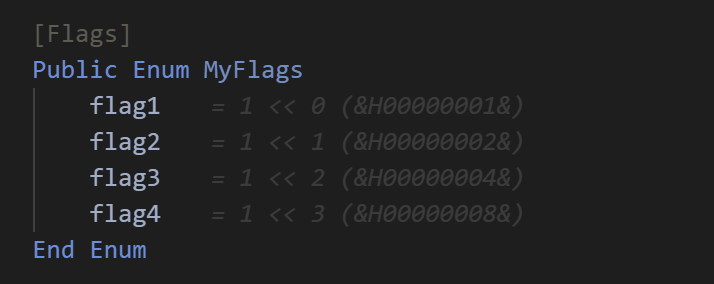

# Attributes
{: .no_toc }

Attributes have two major functions: 

- they can act as instructions to compiler to influence how code is generated, or 
- to annotate Forms, Modules, Classes, Types, Enums, Declares, and [procedures](../Gloss#procedure) i.e. Subs/Functions/Properties. 

Previously in VBx, these attributes, such as the procedure description, hidden, default member, and others, were set via hidden text the IDE's editor didn't show you, configured via the Procedure Attributes dialog or some other places. In tB, these are all visible in the code editor. The legacy ones from VBx are supported for compatibility, but new attributes use the following syntax:   
`[Attribute]` or `[Attribute(value)]`

In attributes that take an optional boolean argument, the value of the argument is taken to be **True** if no value is provided. This does not mean that the default value of the attribute is True, just that if the attribute is specified within the braces with no value, its value will be set to True. Different boolean-valued attributes have different default values. Those values apply unless the user has explicitly provided the attribute.

Multiple attributes can be specified in the same square braces, separated by comma:   
`[Attribute1, Attribute2(param), Attribute3]`

---

The available attributes are listed below in alphabetic order. Not every attribute applies to every language element. The applicability of each attribute is given below its syntax. Many attributes are refused where they do not apply, with either TB5155, *This attribute is not supported in this context*, or TB5182, *Syntax error. No handler for this symbol*. The compiler accepts others there and ignores them, so a build with no error does not show that an attribute does anything at that place. The `Applicable to:` line lists where an attribute has its effect.
* TOC
{:toc}
---

## AllowUnpopulatedVtableEntry
{: #allowunpopulatedvtableentry index="TB65535" }

Syntax: **[AllowUnpopulatedVtableEntry]**

Applicable to: [procedure](../Gloss#procedure) prototype in an [**Interface**](Interface), [procedure](../Gloss#procedure) in a [**Class**](Class)

Marks a prototype that a class implementing the interface is not obliged to supply.

The twinBASIC packages use it to add members to an interface without breaking code written against an earlier revision of it. `ItbHostEventsV2` extends `ItbHostEventsV1` and adds one such prototype; `ItbHostEventsV3` extends that and adds another. An addin that implements only the **V1** members still satisfies **V3**.

On a **Public** procedure of a **Class**, it does the same for a class that [**Implements**](Implements) that class: the member may be left out, where otherwise the build fails with TB65535, *Missing implementation of member ...*. On a property it covers only the accessor it is written on, so a **Property Get** and its **Property Let** each need it.

<!-- test: bug missing-implementation-message -->
> [!NOTE] BETA 1034
> The message of TB65535 reads *Internal Error - Bad Error Info Locale Data*, and does not name the missing member. The error is on the name after **Implements**.

<!-- Applicability from the package census, BETA 1005: 71 uses in tbIDE and VB,
     every one a Sub prototype inside an Interface. The effect described above is read
     from that usage, not from a specification.
     On a Class member (BETA 1005, tbbuild): a Class B that Implements Class A and
     supplies only A's unmarked Sub compiles when A's other Sub carries the
     attribute, and fails with TB65535 "Missing implementation of member Sub
     OptionalOne()" without it; the same for a Function, an object-returning
     Function and each property accessor separately (marking the Get alone still
     reports the Let). A Friend Sub and an Event are never required, with or
     without it. No trace in the type library.
     BETA 1034 (tbbuild, the type library, a run, completion, the Object Browser's
     data): accepted on a Declare in a Class and an Event in a Class, bare, True
     and False, with no change: an Event is never required of a class that
     Implements its class, and a Declare in a Class is always Private (TB5227
     for a Public one). Left off the line above. The error for a missing
     member reads "Internal Error - Bad Error Info Locale Data" on BETA 1034,
     not the text quoted above. -->

## AppObject  (optional Bool)
{: #appobject }

Syntax: **[AppObject** [ **( True** \| **False )** ] **]**

Applicable to: [**CoClass**](CoClass), [**Class**](Class)

Legacy VB attribute: *VB_GlobalNameSpace*

Indicates the class is part of the global namespace. You should not include this attribute without a full understanding of the meaning. The **Global** class is an AppObject.

On a **Class**, the members of the class can be called by their bare names anywhere in the project. Those calls all reach one instance of the class, which is not the same as an instance created with [**New**](New). In an ActiveX build the class is marked `appobject` in the type library, so a client sees its members as global names too.

<!-- Class (BETA 1005, ActiveX DLL dumped with TLI): coclass TYPEFLAGS 0xB
     (appobject, cancreate, predeclid) against 0x2 without it; in a Standard EXE
     an [AppObject] class's GlobalOne() resolves unqualified, the control class's
     GlobalC() is TB5079; tbrun: two bare calls of a counting method print 1, 2,
     and `New AO_Cls` then prints 1. Also accepted on a Private Class, where
     the bare names resolve as well; on a generic Class they do not.
     Interface (BETA 1034, tbrun --exe, win32 and win64, tbbuild, the IDE's
     completion): without the attribute Ping and ISite are TB5079; with
     [AppObject] or (True) they compile, and with (False) they do not.
     TypeName(ISite) is ISite and its ObjPtr is stable. A member with
     [RedirectToStaticImplementation] runs that procedure; any other Sub
     returns and any Function gives its type's default, with no error, in an
     IDE run and an exe. No type library flag in either bitness. Left off the
     line above. -->

For more details, see [this VBA documentation page](https://learn.microsoft.com/en-us/openspecs/microsoft_general_purpose_programming_languages/ms-vbal/189fb41b-cc3a-4999-a6d2-ba89f72d2870).

## ArrayBoundsChecks  (optional Bool)
{: #arrayboundschecks }

Syntax: **[ArrayBoundsChecks** [ **( True** \| **False )** ] **]**

Applicable to: [**Class**](Class), [**Module**](Module), [procedure](../Gloss#procedure)

Disables or enables array element access bounds checking within the scope of a class, module, or a single procedure/method. Used on performance-critical routines. **ArrayBoundsChecks(False)** turns the check off. **ArrayBoundsChecks(True)** turns it back on where the project setting [**Disable Array Bounds Checks**](../IDE/Project-Settings#disable-array-bounds-checks) has turned it off for the whole project.

<!-- BETA 1034 (tbrun --exe, win32 and win64, with the project's setting off and
     on; tbbuild; the type library; the IDE's hover, completion and Object
     Browser data): accepted on an Interface, on each form of Declare and on an
     Event, bare, (True) and (False), with no change to any line of the report or
     to the exe's code but data addresses. A body that trips the check was placed
     in the implementing class, in a module procedure named by
     [RedirectToStaticImplementation], after the Declare or Event, in a caller, in
     a raiser and in a handler. The attribute on a procedure, a Module and a
     Class in the same project does change the report. Left off. -->

## BindOnlyIfNoArguments  (optional Bool)
{: #bindonlyifnoarguments index_also="TB5030" }

Syntax: **[BindOnlyIfNoArguments** [ **( True** \| **False )** ] **]**

Applicable to: [**Declare** (API declaration)](Declare), variable in a [**Module**](Module), variable in a [**Class**](Class), [procedure](../Gloss#procedure)

Only binds this name to a callsite when no arguments are present. Normally false, but see below for an exception.

This attribute resolves the cases where compiler's special treatment of certain procedure names conflicts with a procedure of the same name that shouldn't be treated specially. This currently affects procedures named `Left`. Such procedures get an implicit `[BindOnlyIfNoArguments(True)]` assigned by the compiler. If the user wants to have a procedure of this name, it should include `[BindOnlyIfNoArguments(False)]`.

A **Declare** takes the attribute as a procedure does, and a **Declare** named `Left` gets the implicit one too. On a variable named like a built-in procedure, a call with arguments binds to the built-in procedure, where it would otherwise be error TB5030, *Unexpected call arguments*.

<!-- BETA 1005 (tbrun): a Declare named Right binds a call with arguments
     without the attribute, and VBA's Right with it; (False) binds the Declare.
     A module or class variable named Left: Left(0, 2) is TB5030 without it and
     calls VBA's Left with it.
     BETA 1034 (tbbuild; tbrun and --exe; hover, definition, completion,
     decorations and Object Browser; type library of an ActiveX DLL): on a Const
     (Public, Private, in a Class) and an Event it is accepted and changes
     nothing, bare, (True) or (False), for a name of a built-in procedure, for
     Left and for any other name. The controls, a variable and a Function named
     Left, move on every surface. Left off. -->

## BindOnlyIfStringSuffix  (optional Bool)
{: #bindonlyifstringsuffix }

Syntax: **[BindOnlyIfStringSuffix** [ **( True** \| **False )** ] **]**

Applicable to: [procedure](../Gloss#procedure)

<!-- BETA 1034 (tbbuild; tbrun and --exe; hover, definition, completion,
     decorations and Object Browser; type library): no effect could be shown at
     a procedure, in nine shapes, with or without a [Name$] beside it and with or
     without a symbol of that name further out, so the sites where it is accepted
     and not listed (each Declare, an Event) are not settled. VBA.Conversion's
     Error, the only use in the packages, is a DeclareWide PtrSafe, and Error(5)
     with no suffix binds it. What the attribute does is not known. -->

## ClassId  (String)
{: #classid }

Syntax: **[ClassId("** 00000000-0000-0000-0000-000000000000 **")]**

Applicable to:  [**Class**](Class)

Assigns a COM CLSID to a class. For details, [see this COM documentation page](https://learn.microsoft.com/en-us/windows/win32/com/com-class-objects-and-clsids).

<!-- Interface (BETA 1034): alone, the type library (win32, win64), a run, New and
     the IDE's surfaces are unchanged. Beside [CustomControl] or [WindowsControl]
     the toolbox entry's clsid is the GUID, and a form saved with that clsid holds
     the control at run time (Controls.Count 1); with no [ClassId] the form's
     clsid is out of date and Controls.Count is 0, for a Class as well. An
     Interface has a class identifier only as a toolbox entry, so the attribute
     does something there only beside one of those two. Left off the line
     above. -->

## ClassInterface
{: #classinterface }

twinBASIC doesn't supports this attribute directly. It supports its values under different names. See:

* [DualInterface](#dualinterface)
* [DispInterface](#dispinterface)


## CoClassCustomConstructor  (String)
{: #coclasscustomconstructor }

Syntax: **[CoClassCustomConstructor("** fully qualified path to factory method **")]**

Applicable to: [**CoClass**](CoClass)

Allows custom logic for creating and returning a new instance of the coclass' implementation.

Example:

```tb check_build
[CoClassId("7980D953-10BF-478C-93BB-DD0093315D96")]
[CoClassCustomConstructor("FooFactory.CreateFoo")]
[COMCreatable(True)]
Public CoClass Foo
   ' ...
End CoClass
```

For an overview of coclasses in tB, see [Defining coclasses](../../Features/Language/Interfaces-CoClasses#defining-coclasses).

## CoClassId  (String)
{: #coclassid }

Syntax: **[CoClassId("** 00000000-0000-0000-0000-000000000000 **")]**

Applicable to: [**CoClass**](CoClass)

In addition to interfaces, twinBASIC also allows defining coclasses -- creatable classes that implement one or more defined interfaces. Like interfaces, these too must be in .twin files and not legacy .bas/.cls files, and must appear prior to the `Class` or `Module` statement. The generic form is:

```tb inert=skeleton
[CoClassId("00000000-0000-0000-0000-000000000000")]
*<attributes>*
CoClass <name>
    [Default] Interface <interface name>
    *[Default, Source] Interface <event interface name>*
    *<additional Interface items>*
End CoClass
```

The methods are [procedures](../Gloss#procedure).

For an overview of coclasses in tB, see [Defining coclasses](../../Features/Language/Interfaces-CoClasses#defining-coclasses).

## COMControl  (optional Bool)
{: #comcontrol }

Syntax: **[COMControl** [ **( True** \| **False )** ] **]**

Applicable to: [**Interface**](Interface), [**Class**](Class)

On a **Class**, it marks the class as an ActiveX control (the `control` flag of its coclass in the type library). The compiler then warns, with TB0013, about a class that has no [InterfaceId](#interfaceid) or no [EventInterfaceId](#eventinterfaceid) attribute: a host may cache those identifiers, so they should be fixed rather than generated anew by each build.

<!-- BETA 1005, ActiveX DLL dumped with TLI: coclass TYPEFLAGS 0x22 (cancreate,
     control) against 0x2. Every [COMControl] Class, Private Class and Interface
     draws "TB0013 It is strongly recommended to specify an [ InterfaceId() ]
     attribute for this class. Hosts may cache this information, and so it needs
     to be a stable ID, especially between bitnesses." and the same for
     [ EventInterfaceId() ]; (False) draws neither. On an Interface no type
     library flag changes.
     CoClass (BETA 1034, ActiveX DLL dumped with tlbdump2, win32 and win64):
     bare and (True) turn a member's IHelper* or IUnk* into vt9 (IDispatch) on a
     Function, a parameter, a Property and a field, with or without [CoClassId];
     (False) changes nothing. No CoClass is in the library, with the attribute or
     without. tbrun --exe over Scripting.Dictionary's CLSID, both bitnesses:
     without the attribute New gives a Dictionary; with it Set New is
     -2147467262 (No such interface supported) and As New is 91 at the first
     call. No toolbox entry, no TB0013. What the attribute does there is not the
     effect described above. Left off the line above. -->

## COMCreatable  (optional Bool)
{: #comcreatable index_also="TB5121; TB5135" }

Syntax: **[COMCreatable** [ **( True** \| **False )** ] **]**

Applicable to:  [**Class**](Class), [**CoClass**](CoClass)

Indicates whether the class can be created through COM. It does not govern [**New**](New) inside the project: a `[COMCreatable(False)]` class is created with **New** as usual. A COM-creatable class needs a constructor that takes no arguments, so a class whose only `Sub New` has required arguments fails with TB5135 --- *error generating implicit default constructor ... (for COM exposure)* --- unless it is marked `[COMCreatable(False)]`, is **Private**, or has a constructor without arguments as well. The first two fixes leave the class with no constructor that takes no arguments, so it still cannot be declared [**As New**](New): that fails with TB5121. See [Parameterized Class Constructors](../../Features/Advanced/Classes-and-Modules#parameterized-class-constructors).

<!-- Interface (BETA 1034, each form): the type library (win32, win64), a run, New
     and the IDE's surfaces are as without it. Left off the line above. -->

## ComExport  (optional Bool)
{: #comexport }

Syntax: **[ComExport** [ **( True** \| **False )** ] **]**

Applicable to: [**Declare** (API declaration)](Declare) and constants, in a [**Module**](Module)

The attribute marks a given API for export from the ActiveX control DLL being built from the project the attribute is used in.

The **Declare** can be a **Function** or a **Sub**, including the **PtrSafe** and **DeclareWide** forms. The compiler rejects the attribute on a procedure with a body, on a variable, and on a **Declare** or a constant inside a class.

```tb check_build
[ComExport]
Public Declare Function GetTickCount Lib "kernel32" () As Long
```

<!-- Applicability from the attribute sweep (scripts/sweep_attributes.mjs) against
     BETA 1005, each of the bare form, (True) and (False): accepted on a Public
     Declare Function, a Public Declare Sub, a Private Declare Function, a
     Declare PtrSafe Function and a DeclareWide Function in a module, and on a
     Public and a Private Const in a module; refused with TB5155 on a Sub,
     Function or Property Get in a module (Public, Private, Static and generic)
     and on a module variable, and with TB5182 on a Declare or a Const in a
     class. A clean build
     shows the compiler accepts the attribute, not what it makes a built file
     contain, and no package or sample uses it, so its effect is not
     established. -->

See also [DllExport](#dllexport).

## COMExtensible  (optional Bool)
{: #comextensible }

Syntax: **[COMExtensible** [ **( True** \| **False )** ] **]**

Applicable to: [**Interface**](Interface), [**Class**](Class)

Specifies whether new members added at runtime can be called by name through an interface implementing **IDispatch**. This attribute is set to **False** by default. On a **Class**, it applies to the interface the class exposes through COM.

<!-- BETA 1005, ActiveX DLL dumped with TLI: on a Class the hidden dispinterface
     _X loses TYPEFLAG_FNONEXTENSIBLE (0x10D0 -> 0x1050); (False) is as without
     it; the coclass flags do not change. -->

## ComImport  (optional Bool)
{: #comimport }

Syntax: **[ComImport** [ **( True** \| **False )** ] **]**

Applicable to: [**Interface**](Interface)

Specifies that an interface is an import from an external COM library, for instance, the Windows shell.

<!-- BETA 1034: no effect found at any site, the documented Interface included
     (a plain one, one that extends stdole.IUnknown, and a Private one that a
     Public class implements and a public member names): the type library (win32,
     win64), diagnostics, a run over a real COM object (a failing HRESULT, a class
     implementing the interface), the IDE's surfaces. On a Class also a generic
     and a Private one, an Inherits base, a class of an embedded package, and
     [ClassId] of a real class, which New still makes as the class itself. The
     shipped packages use it on 84 Classes (every VB control) and 8 Private
     Interfaces; TBMANLIB_Dialog on 7 Interfaces. What it does is not known, and
     the text above is the page's, unchanged. Left off the line above. -->

## CompileIf  (Bool)
{: #compileif }

Syntax: **[CompileIf(** condition **)]**

Applicable to: [**Declare** (API declaration)](Declare), [**Const**](Const) in a [**Module**](Module) or a [**Class**](Class), variable in a [**Module**](Module), variable in a [**Class**](Class), [**Event**](Event) declaration in a [**Class**](Class), [procedure definitions](../Gloss#procedure)

Controls the conditional compilation of a procedure definition. Has no default value.

It controls a **Declare**, a **Const**, a variable or an **Event** in the same way: with a **False** condition the declaration is left out, so a use of its name is an error, such as TB5079, *Unrecognized symbol*.

The condition can read a **Const** of the same class or module, so two declarations of one name can each carry a condition and only one of them is compiled.

<!-- BETA 1005 (tbbuild): [CompileIf(False)] on a Declare (every form, also in
     a Class), a Const, a module variable (initialised, Private), a WithEvents
     variable and an Event: a use is TB5079 "Unrecognized symbol", TB5113 at a
     RaiseEvent, TB5027 for o.Member; (True) and no attribute find it.
     BETA 1034 (tbbuild, tbrun and --exe, win32 and win64; hover, definition and
     Object Browser): on a Private Const in a Class, (False) and (0) make a use
     TB5079 and (True) and (1) find it, as on a Const in a Module; two Consts of
     one name chosen by [CompileIf(Flag)] and [CompileIf(Not Flag)] compile, and
     without the attribute are TB5134. Win64 in a condition is TB5124, error in
     CompileIf expression. -->

## CompilerOptions  (String)
{: #compileroptions }

Syntax: **[CompilerOptions( "** options **" )]**

Applicable to: [procedure definitions](../Gloss#procedure)

Sets the LLVM compiler options for one procedure, in place of the **Compiler Options** in [Project Settings](../IDE/Project-Settings). *options* is a comma-separated list of flags; an empty string turns LLVM off for the procedure. Typical use would be `[CompilerOptions("+llvm,+optimize,+optimizesize")]` to compile the procedure using the built-in LLVM instead of the default compiler, with chosen optimizations. [Getting Started with LLVM](../../LLVM/Getting-Started) describes LLVM compilation in full. Compiler options available:

- **+llvm** - uses LLVM to compile this procedure. This feature is experimental at the moment. The LLVM compiler back-end is built into twinBASIC. It is not necessary to have LLVM separately installed, and any such installation is ignored by twinBASIC.
- **+optimize** - enables optimization during compilation of this procedure
- **+optimizesize** - optimize this procedure for small code size, potentially at the expense of slower speed of the procedure
- **+** and the name of a CPU instruction set, such as **+avx2** - lets LLVM use that instruction set in this procedure. The program then does not run on a CPU without it. [Per-procedure LLVM options](../../LLVM/Getting-Started#per-procedure-llvm-options) lists the instruction sets.

<!-- BETA 1034 (tbrun --exe and --llvm, win32 and win64; tbbuild; the type
     library; the IDE's hover, completion and Object Browser data): accepted on
     an Event, with no value, "+optimize", "probe", "+llvm" and "", in a project
     with and without LLVM, with no effect: the next member, the procedure that
     raises it and a handler stay compiled as the project sets them, and the
     exe's code is the same. A marked procedure in the same project does move.
     Left off. -->

## ConstantFoldable  (optional Bool)
{: #constantfoldable }

Syntax: **[ConstantFoldable** [ **( True** \| **False )** ] **]**

Applicable to: [**Function**](Function) in a [**Module**](Module), [**Property Get**](Property) in a [**Module**](Module). The compiler rejects it on a method in a [**Class**](Class).

Specify this attribute for functions that, when called with non-variable input, can be computed at compile time rather than at runtime. For example, a function that converts a string literal to ANSI. The result never changes, so the resulting ANSI string is stored rather than recomputed on every run. Such functions are also called *pure functions*, because their output depends only on the arguments and not on the state of the program.

The restriction to modules is not an oversight. Folding a call to a method would require constant propagation through object state, and a notion of a constant object for the propagation to terminate on. twinBASIC's object model is dynamic enough to make both hard, so the compiler rejects the attribute there rather than folding a subset of cases that would be difficult to describe.

Calls are folded only when **Constant Function Folding** is set to **Yes** in [Project Settings](../IDE/Project-Settings#constant-function-folding). A **Property Get** in a module folds as a function does. On a **Sub** or a **Declare Sub** the attribute is accepted and has no effect.

<!-- test: bug constantfoldable-declare-crash -->
> [!WARNING] BETA 1034
> The compiler also accepts the attribute on a **Declare Function**. With **Constant Function Folding** on, a call to such a function whose arguments are all constants crashes the compiler during the build, though the project compiles without an error.

<!-- BETA 1005 (tbrun --exe, counting calls through a module counter): with
     the setting on, 3 calls with a constant argument of a [ConstantFoldable]
     Boolean Function, Property Get or Static Function run 0 times in the exe,
     3 without the attribute or with (False), 3 with the setting off; a Sub, a
     generic Function and a Declare Sub run every time. The crash: tbbuild
     --build exit 5, ACCESS_VIOLATION, for a Declare Function with
     [ConstantFoldable] or [ConstantFoldableNumericsOnly] called as
     DSleepFn(5, 0); a variable argument or the setting off builds.
     BETA 1034 (tbrun --exe, win32 and win64, folding on and off; tbbuild; the
     IDE's hover, completion and Object Browser data; a Module is not in a type
     library): on a Sub in a Module, Private, Static and generic, with no
     argument and with a constant, each call runs, and the code is the same with
     and without the attribute. On Declare Sub likewise. On Declare Function,
     Private Declare, Declare PtrSafe and DeclareWide, bare or (True), folding
     on, a call with constant or no arguments still ends the build with exit 5,
     ACCESS_VIOLATION; (False), folding off, a variable argument or no call
     leaves the code as it is. Left off. -->
<!-- Bug: constantfoldable-declare-crash in BUGS-TO-REPORT.md. -->

## ConstantFoldableNumericsOnly  (optional Bool)
{: #constantfoldablenumericsonly }

Syntax: **[ConstantFoldableNumericsOnly** [ **( True** \| **False )** ] **]**

Applicable to: [**Function**](Function) in a [**Module**](Module), [**Property Get**](Property) in a [**Module**](Module). The compiler rejects it on a method in a [**Class**](Class).

A limited case of [constant foldable attribute](#constantfoldable), which applies only if the function was called with a numeric parameter. The restriction to modules is the same one [ConstantFoldable](#constantfoldable) carries, and for the same reason, and so are the Project Settings option it needs and the crash on a **Declare Function**.

<!-- BETA 1005: a [ConstantFoldableNumericsOnly] Function called with a String
     literal, FnNStr("abc"), also ran 0 times of 3 in the exe with folding on, so
     the numeric restriction was not seen to apply. Not judged a defect yet: what
     the compiler counts as numeric is not known.
     BETA 1034: as for [ConstantFoldable], on every Sub and Declare Sub site no
     call is left out and the code is the same; the four Declare Function sites
     still end the build with exit 5 when folding is on. Left off. -->

## CustomControl  (String)
{: #customcontrol }

Syntax: **[CustomControl("** image file name **")]**

Applicable to: [**Class**](Class)

<!-- Interface (BETA 1034, the IDE's toolbox data, the designer, Save, an IDE
     run): a path that exists gives a toolbox entry like a Class's, listed on a
     CustomControls form (10 tools against 9); a double-click places ISite1 and
     Save writes it with _className ISite; the form opens modally and closes as
     it does without the attribute. Nothing draws it, since no class implements
     ICustomControl. A path that names no file ("probe") gives an entry with no
     isWindowsControl and no package, which no designer lists. The type library,
     a run with no form and the other IDE surfaces are unchanged. The Interface
     half works: left off the line above. -->

## CustomDesigner  (String)
{: #customdesigner }

Syntax: **[CustomDesigner("** designer name **")]**

Applicable to: variables in a [**Class**](Class)

Chooses which editor the IDE's property window offers for one property, instead of the editor it would otherwise pick from the property's declared type. The argument names an editor built into the IDE.

The editor names the twinBASIC packages use, most-used first. The list is not exhaustive -- these are the ones the packages happen to ask for, and the IDE may offer others.

| Name | Applied to |
|---|---|
| `designer_SpectrumWindows` | an **OLE_COLOR** property: **BackColor**, **ForeColor**, **MaskColor**, **BorderColor**, **FillColor**, **PaperColor** |
| `designer_SpectrumWindowsOrClear` | **TransparencyKey**, an **OLE_COLOR** in which -1 means no colour |
| `designer_IconBytes` | an icon held as **Byte()**: **MouseIconINIT**, **DragIconINIT**, **IconINIT** |
| `designer_RestrictedOLEDropMode` | **OLEDropMode** |
| `designer_MultiLineText` | a **String** property holding text that may wrap: **ToolTipTextINIT**, **Caption_INIT** |
| `designer_PictureBytes` | an image held as **Byte()**: **PictureINIT**, **PaletteINIT**, **ToolboxBitmapINIT**, **MaskPictureINIT** |
| `designer_ImageList` | an image-list reference: **Icons_INIT**, **SmallIcons_INIT**, **ColumnHeaderIcons_INIT** |
| `designer_Spectrum` | a **ColorRGBA** property |
| `designer_Grapick` | a **FillColorPoints** gradient property |
| `designer_PropertyPages` | a property-pages reference |
| `BINARY` | **InternalImages_INIT** |

<!-- Table is a census of 154 uses, BETA 1005, in VB, WebView2,
     WinNativeCommonCtls and CustomControls, ordered by frequency. What each editor does is inferred
     from the properties it is applied to, not from a specification. Not
     probed: the designer name has to suit the property type, so a rejection
     could mean the applicability or the pairing and the probe could not say
     which. -->

## Debuggable  (optional Bool)
{: #debuggable }

Syntax: **[Debuggable** [ **( True** \| **False )** ] **]**

Applicable to: [**Module**](Module), [**Class**](Class), [procedure in a **Class** or **Module**](../Gloss#procedure)

When false, turns off breakpoints and stepping for the method, class or module. The default value is **True**. In a class or module marked `[Debuggable(False)]`, a [**Stop**](Stop) statement does not enter break mode.

<!-- BETA 1005 (tbrun): Stop in a method of a [Debuggable(False)] Class (also
     Private and generic) is passed over; without it the run breaks there. On an
     Interface it is accepted and a Stop in an implementing class still breaks.
     BETA 1034 (the IDE's debugger, win32 and win64: 29 Stop statements, 29
     breakpoints and 37 steps into, in order; tbrun --exe; tbbuild; the type
     library; hover, completion and Object Browser data): on an Interface, a
     prototype, the seven Declare forms and an Event, (False), bare and (True)
     change nothing, and the exe's code is the same; a class that implements the
     interface, a procedure that calls the Declare and a handler of the Event can
     still be stepped through and stop at a breakpoint. (False) on a procedure,
     a Module and a Class in the same project removes its three Stops, its three
     breakpoints and its steps. Left off. -->

## DebugOnly  (optional Bool)
{: #debugonly index="TB5162" }

Syntax: **[DebugOnly** [ **( True** \| **False )** ] **]**

Applicable to: [**Sub**](Sub), generic [**Sub**](Sub), a [**Sub**](Sub) in a [**Class**](Class) (**Friend** included), a [**Sub**](Sub) prototype in an [**Interface**](Interface), [**Declare Sub**](Declare)

Excludes calls to this procedure from the Build. They are only available when running from the IDE, i.e. debugging. On a **Declare Sub** the same holds for calls to the API procedure. The arguments of a call that is left out are not evaluated.

In a **Class**, and through an **Interface**, the same holds for an early-bound call. The procedure stays in the class, so a late-bound call, through an **Object** or **Variant** variable or with **CallByName**, runs in the Build too.

<!-- test: bug debugonly-class-initialize-exe -->
> [!WARNING] BETA 1034
> On **Class_Initialize** the attribute breaks the Build: a program that creates the class stops with error 91, *Object variable or With block variable not set*, or ends with an access violation. A run from the IDE is right. Written as `[DebugOnly(False)]` it changes nothing.

<!-- BETA 1005 (tbrun and --exe): a [DebugOnly] Declare Sub Sleep(150) sleeps in
     the IDE run and not in the built exe; without it or with (False) both sleep.
     BETA 1034 (tbrun and --exe, win32 and win64; type library): an early-bound
     call of a marked Sub in a Class (a bare call, p.Probe, Me.Probe and a With
     block), a Friend Sub, a generic Sub and a call through a marked Interface
     prototype run in the IDE and are gone from the exe, with their arguments;
     (False) is as without the attribute. A late-bound call through Object or
     Variant and CallByName still run. The member stays in the type library, and
     the class's implementation of a marked prototype is left in place. On an
     Event it is accepted and changes nothing: RaiseEvent, its argument and the
     handler run in the exe, in each form. -->

The attribute is accepted on a **Sub** in a **Module**, a **Class** or an **Interface**, and on a **Declare Sub**. On a **Function**, a **Property** or a **Declare Function** it is error **TB5162**, *[DebugOnly] is only allowed on Sub procedures*.

## Default
{: #default }

Syntax: **[Default]**

Applicable to: [**Interface**](Interface) declaration within a [**CoClass**](CoClass)

Marks which of a CoClass's interfaces is its default: the one a client binds to when it holds the CoClass without asking for a particular interface.

A CoClass declares one default interface, and separately one default source interface, which also carries [Source](#source):

```tb check_build project=packages
[CoClassId("E7F3D923-475B-4367-B5EF-568FCF3A74B5")]
CoClass CustomControlTimer
    [Default] Interface _CustomControlTimer
    [Default, Source] Interface _CustomControlTimerEvents
End CoClass
```

<!-- Applicability from the package census, BETA 1005: 50 uses across VB, VBA,
     VBRUN, tbIDE, AppGlobalClassObject and CustomControls, always on an
     Interface line inside a CoClass. -->

## DefaultDesignerEvent
{: #defaultdesignerevent }

Syntax: **[DefaultDesignerEvent]**

Applicable to: [**Event**](Event) declaration in a [**Class**](Class)

Marks the event a control nominates as its primary one. Each control of the VB package that declares it declares exactly one: **Click** for **CheckBox** and **CommandButton**, **Change** for **ComboBox**, **Validate** for **Data**. The **ListView** and **TreeView** controls of WinNativeCommonCtls mark two, **Click** and **BeforeLabelEdit**.

<!-- Applicability from the package census, BETA 1005: 37 uses in VB (28) and
     WinNativeCommonCtls (9), always on an Event in a control class. One per
     class except ListViewBaseCtl and TreeViewBaseCtl, which mark Click and
     BeforeLabelEdit. Which designer action selects it is not
     established. -->

## DefaultMember (optional Bool)

{: #defaultmember }

Syntax: **[DefaultMember** [ **(** **True** \| **False** **)** ] **]**

Applicable to: [procedure in a **Class**](../Gloss#procedure), [procedure](../Gloss#procedure) prototype in an [**Interface**](Interface)

Default members are accessed under the instance of the object itself, without specifying their name. For example, a class that offers indexable elements may have an **Item** property that is the default member:

```tb check_build slot=file
Class MyCollection
    [DefaultMember]
    Property Get Item(ByVal index&) As String
        ' ...
    End Property
        
    [DefaultMember]
    Property Let Item(ByVal index&, ByVal value$)
        ' ...
    End Property
End Class

Module DefaultMemberDemo
    Sub Example()
        Dim coll As New MyCollection
        Debug.Print "Item #3: ", coll(3)   ' Property Get Item is invoked
        coll(4) = "Item 4"                 ' Property Let Item is invoked
    End Sub
End Module
```

On a prototype in an **Interface**, the member gets the dispatch ID 0, so it is the default member of a variable declared as that interface, whichever class is behind it.

<!-- BETA 1005: DISPID 0 in the type library on Sub, Function, object Function
     and Property Get prototypes; with `Dim x As IDef = New ImplDef`, x(3) calls
     IDef.Item, and the same on an interface without it raises 438. Also accepted
     on an Event, which gets DISPID 0 in the class's event interface: left off.
     BETA 1034: on one marked Event the attribute does that and nothing else:
     the class gets no default member (v = o is 438) and the event still reaches
     its handler. Two marked Events in one class both get DISPID 0, and
     RaiseEvent of the second runs the first's handler, win32 and win64, IDE and
     exe; an ActiveX DLL then fails at "[TYPELIB] failed to finalize typelibrary
     interface". Left off. -->

## Description  (String) 
{: #description }

Syntax: **[Description("** arbitrary text **")]**

Applicable to: [**Class**](Class), [**CoClass**](CoClass), [**Const**](Const) in a [**Module**](Module) or a [**Class**](Class), [**Declare** (API declaration)](Declare), [**Enum**](Enum), [**Event**](Event) declaration in a [**Class**](Class), variable in a [**Class**](Class), variable in a [**Module**](Module), [**Interface**](Interface), [**Module**](Module), [procedure](../Gloss#procedure), [procedure](../Gloss#procedure) parameter, [**Type** (UDT)](Type), member of a [**Type** (UDT)](Type)

Provides a description in information popups in the IDE, and is exported as a `helpstring` attribute in the type library (if applicable). The type library holds one for each public procedure, property, event and variable of a class, and for each prototype of an interface. A **Const**, an **Enum**, a variable of a module, a **Type** member and a parameter get none there: their text shows in the popup, and in the Object Browser for a **Const**, an **Enum** and a variable of a module.

The text of a parameter shows when the pointer rests on the parameter's name in the body of the procedure. A parameter of a **Declare** or of an **Interface** prototype has no body, so nothing shows its text.

<!-- test: bug description-field-hover-twice -->
> [!NOTE] BETA 1034
> The popup of a member of a **Type**, and of a variable of a **Class**, shows the text twice, run together: *one lineone line*.

<!-- BETA 1005, ActiveX DLL dumped with TLI: helpstrings written on class
     procedures, properties, events, public variables and interface prototypes.
     For an Enum, a Type, its fields and parameters the text is nowhere in the DLL.
     A description on a Property Let or Set is stored on
     that accessor; a tool asking GetDocumentation by member id gets the Get's.
     BETA 1034: on an Enum (an empty one too), a Const in a Class and a variable
     in a Module, public or Private, the text is in the hover at the declaration
     or a use and in the Object Browser's data; on a Type member and a parameter
     in the hover only, a parameter's where the body uses it. Signature help
     shows a procedure's text and no parameter's. Nothing shows the text of a
     parameter of a Declare or a prototype. None of these reaches the type
     library or the DLL's bytes. Completion items carry no description at any
     site. The hover of a Type member shows the text twice, run together. -->

The value is a **String** whose content is Markdown. The IDE renders it when it displays the popup, so headings, code spans and fenced code blocks all work. The attribute takes a single string literal, so a description running to several lines is assembled with `& vbCrLf & _` continuations, one source line per line of Markdown.

The packages that ship with twinBASIC follow a consistent shape, shown here on `CurrentProjectName` from the VBA package's `Compilation` module:

```tb check_build
[Description("Retrieves the name of the current project as a literal string.  " & vbCrLf & _
             "### Syntax" & vbCrLf & _
             "`projectName = CurrentProjectName()`  " & vbCrLf & _
             "### Parameters" & vbCrLf & _
             "This function does not take any parameters.  " & vbCrLf & _
             "### Return value" & vbCrLf & _
             "Returns the name of the current project as a String.  " & vbCrLf & _
             "### Example" & vbCrLf & _
             "```basic" & vbCrLf & _
             "' Example: Retrieve the current project name" & vbCrLf & _
             "Dim projectName As String" & vbCrLf & _
             "projectName = CurrentProjectName()" & vbCrLf & _
             "MsgBox ""The name of this project is "" & projectName" & vbCrLf & _
             "```")]
' Note, this function uses special internal bindings and so may not behave like a regular function
Public DeclareWide PtrSafe Function CurrentProjectName Lib "<compilation>" Alias "#-33" () As String
```

Five details of that are easy to get wrong:

- **The member is a `Declare`, not an ordinary Function.** Nothing about the attribute requires that -- it is simply how this particular member happens to be written -- but it is worth reading carefully, because a description shaped like a function's is sitting on an API declaration.

- **The two spaces before several of the closing quotes are Markdown hard line breaks.** A bare newline is a soft break in Markdown and renders as a space, so removing them runs the lead sentence and the prose under each heading together into one paragraph. They appear on the prose lines only: the `###` headings and the lines inside the fenced block are already block-level and do not need them. They read as stray trailing whitespace and are easy to delete by accident.
- **A literal `"` inside the string is doubled**, as in `""The name of this project is ""`. That is ordinary twinBASIC string syntax rather than anything Markdown-specific, but it is dense enough here to be misread as part of the description.
- **The fence tag is `basic`**, which is what the IDE's Markdown renderer understands. It has nothing to do with the fence languages this documentation site highlights.
- **The section order is conventional**: a lead sentence, then `### Syntax`, `### Parameters`, `### Return value` and `### Example`. The example above keeps `### Parameters` even though the function takes none, and says so in the body.

## DispId  (Integer)
{: #dispid }

Syntax: **[DispId(** 123 **)]**

Applicable to: [procedure in an Interface](../Gloss#procedure), [procedure in a **Class**](../Gloss#procedure), [**Event**](Event) declaration in a [**Class**](Class)

Defines a dispatch ID associated with the procedure when exposed via **IDispatch**. In a **Class**, it sets the dispatch ID of the member in the interface the class exposes through COM, or, on an **Event**, in its event interface; the accessors of a property share one ID.

<!-- BETA 1005, ActiveX DLL dumped with TLI: Sub, Function, object Function,
     property and Event take the number given; an unmarked sibling keeps the
     automatic 0x60030000 range (events 1, 2, ...). A Friend Sub and
     Class_Initialize accept it but are not in the type library. -->

## DispInterface
{: #dispinterface }

Syntax: **[DispInterface]**

Applicable to: [**Interface**](Interface) in a **Library**

> [!NOTE]
> This attribute is generated in the **Library** modules that twinBASIC generates for COM references in a project. It cannot be manually created.

Indicates that the interface exposes methods via **IDispatch** late-binding. This is the default. Note that [**DualInterface**](#dualinterface) can also be specified, giving much improved performance over that of **IDispatch**-based interfaces.

It is usually written combined with the other attributes on the interface rather than alone --- `[Hidden, DispInterface, COMExtensible]`. See [**LibraryId**](#libraryid) for what a generated **Library** module looks like.

## DllExport  (optional String)
{: #dllexport index="TB5163" }

Syntax: **[DllExport** [ **("** export name **")** ] **]**

Applicable to: [procedures](../Gloss#procedure) and constants in a module.

It's possible to export a function or constant from standard modules. The compiler rejects the attribute on a module-level variable. Example:

```tb check_build
[DllExport]
Public Const MyExportedSymbol As Long = &H00000001
```

Without an argument the DLL exports the procedure or constant under its own name. A **String** argument sets the name the DLL exports it under:

```tb check_build
[DllExport("Add_Numbers")]
Public Function AddNumbers(ByVal a As Long, ByVal b As Long) As Long
    Return a + b
End Function
```

The attribute takes no **Boolean**: `[DllExport(True)]` and `[DllExport(False)]` are error **TB5163**, *Expected a single String argument*.

## DLLStackCheck  (optional Bool)
{: #dllstackcheck }

Syntax: **[DLLStackCheck** [ **( True** \| **False)** ] **]**

Applicable to: [**Declare** (API declaration)](Declare), [**Delegate**](Delegate)

Switches the stack check that follows a call in a 32-bit build. A 64-bit build has no check, with or without the attribute.

A call through a **Delegate** is checked by default. When the delegate's signature has left the stack wrong, the call raises error -353703419, *Bad DLL definition. Stack corruption detected.* `[DLLStackCheck(False)]` removes the check, which makes the code smaller; the program may then end with an access violation. Written bare or with **True**, the attribute changes nothing.

<!-- test: bug declare-dll-stack-not-checked -->
> [!WARNING] BETA 1034
> On a **Declare** the attribute works the other way round. A call of a **Declare** is not checked by default, so a wrong signature can end the program with an access violation. `[DLLStackCheck(False)]` adds the check, which makes the code larger, and a wrong signature then raises the same error. Written bare or with **True**, it changes nothing. VB6 raises error 49, *Bad DLL calling convention*, in its IDE and in a P-Code exe.

<!-- BETA 1034 (tbrun --exe, win32 and win64; tbbuild; the type library of an
     ActiveX DLL; the IDE's hover, completion and Object Browser data), the two
     sites: a Declare and a Delegate each with a signature that leaves the stack
     wrong: with no attribute, bare or (True) the Declare raises nothing and the
     Delegate raises -353703419; with (False) the Declare raises it and the
     Delegate does not. win32 exe, 300 good calls: Declare 43008 bytes, 47616
     with (False); Delegate 40448, 35840 with (False). win64: the same code for
     every form. A Declare in a Class takes it as a module Declare does (BETA
     1005). The 21 other sites, each procedure making a bad Declare call and a
     bad Delegate call: no line and no byte of code changes for any form, in a
     Sub, Function, Property, Static, generic, Friend, Class_Initialize, the next
     member after an Event and a handler, the implementing class under a
     prototype, and a module procedure named by [RedirectToStaticImplementation]
     on a prototype. Those sites are left off. -->

## DualInterface
{: #dualinterface }

Syntax: **[DualInterface]**

Applicable to: [**Interface**](Interface) in a **Library**

> [!NOTE]
>
> This attribute is generated in the **Library** modules that twinBASIC generates for COM references in a project. It cannot be manually created.

Indicates that the interface exposes methods through the OLE VTable binding. The latter has much improved performance over that of **IDispatch**-based interfaces.

See [**LibraryId**](#libraryid) for what a generated **Library** module looks like.

## EnforceErrors  (Warning code list)
{: #enforceerrors index="TB5169" }

Syntax: **[EnforceErrors** **(** **TBnnnn** [ **,** **TBmmmm** ]... **)** **]**

Applicable to: [**Class**](Class), [**Interface**](Interface), [**Module**](Module), [**Declare**](Declare), [**Event**](Event) declaration in a [**Class**](Class), [procedure](../Gloss#procedure)

Reports the named warnings as errors within the class, interface, module or procedure the attribute is applied to. The codes are written bare, as for [IgnoreWarnings](#ignorewarnings). With `[EnforceErrors(TB0009)]` on a procedure, a call to a procedure marked [Unimplemented](#unimplemented) is an error where it would otherwise be warning TB0009. Written bare it is accepted and has no effect. With **True** or **False** in place of a code it is error TB5169, *Expected an error code in the format of TBxxxx*.

On a **Declare** or an **Event** it covers the warnings of the declaration itself, such as TB0003 for a parameter with no type. A warning at a call of the **Declare** is not covered.

<!-- BETA 1034 (tbbuild, win32 and win64): with TB0003 and TB0030, on each form
     of Declare, also in a Class, and with TB0003 on an Event, the marked line's
     diagnostic is an ERROR and the unmarked line under it is not. Also TB0015.
     Written bare it changes nothing. A call of a marked Declare is not covered:
     [Unimplemented, EnforceErrors(TB0009)] leaves TB0009 at the call a WARNING.
     TB0029 and TB0034 do not follow it, at any level. The program, the language
     answers and the type library do not change. -->

## EnforceWarnings  (Warning code list)
{: #enforcewarnings index_also="TB5169" }

Syntax: **[EnforceWarnings** **(** **TBnnnn** [ **,** **TBmmmm** ]... **)** **]**

Applicable to: [**Class**](Class), [**Interface**](Interface), [**Module**](Module), [**Declare**](Declare), [**Event**](Event) declaration in a [**Class**](Class), [procedure](../Gloss#procedure)

Takes warning codes written bare, as [IgnoreWarnings](#ignorewarnings) does. A warning it names is reported as a warning, also one the compiler does not report by default: with `[EnforceWarnings(TB0018)]`, assigning a **Long** to an **Integer** gives warning TB0018, *implicit narrowing conversion*, which is otherwise not reported. With **True** or **False** in place of a code the attribute is TB5169, *Expected an error code in the format of TBxxxx*.

On a **Declare** or an **Event** it covers the warnings of the declaration itself. Written bare it has no effect.

<!-- BETA 1034 (tbbuild, win32 and win64, with the two codes at IGNORE in
     Project Settings): with TB0003 and TB0030, on each form of Declare, also in
     a Class, and with TB0003 on an Event, the marked line is reported as a
     WARNING and the unmarked line under it is not reported. TB0030 is a HINT by
     default, so it becomes a WARNING. Written bare it changes nothing. The
     program, the language answers and the type library do not change. -->

## Enumerator
{: #enumerator }

Syntax: **[Enumerator]**

Applicable to: [procedure](../Gloss#procedure) in a [**Class**](Class) or [**Interface**](Interface)

Marks the member that supplies an enumerator, which is what makes the object usable with [For Each](For-Each-Next). The member is conventionally named `_NewEnum` and returns **stdole.IUnknown** or a **Variant** wrapping one.

```tb check_build slot=class
Private InternalCollection As New Collection

[Enumerator]
Public Property Get _NewEnum() As Variant
    Return InternalCollection.[_NewEnum]
End Property
```

This replaces VB6's hidden `VB_UserMemId = -4` procedure attribute, which twinBASIC still accepts for compatibility. [Custom Enumerators](../../Features/Language/Custom-Enumerators) describes the member's rules, and how a class can implement the enumerator itself.

<!-- Applicability from the package census, BETA 1005: 23 uses in VB, VBRUN,
     WebView2, WinNativeCommonCtls and WinServicesLib, on a Function (20) or
     a Property Get (3), in a Class (19) or an Interface (4).
     WinServicesLib/Services carries a [Description] calling it "For-Each
     support for the services collection", which is where the wording above
     comes from. Not probed: the member must return stdole.IUnknown or a
     Variant, so the generic skeleton would test the return type rather than
     the applicability.
     BETA 1034: accepted on an Event, which gets DISPID -4 in the class's event
     interface and nothing else: For Each over the object is still 438, and the
     event reaches its handler. Two marked Events in a class share the DISPID,
     as DefaultMember's do: the second runs the first's handler, and an ActiveX
     DLL fails at its type library. Left off. -->

## EnumId  (String)
{: #enumid }

Syntax: **[EnumId("** 00000000-0000-0000-0000-000000000000 **")]**

Applicable to: [**Enum**](Enum)

Specifies a GUID to be associated with an enum in type libraries.

## EventInterfaceId  (String)
{: #eventinterfaceid }

Syntax: **[EventInterfaceId("** 00000000-0000-0000-0000-000000000000 **")]**

Applicable to: [**Class**](Class)

Assigns a fixed COM IID to the event interface twinBASIC generates for a class from its **Event** declarations. It is the events-side counterpart of [InterfaceId](#interfaceid), which fixes the IID of the class's own interface.

A host may cache the IID, so a generated one that changes between builds or between bitnesses breaks clients that have already stored it. That is what the TB0013 recommendation on a [COMControl](#comcontrol) interface is asking for.

<!-- Applicability from the package census, BETA 1005: 19 uses in tbIDE, CEF,
     WinNamedPipesLib, WinNativeCommonCtls and VB, all on a Class.
     This entry stated no applicability at all until then.
     Interface (BETA 1034): accepted, where nothing reads it, so a text that is
     no GUID passes too. An Interface cannot hold an Event (TB5182), and on a
     class that implements it FindConnectionPoint for that GUID is 0x80040200, as
     without the attribute. On a Class with an Event such a text is TB5102.
     Left off the line above. -->

## EventsUseDispInterface  (optional Bool)
{: #eventsusedispinterface }

Syntax: **[EventsUseDispInterface** [ **( True** \| **False )** ] **]**

Applicable to: [**Class**](Class)

Makes the event interface generated for the class a dispinterface, so events are raised through **IDispatch** by member id rather than through a vtable. VB6 and VBA event sinks expect a dispinterface, so a control meant to be consumed from either sets this.

<!-- Applicability from the package census, BETA 1005: 88 uses in VB,
     WinNativeCommonCtls and CEF, every one on a Class and every one bare.
     This entry stated no applicability at all until then.
     BETA 1034: on a plain Class the event interface is a dispinterface and
     events arrive at IDispatch::Invoke with or without the attribute (type
     library dump; a hand-made sink on the connection point, IDE run and exe,
     win32 and win64; (True) and (False) the same), so its effect could not be
     shown, even at the documented site. On an Interface, which cannot hold an
     Event, every surface is as without it. The text above is unchanged. Left
     off the line above. -->

## Flags  (optional Bool)
{: #flags }

Syntax: **[Flags** [ **( True** \| **False )** ] **]**

Applicable to: [**Enum**](Enum)

Calculate implicit enum values as a flag set (powers of 2).

> [!NOTE]
> To prevent confusion, once an explicit value is used, all remaining values after it must also be explicit)

With the IDE option **Always show IDE Inline Code Hints** on, the editor shows the value of each member:

{:width="358" height="142"}

## FloatingPointErrorChecks  (optional Bool)
{: #floatingpointerrorchecks }

Syntax: **[FloatingPointErrorChecks** [ **( True** \| **False)** ] **]**

Applicable to: [**Class**](Class), [**Module**](Module), [procedure](../Gloss#procedure)

Disables or enables floating point error checks within the scope of a class, module, or a single procedure/method. Used on performance-critical routines. **FloatingPointErrorChecks(False)** turns the checks off. **FloatingPointErrorChecks(True)** turns them back on where the project setting [**Disable FPU Error Checks**](../IDE/Project-Settings#disable-fpu-error-checks) has turned them off for the whole project.

<!-- BETA 1034 (tbrun --exe, win32 and win64, with the project's setting off and
     on; tbbuild; the type library; the IDE's hover, completion and Object
     Browser data): accepted on an Interface, on each form of Declare and on an
     Event, bare, (True) and (False), with no change to any line of the report or
     to the exe's code but data addresses. A body that trips the check was placed
     in the implementing class, in a module procedure named by
     [RedirectToStaticImplementation], after the Declare or Event, in a caller, in
     a raiser and in a handler. The attribute on a procedure, a Module and a
     Class in the same project does change the report. Left off. -->

## FormDesignerId  (String)
{: #formdesignerid }

Syntax: **[FormDesignerId("** 00000000-0000-0000-0000-000000000000 **")]**

Applicable to: [**Class**](Class)

## Hidden  (optional Bool)
{: #hidden }

Syntax: **[Hidden** [ **(** **True** \| **False** **)** ] **]**

Applicable to: [**Class**](Class), [**CoClass**](CoClass), [**Interface**](Interface), [**Module**](Module), a [procedure](../Gloss#procedure) in a Class or Module, a procedure in an Interface, variable in a Class, variable in a Module, [**Const**](Const), [**Event**](Event) declaration in a Class, [**Declare**](Declare)

Hides the declaration from certain IntelliSense and other lists. It applies to a whole type --- a **Class**, **CoClass**, **Interface** or **Module** --- and equally to a single member of one, so a member can be kept out of those lists without hiding the type that declares it. Within a **Class** that covers procedures, variables, constants and events; within an **Interface**, the member prototypes; within a **Module**, procedures, variables, constants and [**Declare**](Declare) statements.

In the type library of an ActiveX build, it sets the `hidden` flag of each public member of a class and each prototype of an interface it is written on; on a property, the flag goes on every accessor, whichever one carries the attribute.

> [!NOTE]
> A **CoClass** can only be hidden whole. Its body holds nothing but **Interface** lines, and the attribute is refused there with TB5155 --- unlike [**Default**](#default) and [**Source**](#source), which are interface-line attributes. It is likewise refused on an **Enum** or [**Type**](Type) declaration, on a **Type** member, and on a procedure parameter. An **Enum** member cannot be hidden either: written before the member on the same line, the attribute is **TB5182**, and on a line of its own inside the **Enum**, `[Hidden]` declares a member named `Hidden` (see [**Enum**](Enum)).

<!-- Applicability from scripts/census_attributes.mjs over BETA 1005 (271 sites)
     plus the attribute sweep (scripts/sweep_attributes.mjs), BETA 1005.
     Census: Module DeclareWide 160, Module Const 50, Class Property 18 / Sub 9
     / variable 7 / Event 1, Interface Property 10 / Function 6 / Sub 3, whole
     CoClass 3, whole Module 2, whole Interface 2.
     Swept clean: all four whole types, every procedure, variable, Const,
     Event and Declare site in a Class, Module or Interface.
     The Enum member is not a site: on its own line inside an Enum, ANY
     bracket group -- [Hidden], [Description("x")], a name that is no
     attribute -- declares a member named by its text and takes the next
     value, and the inline form is TB5182 (tbrun, BETA 1005). The sweep voids
     the site for that reason. Core/Open's Encoding constants are Consts in
     Module TextEncodingConstants, so they are Module Const sites.
     Swept TB5155: the Interface line inside a CoClass, a whole Enum, a whole
     Type, a Delegate, Implements and Inherits. TB5182: a Type member, a
     procedure parameter.
     Note the census finds NO use on a whole Class, though the probe compiles
     -- absence of a use is not absence of applicability.
     Type library (BETA 1005, ActiveX DLL dumped with TLI): FUNCFLAG_FHIDDEN
     (0x40) on class procedures, properties (both accessors), events, public
     variables and interface prototypes; (False) is as without it. Module and
     Private members never reach a type library. -->


## IdeButton  (String)
{: #idebutton }

Syntax: **[IdeButton("** caption **")]**

Applicable to: [procedure](../Gloss#procedure) definition in a module.

<!-- BETA 1034 (and BETA 1007 for the CodeLens request): with the caption on a
     Sub, a Function, a Private Sub, a Sub with an argument, a Static Sub, a
     Property Get and a generic Sub in a Module, the CodeLens bar stays "run" with
     the procedure's name and pressing it runs the procedure as usual; with
     CodeLens run bars off there is no bar, with the attribute or without it.
     The caption is in no part of the editor's decorations, in no message of the
     compiler to the page and in no text of the page outside the code editor. The
     compiler knows the name (any argument but one String is TB5163). So no
     effect could be shown even at the documented site, and the Declare forms,
     where it is accepted and not listed, are not settled. The text of the
     section is unchanged. -->

## IgnoreWarnings  (Warning code list)
{: #ignorewarnings }

Syntax: **[IgnoreWarnings** **(** **TBnnnn** [ **,** **TBmmmm** ]... **)** **]**

Applicable to: [**Class**](Class), [**Interface**](Interface), [**Module**](Module), [**Declare**](Declare), [**Event**](Event) declaration in a [**Class**](Class), [procedure](../Gloss#procedure)

Suppresses the named warnings within the class, interface, module or procedure the attribute is applied to. The codes are written bare, exactly as the compiler prints them, and are **not** quoted:

```tb check_build
[IgnoreWarnings(TB0001)]
Module MD5
    ' ...
End Module
```

On a **Declare** or an **Event** it covers the warnings of the declaration itself, such as TB0003 for a parameter with no type, and TB0030 for an **Alias** that repeats the name. A warning at a call of the **Declare** is not covered. Written bare, or with a code the declaration does not draw, it has no effect.

<!-- BETA 1034 (tbbuild, win32 and win64): with TB0003 and TB0030, also TB0015,
     on each form of Declare, also in a Class, and with TB0003 on an Event, the
     marked line loses the diagnostic and the unmarked line under it keeps it.
     A call is not covered: [Unimplemented, IgnoreWarnings(TB0009)] leaves TB0009
     at the call. TB0029 and TB0034 do not follow it. Bare and (TB0001), a code
     the declaration does not draw, change nothing. The program, the language
     answers and the type library do not change. -->

<!-- Applicability two ways, BETA 1005: the package census has 113 uses in VB,
     CEF and WinNativeCommonCtls, on a Sub (109), a Class (2), a Module (1)
     and a Property (1), and Sample 22 has one on a Module; the sweep has one
     probe per target, all clean. The codes seen in use are TB0001, TB0020,
     TB0024 and TB0026. This
     entry stated no applicability at all until then, and called the arguments
     a list of strings. -->

## ImplementsViaPrivateFriendlies
{: #implementsviaprivatefriendlies }

Syntax: **[ImplementsViaPrivateFriendlies]**

Applicable to: an [**Implements**](Implements) **... Via** statement in a [**Class**](Class)

Keeps the delegate's **Friend** members private to the delegating class. A plain `Implements ... Via` forwards the delegate's **Public** *and* **Friend** members, so a **Friend** member of the delegate becomes callable on the delegating class from anywhere else in the project. With this attribute it stays reachable from inside the class and nowhere else; **Public** members forward as they always did.

The attribute belongs on the `Via` form of the statement only. A plain **Implements** does not take it, and [**WithDispatchForwarding**](#withdispatchforwarding) --- which does --- is not accepted on the `Via` form.

```tb check_build
Public Class CVehicle
    Public Sub Honk()
    End Sub
    Friend Sub Diagnostics()
    End Sub
End Class

Public Class CCar
    [ImplementsViaPrivateFriendlies] Implements CVehicle Via mBase = New CVehicle
End Class
```

Elsewhere in the project, `Honk` is callable on a **CCar** and `Diagnostics` is not. Inside **CCar**, both are.

For an overview of the `Implements ... Via` mechanism itself, see [Implements Via for basic inheritance](../../Features/Language/Inheritance#implements-via-for-basic-inheritance).

<!-- Applicability by probe and by the attribute sweep, both BETA 1005; no
     package or sample uses this attribute. The control and the effect below
     were tested on BETA 1005. Accepted on `Implements <Class> Via <field> = <expr>` and on
     `Implements <Interface> Via <Class>`; rejected on a plain Implements
     statement (TB5155), on the Class (TB5182), on the Interface (TB5182), on
     an Inherits statement (TB5155) and on an Interface line in a CoClass
     (TB5182). The control is [WithDispatchForwarding] on the same Via
     statement, which draws TB5155 -- so the Via form is not simply accepting
     any attribute. Effect tested as an A/B on one source with and without
     the attribute: a Friend member of the delegate called from a Module
     draws TB5027 with it and compiles without it, while the same member
     called from inside the class compiles either way, qualified with Me or
     bare, and a Public member is unaffected. With (True) the module's call
     draws TB5027 as the bare form does; with (False) it compiles as it does
     without the attribute. -->

## IntegerOverflowChecks  (optional Bool)
{: #integeroverflowchecks }

Syntax: **[IntegerOverflowChecks** [ **( True** \| **False )** ] **]**

Applicable to: [**Class**](Class), [**Module**](Module), [procedure](../Gloss#procedure)

Disables or enables integer overflow checks within the scope of a class, module, or a single procedure/method. Used on performance-critical routines. **IntegerOverflowChecks(False)** turns the checks off. **IntegerOverflowChecks(True)** turns them back on where the project setting [**Disable Overflow Checks**](../IDE/Project-Settings#disable-overflow-checks) has turned them off for the whole project.

<!-- BETA 1034 (tbrun --exe, win32 and win64, with the project's setting off and
     on; tbbuild; the type library; the IDE's hover, completion and Object
     Browser data): accepted on an Interface, on each form of Declare and on an
     Event, bare, (True) and (False), with no change to any line of the report or
     to the exe's code but data addresses. A body that trips the check was placed
     in the implementing class, in a module procedure named by
     [RedirectToStaticImplementation], after the Declare or Event, in a caller, in
     a raiser and in a handler. The attribute on a procedure, a Module and a
     Class in the same project does change the report. Left off. -->

Dividing the most negative **Integer**, **Long** or **LongLong** by -1 with [**\\**](IntegerDivide) or [**Mod**](Mod) raises error 6 whatever this attribute or the project setting says.

## InterfaceId  (String)
{: #interfaceid }

Syntax: **[InterfaceId( "**00000000-0000-0000-0000-000000000000**" )]**

Applicable to: [**Interface**](Interface), [**Class**](Class)

On a **Class**, it fixes the identifier of the interface the class exposes through COM, which is otherwise generated anew by each build. [EventInterfaceId](#eventinterfaceid) does the same for the class's event interface. A control class ([COMControl](#comcontrol)) should have both, and the compiler warns when it does not.

<!-- BETA 1005, ActiveX DLL dumped with TLI: [InterfaceId("33333333-0000-0000-0000-000000000002")]
     on a Class becomes the IID of its hidden dispinterface _X; without it the
     IID changes from build to build. -->

twinBASIC supports defining COM interfaces using BASIC syntax, rather than needing an type library with IDL and C++. These are only supported in .twin files, not in legacy .bas or .cls files. They must appear *before* the [**Class**](Class) or [**Module**](Module) statement, and will always have a project-wide scope. the The generic form for is as follows:

```tb inert=skeleton
[InterfaceId ("00000000-0000-0000-0000-000000000000")]
*<attributes>*
Interface <name> Extends <base-interface>
    *<attributes>*
	<method 1>
	*<attributes>*
	<method 2>
	' ...
End Interface
```

The methods are [procedures](../Gloss#procedure).

For an overview of interfaces in tB, see [Defining interfaces](../../Features/Language/Interfaces-CoClasses.html#defining-interfaces).

## LibraryId  (String)
{: #libraryid }

Syntax: **[LibraryId( "**00000000-0000-0000-0000-000000000000**" )]**

Applicable to: **Library**

> [!NOTE]
> This attribute is generated in the **Library** modules that twinBASIC generates for COM references in a project. It cannot be manually created.

The GUID of the type library the **Library** module was imported from, written without surrounding braces. It is the same GUID the reference itself is recorded under in the project settings.

A **Library** module is the BASIC form of a referenced type library. Adding a COM reference to a project makes one appear, read-only, under **References** in the Project Explorer, and it is where [**DispInterface**](#dispinterface), [**DualInterface**](#dualinterface) and [**Version**](#version) are met. Its head names the library and says where it came from:

```tb inert=external
[LibraryId("00020430-0000-0000-C000-000000000046")]
[Version(2.0)]
[Description("OLE Automation")]
Library stdole

    ' Original type library: C:WindowsSysWOW64stdole2.tlb
    ' NOTE: Offsets and lengths calculated for current Win32 target.

    [InterfaceId("4EF6100A-AF88-11D0-9846-00C04FC29993")]
    [Hidden, DispInterface, COMExtensible]
    [Description("Event interface for the Font object")]
    Interface FontEvents Extends stdole.IDispatch
        [DispId(9)]
        Sub FontChanged(ByVal PropertyName As String)
    End Interface

End Library
```

The **Library** keyword is not available in project source: `Library`, `End Library` and this attribute are each rejected there with **TB5182**.

## MustBeQualified  (optional Bool)
{: #mustbequalified }

Syntax:  **[MustBeQualified** [ **(True** \| **False )** ] **]**

Applicable to: [**Module**](Module), and to [procedures](../Gloss#procedure), [**Declare**](Declare) statements and [**Enum**](Enum)s in a [**Module**](Module)

Requires a name to be written with its qualifier, so that names that would otherwise clash stay apart. **MustBeQualified** and **MustBeQualified(True)** are the same; **MustBeQualified(False)** has no effect.

- On a procedure or a **Declare** statement, code outside its module must call it as *module*.*procedure*. A call without the module name is error **TB5079**, *Unrecognized symbol*. Inside its own module the procedure can still be called by its name alone.
- On one of a property's procedures, it applies to the property's name, so outside the module every use of the property needs the module name: with the attribute on the **Property Let** alone, a bare read through the **Property Get** is also **TB5079**.
- On an **Enum**, code outside its module must write each member as *enum*.*member*; inside its own module the member can still be written alone. The type name itself can still be used alone, as in `As` *enum*.
- On a **Module**, the module name must itself be qualified by the project or package name: *project*.*module*.*member*. The module's members can still be used by their names alone.

The **Assert** package marks all three of its modules this way, and every member in them, which is why its members are called as `Assert.Strict.IsTrue`: `Strict.IsTrue` and a bare `IsTrue` are both **TB5079**; see [Assert](../Packages/Assert/). The **VBRUN** package marks some of its enumerations.

```tb check_build
[MustBeQualified]
Public Enum PenStyle
    Solid
    Dashed
End Enum

Public Sub Draw()
    Dim Style As PenStyle = PenStyle.Dashed   ' outside this module, a bare Dashed is TB5079
End Sub
```

On a class the attribute is error **TB5155**, *This attribute is not supported in this context*. On a member of a class, or on an **Enum** in a class, it is error **TB5182**, *Syntax error. No handler for this symbol*.

## NonBrowsable  (optional Bool)
{: #nonbrowsable }

Syntax: **[NonBrowsable** [ **( True** \| **False )** ] **]**

Applicable to: variable in a [**Class**](Class), [procedure in a **Class**](../Gloss#procedure), [**Event**](Event) declaration in a [**Class**](Class), [procedure](../Gloss#procedure) prototype in an [**Interface**](Interface)

Keeps a member out of the surfaces that list a class's members, while leaving it callable. The twinBASIC packages apply it to members that exist for the framework's own use, such as `InternalSectionId` and `hWndHeader`.

In the type library of an ActiveX build, it sets the `nonbrowsable` flag of a public procedure, property or event of a class and of a prototype of an interface; on a property, the flag goes on every accessor. A public variable of a class gets no flag.

This is distinct from [Hidden](#hidden), which reaches the same member as well as the whole type, and from [Restricted](#restricted).

<!-- Applicability from the package census, BETA 1005: 17 uses in VB and
     WinNativeCommonCtls, on class-level variables (15), a Property Get (1)
     and an Event (1), in both the bare and the (True) form. Exactly which browsing surfaces it
     affects is not established.
     Type library (BETA 1005, ActiveX DLL dumped with TLI): FUNCFLAG_FNONBROWSABLE
     (0x400) on class procedures, properties (both accessors), events and
     interface prototypes; a public class variable's Get/Put pair stays 0x0.
     BETA 1034: accepted on a Declare and a Const in a Class, both always Private
     there. Type library, run, hover, completion, Object Browser and a form's
     PROPERTIES are identical, bare, True and False. Left off. At a documented
     site, on a custom control: on a Property Get the row stays under
     PROPERTIES and the designer's data has no __nonbrowsable_ key; on a
     variable the row goes. -->

## OleAutomation  (optional Bool)
{: #oleautomation }

Syntax:  **[OleAutomation** [ **(True** \| **False )** ] **]**

Applicable to: [**Interface**](Interface)

Controls whether this attribute is applied in the typelibrary. This attribute is set to **True** by default.

It changes only an interface that extends **IUnknown**. An interface that extends **IDispatch** is a dual interface, which is OLE Automation compatible whatever the attribute says.

<!-- BETA 1005, TLI: `Interface X Extends stdole.IUnknown` has TYPEFLAGS 0x180
     (nonextensible, oleautomation), 0x80 with [OleAutomation(False)]; on
     `Extends stdole.IDispatch` no change. Accepted on a Class, where nothing
     changes: a class's interfaces are dual.
     BETA 1034 (type library win32 and win64, a run, the IDE's surfaces): also
     accepted on a generic Class and a Private Class, bare, True and False, with
     no change; those two are not in the library, with or without it. Left off. -->

## PackingAlignment  (Integer)
{: #packingalignment index="packing alignment" }

Syntax:  **[PackingAlignment( 1** \| **2** \| **4** \| **8** \| **16** \| **32** \| **64 )]**

Applicable to: [**Type** (UDT)](Type)

twinBASIC normally aligns objects naturally within UDTs, e.g. an 8-byte object is aligned at the 8-byte boundary relative to the beginning of the UDT. This can leave gaps between UDT fields. A tighter packing can be achieved with a smaller **PackingAlignment**:

```tb check_build
[PackingAlignment(2)]
Private Type MyUDT
    x As Integer
    y As Long
    z As Integer
End Type

Private Sub CheckPacking()
    Dim t As MyUDT
    Debug.Assert Len(t) = 8 And LenB(t) = 8
End Sub
```

You'll now find that both `Len(t)` and `LenB(t)` are 8.

> [!NOTE]
> Alignment, not packing alignment, is not set this way. Specifying 16 would not get you a 16-byte structure for `t`. twinBASIC does not currently have an equivalent for `__declspec_align(n)`, but such a feature is planned. This is rare outside kernel mode programming.

For introduction to this feature, see [Custom UDT Packing](../../Features/Language/UDTs#custom-udt-packing).

## PopulateFrom  (...)
{: #populatefrom }

Syntax: **[PopulateFrom( "json", "**internal path to .json**", "** table field **", "** name field **", "** value field **" )]**

Applicable to: [**Enum**](Enum)

Populates an **Enum** with values from a json file bundled with the project.

The path to the .json file, and the field names, are arbitrary. Thus, the json file doesn't have to be in the Resources folder within the project.

In the future, this attribute may be expanded to allow more data file types, and more context of use besides **Enum**.

For example, consider this enum declaration in a .twin file:

```tb check_build
[PopulateFrom("json", "/Resources/MESSAGETABLE/Strings.json", "events", "name", "id")]
Enum EVENTS
End Enum
```

Then, there should be a `/Resources/MESSAGETABLE/Strings.json` file with following structure:

``` json resource=/Resources/MESSAGETABLE/Strings.json
{
    "events": 
    [
        {
            "id": -1073610751,
            "name": "service_started",
            "LCID_0000": "%1 service started"
        }
    ]
}
```

The result is as-if we hand-typed the following **Enum** definition:

```tb check_build
Enum EVENTS
    service_started = -1073610751
End Enum
```

## PredeclaredID  (optional Bool)
{: #predeclaredid }

Syntax: **[PredeclaredId** [ **( True** \| **False )** ] **]**

Applicable to: [**Class**](Class), [**CoClass**](CoClass)

When set, a global instance of the class is created when the application starts.

This attribute is equivalent to the `VB_PredeclaredId` attribute in VBx .cls files.

On a **CoClass**, the name of the coclass stands for one instance, created through COM at its first use and apart from any made with [**New**](New). The coclass needs a `[Default]` interface: without one a use of its name is TB5044, *Unable to determine default interface of coclass*. The [App](../Packages/AppGlobalClassObject/) object is declared this way, its members marked with [RedirectToStaticImplementation](#redirecttostaticimplementation), which run with no instance at all. Unlike [AppObject](#appobject), the attribute does not make the members global names: they are written with the name in front.

<!-- test: lane ide:vb6-import -->
> [!NOTE] BETA 1034
> In an ActiveX build, a **Class** is marked `appobject` in the type library as well as `predeclid`, which is what [AppObject](#appobject) gives it, so a client that references the library treats the members of the class as global names.

<!-- BETA 1005 and 1010, ActiveX DLL dumped with TLI: [PredeclaredId] and [AppObject]
     on a Class both give coclass TYPEFLAGS 0xB (appobject, cancreate,
     predeclid); found independently by the vb6-import lane's type library
     check.
     CoClass (BETA 1034, tbrun --exe, win32 and win64): CDict over
     Scripting.Dictionary's CLSID gives one instance, counts 1 then 2, TypeName
     Dictionary, New apart; with no real class behind it -2147221164 (Class not
     registered); with no [Default] TB5044; (False) is TB5079. A member with
     [RedirectToStaticImplementation] runs that procedure, with or without
     [COMCreatable(False)] or [CoClassId]. No CoClass is in the type library.
     Interface (same build): ISite.Ping compiles, a bare Ping is TB5079, and a
     member without [RedirectToStaticImplementation] does nothing and raises no
     error, a Function giving its type's default. Neither changes the type
     library. The Interface half does something else than a CoClass's: left off
     the line above. -->

## PreserveSig  (optional Bool)
{: #preservesig }

Syntax: **[PreserveSig** [ **(** **True** \| **False** **)** ] **]**

Applicable to: Method in an [Interface](Interface), [API Declarations](Declare).

Default value: **False** in an Interface, **True** in an API Declare.

In COM interfaces, the default value of this attribute is **False**, since normally methods return an HRESULT that the language hides from you. **[PreserveSig** [ **(True)** ] **]** overrides this behavior and defines the function exactly as you provide. This is necessary if you need to define it as returning something other than a 4-byte **Long**, or want to handle the result yourself, bypassing the normal runtime error raised if the return value is negative (this is helpful when a negative value indicates an expected, acceptable failure, rather than a true error, like when an enum interface is out of items).

In APIs, the default value of this attribute is `True`. So therefore, you can specify `False` to rewrite the last parameter as a return. Example:

```tb inert=external
Public Declare PtrSafe Function SHGetDesktopFolder Lib "shell32" (ppshf As IShellFolder) As Long
```

can be rewritten as

```tb inert=external
[PreserveSig(False)] 
Public Declare PtrSafe Function SHGetDesktopFolder Lib "shell32" () As IShellFolder
```

## PropertyPage  (String)
{: #propertypage index="TB5259" index_also="TB5163" }

Syntax: **[PropertyPage("** page name **")]**

Applicable to: variables and [procedures](../Gloss#procedure) in a [**Class**](Class)

Legacy VB attribute: *VB_ProcData.VB_Invoke_Property*

Ties a property of a [**UserControl**](../Packages/VB/UserControl/) to one of the project's property pages, so that a host that shows a property page for a single property (the **...** button of a property sheet) opens that one. The argument is the class name of the property page, as **Add Windows PropertyPage** created it, matched exactly, case included. The control reports the page through **IPerPropertyBrowsing.MapPropertyToPage**.

```tb inert=designer
[PropertyPage("CaptionPage")]
Public Property Get Caption() As String
    Return m_Caption
End Property

Public Property Let Caption(ByVal Value As String)
    m_Caption = Value
    PropertyChanged "Caption"
End Property
```

A property takes the page from its first accessor in the source, normally the **Property Get**, whichever kind of accessor that is. Written on a later accessor, the attribute has no effect, though its name is still checked; when two accessors name different pages, the control reports the first one's. On a **Sub**, a **Function** or a **Public** variable of the control, the control reports the page for that member's DISPID in the same way. In a class that is not a **UserControl** the compiler accepts the attribute and it has no effect. On an **Interface** prototype the control reports no page, but the name is checked, as on a procedure. The legacy line `Attribute Caption.VB_ProcData.VB_Invoke_Property = "CaptionPage"` inside the **Property Get** means the same. The argument must be a **String**: `[PropertyPage]` with no argument, or with a **Boolean** or a number, is TB5163, *Expected a single String argument*. On a procedure, a name that matches no property page in the project is error TB5259, *Failed to find named PropertyPage '...' for procedure '...'*. That includes an empty string and a name that differs only in case. A variable's name is not checked.

<!-- test: sample propertypage-semicolon, sample propertypage-legacy-semicolon, sample propertypage-legacy-unknown -->
> [!NOTE] BETA 1034
> VB6 stores a property's page as `"PageName;Category"` in the legacy attribute, with the category the property sheet groups the property under. twinBASIC reads such a legacy line and drops what follows the semicolon. **[PropertyPage]** takes the whole string as the name, so `[PropertyPage("CaptionPage;Appearance")]` is TB5259.

```tb probe projname=propertypage-semicolon project=activex-control slot=file id=propertypage-semicolon expect-error=TB5259
[Description("")]
[FormDesignerId("7B247400-0000-4000-9000-7B2474000F51")]
[ClassId("7B247400-0000-4000-9000-7B2474000F55")]
[InterfaceId("7B247400-0000-4000-9000-7B2474000F56")]
[EventInterfaceId("7B247400-0000-4000-9000-7B2474000F57")]
[COMControl]
Class ProbeControl
    [PropertyPage("ProbePage;Appearance")]
    Public Property Get Caption() As String
    End Property
End Class
```

```tb probe projname=propertypage-legacy-semicolon project=activex-control slot=file id=propertypage-legacy-semicolon
[Description("")]
[FormDesignerId("7B247400-0000-4000-9000-7B2474000F51")]
[ClassId("7B247400-0000-4000-9000-7B2474000F55")]
[InterfaceId("7B247400-0000-4000-9000-7B2474000F56")]
[EventInterfaceId("7B247400-0000-4000-9000-7B2474000F57")]
[COMControl]
Class ProbeControl
    Public Property Get Caption() As String
        Attribute Caption.VB_ProcData.VB_Invoke_Property = "ProbePage;Appearance"
    End Property
End Class
```

```tb probe projname=propertypage-legacy-unknown project=activex-control slot=file id=propertypage-legacy-unknown expect-error=TB5259
[Description("")]
[FormDesignerId("7B247400-0000-4000-9000-7B2474000F51")]
[ClassId("7B247400-0000-4000-9000-7B2474000F55")]
[InterfaceId("7B247400-0000-4000-9000-7B2474000F56")]
[EventInterfaceId("7B247400-0000-4000-9000-7B2474000F57")]
[COMControl]
Class ProbeControl
    Public Property Get Caption() As String
        Attribute Caption.VB_ProcData.VB_Invoke_Property = "NoSuchPage;Appearance"
    End Property
End Class
```

The pages the control offers as a whole are listed in its [**PropertyPages**](../Packages/VB/UserControl/#propertypages) property.

<!-- BETA 1005: an ActiveX Control (OCX) built with the attribute on a Property
     Get, loaded through DllGetClassObject without registration: MapPropertyToPage
     for that DISPID returned S_OK and the [ClassId] of the project's PropertyPage
     class; for a member without it, E_NOTIMPL. "mypage", "MYPAGE", "NoSuchPage", a
     plain class's name and "" all give E_NOTIMPL with no diagnostic at build or
     run. BETA 1010 compile-only probes (a UserControl in an ActiveX Control
     project, one page "ProbePage"): the name of the page builds; "NoSuchPage",
     "probepage", "ProbePage;Appearance" and "" on a Property Get, and "NoSuchPage"
     on a Property Let after an unmarked Property Get, are each TB5259 "Failed to
     find named PropertyPage '...' for procedure '...'" (BETA 1007: all build); on
     a Public variable a missing name builds. The legacy line Attribute X.VB_ProcData
     .VB_Invoke_Property = "ProbePage;Appearance" builds and "NoSuchPage;Appearance"
     is TB5259 naming 'NoSuchPage'. The VB package's UserControl.twin
     (MapPropertyToPage) names both forms. Accepted by the compiler on every member
     of a Class or an Interface (TB5163 for a non-String argument); refused with
     TB5182 on a Module member, a Type field, a Class, an Enum. Only a member with a
     DISPID can be mapped: an Event, a Const, a Private variable and a Declare
     accept it to no effect. The type library is the same with or without it.
     BETA 1010 and 1007 (control), win32 and win64, a built OCX called without
     registration (a tbrun --exe exe that loads each OCX with LoadLibrary and
     calls DllGetClassObject, GetIDsOfNames and MapPropertyToPage through
     DispCallFunc): attribute on the Get, on a Let written before an
     unmarked Get, on a Set written first, and the legacy line with or without
     ";Appearance" give S_OK and ProbePage's [ClassId]; on a Let after an unmarked
     Get, or a Get after an unmarked Let, E_NOTIMPL (0x80004001) and CLSID_NULL;
     Get "ProbePage" then Let "ProbePage2" gives ProbePage, Let "ProbePage2" then
     Get "ProbePage" gives ProbePage2, both builds clean; a property without it
     E_NOTIMPL. A Public variable, a Sub and a Function of the control map to the
     page; an Interface member ([DispId(5000)], implemented by the control) gives
     E_NOTIMPL; a plain creatable Class in the OCX has no IPerPropertyBrowsing
     (E_NOINTERFACE). Every answer the same on both builds and both architectures.
     BETA 1034, an ActiveX Control called without registration: on a prototype
     implemented by the control, MapPropertyToPage for its DISPID is E_NOTIMPL
     with and without the attribute, and a name that matches no page is TB5259
     (a Sub, a Function, an object Function and a Property Get prototype). On a
     Declare, a Const and an Event in the control: no diagnostic for a bad name,
     no change to the type library, hover or the Object Browser, and E_NOTIMPL
     for the event's DISPID. Those three are left off the line above. -->

## RedirectToStaticImplementation  (String)
{: #redirecttostaticimplementation }

Syntax: **[RedirectToStaticImplementation("** fully qualified path to a procedure **")]**

Applicable to: [procedure](../Gloss#procedure) prototype in an [**Interface**](Interface)

Supplies an implementation for an interface prototype without a class behind it: the interface declares the signature, and the named module-level procedure is what a call reaches.

The [App](../Packages/AppGlobalClassObject/) object is built this way, each of its properties naming a procedure in a private module:

```tb check_build
Public Interface _App Extends stdole.IUnknown
    [RedirectToStaticImplementation("InternalStuff.GetAppPath")]
    Property Get Path() As String
    [RedirectToStaticImplementation("InternalStuff.GetAppEXEName")]
    Property Get EXEName() As String
End Interface
```

<!-- This entry first went out saying "procedure in a Class", and the probe
     project rejected that with TB5155 (the sweep, BETA 1005, still does on
     every kind of procedure in a Class). The census behind it had grouped uses
     by DECLARATION KEYWORD ("a Property Get, a Function, a Sub"), which says
     nothing about applicability; regrouped by ENCLOSING CONSTRUCT, all 99
     uses in the BETA 1005 census, in VBA, AppGlobalClassObject and VB, are
     inside an Interface -- _ErrObject, _App, _Clipboard, _Screen, _Forms,
     VBGlobal -- and none inside a Class. Worth
     remembering before writing an Applicable to: line from a census. -->

## Restricted  (optional Bool)
{: #restricted }

Syntax: **[Restricted** [ **( True** \| **False )** ] **]**

Applicable to: [**Interface**](Interface), [**Class**](Class), [**Module**](Module), [procedure in a **Class** or **Module**](../Gloss#procedure), [**Declare** (API declaration)](Declare), [**Const**](Const) in a [**Module**](Module) or a [**Class**](Class), variable in a [**Class**](Class), variable in a [**Module**](Module), [**Event**](Event) declaration in a [**Class**](Class), [procedure](../Gloss#procedure) prototype in an [**Interface**](Interface)

Restricts the interface methods from being called in most contexts.

This is attribute has the same function as the [**restricted** MIDL attribute][MIDL restricted]. On a **Class**, it marks the class and the interface it exposes through COM as restricted in the type library. On a single member, it marks that member; on a property, only the accessor it is written on.

A **Module** and its members do not reach a type library. There the attribute hides the name in the IDE and changes nothing else: the code still compiles and runs. A procedure or a **Declare** leaves the IntelliSense lists and the Object Browser, a **Const** or a variable leaves the IntelliSense lists only, and a **Module** leaves the Object Browser only. A **Declare** or a **Const** in a **Class** leaves the lists of the code inside the class.

<!-- BETA 1005, ActiveX DLL dumped with TLI: on a Class, coclass TYPEFLAGS
     0x202 (cancreate, restricted) against 0x2 and _X 0x12D0 against 0x10D0; on
     members FUNCFLAG_FRESTRICTED (0x1) on the accessor that carries it only (a
     public variable marks both of its entries).
     BETA 1034, A/B with every form: on a Module, the Object Browser's data has
     isRestricted and no row for the module, its members still listed. On a Sub,
     Function, Property Get or Declare of a Module, public or Private, Static
     or generic, gone from "Module." and blank-line completion, the Object
     Browser's data flagged and no row. On a Const or a variable, gone from
     completion, no flag, row kept. On a Declare or a Const in a Class, gone from
     the blank-line list inside it. Hover, signature help, diagnostics and the
     run unchanged, IDE and exe; (False) changes nothing. Bare and (True) are the
     same in every cell. Accepted on a CoClass to no effect: a CoClass does not
     reach the type library, with or without [CoClassId] and [COMCreatable], and
     its Object Browser entry has no flag. Left off. A marked member of a class
     stays in the "obj." list, unlike a marked member of a module, though the
     Object Browser drops it. -->

[MIDL restricted]: https://learn.microsoft.com/en-us/windows/win32/midl/restricted

## RunAfterBuild  (optional Bool)
{: #runafterbuild index="TB5114" index_also="TB5155" }

Syntax: **[RunAfterBuild** [ **( True** \| **False )** ] **]**

Applicable to: [**Sub**](Sub) in a [**Module**](Module)

Specifies a procedure that runs after your exe is built. There's `App.LastBuildPath` to know where it is if you're e.g. signing the executable.

The procedure is a **Sub** with no parameters that is not generic. On a **Function**, a **Property Get**, a **Sub** that has a parameter, even an optional one, or a generic **Sub**, the attribute is error TB5155:

```tb check_build expect-error=TB5155
[RunAfterBuild]
Public Function Signed() As Boolean
    Signed = True
End Function
```

```tb check_build expect-error=TB5155
[RunAfterBuild]
Public Sub Signed(Of T)()
End Sub
```

Only one **[RunAfterBuild]** is allowed per project. A second one is compile error TB5114, *encountered too many [RunAfterBuild] attributes. Only allowed one per-project.* A **[RunAfterBuild]** procedure in a package that the project references does not run, and does not count as the project's one.

<!-- BETA 1034 (tbrun --exe): a package embedded in a Standard EXE, with a
     [RunAfterBuild] Sub that appends to a file. With a [RunAfterBuild] in the
     project too, only the project's ran and there was no TB5114 (win32 and
     win64); with none in the project, the build ran nothing (win32). The same
     Sub moved into the project wrote its file. -->

The procedure runs whatever the project's modules and procedures are called: a module may have the project's name, and the module that holds the procedure may also hold a procedure with the module's own name, such as a `Sub Probe` in a module `Probe`.

> [!NOTE]
> VB6 refuses a module that has the project's name, with *Name conflicts with existing module, project, or object library*. It allows a procedure named like its module.

<!-- BETA 1034: sweep_attributes --names RunAfterBuild accepts it on a Sub, a
     Private Sub and a Static Sub in a Module only; a Function (Boolean and
     object-returning included), a Property Get and a generic Sub are refused.
     tbrun: each of those, and a Sub with an Optional parameter, is TB5155
     "[RunAfterBuild] can only be used on a simple parameterless Sub". -->

## RunBeforeStartupObject
{: #runbeforestartupobject }

Syntax: **[RunBeforeStartupObject]**

Applicable to: [procedure](../Gloss#procedure) in a [**Module**](Module)

Runs the function before the project's startup object. Returning **True** suppresses the startup object entirely; returning **False** lets startup proceed as normal.

A **Function** is the usual form, returning a **Boolean**. A **Function** of another type, or a **Property Get**, works the same way: a result of 0 or **Nothing** lets startup proceed, and any other result suppresses the startup object. A **Sub** runs too, and then the startup object never runs.

A procedure with the attribute in a package that the project references runs too, before the startup object, whether or not the project calls the package.

<!-- BETA 1034 (tbrun --exe, win32 and win64): a package embedded in a
     Standard EXE, with a [RunBeforeStartupObject] Function returning False;
     the project called nothing in the package. The exe printed the package's
     line, then Main's. -->

<!-- test: bug runbeforestartupobject-generic-message -->
> [!NOTE] BETA 1034
> The attribute is not allowed on a generic procedure, such as `Sub Pre(Of T)()`. The project compiles in the editor without an error, but building it fails with the message *Build FAILED due to invalid RunBeforeStartupObject procedure*, which names neither the procedure nor the reason.

<!-- test: bug runbeforestartupobject-unchecked -->
> [!WARNING] BETA 1034
> The compiler accepts the attribute on more than one procedure, with no error or warning, and the built program runs only the last of them; the others never run. It also accepts the attribute on a procedure with parameters, which then runs with arbitrary values for its parameters, even for an **Optional** parameter that has a default. Give the attribute to one procedure, with no parameters.

<!-- BETA 1010 (bug_repro run --exe, win32 and win64): of three procedures with
     the attribute in one module, only the last ran; with a ByVal Long
     parameter it ran with an arbitrary value, and with an Optional one with
     default 3 likewise. A generic procedure next to another with the attribute
     builds and is ignored when it is not the last. A second [RunAfterBuild] is
     TB5114; a second [RunBeforeStartupObject] gets nothing. Bugs in
     BUGS-TO-REPORT.md: runbeforestartupobject-unchecked (the WARNING) and
     runbeforestartupobject-generic-message (the NOTE's message). -->

<!-- BETA 1005 (tbrun --exe, TbRun.Out): "pre ran" then "Main ran" when Main
     runs. Boolean False/True: Main runs/does not; Long 0/1: runs/does not;
     stdole.IUnknown Nothing/an object: runs/does not; Property Get As Long 1:
     does not; a Sub, a Static Sub and a Private Sub run and Main does not.
     BETA 1010 (tbbuild --build, win32 and win64): the build of `Public Sub
     Pre(Of T)()` and of a generic Function fails with the message above; the
     same procedures without the attribute, and `Pre()` with it, build. The
     compile alone reports 0 diagnostics. -->

The CEF package uses it to intercept the sub-process launches Chromium makes of the host executable, which must not run the application's own `Sub Main`:

```tb check_build project=packages
Private Module PreSubMain
    [RunBeforeStartupObject]
    Function BeforeMain() As Boolean
        If (InStr(Command, "--type=") = 0) Then
            Return False        ' not a CEF sub process, so launch as usual
        Else
            cefPackage.InitializeCef()
            Return True         ' Sub Main / the startup form will NOT be invoked
        End If
    End Function
End Module
```

Compare [RunAfterBuild](#runafterbuild), which runs in the IDE at build time rather than in the built program.

## Serialize  (optional Bool)
{: #serialize }

Syntax: **[Serialize** [ **( True** \| **False )** ] **]**

Applicable to: variables in a [**Class**](Class), a [**Property Get**](Property) in a [**Class**](Class)

Decides whether a member of a control class is stored with the form. A **Public** variable and a property with a **Public** **Property Get** are listed under PROPERTIES by default. `[Serialize(False)]` on the variable, or on the property's **Property Get**, takes it off the list, and a variable marked so is not restored when the form loads. Written on a **Property Let** or a **Property Set** it has no effect.

<!-- BETA 1034, a custom control on a form: [Serialize(False)] on a Public
     variable or a Property Get takes it out of the designer's data and
     PROPERTIES, whatever the property's Let carries; on a Property Let or Set
     (written first too) it does nothing, and the bare and True forms change
     nothing. A variable marked False keeps its default at run time
     (RuntimeUISrzDeserialize restored 13 in B, bare and True, and 0 in False).
     The value of a property in the form's data is not restored at run time even
     without the attribute, so a run cannot show a property cell. Accepted on
     every other member of a Class (a Const, a Friend Sub, a Sub, a Function,
     an Event, Class_Initialize) and on an Interface prototype to no effect: A/B
     identical on the type library, run, hover, completion, Object Browser and
     PROPERTIES. A UserControl was not read. [Serialize(True, "name")] on a
     Private variable (the packages' idiom) was seen on one variable only and is
     not described above. -->

## SetDllDirectory  (optional Bool)
{: #setdlldirectory }

Syntax: **[SetDllDirectory** [ **( True** \| **False )** ] **]**

Applicable to: [**Declare** (API declaration)](Declare), [**Module**](Module), [**Class**](Class)

Allows an explicitly loaded DLL to load its own dependencies from its load path. It can be used per-declare, or on a module or a class, where it applies to every **Declare** inside it.

It also lets a **Declare** that names its DLL without a path find the DLL in the current directory, which the search otherwise leaves out. An exe started from its own folder has the app path as its current directory. So has a 32-bit run in the IDE; a 64-bit run in the IDE has the IDE's folder.

<!-- BETA 1034 (tbrun --exe, win32 and win64; tbbuild; the type library of an
     ActiveX DLL; the IDE's hover and completion). A Declare naming a DLL by its
     full path, whose import of a second DLL is found only in that DLL's folder,
     raises -353703418 (Unable to load DLL) without the attribute and returns
     with it, on a Declare, a Module, a Class, a Private Class and a generic
     Class, IDE and exe. (False) is the same code as none. On an Interface the
     attribute is accepted to no effect: a Declare in the implementing class and
     in a redirect body still raises. A bare-named Declare, with the current
     directory set away from App.Path: marked, it finds a DLL in the current
     directory and, in an IDE run, not one in App.Path; unmarked, the reverse in
     an exe, and neither in an IDE run, which searches the build folder through
     SetDllDirectory. A 32-bit IDE run's current directory is App.Path, a 64-bit
     one's the install folder. Left off the line above for the Interface. -->

## SimplerByVals  (optional Bool)
{: #simplerbyvals }

Syntax: **[SimplerByVals** [ **( True** \| **False )** ] **]**

Applicable to: [procedures](../Gloss#procedure) and [**Declare**](Declare) statements in a [**Module**](Module)

On a **Declare**, the attribute passes a `ByVal` object without the **AddRef** that the caller otherwise makes: a native callee finds a reference count of 1, not 2.

On a procedure in a **Class** or an **Interface**, and on a **Declare** in a class, the attribute is error **TB5182**, *Syntax error. No handler for this symbol*.

<!-- BETA 1034 (tbrun --exe, win32 and win64; tbbuild; the IDE's hover,
     completion and Object Browser data): bare or (True) on a Declare or
     DeclareWide makes a native callee find a reference count of 1 on a ByVal
     object, not 2, and the code is smaller; (False) is the same code as none.
     On a Delegate, bare, (True) and (False) change no line and no byte of code,
     for Long, Double, String, Variant, Object and two sizes of UDT passed
     ByVal, through a twinBASIC target and through a native one: accepted to no
     effect, left off. What the attribute does on a procedure is not known:
     no printed line moved, and the code of the procedures was not separated
     from that of the Declares. -->

## Source
{: #source }

Syntax: **[Source]**

Applicable to: [**Interface**](Interface) declaration within a [**CoClass**](CoClass)

Marks a CoClass interface as the one the CoClass raises events on, rather than one callable on it. A client implements this interface to receive the events.

Every use in the twinBASIC packages pairs it with [Default](#default) in one set of braces, which marks the interface as the CoClass's *default* source interface:

```tb check_build project=packages
CoClass CustomControlTimer
    [Default] Interface _CustomControlTimer
    [Default, Source] Interface _CustomControlTimerEvents
End CoClass
```

The pairing is a convention rather than a requirement -- `[Source]` on its own compiles, and marks the interface as a source of events without making it the default one.

<!-- Applicability from the package census, BETA 1005: 6 uses, in VB (2), tbIDE
     (3) and CustomControls (1), every one of them [Default, Source]. The
     effect described above therefore rests on thin evidence. That [Source]
     compiles without [Default] was checked on BETA 1005. -->

## SpecialCompilerBinding  (Integer)
{: #specialcompilerbinding }

Syntax: **[SpecialCompilerBinding(** *n* **)]**

Applicable to: [procedure](../Gloss#procedure), [**Declare** (API declaration)](Declare)

Binds the member to one of the compiler's own internal implementations, selected by number.

> [!IMPORTANT]
> This attribute exists for the packages that ship with twinBASIC. The numbers are not a vocabulary a project can choose from: each names one behaviour already built into the compiler, and nothing says what an unlisted number does.

The numbers the VB package uses, should you meet one while reading its source: `(1)` and `(2)` on the `GlobalLoad` and `GlobalUnload` declares, `(3)` on a generic `Item` property, `(4)` on `IdleMessageLoopBreakpoint`, and `(254)` on **Form**'s `Show`, where a comment in the source says it "prevents ClassBeforeFirstMemberAccessFunc for this member".

<!-- This entry gave the syntax as an optional Bool and stated no
     applicability. Every one of the 6 uses in the BETA 1005 census passes an
     integer. Not probed: the argument
     indexes the compiler's own internal implementations, so no value a probe
     could pass would test the applicability rather than the number. -->

## TestCase  (optional Bool)
{: #testcase }

Syntax: **[TestCase** [ **( True** \| **False )** ] **]**

Applicable to: [procedure](../Gloss#procedure) definition in a module.

<!-- BETA 1034: on a Sub in a Module, with or without [TestFixture], bare and
     (True) take away the CodeLens run bar, and (False) keeps it. evaluate with
     isTest answers alike for a marked and an unmarked Sub, and the compiler
     sends the page no list of tests. On a Declare and on the procedures,
     properties, Event and prototypes of a Class or an Interface, and on
     Class_Initialize, it is accepted and changes nothing: no bar, no diagnostic,
     the same run in the IDE and the exe, win32 and win64, the same type
     library. Left off. -->

## TestFixture  (optional Bool)
{: #testfixture }

Syntax: **[TestFixture** [ **( True** \| **False )** ] **]**

Applicable to: [**Module**](Module)

## TypeHint  (EnumType)
{: #typehint }

Syntax: **[TypeHint(** an enum type **)]**

Applicable to: [procedure](../Gloss#procedure) parameters

Allows populating Intellisense with an enum for types other than **Long**.

<!-- BETA 1034: on a parameter, completion lists the enum. Accepted on every
     procedure, Declare, Event and prototype, with no effect: A/B identical on
     completion at each call, hover, type library, Object Browser, run and
     diagnostics, for each site and a twin of it with a parameter, the argument
     an enum and, where accepted, True, False, a string and a number; the same
     on a property in a form's PROPERTIES and the debugger's Variables. On a
     procedure that returns no value its argument is not checked; on one that
     returns a value it must name a type. The packages' 12 uses on a Property
     Get show nothing either. Left off. -->

## Unimplemented  (optional Bool)
{: #unimplemented }

Syntax: **[Unimplemented** [ **( True** \| **False )** ] **]**

Applicable to: [**Declare** (API declaration)](Declare), variable in a [**Class**](Class), [procedure](../Gloss#procedure) definitions

Makes the compiler issue a warning about the procedure being unimplemented wherever it's called. You can upgrade it to an error too.

On a **Declare** the warning, TB0009, comes at each call in the same way. On a **Public** variable of a class it comes at each use of the variable from outside the class; a use inside the class gives none.

<!-- BETA 1005 (tbbuild): "{WARNING} TB0009 [DU] has not yet been implemented"
     at calls of a Declare Function, Declare Sub, DeclareWide and a Declare in a
     Class; for a Public class variable at x = o.VU and o.VU = 4 from another
     module only. Accepted, and no diagnostic at any use, on a Const, a module
     variable, a Private or WithEvents class variable and an Event.
     BETA 1034 (tbbuild; tbrun and --exe; hover, definition, completion,
     decorations and Object Browser; type library): as above, also with
     [EnforceErrors(TB0009)] and [EnforceWarnings(TB0009)] on the code that uses
     them, at a read inside and outside the module, and at a handler of a
     package's [Unimplemented] Event (VB.Data's Resize). Left off. -->

## UseGetLastError  (optional Bool)
{: #usegetlasterror }

Syntax: **[UseGetLastError** [ **( True** \| **False )** ] **]**

Applicable to: [**Declare** (API declaration)](Declare)

If the declared function indicates an error condition, the compiler won't automatically call `GetLastError` to retrieve the error code. The default value of this attribute is **True**, i.e. Declare-d functions are assumed to set `LastError` upon error.

## UserDefinedTypeIsAnAlias  (optional Bool)
{: #userdefinedtypeisanalias }

Syntax: **[UserDefinedTypeIsAnAlias** [ **( True** \| **False )** ] **]**

Applicable to:  [**Type** (UDT)](Type)

## Version  (version number)
{: #version }

Syntax: **[Version(** *major* **.** *minor* **)]**

Applicable to: **Library**

> [!NOTE]
> This attribute is generated in the **Library** modules that twinBASIC generates for COM references in a project. It cannot be manually created.

The version of the imported type library, as a **major.minor** pair --- `[Version(2.0)]` for version 2.0 of OLE Automation. It matches the version recorded against the reference in the project settings, and is the version shown beside the library in the **Version** column of the Library References list of Project Settings.

Not to be confused with the project's own version, which is set from the project settings rather than by an attribute. See [**LibraryId**](#libraryid) for the shape of a generated **Library** module.

## WindowsControl  (String)
{: #windowscontrol }

Syntax: **[WindowsControl("** toolbox image path **")]** or **[WindowsControl("no_designer")]**

Applicable to: [**Class**](Class)

Marks a class as a Windows control, one the form designer can place on a form, and says which image represents it in the toolbox. Pass **"no_designer"** in place of a path for a control that should compile as a control without appearing in the toolbox.

A path is relative to the project root. Where the toolbox wants the image at several sizes, `??` in the path stands for the size and the IDE resolves it against the sizes that are present:

```tb inert=skeleton
[WindowsControl("/miscellaneous/ICONS??/CheckBox??.png")]
```

The VB package supplies that one as `Miscellaneous/ICONS24/Checkbox24.png` and again under `ICONS30`, `ICONS32`, `ICONS36` and `ICONS40`. The lookup ignores case, which is why `Checkbox24` and `CheckBox30` both resolve.

Compare [CustomControl](#customcontrol), which takes one image path and no size placeholder.

<!-- This entry gave the syntax as an optional Boolean and stated no
     applicability. All 44 uses in the BETA 1005 census, in VB, WebView2,
     WinNativeCommonCtls and CEF, are on a Class and all pass a String; not
     one uses the bare form. The ??
     substitution is read from those paths and the icon files beside them, not
     from a specification.
     Interface (BETA 1034, the IDE's toolbox data, the designer, Save, tbrun
     --exe win32 and win64): a path gives a tool as on a Class, placed and saved
     with _className ISite; beside [ClassId] a form holds it at run time,
     Controls.Count 1, TypeName ISite, with no window of its own. "no_designer"
     gives no entry. A path that names no file gives an entry with no
     isWindowsControl, which no designer lists. A member of the placed control
     was not run. The Interface half works: left off the line above. -->

## WithDispatchForwarding
{: #withdispatchforwarding }

Syntax: **[WithDispatchForwarding]**

Applicable to: an [**Implements**](Implements) statement in a [**Class**](Class)

Routes late-bound calls arriving on the implemented interface to the class's own default interface. Without it, a host calling through **IDispatch** reaches the implemented interface and finds nothing there to dispatch to.

The **MyCOMAddin** sample states the consequence directly: the attribute "is needed so that late-bound calls on the IRibbonExtensibility interface get routed to our MyCOMAddin default interface. Without it, events like OnHelloWorldClicked will not fire."

```tb inert=external
[WithDispatchForwarding]
Implements IRibbonExtensibility
```

<!-- Applicability from the package census, BETA 1005: 43 uses in VB,
     WebView2, WinNativeCommonCtls and CEF plus the MyCOMAddin sample, always
     on an Implements statement. The quoted sentence above is that sample's own
     comment. -->
