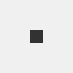

# Animation class
{: .no_toc }

An **Animation** plays a silent AVI clip in a box on the form, such as the moving picture of a file copy or a search in progress.

{:width="60" height="60"}

```tb hidden
Private Sub SamplePut32(b() As Byte, ByRef p As Long, ByVal v As Long)
    b(p) = v And &HFF&
    b(p + 1) = (v \ &H100&) And &HFF&
    b(p + 2) = (v \ &H10000) And &HFF&
    b(p + 3) = (v \ &H1000000) And &HFF&
    p = p + 4
End Sub
Private Sub SamplePut16(b() As Byte, ByRef p As Long, ByVal v As Long)
    b(p) = v And &HFF&
    b(p + 1) = (v \ &H100&) And &HFF&
    p = p + 2
End Sub
Private Sub SamplePutTag(b() As Byte, ByRef p As Long, ByVal tag As String)
    Dim i As Long
    For i = 1 To 4
        b(p) = Asc(Mid$(tag, i, 1))
        p = p + 1
    Next
End Sub
Public Function WriteSampleClip() As String
    Const Frames As Long = 3, FrameBytes As Long = 768
    Dim b(0 To 2607) As Byte
    Dim p As Long, i As Long, j As Long
    SamplePutTag b, p, "RIFF": SamplePut32 b, p, 2600: SamplePutTag b, p, "AVI "
    SamplePutTag b, p, "LIST": SamplePut32 b, p, 192: SamplePutTag b, p, "hdrl"
    SamplePutTag b, p, "avih": SamplePut32 b, p, 56
    SamplePut32 b, p, 100000: SamplePut32 b, p, 7800: SamplePut32 b, p, 0: SamplePut32 b, p, &H10&
    SamplePut32 b, p, Frames: SamplePut32 b, p, 0: SamplePut32 b, p, 1: SamplePut32 b, p, FrameBytes
    SamplePut32 b, p, 16: SamplePut32 b, p, 16
    For i = 1 To 4: SamplePut32 b, p, 0: Next
    SamplePutTag b, p, "LIST": SamplePut32 b, p, 116: SamplePutTag b, p, "strl"
    SamplePutTag b, p, "strh": SamplePut32 b, p, 56
    SamplePutTag b, p, "vids": SamplePutTag b, p, "DIB "
    SamplePut32 b, p, 0: SamplePut16 b, p, 0: SamplePut16 b, p, 0: SamplePut32 b, p, 0
    SamplePut32 b, p, 1: SamplePut32 b, p, 10: SamplePut32 b, p, 0: SamplePut32 b, p, Frames
    SamplePut32 b, p, FrameBytes: SamplePut32 b, p, -1: SamplePut32 b, p, 0
    SamplePut16 b, p, 0: SamplePut16 b, p, 0: SamplePut16 b, p, 16: SamplePut16 b, p, 16
    SamplePutTag b, p, "strf": SamplePut32 b, p, 40
    SamplePut32 b, p, 40: SamplePut32 b, p, 16: SamplePut32 b, p, 16
    SamplePut16 b, p, 1: SamplePut16 b, p, 24: SamplePut32 b, p, 0: SamplePut32 b, p, FrameBytes
    For i = 1 To 4: SamplePut32 b, p, 0: Next
    SamplePutTag b, p, "LIST": SamplePut32 b, p, 2332: SamplePutTag b, p, "movi"
    For i = 0 To Frames - 1
        SamplePutTag b, p, "00db": SamplePut32 b, p, FrameBytes
        For j = 0 To FrameBytes - 1
            b(p) = (i * 100 + 50) And &HFF&
            p = p + 1
        Next
    Next
    SamplePutTag b, p, "idx1": SamplePut32 b, p, 48
    For i = 0 To Frames - 1
        SamplePutTag b, p, "00db": SamplePut32 b, p, &H10&
        SamplePut32 b, p, 4 + i * 776: SamplePut32 b, p, FrameBytes
    Next
    Dim path As String
    path = Environ$("TEMP") & "\vbccr-animation-sample.avi"
    Dim n As Long
    n = FreeFile
    Open path For Binary Access Write As #n
    Put #n, , b
    Close #n
    WriteSampleClip = path
End Function
```

```tb check_build check_run arch=win32,win64
Dim Clip As String
Clip = WriteSampleClip()                ' a small silent AVI in the temporary folder
Animation1.LoadFile Clip
Animation1.Play                         ' repeats until StopPlay
Debug.Print Animation1.Playing
Animation1.StopPlay
Animation1.Unload                       ' the control lets go of the file
Kill Clip
' Output:
' True
```

In the samples of this page, **WriteSampleClip** writes a small silent AVI clip to the temporary folder and returns its path.

The control wraps the animation control of Windows (`SysAnimate32`), which plays an AVI clip that has no sound and is uncompressed or compressed by run-length encoding. It stands in place of the Animation of `MSCOMCT2.OCX`: the **Open**, **Close** and **Stop** methods of that control are [**LoadFile**](#loadfile), [**Unload**](#unload) and [**StopPlay**](#stopplay) here.

Of the [common members](Common), the control has those under [Name and place](Common#name-and-place), [Window handles](Common#window-handles), [Mouse](Common#mouse), [Keyboard and focus](Common#keyboard-and-focus), [Dragging the control](Common#dragging-the-control), [OLE drag and drop](Common#ole-drag-and-drop) and [Right-to-left](Common#right-to-left), **RightToLeftLayout** included. It has no **Font**, **FontQuality** or **VisualStyles**.

* TOC
{:toc}

## Loading a clip

[**LoadFile**](#loadfile) loads a clip from a file, and [**LoadRes**](#loadres) from a resource, either of the program or of a library file. Each shows the first frame of the clip and replaces a clip that was loaded. [**Unload**](#unload) removes the clip.

<!-- test: AnimationTests.LoadFile_MissingFile_Raises53, AnimationTests.LoadRes_MissingResource_Raises326, AnimationTests.LoadRes_MissingFile_Raises53 -->
**LoadFile** raises run-time error 53 when Windows cannot open the file as a clip. **LoadRes** raises run-time error 326 when there is no clip with that identifier, and 53 when the library file cannot be loaded.

```tb check_build
Animation1.LoadRes 101                  ' the clip 101 of the program
Animation1.LoadRes 7, "Clips.dll"       ' the clip 7 of a library
```
<!-- /test -->

<!-- test: AnimationTests.Unload_ReleasesTheFile -->
While a clip is loaded from a file, the control keeps the file open, and the file cannot be deleted. **Unload** lets go of it.
<!-- /test -->

## Playing the clip

<!-- test: AnimationTests.Play_AndStopPlay_ChangeTheStateAndRaiseChange -->
[**Play**](#play) starts the clip and [**StopPlay**](#stopplay) stops it, and [**Playing**](#playing) tells which of the two the control is doing. A clip that is loaded and not started is not playing. The event [**Change**](#change) is raised each time the clip starts and each time it stops, whether it ended or was stopped, and **Playing** then has the new state.
<!-- /test -->

**Play** takes the number of times to play the clip and the frames to play. A clip that is already playing is stopped first.

```tb check_build
Private Sub Animation1_Change()
    If Animation1.Playing Then
        Debug.Print "started"
    Else
        Debug.Print "stopped"
    End If
End Sub
```

[**AutoPlay**](#autoplay) makes a clip start as soon as it is loaded.

## The look of the control

<!-- test: AnimationTests.Defaults_OfANewControl, AnimationTests.BackStyle_OutOfRange_Raises380 -->
A new control plays nothing, and has [**AutoPlay**](#autoplay) and [**Center**](#center) set to **False** and a [**BackStyle**](#backstyle) of **CCBackStyleTransparent**.
<!-- /test -->

With a transparent [**BackStyle**](#backstyle) the background color of the clip is not drawn, and the control's [**BackColor**](#backcolor) shows in its place; with an opaque one the clip keeps all its colors. With [**Center**](#center) set to **True** the clip is drawn in the middle of the control, and otherwise at its top left corner. Changing **AutoPlay**, **BackStyle** or **Center** loads the clip again, which stops a clip that was playing.

{:width="621" height="143"}

Properties
----------

### AutoPlay
{: .no_toc }

Whether a clip starts to play as soon as it is loaded. **Boolean**. Default: **False**.

### BackColor
{: .no_toc }

The background color of the control, which a clip with a transparent [**BackStyle**](#backstyle) shows. **OLE_COLOR**. Default: **vbButtonFace**.

### BackStyle
{: .no_toc }

Whether the background of the clip is transparent or the clip keeps its own colors. A member of [**CCBackStyleConstants**](Common#ccbackstyleconstants). Default: **CCBackStyleTransparent**. Another value raises run-time error 380.

### Center
{: .no_toc }

Whether the clip is drawn in the middle of the control. **Boolean**. Default: **False**, with which it is drawn at the top left corner.

### Playing
{: .no_toc }

Whether the clip is playing. **Boolean**, read-only.

Methods
-------

### LoadFile
{: .no_toc }

Loads a clip from a file and shows its first frame. A clip that was loaded is removed.

Syntax: *object*.**LoadFile** *FileName*

*FileName*
: *required* A **String**: the path of the AVI file.

### LoadRes
{: .no_toc }

Loads a clip from a resource and shows its first frame. A clip that was loaded is removed.

Syntax: *object*.**LoadRes** *ResID* [ , *FileName* ]

*ResID*
: *required* An **Integer**: the identifier of the clip's resource.

*FileName*
: *optional* A **String**: the path of a library or program file that has the resource. The default is the program itself.

### Play
{: .no_toc }

Plays the loaded clip, after stopping it if it was already playing. A clip that is not loaded plays nothing.

Syntax: *object*.**Play** [ *RepeatCount* ] [ , *StartFrame* ] [ , *EndFrame* ]

*RepeatCount*
: *optional* A **Long**: how many times to play the clip. The default is -1, which plays it until [**StopPlay**](#stopplay). A value of 0 plays nothing.

*StartFrame*
: *optional* An **Integer**: the number of the first frame to play, counted from 0. The default is 0.

*EndFrame*
: *optional* An **Integer**: the number of the last frame to play. The default is -1, the last frame of the clip.

### StopPlay
{: .no_toc }

Stops the clip, if it is playing.

Syntax: *object*.**StopPlay**

### Unload
{: .no_toc }

Removes the loaded clip and lets go of its file. The control then shows nothing.

Syntax: *object*.**Unload**

Events
------

### Change
{: .no_toc }

Raised when the clip has started playing and when it has stopped, by reaching its end or by [**StopPlay**](#stopplay). [**Playing**](#playing) has the new state. See [Playing the clip](#playing-the-clip).

Syntax: *object*\_**Change**( )

### MouseDown, MouseMove, MouseUp
{: .no_toc }

<!-- test: AnimationTests.MouseMove_XAndY_AreInTwips -->
As the [common events](Common#mousedown-mousemove-mouseup) of these names; *X* and *Y* are in twips, whatever the scale units of the control's container, measured from the top left corner of the control.
<!-- /test -->

## See Also

- [Common members](Common) -- the members this control shares with the package's other controls
