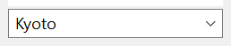
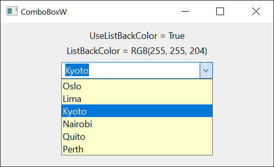

# ComboBoxW class
{: .no_toc }

A **ComboBoxW** is a text box joined to a list of text items: the user types a text or picks an item from the list, which drops down under the text box or stays open below it.

{:width="172" height="35"}

```tb check_build check_run arch=win32,win64
ComboBoxW1.AddItem "Oslo"
ComboBoxW1.AddItem "Lima"
ComboBoxW1.AddItem "Kyoto"
ComboBoxW1.ListIndex = 2
Debug.Print ComboBoxW1.Text; ComboBoxW1.ListCount
' Output:
' Kyoto 3
```

The control stands in place of the [**ComboBox**](../../VB/ComboBox/) of VB6. It keeps its text in Unicode, and adds a prompt in the empty text box ([**CueBanner**](#cuebanner)), the size and the colors of the drop-down list, searching ([**FindItem**](#finditem), [**SelectItem**](#selectitem), [**AutoSelect**](#autoselect)), upper or lower case, and items that the program draws.

Of the [common members](Common), the control has every member under [Name and place](Common#name-and-place), [Window handles](Common#window-handles), [Font and visual styles](Common#font-and-visual-styles), [Mouse](Common#mouse), [Keyboard and focus](Common#keyboard-and-focus), [Dragging the control](Common#dragging-the-control), [OLE drag and drop](Common#ole-drag-and-drop) and [Right-to-left](Common#right-to-left) but **RightToLeftLayout**. Its [**Click**](#click) and [**DblClick**](#dblclick) have a meaning of their own, and its [mouse events](#mousedown-mousemove-mouseup) give the position in twips.

* TOC
{:toc}

## The styles

[**Style**](#style) is set at design time and decides what the control is made of:

| Style | The control |
|---|---|
| **CboStyleDropDownCombo** | A text box with an arrow button. The list drops down when the user presses the button. The user types any text or picks an item. |
| **CboStyleSimpleCombo** | A text box with the list always open below it. The user types any text or picks an item. |
| **CboStyleDropDownList** | A field that shows the selected item, with an arrow button. The user picks an item and cannot type a text of their own. |

The first two have a text box, whose window is [**hWndEdit**](#hwndedit). The members that work on the text box, such as [**SelStart**](#selstart), [**Locked**](#locked) and [**MaxLength**](#maxlength), do nothing useful on a **CboStyleDropDownList** control, which has none.

## The list

[**AddItem**](#additem) adds an item at the end of the list or at an index, [**RemoveItem**](#removeitem) removes one and [**Clear**](#clear) removes all. [**ListCount**](#listcount) is the number of items, and [**List**](#list) is the text of one, by its index from 0. Each item also holds a number of the program's own, [**ItemData**](#itemdata), which stays with the item when others are added or removed.

<!-- test: ComboBoxWTests.AddItem_NewIndex_IsWhereTheItemWent, ComboBoxWTests.Sorted_NewItemsGoInOrder, ComboBoxWTests.List_Assigned_KeepsItemData -->
[**NewIndex**](#newindex) is the index that the last **AddItem** gave its item. With [**Sorted**](#sorted) set to **True**, **AddItem** without an index puts each item in alphabetical order, without regard to case, so **NewIndex** is the way to find it again.

```tb check_build check_run arch=win32,win64
With ComboBoxW1
    .Sorted = True
    .AddItem "pear"
    .AddItem "fig"
    .AddItem "apple"
    .ItemData(.NewIndex) = 500
    Debug.Print .List(0); " "; .List(1); " "; .List(2); .NewIndex; .ItemData(0)
    .List(0) = "apricot"                 ' the item keeps its ItemData
    Debug.Print .List(0); .ItemData(0)
End With
' Output:
' apple fig pear 0  500
' apricot 500
```
<!-- /test -->

To add many items quickly, set [**Redraw**](#redraw) to **False**, add them, and set it to **True** again.

<!-- test: ComboBoxWTests.Sorted_SetAtRunTime_RaisesClickForTheSelectedItem -->
A change of [**Sorted**](#sorted), [**CharacterCasing**](#charactercasing) or [**DisableNoScroll**](#disablenoscroll) at run time makes the control's window again. The items, their **ItemData**, the selection and the text are kept, but [**hWnd**](Common#hwnd), **hWndEdit** and [**hWndList**](#hwndlist) are new handles, and the control raises [**Click**](#click) once more when an item is selected.
<!-- /test -->

## The selection and the text

[**ListIndex**](#listindex) is the index of the selected item, or -1 when none is selected. [**Text**](#text) is the text in the text box.

<!-- test: ComboBoxWTests.ListIndex_Assigned_SetsTextAndRaisesClick, ComboBoxWTests.Text_Assigned_RaisesChangeAndKeepsListIndex -->
Selecting an item, by the user or by an assignment to **ListIndex**, puts the item's text in the text box and raises [**Click**](#click), not [**Change**](#change). Typing in the text box, or assigning another text to **Text**, raises **Change** and leaves **ListIndex** as it was, so after such a change **ListIndex** can name an item whose text is not the one in the text box.

```tb check_build check_run arch=win32,win64
With ComboBoxW1
    .AddItem "red"
    .AddItem "green"
    .AddItem "blue"
    .ListIndex = 1
    Debug.Print .Text; .ListIndex
    .Text = "mauve"
    Debug.Print .Text; .ListIndex
    .ListIndex = -1
    Debug.Print "["; .Text; "]"; .ListIndex
End With
' Output:
' green 1
' mauve 1
' []-1
```
<!-- /test -->

A program that reacts to both the typed text and the picked item handles both events:

```tb check_build
Private Sub ComboBoxW1_Click()
    Debug.Print "picked item"; ComboBoxW1.ListIndex
End Sub

Private Sub ComboBoxW1_Change()
    Debug.Print "text is now "; ComboBoxW1.Text
End Sub
```

[**SelStart**](#selstart), [**SelLength**](#sellength) and [**SelText**](#seltext) are the selected part of the text in the text box, as on a text box.

## Finding an item

[**FindItem**](#finditem) returns the index of an item by its text, and [**SelectItem**](#selectitem) selects the first item that begins with a text. Neither regards case.

<!-- test: ComboBoxWTests.FindItem_WholeTextOrBeginning, ComboBoxWTests.SelectItem_SelectsTheItemThatBeginsWithTheText -->
```tb check_build check_run arch=win32,win64
With ComboBoxW1
    .AddItem "red"
    .AddItem "green"
    .AddItem "blue"
    Debug.Print .FindItem("GREEN"); .FindItem("gr"); .FindItem("gr", , True)
    Debug.Print .SelectItem("bl"); .Text; .ListIndex
End With
' Output:
'  1 -1  1
'  2 blue 2
```
<!-- /test -->

<!-- test: ComboBoxWTests.AutoSelect_TypedTextOfAnItem_SelectsTheItem -->
With [**AutoSelect**](#autoselect) set to **True** the control does the same for the user: as soon as the text typed is the whole text of an item, that item is selected and **Click** is raised before **Change**.
<!-- /test -->

## The drop-down list

<!-- test: ComboBoxWTests.DroppedDown_Assigned_RaisesDropDownAndCloseUp -->
[**DroppedDown**](#droppeddown) says whether the list is open, and opens or closes it. The control raises [**DropDown**](#dropdown) before the list opens, which is the moment to fill a list that depends on something else, and [**CloseUp**](#closeup) when it has closed.
<!-- /test -->

```tb check_build
Private Sub ComboBoxW1_DropDown()
    If ComboBoxW1.ListCount = 0 Then
        ComboBoxW1.AddItem "filled when first opened"
    End If
End Sub
```

The list is as high as its items, up to [**MaxDropDownItems**](#maxdropdownitems) of them, unless the program sets [**DropDownHeight**](#dropdownheight). It is as wide as the control unless [**DropDownWidth**](#dropdownwidth) is wider. [**UseListBackColor**](#uselistbackcolor) and [**UseListForeColor**](#uselistforecolor) give the list colors of its own, [**ListBackColor**](#listbackcolor) and [**ListForeColor**](#listforecolor).

{:width="361" height="221"}

## Drawing the items

With [**DrawMode**](#drawmode) set at design time to **CboDrawModeOwnerDrawFixed** or **CboDrawModeOwnerDrawVariable**, the control draws no item: it raises [**ItemDraw**](#itemdraw) for each item to show, in the list and in the field of a **CboStyleDropDownList** control, and the handler draws into the device context it is given. With **CboDrawModeOwnerDrawVariable** the items can differ in height, and the control first raises [**ItemMeasure**](#itemmeasure) for each item as it is added. The items still hold their texts.

```tb check_build
Private Declare PtrSafe Function SetTextColor Lib "gdi32" (ByVal hDC As LongPtr, ByVal Color As Long) As Long
Private Declare PtrSafe Function SetBkMode Lib "gdi32" (ByVal hDC As LongPtr, ByVal Mode As Long) As Long
Private Declare PtrSafe Function TextOutW Lib "gdi32" (ByVal hDC As LongPtr, ByVal X As Long, ByVal Y As Long, ByVal Text As LongPtr, ByVal Length As Long) As Long

Private Sub ComboBoxW1_ItemDraw(ByVal Item As Long, ByVal ItemAction As Long, ByVal ItemState As Long, ByVal hDC As Long, ByVal Left As Long, ByVal Top As Long, ByVal Right As Long, ByVal Bottom As Long)
    If Item < 0 Then Exit Sub
    Dim Caption As String
    Caption = ComboBoxW1.List(Item)
    SetBkMode hDC, 1                                           ' transparent
    SetTextColor hDC, IIf((ItemState And 1) <> 0, vbRed, vbBlue)   ' 1: the item is selected
    TextOutW hDC, Left + 2, Top, StrPtr(Caption), Len(Caption)
End Sub
```

Properties
----------

### AlwaysFindExact
{: .no_toc }

Whether the control looks in its list for whole texts only. **Boolean**. Default: **False**, with which the list, when it opens, selects the first item that begins with the text in the text box. With **True** it selects only an item whose whole text is that text.

### AutoSelect
{: .no_toc }

Whether the control selects an item as soon as the user has typed its whole text. **Boolean**. Default: **False**. See [Finding an item](#finding-an-item). It has no effect on a **CboStyleDropDownList** control.

### BackColor
{: .no_toc }

The background color of the control. **OLE_COLOR**. A new control has **vbWindowBackground**.

### CharacterCasing
{: .no_toc }

Whether the control changes the case of its text. A member of [**CboCharacterCasingConstants**](#cbocharactercasingconstants). Default: **CboCharacterCasingNormal**. Another value raises run-time error 380.

<!-- test: ComboBoxWTests.CharacterCasing_Upper_ChangesTheTextAndTheItems -->
With **CboCharacterCasingUpper** or **CboCharacterCasingLower** the control changes to that case the text in the text box and the items of the list, and from then on what the user types, a text assigned to [**Text**](#text) and each item added. A return to **CboCharacterCasingNormal** does not give the texts their former case.
<!-- /test -->

### CueBanner
{: .no_toc }

A prompt shown in grey in the text box while it is empty, such as `Choose a city`. **String**. Default: empty. It shows when the program has visual styles.

### DisableNoScroll
{: .no_toc }

Whether the list shows a disabled scroll bar when all its items fit. **Boolean**. Default: **False**, with which the list has a scroll bar only when it needs one.

### DrawMode
{: .no_toc }

Whether the control or the program draws the items. A member of [**CboDrawModeConstants**](#cbodrawmodeconstants). Default: **CboDrawModeNormal**. See [Drawing the items](#drawing-the-items).

<!-- test: ComboBoxWTests.DrawMode_AtRunTime_Raises382 -->
It is set at design time. At run time an assignment raises run-time error 382, and a value that is not a member raises 380.
<!-- /test -->

### DropDownHeight
{: .no_toc }

The height of the drop-down list, in the scale units of the control's container. **Single**.

<!-- test: ComboBoxWTests.DropDownHeight_Assigned_ClearsIntegralHeight, ComboBoxWTests.DropDownHeight_Zero_Raises380 -->
An assignment fixes the height: [**MaxDropDownItems**](#maxdropdownitems) no longer counts, until it is assigned again, and [**IntegralHeight**](#integralheight) becomes **False**. A value that is not greater than 0 raises run-time error 380. On a **CboStyleSimpleCombo** control the property raises run-time error 5.
<!-- /test -->

### DropDownWidth
{: .no_toc }

The least width of the drop-down list, in the scale units of the control's container. **Single**. The list is never narrower than the control. A negative value raises run-time error 380.

### DroppedDown
{: .no_toc }

Whether the drop-down list is open. **Boolean**. An assignment opens or closes it.

### ExtendedUI
{: .no_toc }

Whether the control uses the extended keyboard interface of the Windows combo box. **Boolean**. Default: **False**. With **True** the Down Arrow key opens the list, the F4 key does not, and the mouse wheel does not change the selection while the list is closed. It has no effect on a **CboStyleSimpleCombo** control.

### FieldHeight
{: .no_toc }

The height of the text box, or of the field of a **CboStyleDropDownList** control, in the scale units of the control's container. **Single**. A negative value raises run-time error 380.

### ForeColor
{: .no_toc }

The color of the control's text. **OLE_COLOR**.

### HorizontalExtent
{: .no_toc }

The width over which the list can be scrolled sideways, in the scale units of the control's container. **Single**. Default: 0. The list has a horizontal scroll bar while this is greater than its own width. [**GetIdealHorizontalExtent**](#getidealhorizontalextent) returns the value that fits the items. A negative value raises run-time error 380.

### hWndEdit
{: .no_toc }

The handle of the text box inside the control. **LongPtr**, read-only. It is 0 on a **CboStyleDropDownList** control.

### hWndList
{: .no_toc }

The handle of the list. **LongPtr**, read-only.

### IMEMode
{: .no_toc }

The state of the Input Method Editor while the text box has the focus. A member of [**CCIMEModeConstants**](Common#ccimemodeconstants). Default: **CCIMEModeNoControl**. Another value raises run-time error 380.

### IntegralHeight
{: .no_toc }

Whether the list shows whole items only. **Boolean**. Default: **True**, with which the list makes itself a little lower so that its last item is not cut. It is always **False** in effect with **CboDrawModeOwnerDrawVariable**.

<!-- test: ComboBoxWTests.IntegralHeight_AtRunTime_Raises382 -->
It is set at design time: an assignment at run time raises run-time error 382. An assignment to [**DropDownHeight**](#dropdownheight) makes it **False**.
<!-- /test -->

### ItemData
{: .no_toc }

A number of the program's own that an item holds, such as the key of the record the item stands for. **LongPtr**. A new item has 0.

Syntax: *object*.**ItemData**( *Index* ) [ = *value* ]

<!-- test: ComboBoxWTests.ItemData_NoSuchItem_Raises381 -->
An *Index* that is not an item raises run-time error 381.
<!-- /test -->

### ItemHeight
{: .no_toc }

The height of an item in the list, in the scale units of the control's container. **Single**.

Syntax: *object*.**ItemHeight**[( *Index* )] [ = *value* ]

*Index*
: *optional* The item, with **CboDrawModeOwnerDrawVariable**, where each item has its own height. With the other draw modes all items have one height, and an *Index* other than 0 raises run-time error 5.

A negative height or *Index* raises run-time error 380.

### List
{: .no_toc }

The text of an item. **String**.

Syntax: *object*.**List**( *Index* ) [ = *value* ]

<!-- test: ComboBoxWTests.List_NoSuchItem_Raises5 -->
An assignment replaces the item's text and keeps its [**ItemData**](#itemdata) and the selection. When the item is the selected one, the text box receives the new text. An *Index* that is not an item raises run-time error 5.
<!-- /test -->

### ListBackColor
{: .no_toc }

The background color of the drop-down list while [**UseListBackColor**](#uselistbackcolor) is **True**. **OLE_COLOR**. Default: **vbWindowBackground**.

### ListCount
{: .no_toc }

The number of items in the list. **Long**, read-only.

### ListForeColor
{: .no_toc }

The color of the text in the drop-down list while [**UseListForeColor**](#uselistforecolor) is **True**. **OLE_COLOR**. Default: **vbWindowText**.

### ListIndex
{: .no_toc }

The index of the selected item, or -1 when no item is selected. **Long**. Default: -1.

<!-- test: ComboBoxWTests.ListIndex_NoSuchItem_Raises380, ComboBoxWTests.ListIndex_SameValue_RaisesNothing -->
An assignment selects the item, puts its text in the text box and raises [**Click**](#click), unless the item is selected already. -1 removes the selection and empties the text box. A value that is not an item raises run-time error 380.
<!-- /test -->

### Locked
{: .no_toc }

Whether the user is kept from changing the text and the selection. **Boolean**. Default: **False**.

<!-- test: ComboBoxWTests.Locked_TypingChangesNothing -->
With **True** the text box takes no typing, and the list does not respond to the keyboard or to the mouse on its items. The program can still assign [**Text**](#text) and [**ListIndex**](#listindex).
<!-- /test -->

### MaxDropDownItems
{: .no_toc }

The greatest number of items that the drop-down list shows without scrolling. **Integer**. Default: 9.

<!-- test: ComboBoxWTests.MaxDropDownItems_OutOfRange_Raises380 -->
A value less than 1 or greater than 30 raises run-time error 380.
<!-- /test -->

### MaxLength
{: .no_toc }

The greatest number of characters that the user can type in the text box. **Long**. Default: 0. A negative value raises run-time error 380.

<!-- test: ComboBoxWTests.MaxLength_Zero_LimitsTypingTo255, ComboBoxWTests.Text_LongerThanMaxLength_IsCut -->
With 0 the user can type 255 characters, and a text that the program assigns to [**Text**](#text) has no limit. With another value the limit is that number of characters for both: an assigned text loses what is beyond it.
<!-- /test -->

### NewIndex
{: .no_toc }

The index of the item that [**AddItem**](#additem) added last. **Long**, read-only. It is -1 when no item was added, and after [**RemoveItem**](#removeitem) or [**Clear**](#clear).

### OLEDragMode
{: .no_toc }

Whether the user can drag the selected text out of the text box. A member of [**OLEDragConstants**](../../VBRUN/Constants/OLEDragConstants). Default: **vbOLEDragManual**, with which only [**OLEDrag**](Common#oledrag) starts a drag. With **vbOLEDragAutomatic** a drag that begins on the selected text carries it as text, to copy or to move; the control removes text that was moved. Another value raises run-time error 380.

### Redraw
{: .no_toc }

Whether the control draws itself when its items change. **Boolean**. Default: **True**. Setting it to **True** again draws the control.

### ScrollTrack
{: .no_toc }

Whether the list scrolls while the user drags the scroll box of its scroll bar. **Boolean**. Default: **True**. With **False** the list scrolls when the user releases the scroll box.

### SelLength
{: .no_toc }

The number of characters selected in the text box. **Long**. A negative value raises run-time error 380.

### SelStart
{: .no_toc }

The position where the selection in the text box starts, counted from 0, or the position of the caret when nothing is selected. **Long**. An assignment puts the caret there and selects nothing. A negative value raises run-time error 380.

### SelText
{: .no_toc }

The selected text of the text box. **String**. An assignment replaces the selection, or inserts the text at the caret. On a **CboStyleDropDownList** control the property raises run-time error 380.

### Sorted
{: .no_toc }

Whether [**AddItem**](#additem) without an index puts each new item in alphabetical order. **Boolean**. Default: **False**. An **AddItem** with an index puts the item at that index all the same.

<!-- test: ComboBoxWTests.Sorted_SetAtRunTime_LeavesTheItemsInPlace -->
> [!NOTE] 1.8.140.0
> An assignment of **True** at run time does not sort the items already in the list, and the items added afterward are placed as if the list were sorted. Set **Sorted** before the first item is added.

### Style
{: .no_toc }

What the control is made of. A member of [**CboStyleConstants**](#cbostyleconstants). Default: **CboStyleDropDownCombo**. See [The styles](#the-styles).

<!-- test: ComboBoxWTests.Style_AtRunTime_Raises382 -->
It is set at design time. At run time an assignment raises run-time error 382, and a value that is not a member raises 380.
<!-- /test -->

### Text
{: .no_toc }

The text in the text box. **String**. A control newly drawn on a form has its own name.

On a **CboStyleDropDownList** control it is the text of the selected item, and an assignment selects the item that has this text; a text that no item has raises run-time error 383.

On the other styles an assignment that changes the text raises [**Change**](#change), and does not change [**ListIndex**](#listindex).

### TopIndex
{: .no_toc }

The index of the item at the top of the list. **Long**. An assignment scrolls the list. A value that is not an item raises run-time error 380.

### UseListBackColor
{: .no_toc }

Whether the drop-down list has [**ListBackColor**](#listbackcolor) as its background color. **Boolean**. Default: **False**.

### UseListForeColor
{: .no_toc }

Whether the drop-down list has [**ListForeColor**](#listforecolor) as the color of its text. **Boolean**. Default: **False**.

Methods
-------

### AddItem
{: .no_toc }

Adds an item to the list, and sets [**NewIndex**](#newindex) to its index.

Syntax: *object*.**AddItem** *Item* [, *Index* ]

*Item*
: *required* A **String**: the text of the item.

*Index*
: *optional* The index the item gets; the items from there on move down by one. Without it the item goes to the end of the list, or to its place in a [**Sorted**](#sorted) list.

<!-- test: ComboBoxWTests.AddItem_IndexPastTheEnd_Raises5 -->
An *Index* that is negative or greater than [**ListCount**](#listcount) raises run-time error 5.
<!-- /test -->

### Clear
{: .no_toc }

<!-- test: ComboBoxWTests.Clear_EmptiesTheListAndTheText -->
Removes every item, and empties the text box. It raises no event.
<!-- /test -->

Syntax: *object*.**Clear**

### FindItem
{: .no_toc }

Returns the index of the first item that has a text, or -1 when there is none. The search does not regard case.

Syntax: *object*.**FindItem**( *Text* [, *Index* [, *Partial* ] ] )

*Text*
: *required* A **String**: the text to look for.

*Index*
: *optional* A **Long**: the item after which the search starts. The search goes to the end of the list and on from its top, so this item is the last one looked at. The default, -1, searches from the top. A value that is not an item raises run-time error 381.

*Partial*
: *optional* A **Boolean**: **True** finds an item that begins with *Text*, **False** (the default) one whose whole text is *Text*.

### GetIdealHorizontalExtent
{: .no_toc }

Returns the [**HorizontalExtent**](#horizontalextent) with which the widest item can be scrolled into view, as a **Single** in the scale units of the control's container. It returns 0 for an empty list.

Syntax: *object*.**GetIdealHorizontalExtent**

### RemoveItem
{: .no_toc }

Removes an item from the list, and sets [**NewIndex**](#newindex) to -1.

Syntax: *object*.**RemoveItem** *Index*

*Index*
: *required* A **Long**: the item to remove. A value that is not an item raises run-time error 5.

<!-- test: ComboBoxWTests.RemoveItem_TheSelectedItem_EmptiesTheText -->
Removing the selected item leaves no item selected and empties the text box.
<!-- /test -->

### SelectItem
{: .no_toc }

Selects the first item that begins with a text, and returns its index. When no item does, it returns -1 and the selection stays. The search does not regard case. The method raises [**Click**](#click) when it selects another item than before.

Syntax: *object*.**SelectItem**( *Text* [, *Index* ] )

*Text*
: *required* A **String**: the beginning of the item's text.

*Index*
: *optional* A **Long**: the item after which the search starts, as in [**FindItem**](#finditem).

Events
------

### Change
{: .no_toc }

Raised when the text in the text box has changed: by the user's typing, or by an assignment to [**Text**](#text) of another text than the box has. Selecting an item raises [**Click**](#click) instead.

Syntax: *object*\_**Change**( )

### Click
{: .no_toc }

Raised when another item has been selected: by the user, with the mouse or the keyboard, or by [**ListIndex**](#listindex), [**SelectItem**](#selectitem) or [**AutoSelect**](#autoselect). A mouse click that selects nothing raises no **Click**.

Syntax: *object*\_**Click**( )

### CloseUp
{: .no_toc }

Raised when the drop-down list has closed.

Syntax: *object*\_**CloseUp**( )

### ContextMenu
{: .no_toc }

Raised when the user asks for the control's shortcut menu, with the right mouse button or with Shift+F10.

Syntax: *object*\_**ContextMenu**( *Handled* **As Boolean**, **ByVal** *X* **As Single**, **ByVal** *Y* **As Single** )

*Handled*
: **False** when the event is raised. A handler that sets it to **True**, having shown a menu of its own, keeps the text box from showing the menu of Windows.

*X*, *Y*
: The position of the pointer, measured from the control's top left corner in the scale units of the control's container. Both are -1 when the user asked with the keyboard.

### DblClick
{: .no_toc }

Raised when the user double-clicks an item in the list of a **CboStyleSimpleCombo** control. The other styles do not raise it.

Syntax: *object*\_**DblClick**( )

### DropDown
{: .no_toc }

Raised when the drop-down list is about to open.

Syntax: *object*\_**DropDown**( )

### ItemDraw
{: .no_toc }

Raised when an item is to be drawn, while [**DrawMode**](#drawmode) is not **CboDrawModeNormal**. See [Drawing the items](#drawing-the-items).

Syntax: *object*\_**ItemDraw**( **ByVal** *Item* **As Long**, **ByVal** *ItemAction* **As Long**, **ByVal** *ItemState* **As Long**, **ByVal** *hDC* **As Long**, **ByVal** *Left* **As Long**, **ByVal** *Top* **As Long**, **ByVal** *Right* **As Long**, **ByVal** *Bottom* **As Long** )

*Item*
: The index of the item, or -1 when the control is empty and only the focus is to be drawn.

*ItemAction*
: What to draw, a sum of 1 (the whole item), 2 (the item was selected or the selection was removed) and 4 (the item received or lost the focus).

*ItemState*
: The state of the item, a sum of 1 (selected), 4 (disabled), &H10 (it has the focus) and &H1000 (the item is drawn in the field of the control, not in the list).

*hDC*
: The device context to draw into. In a 64-bit program it is the low 32 bits of the handle, which is all that a device context's handle uses.

*Left*, *Top*, *Right*, *Bottom*
: The rectangle of the item, in pixels.

### ItemMeasure
{: .no_toc }

Raised once for each item added, while [**DrawMode**](#drawmode) is **CboDrawModeOwnerDrawVariable**, to ask for the item's height.

Syntax: *object*\_**ItemMeasure**( **ByVal** *Item* **As Long**, *ItemHeight* **As Long** )

*Item*
: The index of the item.

*ItemHeight*
: The height of the item in pixels. The handler sets it.

### MouseDown, MouseMove, MouseUp
{: .no_toc }

<!-- test: ComboBoxWTests.MouseMove_XAndY_AreInTwips -->
As the [common events](Common#mousedown-mousemove-mouseup) of these names, but *X* and *Y* are in twips, whatever the scale units of the control's container, and are measured from the top left corner of the control.
<!-- /test -->

### Scroll
{: .no_toc }

Raised when the list has scrolled, so that another item is at its top.

Syntax: *object*\_**Scroll**( )

## CboStyleConstants
{: #cbostyleconstants }

The values of [**Style**](#style).

{:width="681" height="225"}

| Member | Value | Description |
|---|---|---|
| **CboStyleDropDownCombo**{: #CboStyleConstants_CboStyleDropDownCombo } | 0 | A text box and a list that drops down. |
| **CboStyleSimpleCombo**{: #CboStyleConstants_CboStyleSimpleCombo } | 1 | A text box and a list that is always open. |
| **CboStyleDropDownList**{: #CboStyleConstants_CboStyleDropDownList } | 2 | A list that drops down, and no text box. |

## CboCharacterCasingConstants
{: #cbocharactercasingconstants }

The values of [**CharacterCasing**](#charactercasing).

| Member | Value | Description |
|---|---|---|
| **CboCharacterCasingNormal**{: #CboCharacterCasingConstants_CboCharacterCasingNormal } | 0 | The text keeps its case. |
| **CboCharacterCasingUpper**{: #CboCharacterCasingConstants_CboCharacterCasingUpper } | 1 | The text is changed to upper case. |
| **CboCharacterCasingLower**{: #CboCharacterCasingConstants_CboCharacterCasingLower } | 2 | The text is changed to lower case. |

## CboDrawModeConstants
{: #cbodrawmodeconstants }

The values of [**DrawMode**](#drawmode).

| Member | Value | Description |
|---|---|---|
| **CboDrawModeNormal**{: #CboDrawModeConstants_CboDrawModeNormal } | 0 | The control draws the items. |
| **CboDrawModeOwnerDrawFixed**{: #CboDrawModeConstants_CboDrawModeOwnerDrawFixed } | 1 | The program draws the items, which all have one height. |
| **CboDrawModeOwnerDrawVariable**{: #CboDrawModeConstants_CboDrawModeOwnerDrawVariable } | 2 | The program draws the items and gives each its height. |

## See Also

- [Common members](Common) -- the members this control shares with the package's other controls
- [VirtualCombo](VirtualCombo) -- the same control without a list of its own, for a very long list
- [ListBoxW](ListBoxW) -- a list without a text box
- [ComboBox](../../VB/ComboBox/) -- the control of the VB package that this one stands in place of
