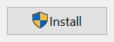

# CommandButtonW class
{: .no_toc }

A **CommandButtonW** is a push button with a caption, which the user clicks to start an action. It can show a picture beside its caption, have a second part with an arrow that opens a menu, show the shield of an action that needs elevation, and leave its drawing to the program.

{:width="108" height="40"}

```tb check_build check_run arch=win32,win64
CommandButtonW1.Caption = "&Save " & ChrW$(&H3A9)      ' the caption is Unicode: a Greek capital omega
CommandButtonW1.Default = True                         ' the Enter key clicks it
Debug.Print Len(CommandButtonW1.Caption); CommandButtonW1.Default; CommandButtonW1.Value
' Output:
'  7 TrueFalse
```

The control stands in place of the CommandButton of VB6, which in twinBASIC is the [**CommandButton**](../../VB/CommandButton/) of the VB package. This one adds the split button ([**SplitButton**](#splitbutton)), a picture from an image list ([**ImageList**](#imagelist)), a picture and a caption together ([**PictureAndCaption**](#pictureandcaption)), the caption's alignment and wrapping, [**SetShield**](#setshield), [**GetIdealSize**](#getidealsize), [**PerformClick**](#performclick), [**Transparent**](#transparent), and drawing by the program ([**DrawMode**](#drawmode)).

Of the [common members](Common), the control has those under [Name and place](Common#name-and-place), [Window handles](Common#window-handles), [Font and visual styles](Common#font-and-visual-styles), [Mouse](Common#mouse) but **DblClick**, [Keyboard and focus](Common#keyboard-and-focus), [Dragging the control](Common#dragging-the-control), [OLE drag and drop](Common#ole-drag-and-drop) and [Right-to-left](Common#right-to-left) but **RightToLeftLayout**. Its [**Click**](#click) event has a meaning of its own.

* TOC
{:toc}

## Clicking the button

The control raises [**Click**](#click) when the user clicks it with the left mouse button, presses the space key while it has the focus, or presses the Alt key with the character that follows an `&` in the [**Caption**](#caption). The button with [**Default**](#default) set raises it for the Enter key, and the button with [**Cancel**](#cancel) set for the Esc key, whichever control of the form has the focus.

<!-- test: CommandButtonWTests.Value_True_RaisesClick, CommandButtonWTests.PerformClick_RaisesClick -->
A program clicks the button with [**PerformClick**](#performclick), or by setting [**Value**](#value) to **True**. **Value** is **True** only while the **Click** event runs, and **False** at every other time.
<!-- /test -->

```tb check_build
Private Sub CommandButtonW1_Click()
    Debug.Print "Saving..."
End Sub
```

## Caption and pictures

In the standard [**Style**](#style) Windows draws the button. [**Alignment**](#alignment), [**VerticalAlignment**](#verticalalignment) and [**WordWrap**](#wordwrap) place the caption on it.

A picture comes from one of two places:

- [**Picture**](#picture) is shown in place of the caption. With [**PictureAndCaption**](#pictureandcaption) set, in a program with visual styles, the button shows both.
- An [**ImageList**](ImageList/) control assigned to the [**ImageList**](#imagelist) property is shown together with the caption, at the side that [**ImageListAlignment**](#imagelistalignment) names and at the distance of [**ImageListMargin**](#imagelistmargin) from the edge. The control shows the image list's pictures when the program has visual styles. While an image list is assigned, **Picture** is not shown.

The image list holds one picture, which the control shows in every state, or one picture for each state in this order: normal, under the mouse, pressed, disabled, default or with the focus, under a pen.

[**GetIdealSize**](#getidealsize) gives the size at which the caption and the picture fit:

```tb check_build
Dim W As Single, H As Single
CommandButtonW1.Caption = "Copy to the clipboard"
CommandButtonW1.GetIdealSize W, H
CommandButtonW1.Width = W
CommandButtonW1.Height = H
```

## The split button

With [**SplitButton**](#splitbutton) set, in a program with visual styles, the button has a narrow second part with an arrow, at the side that [**SplitButtonAlignment**](#splitbuttonalignment) names. A click on the main part raises [**Click**](#click). A click on the arrow raises [**DropDown**](#dropdown) and no **Click**, and the handler shows what the arrow opens, a popup menu as a rule. The arrow part is drawn as held down while the handler runs.

```tb check_build
Private Sub CommandButtonW1_DropDown()
    ' Show a popup menu under the button here. The arrow stays down until this procedure returns.
    Debug.Print CommandButtonW1.DroppedDown        ' True
End Sub
```

[**SplitButtonGlyph**](#splitbuttonglyph) puts a picture in place of the arrow. [**SplitButtonNoSplit**](#splitbuttonnosplit) removes the line between the two parts.

{:width="921" height="123"}

<!-- test: CommandButtonWTests.DroppedDown_True_RaisesDropDown, CommandButtonWTests.DroppedDown_WithoutSplitButton_DoesNothing -->
Setting [**DroppedDown**](#droppeddown) to **True** does what a click on the arrow does: the arrow part goes down, **DropDown** is raised, and the arrow part comes up again when the handler returns. On a button that is not a split button it does nothing.

```tb check_build check_run arch=win32,win64
CommandButtonW1.SplitButton = True
CommandButtonW1.DroppedDown = True          ' raises DropDown
Debug.Print CommandButtonW1.DroppedDown
' Output:
' False
```
<!-- /test -->

## The graphical style

With [**Style**](#style) set to **vbButtonGraphical** the control draws the button itself: the picture in the middle and the caption under it, centered. [**Picture**](#picture) is the picture of the button when it is up, [**DownPicture**](#downpicture) when it is held down, and [**DisabledPicture**](#disabledpicture) when it is disabled. With [**UseMaskColor**](#usemaskcolor) the color [**MaskColor**](#maskcolor) of a bitmap is not drawn. The button has the [**BackColor**](#backcolor) and the caption the [**ForeColor**](#forecolor).

In this style [**Alignment**](#alignment), [**VerticalAlignment**](#verticalalignment), [**WordWrap**](#wordwrap), [**ImageList**](#imagelist), [**PictureAndCaption**](#pictureandcaption) and [**SplitButton**](#splitbutton) have no effect.

## Drawing the control in code

With [**DrawMode**](#drawmode) set to **CmdDrawModeOwnerDraw** the control draws nothing. It raises [**OwnerDraw**](#ownerdraw) each time it has to be drawn, and the handler draws the whole button on the device context the event gives it. The button is still clicked as any other.

```tb check_build
Private Declare PtrSafe Function Rectangle Lib "gdi32" (ByVal hDC As LongPtr, ByVal Left As Long, ByVal Top As Long, ByVal Right As Long, ByVal Bottom As Long) As Long
Private Declare PtrSafe Function TextOutW Lib "gdi32" (ByVal hDC As LongPtr, ByVal X As Long, ByVal Y As Long, ByVal Text As LongPtr, ByVal Length As Long) As Long

Private Sub CommandButtonW1_OwnerDraw(ByVal DisplayAsDefault As Boolean, ByVal Action As Long, ByVal State As Long, ByVal hDC As Long, ByVal Left As Long, ByVal Top As Long, ByVal Right As Long, ByVal Bottom As Long)
    Dim Shift As Long
    If (State And 1) <> 0 Then Shift = 1            ' held down: move the caption a little
    Rectangle hDC, Left, Top, Right, Bottom
    TextOutW hDC, Left + 6 + Shift, Top + 4 + Shift, StrPtr(CommandButtonW1.Caption), Len(CommandButtonW1.Caption)
End Sub
```

<!-- test: CommandButtonWTests.Style_GraphicalInOwnerDrawMode_Raises383, CommandButtonWTests.DrawMode_OwnerDraw_MakesStyleStandard -->
The graphical style and this mode exclude each other. Setting **Style** to **vbButtonGraphical** in this mode raises run-time error 383, and setting **DrawMode** to **CmdDrawModeOwnerDraw** makes a graphical **Style** standard.
<!-- /test -->

Properties
----------

### Alignment
{: .no_toc }

Where the caption is on the button, from left to right. A member of [**AlignmentConstants**](../../VBRUN/Constants/AlignmentConstants). Default: **vbCenter**.

<!-- test: CommandButtonWTests.Alignment_OutOfRange_Raises380 -->
Another value raises run-time error 380.
<!-- /test -->

Setting [**RightToLeft**](Common#righttoleft) to **True** changes **vbLeftJustify** to **vbRightJustify**, and setting it to **False** changes it back.

### Appearance
{: .no_toc }

Whether the button is drawn flat or raised. A member of [**CCAppearanceConstants**](Common#ccappearanceconstants). Default: **CCAppearance3D**. Another value raises run-time error 380. The flat button shows where the control is drawn without visual styles.

### BackColor
{: .no_toc }

The color of the button in the graphical [**Style**](#style), where the control is drawn without visual styles. **OLE_COLOR**. Default: **vbButtonFace**.

### Cancel
{: .no_toc }

Whether the button is the form's cancel button, which the Esc key clicks. **Boolean**. Default: **False**.

### Caption
{: .no_toc }

The text on the button. **String**. A control newly drawn on a form has its own name.

The character after an `&` is underlined, and the Alt key with that character clicks the button. Two of them, `&&`, show one `&`.

### Default
{: .no_toc }

Whether the button is the form's default button, which the Enter key clicks while no other button has the focus. **Boolean**. Default: **False**. The form's default button is drawn with a heavier border.

### DisabledPicture
{: .no_toc }

The picture of a disabled control in the graphical [**Style**](#style). A picture object, or **Nothing** (the default): the control then shows [**Picture**](#picture), grayed.

### DownPicture
{: .no_toc }

The picture of the control in the graphical [**Style**](#style) while it is held down. A picture object, or **Nothing** (the default): the control then shows [**Picture**](#picture).

### DrawMode
{: .no_toc }

Whether the control draws itself or leaves the drawing to the [**OwnerDraw**](#ownerdraw) event. A member of [**CmdDrawModeConstants**](#cmddrawmodeconstants). Default: **CmdDrawModeNormal**. Another value raises run-time error 380. A change makes the control's window again, so [**hWnd**](Common#hwnd) changes. See [Drawing the control in code](#drawing-the-control-in-code).

### DroppedDown
{: .no_toc }

Whether the arrow part of a split button is drawn as held down. **Boolean**. It is **True** while the [**DropDown**](#dropdown) event runs. Setting it to **True** raises **DropDown**; see [The split button](#the-split-button).

### ForeColor
{: .no_toc }

The color of the caption in the graphical [**Style**](#style). **OLE_COLOR**. A control newly drawn on a form has black. In the standard style Windows draws the caption in the color of the system or of the visual style.

### Hot
{: .no_toc }

Whether the mouse is over the control, as Windows reports it for a control with visual styles. **Boolean**, read-only.

<!-- test: CommandButtonWTests.Hot_Assigned_Raises383 -->
Assigning to it raises run-time error 383.
<!-- /test -->

### ImageList
{: .no_toc }

The image list whose pictures the control shows beside its caption. See [Caption and pictures](#caption-and-pictures).

<!-- test: CommandButtonWTests.ImageList_TakesAControlANameOrAHandle -->
The property takes one of three things:

- an [**ImageList**](ImageList/) control of the package. The property then returns the control.
- a **String**: the name of an **ImageList** control on the same form. The property then returns the control.
- a **Long** or a **LongLong**: the handle of an image list of Windows. The property then returns the handle.
<!-- /test -->

<!-- test: CommandButtonWTests.ImageList_UnknownName_IsNothing, CommandButtonWTests.ImageList_OtherObject_Raises35610, CommandButtonWTests.ImageList_OtherType_Raises13 -->
**Nothing**, the handle 0, a name that no **ImageList** control on the form has, and an image list that holds no picture all leave the control without an image list: the property then returns **Nothing**. An object of another class raises run-time error 35610, and a value of another type, an **Integer** included, raises run-time error 13.
<!-- /test -->

### ImageListAlignment
{: .no_toc }

Where the picture of the image list is, relative to the caption. A member of [**CmdImageListAlignmentConstants**](#cmdimagelistalignmentconstants). Default: **CmdImageListAlignmentLeft**. Another value raises run-time error 380.

Setting [**RightToLeft**](Common#righttoleft) to **True** changes **CmdImageListAlignmentLeft** to **CmdImageListAlignmentRight**, and setting it to **False** changes it back.

### ImageListMargin
{: .no_toc }

The distance between the picture of the image list and the edge of the control that [**ImageListAlignment**](#imagelistalignment) names, in the scale units of the control's container. **Single**. Default: 0. The control keeps it as a whole number of pixels. With **CmdImageListAlignmentCenter** it has no effect.

<!-- test: CommandButtonWTests.ImageListMargin_Negative_Raises380 -->
A negative value raises run-time error 380.
<!-- /test -->

### MaskColor
{: .no_toc }

The color of a bitmap that the control does not draw, in the graphical [**Style**](#style) and while [**UseMaskColor**](#usemaskcolor) is **True**. **OLE_COLOR**. Default: `&HC0C0C0`, light gray.

### Picture
{: .no_toc }

The picture the control shows. A picture object, or **Nothing** (the default).

In the standard [**Style**](#style) an icon or a bitmap is shown in place of the caption, or beside it with [**PictureAndCaption**](#pictureandcaption), unless an [**ImageList**](#imagelist) is assigned. In the graphical style the picture is drawn in the middle of the button, above the caption.

### PictureAndCaption
{: .no_toc }

Whether a button in the standard [**Style**](#style) shows its [**Picture**](#picture) and its [**Caption**](#caption) together, in a program with visual styles. **Boolean**. Default: **False**, with which the picture takes the caption's place.

### Pushed
{: .no_toc }

Whether the control is drawn as held down. **Boolean**. It is **True** while the user holds the mouse button or the space key down on the control. Setting it changes how the control is drawn and raises no event.

### SplitButton
{: .no_toc }

Whether the button has a second part with an arrow, in a program with visual styles. **Boolean**. Default: **False**. See [The split button](#the-split-button).

### SplitButtonAlignment
{: .no_toc }

The side of the button that the arrow part is at. A member of [**CCLeftRightAlignmentConstants**](Common#ccleftrightalignmentconstants). Default: **CCLeftRightAlignmentRight**.

<!-- test: CommandButtonWTests.SplitButtonAlignment_OutOfRange_Raises380 -->
Another value raises run-time error 380.
<!-- /test -->

Setting [**RightToLeft**](Common#righttoleft) to **True** changes **CCLeftRightAlignmentRight** to **CCLeftRightAlignmentLeft**, and setting it to **False** changes it back.

### SplitButtonGlyph
{: .no_toc }

The picture shown on the arrow part of a split button, in place of the arrow. A picture object that holds a bitmap or an icon, or **Nothing** (the default) for the arrow.

### SplitButtonNoSplit
{: .no_toc }

Whether a split button is drawn without the line between its two parts. **Boolean**. Default: **False**. Without the line the button has no part of its own for the arrow: a click by the user anywhere on it raises [**Click**](#click) and no [**DropDown**](#dropdown).

### Style
{: .no_toc }

Whether Windows draws the button or the control draws it itself, with a picture. A member of [**ButtonConstants**](../../VBRUN/Constants/ButtonConstants): **vbButtonStandard** (the default) or **vbButtonGraphical**. Another value raises run-time error 380. See [The graphical style](#the-graphical-style).

Setting it to **vbButtonGraphical** while [**DrawMode**](#drawmode) is **CmdDrawModeOwnerDraw** raises run-time error 383. A change makes the control's window again, so [**hWnd**](Common#hwnd) changes.

### Transparent
{: .no_toc }

Whether the control's background is a copy of what its container draws behind it, so that a picture or a gradient on the form shows through where the button does not cover it. **Boolean**. Default: **False**. The control takes the copy when it is first drawn, and again after a change of its size and after [**Refresh**](Common#refresh).

### UseMaskColor
{: .no_toc }

Whether the color [**MaskColor**](#maskcolor) of a bitmap is left out when the control draws the bitmap in the graphical [**Style**](#style). **Boolean**. Default: **False**.

### Value
{: .no_toc }

Whether the button is being clicked. **Boolean**. It is the control's default property. It is **True** while the [**Click**](#click) event runs and **False** at every other time.

<!-- test: CommandButtonWTests.Value_True_RaisesClick, CommandButtonWTests.Value_True_OnADisabledButton_RaisesClick -->
Setting it to **True** raises **Click**, on a disabled button too. Setting it to **False** does nothing.
<!-- /test -->

### VerticalAlignment
{: .no_toc }

Whether the caption is at the top, the middle or the bottom of the button. A member of [**CCVerticalAlignmentConstants**](Common#ccverticalalignmentconstants). Default: **CCVerticalAlignmentCenter**. Another value raises run-time error 380.

### WordWrap
{: .no_toc }

Whether a caption too long for one line continues on the next. **Boolean**. Default: **True**.

Methods
-------

### GetIdealSize
{: .no_toc }

Gives the size at which the button's caption and picture fit, as Windows works it out for a control with visual styles.

Syntax: *object*.**GetIdealSize** *Width*, *Height*

*Width*, *Height*
: *required* Two **Single** variables, which the method sets to the size in the scale units of the control's container.

### PerformClick
{: .no_toc }

Clicks the button as the user would: it makes the button's form the active window, gives the button the focus, and has Windows press and release it, which raises [**Click**](#click).

Syntax: *object*.**PerformClick**

### SetShield
{: .no_toc }

Shows or removes the shield icon that marks an action for which Windows asks the user for elevation, in a program with visual styles. The icon is beside the caption.

Syntax: *object*.**SetShield**( *State* ) **As Long**

*State*
: *required* A **Boolean**: **True** to show the shield, **False** to remove it and show the button's [**Picture**](#picture) again.

The function returns what Windows returns for the request, which does not tell whether the shield is shown: it is 0 when a button with no picture gets the shield.

Events
------

### Click
{: .no_toc }

Raised when the button is clicked: by the user with the mouse or the keyboard, by [**PerformClick**](#performclick), or by setting [**Value**](#value) to **True**. See [Clicking the button](#clicking-the-button).

Syntax: *object*\_**Click**( )

### DropDown
{: .no_toc }

Raised when the user clicks the arrow part of a split button, and when the program sets [**DroppedDown**](#droppeddown) to **True**. See [The split button](#the-split-button).

Syntax: *object*\_**DropDown**( )

### HotChanged
{: .no_toc }

Raised when the mouse moves onto the control or leaves it, where the control is drawn with visual styles. [**Hot**](#hot) tells which.

Syntax: *object*\_**HotChanged**( )

### OwnerDraw
{: .no_toc }

Raised when the control has to be drawn, while [**DrawMode**](#drawmode) is **CmdDrawModeOwnerDraw**.

Syntax: *object*\_**OwnerDraw**( **ByVal** *DisplayAsDefault* **As Boolean**, **ByVal** *Action* **As Long**, **ByVal** *State* **As Long**, **ByVal** *hDC* **As Long**, **ByVal** *Left* **As Long**, **ByVal** *Top* **As Long**, **ByVal** *Right* **As Long**, **ByVal** *Bottom* **As Long** )

*DisplayAsDefault*
: **True** while the button is the one the Enter key would click, which a button shows with a heavier border.

*Action*
: Why the control is drawn, as a sum of: 1, the whole control has to be drawn; 2, it was pressed or released; 4, it took or lost the focus.

*State*
: The state to draw, as a sum of: 1, held down; 4, disabled; `&H10`, with the focus; `&H40`, under the mouse, which the control reports only while [**MouseTrack**](Common#mousetrack) is **True**; `&H100`, without the underline of the access key; `&H200`, without the focus rectangle.

*hDC*
: The handle of the device context to draw on.

*Left*, *Top*, *Right*, *Bottom*
: The rectangle of the control, in pixels.

## CmdImageListAlignmentConstants
{: #cmdimagelistalignmentconstants }

The values of [**ImageListAlignment**](#imagelistalignment).

{:width="1021" height="139"}

| Member | Value | Description |
|---|---|---|
| **CmdImageListAlignmentLeft**{: #CmdImageListAlignmentConstants_CmdImageListAlignmentLeft } | 0 | The picture is to the left of the caption. |
| **CmdImageListAlignmentRight**{: #CmdImageListAlignmentConstants_CmdImageListAlignmentRight } | 1 | The picture is to the right of the caption. |
| **CmdImageListAlignmentTop**{: #CmdImageListAlignmentConstants_CmdImageListAlignmentTop } | 2 | The picture is above the caption. |
| **CmdImageListAlignmentBottom**{: #CmdImageListAlignmentConstants_CmdImageListAlignmentBottom } | 3 | The picture is under the caption. |
| **CmdImageListAlignmentCenter**{: #CmdImageListAlignmentConstants_CmdImageListAlignmentCenter } | 4 | The picture is in the middle of the control. |

## CmdDrawModeConstants
{: #cmddrawmodeconstants }

The values of [**DrawMode**](#drawmode).

| Member | Value | Description |
|---|---|---|
| **CmdDrawModeNormal**{: #CmdDrawModeConstants_CmdDrawModeNormal } | 0 | The control is drawn by Windows, or by itself in the graphical style. |
| **CmdDrawModeOwnerDraw**{: #CmdDrawModeConstants_CmdDrawModeOwnerDraw } | 1 | The program draws the control, in the [**OwnerDraw**](#ownerdraw) event. |

## See Also

- [Common members](Common) -- the members this control shares with the package's other controls
- [CommandLink](CommandLink) class -- a button with a title, a note and an arrow
- [CheckBoxW](CheckBoxW) class -- a check box, which can also look like a button that stays down
- [CommandButton](../../VB/CommandButton/) -- the push button of the VB package
