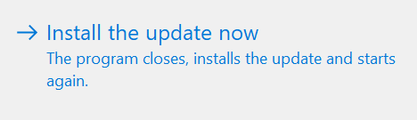

# CommandLink class
{: .no_toc }

A **CommandLink** is a wide button with an arrow, a caption in a larger font and a note in smaller text under it: the button with which the dialogs of Windows offer a choice between a few actions and say what each one does.

{:width="312" height="90"}

```tb check_build check_run arch=win32,win64
CommandLink1.Caption = "&Keep the changes"
CommandLink1.Hint = "The file is saved under its present name."
Debug.Print CommandLink1.Caption
Debug.Print CommandLink1.Hint
' Output:
' &Keep the changes
' The file is saved under its present name.
```

VB6 has no control of this kind. The control is a push button of Windows in its command link style, so it is clicked as a [**CommandButtonW**](CommandButtonW) is, and it has that control's [**Default**](#default), [**Cancel**](#cancel), [**Value**](#value), [**PerformClick**](#performclick) and [**SetShield**](#setshield).

Of the [common members](Common), the control has those under [Name and place](Common#name-and-place), [Window handles](Common#window-handles), [Font and visual styles](Common#font-and-visual-styles), [Mouse](Common#mouse) but **DblClick**, [Keyboard and focus](Common#keyboard-and-focus), [Dragging the control](Common#dragging-the-control), [OLE drag and drop](Common#ole-drag-and-drop) and [Right-to-left](Common#right-to-left), **RightToLeftLayout** included. Its [**Click**](#click) event has a meaning of its own.

* TOC
{:toc}

## A program without visual styles

Windows has the command link only for a program with visual styles. In a program without them the control makes no window: it fills its place on the form with diagonal lines, its [**hWnd**](Common#hwnd) is 0, and its properties keep what they are given and show nothing.

## Caption, note and picture

[**Caption**](#caption) is the first line, and [**Hint**](#hint) the note under it, which Windows wraps over as many lines as the control's width needs. [**GetIdealHeight**](#getidealheight) gives the height at which the caption and a note of one line fit:

```tb check_build
CommandLink1.Caption = "Install the update now"
CommandLink1.Hint = "The program closes and starts again."
CommandLink1.Height = CommandLink1.GetIdealHeight()
```

<!-- test: CommandLinkTests.GetIdealHeight_NoteThatWraps_IsHigher -->
> [!NOTE] 1.8.142.0
> **GetIdealHeight** does not count the lines that a note wraps to: it returns the same height for a note of one word and for one that the control's width breaks into three lines. A control given that height cuts off every line of the note after the first. For a longer note, set the height that shows it.

The arrow at the left gives way to a picture of the program's: the icon or bitmap in [**Picture**](#picture), or the picture of an [**ImageList**](ImageList/) control assigned to [**ImageList**](#imagelist). [**SetShield**](#setshield) puts the shield of an action that needs elevation there.

{:width="981" height="127"}

## Clicking the link

The control raises [**Click**](#click) when the user clicks it with the left mouse button, presses the space key while it has the focus, or presses the Alt key with the character that follows an `&` in the [**Caption**](#caption). The link with [**Default**](#default) set raises it for the Enter key, and the one with [**Cancel**](#cancel) set for the Esc key, whichever control of the form has the focus.

<!-- test: CommandLinkTests.Value_True_RaisesClick, CommandLinkTests.PerformClick_RaisesClick -->
A program clicks the link with [**PerformClick**](#performclick), or by setting [**Value**](#value) to **True**. **Value** is **True** only while the **Click** event runs, and **False** at every other time.
<!-- /test -->

```tb check_build
Private Sub CommandLink1_Click()
    Debug.Print "Chosen: "; CommandLink1.Caption
End Sub
```

Properties
----------

### BackColor
{: .no_toc }

The color behind the link. **OLE_COLOR**. Default: **vbButtonFace**.

### Cancel
{: .no_toc }

Whether the link is the form's cancel button, which the Esc key clicks. **Boolean**. Default: **False**.

### Caption
{: .no_toc }

The first line of the link, in the larger font. **String**. A control newly drawn on a form has its own name.

The character after an `&` is underlined, and the Alt key with that character clicks the link. Two of them, `&&`, show one `&`.

### Default
{: .no_toc }

Whether the link is the form's default button, which the Enter key clicks while no other button has the focus. **Boolean**. Default: **False**.

### Hint
{: .no_toc }

<!-- test: CommandLinkTests.Hint_KeepsUnicodeText -->
The note under the caption. **String**, in Unicode as the caption is. Default: empty, with which the link has its caption alone.
<!-- /test -->

### Hot
{: .no_toc }

Whether the mouse is over the control. **Boolean**, read-only.

<!-- test: CommandLinkTests.Hot_Assigned_Raises383 -->
Assigning to it raises run-time error 383.
<!-- /test -->

### ImageList
{: .no_toc }

The image list whose picture the control shows in place of its arrow. It holds one picture, which the control shows in every state, or one picture for each state in this order: normal, under the mouse, pressed, disabled, default or with the focus, under a pen. While an image list is assigned, [**Picture**](#picture) is not shown.

<!-- test: CommandLinkTests.ImageList_TakesAControlANameOrAHandle -->
The property takes one of three things:

- an [**ImageList**](ImageList/) control of the package. The property then returns the control.
- a **String**: the name of an **ImageList** control on the same form. The property then returns the control.
- a **Long** or a **LongLong**: the handle of an image list of Windows. The property then returns the handle.
<!-- /test -->

<!-- test: CommandLinkTests.ImageList_UnknownName_IsNothing, CommandLinkTests.ImageList_OtherObject_Raises35610, CommandLinkTests.ImageList_OtherType_Raises13 -->
**Nothing**, the handle 0, a name that no **ImageList** control on the form has, and an image list that holds no picture all leave the control without an image list: the property then returns **Nothing**. An object of another class raises run-time error 35610, and a value of another type, an **Integer** included, raises run-time error 13.
<!-- /test -->

The control has no property for the picture's side or margin, as [**CommandButtonW**](CommandButtonW#imagelistalignment) has: the picture is where the arrow was.

### Picture
{: .no_toc }

The icon or bitmap shown in place of the arrow, unless an [**ImageList**](#imagelist) is assigned. A picture object, or **Nothing** (the default) for the arrow.

### Pushed
{: .no_toc }

Whether the control is drawn as held down. **Boolean**. It is **True** while the user holds the mouse button or the space key down on the control. Setting it changes how the control is drawn and raises no event.

### Transparent
{: .no_toc }

Whether the control's background is a copy of what its container draws behind it, so that a picture or a gradient on the form shows through. **Boolean**. Default: **False**. The control takes the copy when it is first drawn, and again after a change of its size and after [**Refresh**](Common#refresh).

### Value
{: .no_toc }

Whether the link is being clicked. **Boolean**. It is the control's default property. It is **True** while the [**Click**](#click) event runs and **False** at every other time. Setting it to **True** raises **Click**, and setting it to **False** does nothing.

Methods
-------

### GetIdealHeight
{: .no_toc }

Returns the height at which the caption and a note of one line fit, in the scale units of the control's container. **Single**. See [Caption, note and picture](#caption-note-and-picture) for a note that wraps.

Syntax: *object*.**GetIdealHeight**( ) **As Single**

### PerformClick
{: .no_toc }

Clicks the link as the user would: it makes the link's form the active window, gives the link the focus, and has Windows press and release it, which raises [**Click**](#click).

Syntax: *object*.**PerformClick**

### SetShield
{: .no_toc }

Shows the shield icon that marks an action for which Windows asks the user for elevation, in place of the arrow, or removes it.

Syntax: *object*.**SetShield**( *State* ) **As Long**

*State*
: *required* A **Boolean**: **True** to show the shield, **False** to remove it and show the link's [**Picture**](#picture) or its arrow again.

The function returns what Windows returns for the request, which does not tell whether the shield is shown: it is 0 when a link with no picture gets the shield.

Events
------

### Click
{: .no_toc }

Raised when the link is clicked: by the user with the mouse or the keyboard, by [**PerformClick**](#performclick), or by setting [**Value**](#value) to **True**. See [Clicking the link](#clicking-the-link).

Syntax: *object*\_**Click**( )

### HotChanged
{: .no_toc }

Raised when the mouse moves onto the control or leaves it. [**Hot**](#hot) tells which.

Syntax: *object*\_**HotChanged**( )

## See Also

- [Common members](Common) -- the members this control shares with the package's other controls
- [CommandButtonW](CommandButtonW) class -- a push button, also with a split button and a picture beside its caption
- [LinkLabel](LinkLabel) class -- text with links in it
