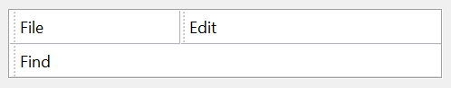

# CoolBar class
{: .no_toc }

A **CoolBar** is a bar of bands. Each band has a grip, a caption and an optional picture, and holds one control, such as a toolbar or a combo box. The user drags a band by its grip to another place, and along a row to give it more room or less.

{:width="332" height="65"}

```tb check_build check_run arch=win32,win64
CoolBar1.Bands.Clear
CoolBar1.Bands.Add , "file", "File"
CoolBar1.Bands.Add , "edit", "Edit"
CoolBar1.Bands.Add , "find", "Find", , True      ' on a row of its own
Debug.Print CoolBar1.Bands.Count; CoolBar1.RowCount
' Output:
'  3  2
```

The control stands in place of the CoolBar of the Microsoft Windows common controls 3 (`COMCT332.OCX`). The package's classes for its parts are [**CbrBands**](CbrBands), the collection of the bands, and [**CbrBand**](CbrBand), one band.

Of the [common members](../Common), the control has those under [Name and place](../Common#name-and-place) but **HelpContextID**, [Window handles](../Common#window-handles), [Font and visual styles](../Common#font-and-visual-styles), [Mouse](../Common#mouse), [Dragging the control](../Common#dragging-the-control), [OLE drag and drop](../Common#ole-drag-and-drop) and [Right-to-left](../Common#right-to-left), **RightToLeftLayout** included. It never takes the focus, so it has no keyboard events.

* TOC
{:toc}

## Bands and rows

[**Bands**](#bands) returns the collection of the bands, and [**Add**](CbrBands#add) puts a band into it. The bands lie in rows: a band starts a row where its [**NewRow**](CbrBand#newrow) is **True**, and otherwise goes after the band before it. A control newly drawn on a form has three bands, the second of them on a row of its own.

```tb check_build check_run arch=win32,win64
Dim Band As CbrBand
For Each Band In CoolBar1.Bands
    Debug.Print Band.Index; Band.NewRow
Next
Debug.Print CoolBar1.RowCount
' Output:
'  1 False
'  2 True
'  3 False
'  2
```

<!-- test: CoolBarTests.Bands_NewControl_HasThreeBandsTheSecondOnANewRow -->
The sample is a control as the form designer makes it. A form file that was saved with other bands has those bands.
<!-- /test -->

A band has two places. Its **Index** is its place in the collection, and stays when the user or the program moves the band. Its [**Position**](CbrBand#position) is its place in the cool bar, counted along the rows from the first band, and [**ItemFromPosition**](CbrBands#itemfromposition) returns the band at a position.

<!-- test: CoolBarTests.Band_Position_MovesTheBandNotItsIndex -->
```tb check_build check_run arch=win32,win64
CoolBar1.Bands.Clear
CoolBar1.Bands.Add , "file", "File"
CoolBar1.Bands.Add , "edit", "Edit"
CoolBar1.Bands("edit").Position = 1
Debug.Print CoolBar1.Bands("edit").Position; CoolBar1.Bands("edit").Index
Debug.Print CoolBar1.Bands.ItemFromPosition(1).Key
' Output:
'  1  2
' edit
```
<!-- /test -->

<!-- test: CoolBarTests.HeightChanged_BandsRemoved_FollowsResize -->
The height of a horizontal cool bar follows its rows of bands, and the width of a vertical one follows them. When it changes, the cool bar raises [**Resize**](#resize) and then [**HeightChanged**](#heightchanged).
<!-- /test -->

## Holding a control

A band holds the control that its [**Child**](CbrBand#child) names. The control has to be on the cool bar: drawn on it in the form designer, or moved onto it with **Set** *control*.**Container**. The cool bar then keeps the control in the band's area, moving and sizing it as the band moves and changes its size.

```tb check_build
Set ComboBoxW1.Container = CoolBar1          ' the combo box is now on the cool bar
Set CoolBar1.Bands(2).Child = ComboBoxW1     ' and in the second band
```

<!-- test: CoolBarTests.Band_Child_ControlNotOnTheCoolBar_Raises380, CoolBarTests.Bands_Add_ChildNotOnTheCoolBar_Raises380 -->
A control that is not on the cool bar, though it is on the same form, and the cool bar itself, raise run-time error 380 when they are given as **Child**, or as the *Child* argument of [**Add**](CbrBands#add). A band without a control has a placeholder window of the cool bar's own.
<!-- /test -->

[**MinWidth**](CbrBand#minwidth) and [**MinHeight**](CbrBand#minheight) are the smallest room the band keeps for the control, and [**IdealWidth**](CbrBand#idealwidth) the width at which the control shows everything it has. [**ContainedControls**](#containedcontrols) lists the controls on the cool bar.

## Moving and resizing by the user

The user drags a band by its grip to another place in the same row or in another row, and drags the boundary between two bands of a row to give one of them more room. [**FixedOrder**](#fixedorder) set to **True** keeps the order of the bands, though a band can still go to another row, and a band's [**Gripper**](CbrBand#gripper) says whether its grip shows. [**BandBeforeDrag**](#bandbeforedrag) is raised when a drag begins, and a handler can refuse it. [**BandAfterDrag**](#bandafterdrag) is raised when it ends, and [**LayoutChanged**](#layoutchanged) after the layout has changed. [**DblClickToggle**](#dblclicktoggle) lets a double-click on a band maximize it or minimize it, and [**MinMax**](#minmax) is raised before.

```tb check_build
Private Sub CoolBar1_BandBeforeDrag(ByVal Band As CbrBand, Cancel As Boolean)
    Cancel = (Band.Key = "menu")           ' the menu band stays where it is
End Sub
```

A band of style **CbrBandStyleFixedSize** keeps its width, and the user cannot resize it.

## The chevron

A band whose [**UseChevron**](CbrBand#usechevron) is **True** shows a chevron button when the cool bar gives it less room than its [**IdealWidth**](CbrBand#idealwidth). Pressing the button raises [**BandChevronPushed**](#bandchevronpushed) with the button's place, where the program shows the part of the band that no longer fits. [**PushChevron**](CbrBand#pushchevron) presses it from code.

```tb check_build
Private Sub CoolBar1_BandChevronPushed(ByVal Band As CbrBand, ByVal Left As Single, ByVal Top As Single, ByVal Width As Single, ByVal Height As Single)
    Debug.Print Band.Key; Left; Top
End Sub
```

## Appearance

[**BandBorders**](#bandborders) draws a line between the bands, and [**BorderStyle**](#borderstyle) a border around the cool bar. [**Picture**](#picture) is a bitmap that fills the background of the bands, and a band's [**FixedBackground**](CbrBand#fixedbackground) says whether the picture moves with the band or stays fixed to the cool bar. A band takes the cool bar's picture and colors unless its [**UseCoolBarPicture**](CbrBand#usecoolbarpicture) or [**UseCoolBarColors**](CbrBand#usecoolbarcolors) is **False**. A program with visual styles draws the bands in the style of Windows, and the cool bar's **BackColor** then has no effect.

[**ImageList**](#imagelist) gives the bands their pictures, which a band names by its [**Image**](CbrBand#image). [**Orientation**](#orientation) set to **CbrOrientationVertical** makes the cool bar a column of bands, with the grips on top of the bands unless [**VerticalGripper**](#verticalgripper) is **True**.

## Finding a band

[**HitTest**](#hittest) returns the band at a point, and says what part of the band it is: the grip, the caption, the area of the control, the chevron, or the boundary between two bands.

```tb check_build
Private Sub CoolBar1_MouseDown(Button As Integer, Shift As Integer, X As Single, Y As Single)
    Dim Band As CbrBand, Part As CbrHitResultConstants
    Set Band = CoolBar1.HitTest(X, Y, Part)
    If Not Band Is Nothing Then Debug.Print Band.Key; Part
End Sub
```

With [**MouseTrack**](../Common#mousetrack) set to **True** the cool bar raises [**BandMouseEnter**](#bandmouseenter) and [**BandMouseLeave**](#bandmouseleave) as well.

<!-- test: CoolBarTests.BandMouseEnter_MouseTrackTrue_RaisedAfterMouseEnterAndBeforeMouseLeave, CoolBarTests.Click_AMouseClick_IsRaisedAfterMouseUp -->
When the pointer moves onto a band from outside the cool bar, **MouseEnter** comes first, then **BandMouseEnter**. When it leaves the cool bar, **BandMouseLeave** comes before **MouseLeave**. A click raises **MouseDown**, **MouseUp** and then **Click**.
<!-- /test -->

Properties
----------

### Align
{: .no_toc }

The edge of the form that the control is attached to, where it takes the form's whole width or height. A member of [**AlignConstants**](../../../VBRUN/Constants/AlignConstants). Default: **vbAlignNone**.

<!-- test: sample coolbar-align -->
> [!NOTE] 1.8.137.0, BETA 1042
> twinBASIC has not implemented **Align**: an assignment compiles with the warning TB0009 and changes nothing, and the property goes on returning **vbAlignNone**. A program places and sizes the cool bar itself.

```tb probe check_run arch=win32,win64 id=coolbar-align
CoolBar1.Align = vbAlignTop
Debug.Print CoolBar1.Align
' Output:
'  0
```

### BackColor
{: .no_toc }

The color behind the bands. **OLE_COLOR**. Default: **vbButtonFace**. It shows only while the control is drawn without visual styles, with [**VisualStyles**](../Common#visualstyles) set to **False**.

### BandBorders
{: .no_toc }

Whether a line is drawn between the bands. **Boolean**. Default: **True**.

### Bands
{: .no_toc }

The collection of the bands. A [**CbrBands**](CbrBands) object, read-only.

### BorderStyle
{: .no_toc }

Whether the cool bar has a border of one line. **Integer**: 0 for none or 1 for a line (the default).

<!-- test: CoolBarTests.Band_Properties_ValuesOutOfRange_Raise380 -->
Another value raises run-time error 380.
<!-- /test -->

### ContainedControls
{: .no_toc }

The controls that were put onto the cool bar. A [**ContainedControls**](../../../VBRUN/ContainedControls/) collection, read-only.

### DblClickToggle
{: .no_toc }

Whether the cool bar maximizes or minimizes a band when the user double-clicks it. **Boolean**. Default: **False**.

### DoubleBuffer
{: .no_toc }

Whether the cool bar paints in a bitmap and draws that, which avoids flicker. **Boolean**. Default: **True**.

### FixedOrder
{: .no_toc }

Whether the user is kept from moving the bands to other places. **Boolean**. Default: **False**.

### ForeColor
{: .no_toc }

The color of the captions of the bands. **OLE_COLOR**. Default: **vbButtonText**.

### hWndToolTip
{: .no_toc }

The handle of the window that shows the bands' tips. **LongPtr**, read-only. It is 0 until [**ShowTips**](#showtips) has been set to **True**.

### ImageList
{: .no_toc }

The image list whose pictures the bands show. A **Variant**: an [**ImageList**](../ImageList/) control, the handle of an image list as a **Long**, or the name of an **ImageList** control on the same form as a string. Reading it returns what was assigned, or **Nothing**. A name that no such control has, and **Nothing**, take the image list away.

<!-- test: CoolBarTests.ImageList_AnotherObject_Raises35610 -->
A control that is not an **ImageList** raises run-time error 35610, and a value of another type raises error 13.
<!-- /test -->

An image list that has no picture is not taken, as [**ImageList**](../ImageList/#giving-the-list-to-a-control) says.

### Orientation
{: .no_toc }

Whether the bands run in rows or in columns. A member of [**CbrOrientationConstants**](#cbrorientationconstants). Default: **CbrOrientationHorizontal**.

<!-- test: CoolBarTests.Orientation_Vertical_ExchangesWidthAndHeight, CoolBarTests.Band_Properties_ValuesOutOfRange_Raise380 -->
A change exchanges the cool bar's width and height. A value that is not a member raises run-time error 380.
<!-- /test -->

### Picture
{: .no_toc }

A bitmap that fills the background of the bands. A picture object. Default: **Nothing**. A band shows it while its [**UseCoolBarPicture**](CbrBand#usecoolbarpicture) is **True**.

### RowCount
{: .no_toc }

The number of rows of bands. **Long**, read-only.

### ShowTips
{: .no_toc }

Whether the cool bar shows the [**ToolTipText**](CbrBand#tooltiptext) of a band in a small window when the pointer rests on the band's caption. **Boolean**. Default: **False**.

### VariantHeight
{: .no_toc }

Whether the bands of a row can have different heights. **Boolean**. Default: **True**. With **False** a row is as high as the highest band, and all its bands that high.

### VerticalGripper
{: .no_toc }

Whether the grip of a band in a vertical cool bar is drawn upright, beside the band's contents, instead of lying along the band's top. **Boolean**. Default: **False**.

Methods
-------

### HitTest
{: .no_toc }

Returns the band at a point, and says which part of it the point is on.

Syntax: *object*.**HitTest**( *X*, *Y* [, *HitResult* ] ) **As CbrBand**

*X*, *Y*
: *required* **Single**: the point, in the container's scale units, measured from the cool bar's top left corner.

*HitResult*
: *optional* A member of [**CbrHitResultConstants**](#cbrhitresultconstants), by reference: the part of the band that the point is on.

<!-- test: CoolBarTests.HitTest_PointOnABand_ReturnsTheBand -->
Where no band is at the point, the method returns **Nothing** and leaves *HitResult* as it was.
<!-- /test -->

Events
------

### BandAfterDrag
{: .no_toc }

Raised when the user has dragged a band to another place.

Syntax: *object*\_**BandAfterDrag**( *Band* **As CbrBand**, *NewPosition* **As Long** )

*Band*
: The band.

*NewPosition*
: The [**Position**](CbrBand#position) the band has now.

### BandBeforeDrag
{: .no_toc }

Raised when the user begins to drag a band.

Syntax: *object*\_**BandBeforeDrag**( *Band* **As CbrBand**, *Cancel* **As Boolean** )

*Band*
: The band.

*Cancel*
: By reference. A handler sets it to **True** to stop the drag.

### BandChevronPushed
{: .no_toc }

Raised when the user presses the chevron button of a band, or the program does with [**PushChevron**](CbrBand#pushchevron). See [The chevron](#the-chevron).

Syntax: *object*\_**BandChevronPushed**( *Band* **As CbrBand**, *Left* **As Single**, *Top* **As Single**, *Width* **As Single**, *Height* **As Single** )

*Band*
: The band.

*Left*, *Top*, *Width*, *Height*
: The place of the chevron button, in the container's scale units.

### BandMouseEnter
{: .no_toc }

Raised while [**MouseTrack**](../Common#mousetrack) is **True**, when the pointer moves onto a band.

Syntax: *object*\_**BandMouseEnter**( *Band* **As CbrBand** )

*Band*
: The band.

### BandMouseLeave
{: .no_toc }

Raised while [**MouseTrack**](../Common#mousetrack) is **True**, when the pointer moves off a band.

Syntax: *object*\_**BandMouseLeave**( *Band* **As CbrBand** )

*Band*
: The band.

### HeightChanged
{: .no_toc }

Raised when the cool bar's height changes, for a horizontal cool bar, or its width, for a vertical one, because the rows of bands need more or less room.

Syntax: *object*\_**HeightChanged**( *NewHeight* **As Single** )

*NewHeight*
: The new height, in the container's scale units.

### LayoutChanged
{: .no_toc }

Raised when the user has changed the layout of the bands.

Syntax: *object*\_**LayoutChanged**( )

### MinMax
{: .no_toc }

Raised before the user maximizes or minimizes a band.

Syntax: *object*\_**MinMax**( *Cancel* **As Boolean** )

*Cancel*
: By reference. A handler sets it to **True** to stop the change.

### Resize
{: .no_toc }

Raised when the size of the cool bar changes, also where the cool bar changes its own height to that of its rows of bands.

Syntax: *object*\_**Resize**( )

## CbrBandGripperConstants
{: #cbrbandgripperconstants }

The values of the [**Gripper**](CbrBand#gripper) of a band.

| Member | Value | Description |
|---|---|---|
| **CbrBandGripperNormal**{: #CbrBandGripperConstants_CbrBandGripperNormal } | 0 | The grip shows on a band that the user can move or resize. |
| **CbrBandGripperAlways**{: #CbrBandGripperConstants_CbrBandGripperAlways } | 1 | The grip shows on the band always, also where it could not be dragged. |
| **CbrBandGripperNever**{: #CbrBandGripperConstants_CbrBandGripperNever } | 2 | The band has no grip. |

## CbrBandStyleConstants
{: #cbrbandstyleconstants }

The values of the [**Style**](CbrBand#style) of a band.

| Member | Value | Description |
|---|---|---|
| **CbrBandStyleNormal**{: #CbrBandStyleConstants_CbrBandStyleNormal } | 0 | The user can resize the band. |
| **CbrBandStyleFixedSize**{: #CbrBandStyleConstants_CbrBandStyleFixedSize } | 1 | The band keeps its size. |

## CbrHitResultConstants
{: #cbrhitresultconstants }

The values that [**HitTest**](#hittest) gives for the part of a band.

| Member | Value | Description |
|---|---|---|
| **CbrHitResultNoWhere**{: #CbrHitResultConstants_CbrHitResultNoWhere } | 0 | No part of a band. |
| **CbrHitResultCaption**{: #CbrHitResultConstants_CbrHitResultCaption } | 1 | The band's caption. |
| **CbrHitResultClient**{: #CbrHitResultConstants_CbrHitResultClient } | 2 | The area of the band that holds its control. |
| **CbrHitResultGrabber**{: #CbrHitResultConstants_CbrHitResultGrabber } | 3 | The band's grip. |
| **CbrHitResultChevron**{: #CbrHitResultConstants_CbrHitResultChevron } | 4 | The band's chevron button. |
| **CbrHitResultSplitter**{: #CbrHitResultConstants_CbrHitResultSplitter } | 5 | The boundary between two bands of a row. |

## CbrOrientationConstants
{: #cbrorientationconstants }

The values of [**Orientation**](#orientation).

| Member | Value | Description |
|---|---|---|
| **CbrOrientationHorizontal**{: #CbrOrientationConstants_CbrOrientationHorizontal } | 0 | The bands lie in rows. |
| **CbrOrientationVertical**{: #CbrOrientationConstants_CbrOrientationVertical } | 1 | The bands lie in columns. |

## See Also

- [CbrBands](CbrBands) class -- the collection of the bands
- [CbrBand](CbrBand) class -- one band
- [ImageList](../ImageList/) class -- the pictures of the bands
- [Common members](../Common) -- the members this control shares with the package's other controls
