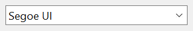
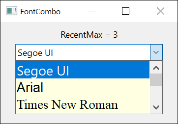

# FontCombo class
{: .no_toc }

A **FontCombo** is a combo box that lists the fonts installed in Windows, each name written in its own font, as the font box of a word processor does. It keeps a list of the fonts the user chose last, and can feed a second **FontCombo** with the sizes of the chosen font.

{:width="212" height="35"}

```tb check_build check_run arch=win32,win64
FontCombo1.ListIndex = 0                 ' the first font of the list
Debug.Print FontCombo1.ListCount > 0
Debug.Print FontCombo1.Text = FontCombo1.List(0)
' Output:
' True
' True
```

The control is made of the combo box of Windows, as [**ComboBoxW**](ComboBoxW) is, and has many of its members: [**ListIndex**](#listindex), [**List**](#list), [**ListCount**](#listcount), [**Text**](#text), [**DroppedDown**](#droppeddown) and others. The program does not add the items, though: the control fills its list with the fonts, so it has no **AddItem**, **RemoveItem** or **Clear**.

Of the [common members](Common), the control has every member under [Name and place](Common#name-and-place), [Window handles](Common#window-handles), [Font and visual styles](Common#font-and-visual-styles), [Mouse](Common#mouse), [Keyboard and focus](Common#keyboard-and-focus), [Dragging the control](Common#dragging-the-control), [OLE drag and drop](Common#ole-drag-and-drop) and [Right-to-left](Common#right-to-left) but **RightToLeftLayout**. Its [**Click**](#click) and [**DblClick**](#dblclick) have a meaning of their own, and its [mouse events](#mousedown-mousemove-mouseup) give the position in twips.

* TOC
{:toc}

## The list of fonts

The control fills its list when it is made, with the name of each font that Windows lists for the ANSI and for the symbol character sets, in alphabetical order. A name that starts with `@`, which Windows uses for a font written from top to bottom, is left out. [**FontType**](#fonttype) decides which kinds of font are listed, and [**FontPitch**](#fontpitch) whether the list has the fonts of fixed width, the fonts of variable width, or both.

<!-- test: FontComboTests.FontPitch_Fixed_ListsSomeOfTheFonts, FontComboTests.FontPitch_Changed_BuildsTheListAgain -->
A change of **FontType** or **FontPitch** fills the list again. The selection is lost: [**ListIndex**](#listindex) becomes -1.
<!-- /test -->

```tb check_build check_run arch=win32,win64
Dim All As Long, Fixed As Long
With FontCombo1
    All = .ListCount
    .FontPitch = FtcFontPitchFixed
    Fixed = .ListCount
    Debug.Print Fixed > 0
    Debug.Print Fixed <= All
    .FontPitch = FtcFontPitchAll
    Debug.Print .ListCount = All
End With
' Output:
' True
' True
' True
```

The font of the control, [**Font**](Common#font), is the font of the text box. In the list each name is written in its own font, in a size that fits the height of an item, [**ItemHeight**](#itemheight).

[**ListCount**](#listcount) is the number of names in the list, and [**List**](#list) is one name, by its index from 0. With [**RecentMax**](#recentmax) greater than 0 a name can appear twice.

## The selection and the text

[**ListIndex**](#listindex) is the index of the selected font, or -1 when none is selected. [**Text**](#text) is the name of the selected font on a control with the style **FtcStyleDropDownList**, which is the default style, and the text in the text box on the other styles, where the user can type a name.

<!-- test: FontComboTests.ListIndex_Assigned_SetsTextAndRaisesClick, FontComboTests.ListIndex_MinusOne_RemovesTheSelection, FontComboTests.Text_DropDownList_Assigned_SelectsTheFont -->
Selecting a font, by the user or by an assignment to **ListIndex**, raises [**Click**](#click), unless the font was selected already. On a **FtcStyleDropDownList** control an assignment to **Text** selects the font of that name, regardless of case, and raises **Click** too.
<!-- /test -->

```tb check_build check_run arch=win32,win64
Dim Name As String
With FontCombo1
    Name = .List(2)
    .ListIndex = 2
    Debug.Print .Text = Name
    .ListIndex = -1
    Debug.Print "[" & .Text & "]"
    .Text = Name
    Debug.Print .List(.ListIndex) = Name
End With
' Output:
' True
' []
' True
```

[**FindItem**](#finditem) returns the index of a font by its name, and [**SelectItem**](#selectitem) selects the first font whose name begins with a text. Neither regards case.

<!-- test: FontComboTests.FindItem_WholeNameOrBeginning, FontComboTests.SelectItem_SelectsTheFontThatBeginsWithTheText -->
```tb check_build check_run arch=win32,win64
Dim Name As String
Name = FontCombo1.List(3)
Debug.Print FontCombo1.FindItem(UCase$(Name)) <= 3
Debug.Print FontCombo1.FindItem(Left$(Name, 2), , True) <= 3
Debug.Print FontCombo1.FindItem("no such font")
' Output:
' True
' True
' -1
```
<!-- /test -->

On a control with a text box, [**AutoSelect**](#autoselect) selects a font as soon as the user has typed its whole name.

## Recent fonts

With [**RecentMax**](#recentmax) greater than 0 the list starts with the fonts that the user chose last, drawn in [**RecentBackColor**](#recentbackcolor) and [**RecentForeColor**](#recentforecolor), and the complete list follows, so that a recent font is in the list twice. [**RecentCount**](#recentcount) is the number of recent fonts, and [**ListCount**](#listcount) and [**List**](#list) count them too.

{:width="241" height="169"}

<!-- test: FontComboTests.Recent_UserPicksAFont_IsAddedAtTheTop, FontComboTests.Recent_PicksBeyondRecentMax_DropTheOldest, FontComboTests.Recent_OriginalOfARecentFont_MovesToTheTop, FontComboTests.Recent_APickedRecentFont_IsNotMoved, FontComboTests.Recent_ListIndexAssigned_AddsNothing -->
A font that the user chooses from the complete list is added at the top of the recent fonts, as the most recent one; when the recent fonts already have **RecentMax** of them, the oldest goes. A font that is already among the recent fonts moves to the top, when the user chooses it from the complete list. Choosing a recent font does not change the order. A font selected by the program, with **ListIndex**, **Text** or **SelectItem**, is not added.
<!-- /test -->

[**SaveRecent**](#saverecent) and [**RestoreRecent**](#restorerecent) let a program keep the recent fonts between two runs, for instance in a file or in the registry:

<!-- test: FontComboTests.RestoreRecent_Names_BecomeTheRecentFonts, FontComboTests.SaveRecent_ReturnsTheNamesMostRecentFirst, FontComboTests.ClearRecent_RemovesTheRecentFonts -->
```tb check_build check_run arch=win32,win64
Dim Saved As Variant, First As String
With FontCombo1
    .RecentMax = 3
    First = .List(10)
    .RestoreRecent Array(First, .List(4))
    Debug.Print .RecentCount
    Debug.Print .List(0) = First
    Saved = .SaveRecent
    Debug.Print UBound(Saved) - LBound(Saved) + 1
    .ClearRecent
    Debug.Print .RecentCount
End With
' Output:
'  2
' True
'  2
'  0
```
<!-- /test -->

## A box of sizes

[**BuddyControl**](#buddycontrol) joins a second **FontCombo** to this one. The second control then lists the sizes, in points, of the font that is selected here. It lists 8, 9, 10, 11, 12, 14, 16, 18, 20, 22, 24, 26, 28, 36, 48 and 72 for a TrueType font, and for another font the sizes from 6 to 72 that the font has. It is empty while this control has no text. The buddy is usually a control with the style **FtcStyleDropDownCombo**, so that the user can also type a size. Its text box takes digits only, and its own **RecentMax** has no effect.

<!-- test: FontComboTests.BuddyControl_NoSelectedFont_HasNoSizes, FontComboTests.BuddyControl_SelectedSize_IsKept -->
The buddy's list changes whenever the selection of this control changes by the user or by an assignment to **ListIndex** or **Text**. It keeps its own selected size, when the new list has it.
<!-- /test -->

<!-- test: FontComboTests.SelectItem_UpdatesTheBuddy -->
> [!WARNING] 1.8.140.0
> A font selected with [**SelectItem**](#selectitem) does not change the list of the buddy, which then shows the sizes of the font selected before, or none. A program that uses a buddy selects a font with **ListIndex** or **Text**.

```tb hidden
Private SecondForm As frmFontCombo
Public Property Get FontCombo2() As VBCCR18.FontCombo
    If SecondForm Is Nothing Then
        Set SecondForm = New frmFontCombo
        Load SecondForm
    End If
    Set FontCombo2 = SecondForm.FontCombo1
End Property
```

In this sample **FontCombo2** is a second **FontCombo**, on the same form as **FontCombo1**:

<!-- test: FontComboTests.BuddyControl_Assigned_ListsTheSizesOfTheSelectedFont -->
```tb check_build check_run arch=win32,win64
FontCombo1.BuddyControl = FontCombo2     ' FontCombo2 lists the sizes
FontCombo1.ListIndex = 4                 ' a font name
Debug.Print FontCombo2.ListCount
Debug.Print FontCombo2.List(0) & " " & FontCombo2.List(FontCombo2.ListCount - 1)
' Output:
'  16
' 8 72
```
<!-- /test -->

Properties
----------

### AlwaysFindExact
{: .no_toc }

Whether the control looks in its list for whole names only. **Boolean**. Default: **False**, with which the list, when it opens, selects the first font whose name begins with the text in the text box. With **True** it selects only a font whose whole name is that text. It matters to a control with a text box.

### AutoSelect
{: .no_toc }

Whether the control selects a font as soon as the user has typed its whole name. **Boolean**. Default: **True**. It has no effect on a **FtcStyleDropDownList** control, which has no text box.

### BackColor
{: .no_toc }

The background color of the text box and of the list. **OLE_COLOR**. A new control has **vbWindowBackground**.

### BuddyControl
{: .no_toc }

The **FontCombo** that lists the sizes of the font selected in this one. **Variant**. Default: none. See [A box of sizes](#a-box-of-sizes).

An assignment takes a **FontCombo** control, or the name of a **FontCombo** control on the same form as a **String**. A name that no **FontCombo** has leaves the control without a buddy, with no error. An object that is not a **FontCombo** raises run-time error 35610, and a value of another type raises 13. A control that is already the buddy of another one cannot be a buddy again, and an assignment of such a control leaves this one without a buddy.

<!-- test: FontComboTests.BuddyControl_Object_IsReturned, FontComboTests.BuddyControl_Nothing_RemovesTheBuddy, FontComboTests.BuddyControl_NotAFontCombo_Raises35610, FontComboTests.BuddyControl_AnotherType_Raises13 -->
Reading the property returns the buddy, or **Nothing**. An assignment of **Nothing** removes the buddy, which then lists fonts again.
<!-- /test -->

### DropDownWidth
{: .no_toc }

The least width of the drop-down list, in the scale units of the control's container. **Single**. The list is never narrower than the control. On a **FtcStyleSimpleCombo** control, which has no drop-down list, the property raises run-time error 5.

<!-- test: FontComboTests.DropDownWidth_Negative_Raises380, FontComboTests.DropDownWidth_Assigned_WidensTheList -->
A negative value raises run-time error 380. A value wider than the control makes the list that wide.
<!-- /test -->

### DroppedDown
{: .no_toc }

Whether the drop-down list is open. **Boolean**. An assignment opens or closes it. The control raises [**DropDown**](#dropdown) before the list opens, and [**CloseUp**](#closeup) after it has closed.

### ExtendedUI
{: .no_toc }

Whether the control uses the extended keyboard interface of the Windows combo box. **Boolean**. Default: **False**. With **True** the Down Arrow key opens the list, the F4 key does not, and the mouse wheel does not change the selection while the list is closed. It has no effect on a **FtcStyleSimpleCombo** control.

### FieldHeight
{: .no_toc }

The height of the text box, or of the field of a **FtcStyleDropDownList** control, in the scale units of the control's container. **Single**, read-only.

### FontPitch
{: .no_toc }

Which fonts the list has, by the width of their characters. A member of [**FtcFontPitchConstants**](#ftcfontpitchconstants). Default: **FtcFontPitchAll**. A change fills the list again: see [The list of fonts](#the-list-of-fonts).

<!-- test: FontComboTests.FontPitch_NotAMember_Raises380 -->
A value that is not a member raises run-time error 380.
<!-- /test -->

### FontType
{: .no_toc }

Which kinds of font the list has. A member of [**FtcFontTypeConstants**](#ftcfonttypeconstants). Default: **FtcFontTypeTrueType**. A change fills the list again: see [The list of fonts](#the-list-of-fonts).

<!-- test: FontComboTests.FontType_NotAMember_Raises380 -->
A value that is not a member raises run-time error 380.
<!-- /test -->

### ForeColor
{: .no_toc }

The color of the text in the text box and in the list. **OLE_COLOR**. A control newly drawn on a form has black.

### HorizontalExtent
{: .no_toc }

The width over which the list can be scrolled sideways, in the scale units of the control's container. **Single**. Default: 0. The list has a horizontal scroll bar while this is greater than its own width. [**GetIdealHorizontalExtent**](#getidealhorizontalextent) returns the value that fits the widest name. A negative value raises run-time error 380.

### hWndEdit
{: .no_toc }

The handle of the text box inside the control. **LongPtr**, read-only. It is 0 on a **FtcStyleDropDownList** control. [**hWnd**](Common#hwnd) is the handle of the combo box.

### hWndList
{: .no_toc }

The handle of the list. **LongPtr**, read-only.

### IMEMode
{: .no_toc }

The state of the Input Method Editor while the text box has the focus. A member of [**CCIMEModeConstants**](Common#ccimemodeconstants). Default: **CCIMEModeNoControl**. Another value raises run-time error 380.

### IntegralHeight
{: .no_toc }

Whether the list shows whole items only. **Boolean**. Default: **True**, with which the list makes itself a little lower so that its last item is not cut.

<!-- test: FontComboTests.IntegralHeight_AtRunTime_Raises382 -->
It is set at design time: an assignment at run time raises run-time error 382.
<!-- /test -->

### ItemData
{: .no_toc }

A number of the program's own that an entry of the list holds. **LongPtr**. A new entry has 0.

Syntax: *object*.**ItemData**( *Index* ) [ = *value* ]

<!-- test: FontComboTests.ItemData_NoSuchEntry_Raises381, FontComboTests.ItemData_Assigned_IsKept -->
An *Index* that is not an entry raises run-time error 381.
<!-- /test -->

### ItemHeight
{: .no_toc }

The height of an item in the list, in the scale units of the control's container. **Single**, read-only. It follows the [**Font**](Common#font) of the control.

### List
{: .no_toc }

The name of a font in the list, including the recent fonts. **String**, read-only.

Syntax: *object*.**List**( *Index* )

<!-- test: FontComboTests.List_NoSuchEntry_Raises5 -->
An *Index* that is not an entry of the list raises run-time error 5.
<!-- /test -->

### ListCount
{: .no_toc }

The number of entries in the list, the recent fonts included. **Long**, read-only.

### ListIndex
{: .no_toc }

The index of the selected entry, or -1 when none is selected. **Long**. Default: -1. An assignment selects the entry, raises [**Click**](#click) unless it was selected already, and updates the [**BuddyControl**](#buddycontrol). -1 removes the selection.

<!-- test: FontComboTests.ListIndex_NoSuchEntry_Raises380 -->
A value that is not an entry of the list raises run-time error 380.
<!-- /test -->

### Locked
{: .no_toc }

Whether the user is kept from changing the text and the selection. **Boolean**. Default: **False**. With **True** the text box takes no typing, and the list does not respond to the keyboard or to the mouse on its items. The program can still assign [**Text**](#text) and [**ListIndex**](#listindex).

### MaxDropDownItems
{: .no_toc }

The greatest number of items that the drop-down list shows without scrolling. **Integer**. Default: 9.

<!-- test: FontComboTests.MaxDropDownItems_OutOfRange_Raises380 -->
A value less than 1 or greater than 30 raises run-time error 380.
<!-- /test -->

### MaxLength
{: .no_toc }

The greatest number of characters that the user can type in the text box. **Long**. Default: 0, with which the user can type 255 characters. A text that the program assigns to [**Text**](#text) loses what is beyond **MaxLength**, when it is greater than 0. It has no effect on a **FtcStyleDropDownList** control.

<!-- test: FontComboTests.MaxLength_Negative_Raises380 -->
A negative value raises run-time error 380.
<!-- /test -->

### OLEDragMode
{: .no_toc }

Whether the user can drag the selected text out of the text box. A member of [**OLEDragConstants**](../../VBRUN/Constants/OLEDragConstants). Default: **vbOLEDragManual**, with which only [**OLEDrag**](Common#oledrag) starts a drag. With **vbOLEDragAutomatic** a drag that begins on the selected text carries it as text, to copy or to move; the control removes text that was moved. Another value raises run-time error 380.

### RecentBackColor
{: .no_toc }

The background color of the recent fonts in the list. **OLE_COLOR**. Default: **vbInfoBackground**.

### RecentCount
{: .no_toc }

The number of recent fonts at the top of the list. **Long**, read-only.

### RecentForeColor
{: .no_toc }

The color of the names of the recent fonts in the list. **OLE_COLOR**. Default: **vbInfoText**.

### RecentMax
{: .no_toc }

The greatest number of recent fonts. **Integer**. Default: 0, with which the list has no recent fonts. See [Recent fonts](#recent-fonts).

<!-- test: FontComboTests.RecentMax_OutOfRange_Raises380, FontComboTests.RecentMax_Lowered_DropsTheOldest -->
A value less than 0 or greater than 9 raises run-time error 380. A smaller value than the number of recent fonts removes the oldest ones.
<!-- /test -->

### ScrollTrack
{: .no_toc }

Whether the list scrolls while the user drags the scroll box of its scroll bar. **Boolean**. Default: **True**. With **False** the list scrolls when the user releases the scroll box.

### SelLength
{: .no_toc }

The number of characters selected in the text box. **Long**. A negative value raises run-time error 380. It does nothing on a **FtcStyleDropDownList** control.

### SelStart
{: .no_toc }

The position where the selection in the text box starts, counted from 0, or the position of the caret when nothing is selected. **Long**. An assignment puts the caret there and selects nothing. A negative value raises run-time error 380. It does nothing on a **FtcStyleDropDownList** control.

### SelText
{: .no_toc }

The selected text of the text box. **String**. An assignment replaces the selection, or inserts the text at the caret.

<!-- test: FontComboTests.SelText_DropDownList_Raises380 -->
On a **FtcStyleDropDownList** control the property raises run-time error 380.
<!-- /test -->

### Style
{: .no_toc }

What the control is made of. A member of [**FtcStyleConstants**](#ftcstyleconstants). Default: **FtcStyleDropDownList**, unlike the other combo boxes of the package.

<!-- test: FontComboTests.Defaults_OfANewControl -->
A new control has the style **FtcStyleDropDownList**, no recent font and no selected font.
<!-- /test -->

<!-- test: FontComboTests.Style_AtRunTime_Raises382, FontComboTests.Style_NotAMember_Raises380 -->
It is set at design time. At run time an assignment raises run-time error 382, and a value that is not a member raises 380.
<!-- /test -->

### Text
{: .no_toc }

The name of the selected font, or the text in the text box. **String**. See [The selection and the text](#the-selection-and-the-text).

On a **FtcStyleDropDownList** control the text is that of the selected entry, and an empty string when none is selected. An assignment selects the first entry that has this text, regardless of case.

<!-- test: FontComboTests.Text_DropDownList_UnknownName_Raises383 -->
A text that no entry has raises run-time error 383.
<!-- /test -->

On a **FtcStyleDropDownCombo** or **FtcStyleSimpleCombo** control an assignment puts the text into the text box, cut to [**MaxLength**](#maxlength), and raises [**Change**](#change) when the text is another one.

### TopIndex
{: .no_toc }

The index of the entry at the top of the list. **Long**. An assignment scrolls the list.

<!-- test: FontComboTests.TopIndex_OutOfRange_Raises380 -->
A value that is not an entry raises run-time error 380.
<!-- /test -->

Methods
-------

### ClearRecent
{: .no_toc }

Removes every recent font from the list.

Syntax: *object*.**ClearRecent**

### FindItem
{: .no_toc }

Returns the index of the first entry of the list that has a name, or -1 when there is none. The search does not regard case.

Syntax: *object*.**FindItem**( *Text* [, *Index* [, *Partial* ] ] ) **As Long**

*Text*
: *required* A **String**: the name to look for.

*Index*
: *optional* A **Long**: the entry after which the search starts. The search goes to the end of the list and on from its top, so this entry is the last one looked at. The default, -1, searches from the top. A value that is not an entry raises run-time error 381.

*Partial*
: *optional* A **Boolean**: **True** finds an entry whose name begins with *Text*, **False** (the default) one whose whole name is *Text*.

<!-- test: FontComboTests.FindItem_IndexOutOfRange_Raises381, FontComboTests.FindItem_StartsAfterIndex_AndWraps -->
A search from an *Index* that goes round the list finds the entry at *Index* itself when no other has the name.
<!-- /test -->

### GetIdealHorizontalExtent
{: .no_toc }

Returns the [**HorizontalExtent**](#horizontalextent) with which the widest name can be scrolled into view, as a **Single** in the scale units of the control's container. It returns 0 for an empty list.

Syntax: *object*.**GetIdealHorizontalExtent**

<!-- test: FontComboTests.GetIdealHorizontalExtent_ListWithFonts_IsGreaterThanZero -->
It is greater than 0 for a list that has fonts.
<!-- /test -->

### RestoreRecent
{: .no_toc }

Makes the recent fonts the names in an array, as [**SaveRecent**](#saverecent) returned it. The recent fonts that the control had are removed first.

Syntax: *object*.**RestoreRecent** *ArgList*

*ArgList*
: *required* A **Variant** that holds a one-dimensional array of strings, the most recent first. **Empty** removes the recent fonts, as [**ClearRecent**](#clearrecent) does.

<!-- test: FontComboTests.RestoreRecent_NotAnArray_Raises380, FontComboTests.RestoreRecent_TwoDimensionalArray_Raises5, FontComboTests.RestoreRecent_UnallocatedArray_Raises91 -->
A value that is not an array raises run-time error 380, an array of two dimensions raises 5, and an array that is not allocated raises 91.
<!-- /test -->

<!-- test: FontComboTests.RestoreRecent_UnknownNames_AreSkipped, FontComboTests.RestoreRecent_NamesBeyondRecentMax_AreNotTaken -->
An empty string, and a name that is not in the list, is skipped, and the names beyond [**RecentMax**](#recentmax) are not taken.
<!-- /test -->

<!-- test: FontComboTests.RestoreRecent_UnknownNameBeforeAKnownOne_KeepsTheKnownOnes -->
> [!WARNING] 1.8.140.0
> A name that the list does not have, followed by a name that it has, leaves the recent fonts wrong. [**RecentCount**](#recentcount) counts every name that was found, but the list gets no entry for the names after the unknown one, so the control takes the first fonts of the complete list for recent ones and draws them in the colors of the recent fonts. An array that [**SaveRecent**](#saverecent) returned on a machine with other fonts can hold such a name. A program removes the names that [**FindItem**](#finditem) does not find before it calls **RestoreRecent**.

<!-- test: FontComboTests.RestoreRecent_RecentMaxZero_KeepsTheFonts -->
> [!WARNING] 1.8.140.0
> With [**RecentMax**](#recentmax) at 0, its default, **RestoreRecent** removes fonts from the list: as many from its top as the array has names, so that [**ListCount**](#listcount) is smaller and the first fonts are missing. A program sets **RecentMax** before it calls **RestoreRecent**.

### SaveRecent
{: .no_toc }

Returns the names of the recent fonts, the most recent first, as a **Variant** that holds a zero-based array of strings. It returns **Empty** when there are none.

Syntax: *object*.**SaveRecent** **As Variant**

### SelectItem
{: .no_toc }

Selects the first entry of the list whose name begins with a text, and returns its index. When no entry does, it returns -1 and the selection stays. The search does not regard case. The method raises [**Click**](#click) when it selects another entry than before. It does not update the [**BuddyControl**](#buddycontrol).

Syntax: *object*.**SelectItem**( *Text* [, *Index* ] ) **As Long**

*Text*
: *required* A **String**: the beginning of the name.

*Index*
: *optional* A **Long**: the entry after which the search starts, as in [**FindItem**](#finditem). A value that is not an entry raises run-time error 381.

<!-- test: FontComboTests.SelectItem_IndexOutOfRange_Raises381, FontComboTests.SelectItem_NoMatch_ReturnsMinusOne -->
A name that no entry begins with leaves the selection as it was.
<!-- /test -->

Events
------

### Change
{: .no_toc }

Raised when the text in the text box has changed: by the user's typing, or by an assignment to [**Text**](#text) of another text. A **FtcStyleDropDownList** control has no text box and does not raise it.

Syntax: *object*\_**Change**( )

### Click
{: .no_toc }

Raised when another entry has been selected: by the user, with the mouse or the keyboard, or by [**ListIndex**](#listindex), [**SelectItem**](#selectitem) or, on a **FtcStyleDropDownList** control, [**Text**](#text).

Syntax: *object*\_**Click**( )

### CloseUp
{: .no_toc }

Raised when the drop-down list has closed.

Syntax: *object*\_**CloseUp**( )

### ContextMenu
{: .no_toc }

Raised when the user asks for the control's shortcut menu, with the right mouse button or with Shift+F10.

Syntax: *object*\_**ContextMenu**( *Handled* **As Boolean**, **ByVal** *X* **As Single**, **ByVal** *Y* **As Single** )

*Handled*
: **False** when the event is raised. A handler that sets it to **True**, having shown a menu of its own, keeps the control from showing the menu of Windows.

*X*, *Y*
: The position of the pointer, measured from the control's top left corner in the scale units of the control's container.

<!-- test: FontComboTests.ContextMenu_FromTheKeyboard_GivesMinusOne -->
When the user asked with the keyboard, *X* and *Y* are both -1.
<!-- /test -->

### DblClick
{: .no_toc }

Raised when the user double-clicks an entry in the list of a **FtcStyleSimpleCombo** control. The other styles do not raise it.

Syntax: *object*\_**DblClick**( )

### DropDown
{: .no_toc }

Raised when the drop-down list is about to open.

Syntax: *object*\_**DropDown**( )

### MouseDown, MouseMove, MouseUp
{: .no_toc }

<!-- test: FontComboTests.MouseMove_XAndY_AreInTwips -->
As the [common events](Common#mousedown-mousemove-mouseup) of these names, but *X* and *Y* are in twips, whatever the scale units of the control's container, and are measured from the top left corner of the control.
<!-- /test -->

### Scroll
{: .no_toc }

Raised when the list has scrolled, so that another entry is at its top.

Syntax: *object*\_**Scroll**( )

## FtcStyleConstants
{: #ftcstyleconstants }

The values of [**Style**](#style).

| Member | Value | Description |
|---|---|---|
| **FtcStyleDropDownCombo**{: #FtcStyleConstants_FtcStyleDropDownCombo } | 0 | A text box and a list that drops down. The user types any text or picks a font. |
| **FtcStyleSimpleCombo**{: #FtcStyleConstants_FtcStyleSimpleCombo } | 1 | A text box and a list that is always open. |
| **FtcStyleDropDownList**{: #FtcStyleConstants_FtcStyleDropDownList } | 2 | A list that drops down, and no text box. The user picks a font. |

## FtcFontTypeConstants
{: #ftcfonttypeconstants }

The values of [**FontType**](#fonttype).

| Member | Value | Description |
|---|---|---|
| **FtcFontTypeTrueType**{: #FtcFontTypeConstants_FtcFontTypeTrueType } | 0 | The TrueType fonts. |
| **FtcFontTypeBitmap**{: #FtcFontTypeConstants_FtcFontTypeBitmap } | 1 | The fonts made of bitmaps. |
| **FtcFontTypeBitmapTrueType**{: #FtcFontTypeConstants_FtcFontTypeBitmapTrueType } | 2 | Both kinds. |

## FtcFontPitchConstants
{: #ftcfontpitchconstants }

The values of [**FontPitch**](#fontpitch).

| Member | Value | Description |
|---|---|---|
| **FtcFontPitchAll**{: #FtcFontPitchConstants_FtcFontPitchAll } | 0 | Every font. |
| **FtcFontPitchFixed**{: #FtcFontPitchConstants_FtcFontPitchFixed } | 1 | The fonts whose characters all have one width. |
| **FtcFontPitchVariable**{: #FtcFontPitchConstants_FtcFontPitchVariable } | 2 | The fonts whose characters have different widths. |

## See Also

- [Common members](Common) -- the members this control shares with the package's other controls
- [ComboBoxW](ComboBoxW) -- a combo box whose items the program adds
- [ImageCombo](ImageCombo/) -- a combo box whose items can show pictures
