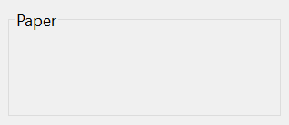

# FrameW class
{: .no_toc }

A **FrameW** is a rectangle with a caption in its top edge that holds other controls, to show that they belong together and to move, hide or disable them as one.

{:width="212" height="92"}

```tb check_build
FrameW1.Caption = "Search &options"
Set TextBoxW1.Container = FrameW1        ' the text box is now in the frame
TextBoxW1.Left = 120                     ' measured from the frame's corner
TextBoxW1.Top = 300
FrameW1.Visible = False                  ' hides the text box as well
```

The control stands in place of the [**Frame**](../../VB/Frame/) of the VB package, the frame of VB6. It holds its caption in Unicode, and adds [**Alignment**](#alignment), [**Picture**](#picture), [**Transparent**](#transparent), [**UseMnemonic**](#usemnemonic) and the [**Resize**](#resize) event.

Of the [common members](Common), the control has those under [Name and place](Common#name-and-place) but **HelpContextID**, [**hWnd**](Common#hwnd), [Font and visual styles](Common#font-and-visual-styles), [Mouse](Common#mouse), [Dragging the control](Common#dragging-the-control), [OLE drag and drop](Common#ole-drag-and-drop) and [Right-to-left](Common#right-to-left) but **RightToLeftLayout**. The control is one window, so it has no **hWndUserControl**: **hWnd** is the handle of the window on the form. It never takes the focus, so it has no keyboard events.

* TOC
{:toc}

## Holding other controls

A control drawn inside the frame in the form designer, or moved into it with **Set** *control*.**Container**, is a child of the frame. Its **Left** and **Top** are measured from the frame's top left corner, it moves with the frame, and it is hidden with it.

<!-- test: FrameWTests.Container_Set_PutsTheControlInTheFrame, FrameWTests.Enabled_False_LeavesTheContainedControlsEnabledProperty -->
A frame with **Enabled** set to **False** draws its caption in the grey of disabled text, and the controls in it take neither the mouse nor the keyboard. Their own **Enabled** properties keep their values.
<!-- /test -->

<!-- test: FrameWTests.Resize_RaisedWhenTheSizeChanges -->
The frame raises [**Resize**](#resize) when its width or its height changes, so that a handler can lay the controls in it out again. Moving the frame raises nothing.
<!-- /test -->

```tb check_build
Private Sub FrameW1_Resize()
    TextBoxW1.Width = FrameW1.Width - 2 * TextBoxW1.Left
End Sub
```

## Caption, picture and border

The caption stands in the frame's top edge, at the left, in the middle or at the right by [**Alignment**](#alignment). [**Picture**](#picture) puts a small picture beside it, before or after it by [**PictureAlignment**](#picturealignment); with an empty caption the picture stands in the caption's place.

In a program with visual styles the frame's line is drawn in the style of Windows, and without them, or with [**VisualStyles**](Common#visualstyles) set to **False**, as an etched line. The caption is drawn in [**ForeColor**](#forecolor) either way. With [**BorderStyle**](#borderstyle) set to 0 the control draws neither the line nor the caption nor the picture, and is a plain container.

The frame fills itself with [**BackColor**](#backcolor), or, with [**Transparent**](#transparent) set to **True**, with a copy of what its container shows behind it.

Properties
----------

### Alignment
{: .no_toc }

Where the caption stands in the frame's top edge. A member of [**AlignmentConstants**](../../VBRUN/Constants/AlignmentConstants): **vbLeftJustify** (the default), **vbRightJustify** or **vbCenter**. Another value raises run-time error 380. When [**RightToLeft**](Common#righttoleft) takes effect, a left alignment becomes a right one, of the caption and of the picture, and the other way round when it stops.

### Appearance
{: .no_toc }

The look of the frame. A member of [**CCAppearanceConstants**](Common#ccappearanceconstants). Default: **CCAppearance3D**. Another value raises run-time error 380. With **CCAppearanceFlat** a frame drawn without visual styles has a line of one color.

<!-- test: FrameWTests.Appearance_SetsForeColor -->
An assignment sets [**ForeColor**](#forecolor) to **vbWindowText** for **CCAppearanceFlat** and to **vbButtonText** for **CCAppearance3D**. A program that wants another color sets it after **Appearance**.
<!-- /test -->

### BackColor
{: .no_toc }

The color the frame fills itself with. **OLE_COLOR**. Default: **vbButtonFace**.

### BorderStyle
{: .no_toc }

Whether the frame draws its line, its caption and its picture. **Integer**: 1 to draw them (the default) or 0 to draw nothing.

<!-- test: FrameWTests.BorderStyle_OutOfRange_Raises380 -->
Another value raises run-time error 380.
<!-- /test -->

### Caption
{: .no_toc }

The text in the frame's top edge. **String**. A control newly drawn on a form has its own name.

### ContainedControls
{: .no_toc }

The controls that were put into the frame. A [**ContainedControls**](../../VBRUN/ContainedControls/) collection, read-only.

### ForeColor
{: .no_toc }

The color of the caption. **OLE_COLOR**. A control newly drawn on a form has black. An assignment to [**Appearance**](#appearance) sets it again.

### Picture
{: .no_toc }

A picture shown beside the caption. A picture object, such as **LoadPicture** returns. Default: **Nothing**. Assigning **Nothing** removes the picture.

### PictureAlignment
{: .no_toc }

Whether the picture stands before or after the caption. A member of [**CCLeftRightAlignmentConstants**](Common#ccleftrightalignmentconstants). Default: **CCLeftRightAlignmentLeft**.

<!-- test: FrameWTests.PictureAlignment_OutOfRange_Raises380 -->
Another value raises run-time error 380.
<!-- /test -->

### Transparent
{: .no_toc }

Whether the frame draws, in place of [**BackColor**](#backcolor), a copy of what its container shows behind it. **Boolean**. Default: **False**. The copy is made when the frame draws itself, so after the container has changed what it shows there, [**Refresh**](Common#refresh) brings the frame up to date.

### UseMnemonic
{: .no_toc }

Whether an ampersand (`&`) in the caption makes the character after it the frame's access key. **Boolean**. Default: **True**, with which that character is underlined, the ampersand is not drawn, and `&&` draws one ampersand. With **False** the caption is drawn as it is.

Events
------

### Resize
{: .no_toc }

Raised when the width or the height of the frame has changed.

Syntax: *object*\_**Resize**( )

## See Also

- [Common members](Common) -- the members this control shares with the package's other controls
- [Frame](../../VB/Frame/) -- the frame of the VB package
- [ContainedControls](../../VBRUN/ContainedControls/) class
