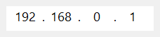
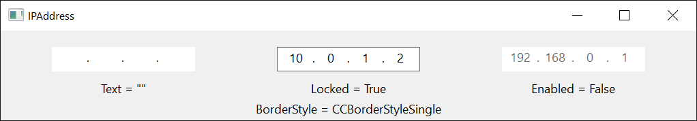

# IPAddress class
{: .no_toc }

An **IPAddress** is a box for an IPv4 address: four fields that each take a number from 0 to 255, with a dot between two fields. A program reads the address as text or as one number, and can limit the numbers each field takes.

{:width="152" height="36"}

```tb check_build check_run arch=win32,win64
IPAddress1.Text = "192.168.0.1"
Debug.Print IPAddress1.Text
Debug.Print Hex$(IPAddress1.Value)
' Output:
' 192.168.0.1
' C0A80001
```

VB6 and the Microsoft common controls have no control for an IP address. This one is four text boxes of Windows, drawn as one box, that behave as the IP address control of Windows (`SysIPAddress32`) does.

<!-- test: IPAddressTests.Messages_OfTheWindowsControl_AreAnswered -->
It answers the messages of that control, sent to [**hWnd**](Common#hwnd): IPM_SETADDRESS, IPM_GETADDRESS, IPM_CLEARADDRESS, IPM_SETRANGE and IPM_ISBLANK. IPM_SETFOCUS gives a field the focus.
<!-- /test -->

Of the [common members](Common), the control has those under [Name and place](Common#name-and-place), [**hWnd**](Common#hwnd) but not **hWndUserControl**, [Font and visual styles](Common#font-and-visual-styles), [Mouse](Common#mouse), [Keyboard and focus](Common#keyboard-and-focus), [Dragging the control](Common#dragging-the-control), [OLE drag and drop](Common#ole-drag-and-drop) and [Right-to-left](Common#right-to-left), but not **RightToLeftLayout**. The window of **hWnd** holds the four text boxes, and [**hWndEdit**](#hwndedit) gives the window of each.

* TOC
{:toc}

## The address as text and as a number

[**Text**](#text) is the four numbers joined by dots. [**Value**](#value) is the same address as one **Long**, with the first number in the highest byte: 192.168.0.1 is &HC0A80001.

<!-- test: IPAddressTests.Text_Assigned_IsReturnedAsFourNumbers, IPAddressTests.Text_NotFourFieldsOfDigits_Raises380, IPAddressTests.Text_FieldAboveTheMaximum_IsTheMaximum -->
The text assigned to **Text** has four parts of up to three digits, separated by dots. A part may be empty, as the last one is in `1.2.3.`. Any other text, such as `1.2.3`, `1.2.3.4.5`, `1.2.3.x` or `1.2.3.1234`, raises run-time error 380 and changes nothing. A part is kept as written, leading zeros included, but a number above the [**Max**](#max) of its field, or below its [**Min**](#min), is replaced by that limit. An empty string empties the four fields, and a control with four empty fields has an empty **Text**.
<!-- /test -->

<!-- test: IPAddressTests.Value_IsTheFirstFieldInTheHighByte -->
**Value** counts an empty field as 0. Assigning it fills the four fields, so that `&H0A000102` is 10.0.1.2 and -1 is 255.255.255.255. An empty **Text** gives a **Value** of 0.

```tb check_build check_run arch=win32,win64
IPAddress1.Value = &H0A000102
Debug.Print IPAddress1.Text
IPAddress1.Text = "300.1.2.3"
Debug.Print IPAddress1.Text
IPAddress1.Text = ""
Debug.Print IPAddress1.Value
' Output:
' 10.0.1.2
' 255.1.2.3
'  0
```
<!-- /test -->

## The limits of a field

[**Min**](#min) and [**Max**](#max) are the lowest and the highest number each field takes, from 0 to 255 by default. They have an argument, the number of the field from 1 to 4.

<!-- test: IPAddressTests.MinAndMax_LimitTheFieldsOfAnAssignedText, IPAddressTests.MinAndMax_PastEachOther_AreStoppedAtTheOther, IPAddressTests.Value_Assigned_IsNotLimitedByMinAndMax, IPAddressTests.MinAndMax_ItemOutOfRange_Raises5 -->
The limits apply to a text assigned to **Text** and, for the user, when the focus leaves a field. A number assigned through [**Value**](#value) is not checked against them. A **Min** above the **Max** of its field becomes that **Max**, and a **Max** below the **Min** becomes that **Min**. A field number outside 1 to 4 raises run-time error 5.

```tb check_build check_run arch=win32,win64
IPAddress1.Min(1) = 10
IPAddress1.Max(1) = 20
IPAddress1.Max(2) = 5
IPAddress1.Text = "99.9.0.0"
Debug.Print IPAddress1.Text
IPAddress1.Text = "1.1.0.0"
Debug.Print IPAddress1.Text
' Output:
' 20.5.0.0
' 10.1.0.0
```
<!-- /test -->

## Typing in the fields

A field takes digits only, up to three. After the third digit the focus moves to the next field. A dot or a space typed after at least one digit moves the focus to the next field too, and in the last field it is refused. The arrow keys move between the fields at the end or the start of the text, and with Ctrl held down they move a field at once. Home goes to the first field and End to the last, and Backspace at the start of a field goes back to the one before. A number a field holds when the focus leaves it is brought within its limits.

[**AutoSelect**](#autoselect) is the field that gets the focus, with its number selected, when the control gets it. [**SelectedItem**](#selecteditem) is the number of the field that has the focus, or had it last. The event [**SelChange**](#selchange) is raised when the focus moves to another field. [**Locked**](#locked) makes the fields read-only.

{:width="681" height="119"}

## Mouse events

[**MouseDown**](#mousedown-mousemove-mouseup), **MouseMove** and **MouseUp**, and [**Click**](Common#click) and [**DblClick**](Common#dblclick), are raised for the four fields and for the border and the dots around them. Where the position is given, it is measured from the top left corner of the control.

Properties
----------

### AutoSelect
{: .no_toc }

Which field gets the focus when the control gets it. A member of [**IpaAutoSelectConstants**](#ipaautoselectconstants). Default: **IpaAutoSelectFirst**.

<!-- test: IPAddressTests.AutoSelect_OutOfRange_Raises380 -->
Another value raises run-time error 380.
<!-- /test -->

### BackColor
{: .no_toc }

The color behind the numbers. **OLE_COLOR**. Default: **vbWindowBackground**. A [**BorderStyle**](#borderstyle) of **CCBorderStyleSunken** drawn with visual styles is filled with it too.

### BorderStyle
{: .no_toc }

The border of the box. A member of [**CCBorderStyleConstants**](Common#ccborderstyleconstants). Default: **CCBorderStyleSunken**. Another value raises run-time error 380.

### ForeColor
{: .no_toc }

The color of the numbers and the dots. **OLE_COLOR**. Default: **vbWindowText**; a control newly drawn on a form has black.

### hWndEdit
{: .no_toc }

The handle of the window of one field, the text box of Windows that holds its number. **LongPtr**, read-only.

Syntax: *object*.**hWndEdit**( *Index* )

*Index*
: *required* An **Integer**: the number of the field, from 1 to 4.

<!-- test: IPAddressTests.hWndEdit_IndexOutOfRange_Raises35600 -->
Another *Index* raises run-time error 35600, *Index out of bounds*.
<!-- /test -->

### Locked
{: .no_toc }

Whether the user is kept from changing the numbers. **Boolean**. Default: **False**. With **True** the four fields are read-only, and a program can still change the address.

<!-- test: IPAddressTests.Locked_MakesTheFieldsReadOnly -->
Each field is given the read-only style of the edit control of Windows, `ES_READONLY`.
<!-- /test -->
The fields keep their background colour: a locked control does not look different.

### Max
{: .no_toc }

The highest number a field takes. **Byte**. Default: 255 for each field. See [The limits of a field](#the-limits-of-a-field).

Syntax: *object*.**Max**( *Item* )

*Item*
: *required* An **Integer**: the number of the field, from 1 to 4.

### Min
{: .no_toc }

The lowest number a field takes. **Byte**. Default: 0 for each field.

Syntax: *object*.**Min**( *Item* )

*Item*
: *required* An **Integer**: the number of the field, from 1 to 4.

### SelectedItem
{: .no_toc }

The number of the field that has the focus, or had it last, from 1 to 4. **Integer**. Default: 1. While the control has the focus, an assignment moves the focus to that field and selects its number.

<!-- test: IPAddressTests.SelectedItem_OutOfRange_Raises380 -->
A value outside 1 to 4 raises run-time error 380.
<!-- /test -->

### Text
{: .no_toc }

The address as text, such as `192.168.0.1`. **String**. Default: empty. It is the control's default property. See [The address as text and as a number](#the-address-as-text-and-as-a-number) for what it accepts.

### Value
{: .no_toc }

The address as one number, the first field in the highest byte. **Long**. Default: 0. A field that is empty counts as 0.

Events
------

### Change
{: .no_toc }

<!-- test: IPAddressTests.Change_RaisedOnceForEachChangeOfTheText, IPAddressTests.Change_ByTheUser_RaisedForEachFieldChange -->
Raised when the text of the address has changed, by the user or by an assignment to [**Text**](#text) or [**Value**](#value). An assignment that leaves the text as it was, or empties a control that was already empty, raises nothing.
<!-- /test -->

Syntax: *object*\_**Change**( )

### ContextMenu
{: .no_toc }

Raised when the user presses the right mouse button over a field, or presses Shift+F10 or the menu key in one, so that the program can show a menu of its own.

Syntax: *object*\_**ContextMenu**( *Handled* **As Boolean**, *X* **As Single**, *Y* **As Single** )

*Handled*
: **False** when the event is raised. A handler that sets it to **True** keeps Windows from showing the standard menu of the text box.

*X*, *Y*
: The position of the pointer, measured from the top left corner of the control, in the scale units of the container.

<!-- test: IPAddressTests.ContextMenu_ByTheKeyboard_GivesMinusOne -->
When the keyboard asked for the menu, *X* and *Y* are both -1.
<!-- /test -->

### MouseDown, MouseMove, MouseUp
{: .no_toc }

<!-- test: IPAddressTests.MouseMove_OverAField_XAndYAreInTwips -->
As the [common events](Common#mousedown-mousemove-mouseup) of these names. Over a field, *X* and *Y* are in twips, whatever the scale units of the control's container, and are measured from the top left corner of the control.
<!-- /test -->

<!-- test: IPAddressTests.MouseMove_OverTheBorder_XAndYAreInTwips -->
> [!WARNING] 1.8.142.0
> Over the border of the control and over the dots between the fields, *X* and *Y* are in pixels, not in twips. A program that uses the position converts those values itself, or ignores the events there.

### SelChange
{: .no_toc }

Raised when the focus moves to another field. [**SelectedItem**](#selecteditem) already has the number of the new field.

<!-- test: IPAddressTests.SelChange_RaisedWhenTheFocusMovesToAnotherField -->
Moving the focus into the field that has it raises nothing.
<!-- /test -->

Syntax: *object*\_**SelChange**( )

## IpaAutoSelectConstants
{: #ipaautoselectconstants }

The values of [**AutoSelect**](#autoselect).

| Member | Value | Description |
|---|---|---|
| **IpaAutoSelectNone**{: #IpaAutoSelectConstants_IpaAutoSelectNone } | 0 | The field of [**SelectedItem**](#selecteditem), the one that had the focus last. |
| **IpaAutoSelectFirst**{: #IpaAutoSelectConstants_IpaAutoSelectFirst } | 1 | The first field. |
| **IpaAutoSelectSecond**{: #IpaAutoSelectConstants_IpaAutoSelectSecond } | 2 | The second field. |
| **IpaAutoSelectThird**{: #IpaAutoSelectConstants_IpaAutoSelectThird } | 3 | The third field. |
| **IpaAutoSelectFourth**{: #IpaAutoSelectConstants_IpaAutoSelectFourth } | 4 | The fourth field. |
| **IpaAutoSelectBlank**{: #IpaAutoSelectConstants_IpaAutoSelectBlank } | 5 | The first empty field, or the first field when none is empty. |

## See Also

- [Common members](Common) -- the members this control shares with the package's other controls
