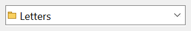
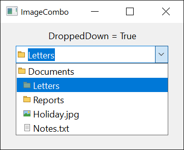

# ImageCombo class
{: .no_toc }

An **ImageCombo** is a combo box whose items can each show a picture, and be indented, so that the list can show a folder tree or a list of files with their icons. The pictures come from an [**ImageList**](../ImageList/) control.

{:width="212" height="35"}

```tb hidden
Public Type SquarePictDesc
    Size As Long
    Kind As Long
    Handle As LongPtr
    Palette As LongPtr
End Type
Public Type SquareGuid
    Data1 As Long
    Data2 As Integer
    Data3 As Integer
    Data4(0 To 7) As Byte
End Type
Public Declare PtrSafe Function SqGetDC Lib "user32" Alias "GetDC" (ByVal hWnd As LongPtr) As LongPtr
Public Declare PtrSafe Function SqReleaseDC Lib "user32" Alias "ReleaseDC" (ByVal hWnd As LongPtr, ByVal hDC As LongPtr) As Long
Public Declare PtrSafe Function SqCreateCompatibleDC Lib "gdi32" Alias "CreateCompatibleDC" (ByVal hDC As LongPtr) As LongPtr
Public Declare PtrSafe Function SqCreateCompatibleBitmap Lib "gdi32" Alias "CreateCompatibleBitmap" (ByVal hDC As LongPtr, ByVal W As Long, ByVal H As Long) As LongPtr
Public Declare PtrSafe Function SqSelectObject Lib "gdi32" Alias "SelectObject" (ByVal hDC As LongPtr, ByVal hObject As LongPtr) As LongPtr
Public Declare PtrSafe Function SqCreateSolidBrush Lib "gdi32" Alias "CreateSolidBrush" (ByVal Color As Long) As LongPtr
Public Declare PtrSafe Function SqPatBlt Lib "gdi32" Alias "PatBlt" (ByVal hDC As LongPtr, ByVal X As Long, ByVal Y As Long, ByVal W As Long, ByVal H As Long, ByVal Rop As Long) As Long
Public Declare PtrSafe Function SqDeleteObject Lib "gdi32" Alias "DeleteObject" (ByVal hObject As LongPtr) As Long
Public Declare PtrSafe Function SqDeleteDC Lib "gdi32" Alias "DeleteDC" (ByVal hDC As LongPtr) As Long
Public Declare PtrSafe Function SqOleCreatePictureIndirect Lib "oleaut32" Alias "OleCreatePictureIndirect" (ByRef Desc As SquarePictDesc, ByRef IID As SquareGuid, ByVal Own As Long, ByRef Pic As IPictureDisp) As Long

' A bitmap of one color.
Public Function ColorSquare(ByVal Color As Long, Optional ByVal Width As Long = 16, Optional ByVal Height As Long = 16) As StdPicture
    Dim screenDC As LongPtr, memDC As LongPtr, bmp As LongPtr, brush As LongPtr, oldBmp As LongPtr, oldBrush As LongPtr
    screenDC = SqGetDC(0)
    memDC = SqCreateCompatibleDC(screenDC)
    bmp = SqCreateCompatibleBitmap(screenDC, Width, Height)
    brush = SqCreateSolidBrush(Color)
    oldBmp = SqSelectObject(memDC, bmp)
    oldBrush = SqSelectObject(memDC, brush)
    SqPatBlt memDC, 0, 0, Width, Height, &HF00021
    SqSelectObject memDC, oldBrush
    SqSelectObject memDC, oldBmp
    SqDeleteObject brush
    SqDeleteDC memDC
    SqReleaseDC 0, screenDC
    Dim desc As SquarePictDesc, iid As SquareGuid, pic As IPictureDisp
    desc.Size = LenB(desc)
    desc.Kind = 1
    desc.Handle = bmp
    iid.Data1 = &H7BF80981
    iid.Data2 = &HBF32
    iid.Data3 = &H101A
    iid.Data4(0) = &H8B
    iid.Data4(1) = &HBB
    iid.Data4(3) = &HAA
    iid.Data4(5) = &H30
    iid.Data4(6) = &HC
    iid.Data4(7) = &HAB
    SqOleCreatePictureIndirect desc, iid, 1, pic
    Set ColorSquare = pic
End Function
```

```tb check_build check_run arch=win32,win64
ImageList1.ListImages.Add , "red", ColorSquare(vbRed)
ImageList1.ListImages.Add , "blue", ColorSquare(vbBlue)
ImageCombo1.ImageList = ImageList1
ImageCombo1.ComboItems.Add , "r", "Red", "red"
ImageCombo1.ComboItems.Add , "b", "Blue", "blue"
ImageCombo1.ComboItems("b").Selected = True
Debug.Print ImageCombo1.Text; ImageCombo1.ComboItems.Count
' Output:
' Blue 2
```

**ColorSquare** in the samples of this page is a function of the program's own that returns a bitmap of one color, 16 pixels wide and high.

The control stands in place of the ImageCombo of the Microsoft common controls (`MSCOMCTL.OCX`). It is made of the combo box with pictures that Windows provides. It differs from [**ComboBoxW**](../ComboBoxW) in its items: they are objects in the [**ComboItems**](#comboitems) collection, each with a picture, an indentation and a number of its own, and not the texts that **AddItem** adds.

Of the [common members](../Common), the control has every member under [Name and place](../Common#name-and-place), [Window handles](../Common#window-handles), [Font and visual styles](../Common#font-and-visual-styles), [Mouse](../Common#mouse), [Keyboard and focus](../Common#keyboard-and-focus), [Dragging the control](../Common#dragging-the-control), [OLE drag and drop](../Common#ole-drag-and-drop) and [Right-to-left](../Common#right-to-left). Its [**Click**](#click) and [**DblClick**](#dblclick) have a meaning of their own, and its [mouse events](#mousedown-mousemove-mouseup) give the position in twips.

Its sub-objects have pages of their own:

- [ImcComboItems](ImcComboItems) -- the collection of the items, which [**ComboItems**](#comboitems) returns
- [ImcComboItem](ImcComboItem) -- one item

* TOC
{:toc}

## The styles

[**Style**](#style) is set at design time and decides what the control is made of:

| Style | The control |
|---|---|
| **ImcStyleDropDownCombo** | A text box with an arrow button. The list drops down when the user presses the button. The user types any text or picks an item. |
| **ImcStyleSimpleCombo** | A text box with the list always open below it. The user types any text or picks an item. |
| **ImcStyleDropDownList** | A field that shows the selected item, with an arrow button. The user picks an item and cannot type a text of their own. |

The first two have a text box, whose window is [**hWndEdit**](#hwndedit). The members that work on the text box, such as [**SelStart**](#selstart) and [**MaxLength**](#maxlength), do nothing useful on an **ImcStyleDropDownList** control, which has none.

<!-- test: ImageComboTests.Defaults_OfANewControl -->
A new control has the style **ImcStyleDropDownCombo**, no image list and no item, and shows its own name as its text.
<!-- /test -->

## The pictures

The control takes its pictures from an **ImageList** control, which a program assigns to [**ImageList**](#imagelist). The list must hold pictures at the time of the assignment: the combo box then shares the image list of Windows that the **ImageList** control holds, so a picture added later is shown as well. [Giving the list to a control](../ImageList/#giving-the-list-to-a-control) has the rules about an empty list.

Each item names its picture by its number in the **ImageList**, from 1, or by its key. [**ImcComboItem.Image**](ImcComboItem#image) is the picture the item shows, and [**ImcComboItem.SelImage**](ImcComboItem#selimage) the picture it shows while it is the selected item, in the text box and in the list. A number of 0 means no picture, and for **SelImage** the picture of **Image**.

How the control finds a picture by its key depends on what the program assigned to **ImageList**. With the **ImageList** control itself, or with its name, the control asks that list. With the handle that [**hImageList**](../ImageList/#himagelist) returns, there is no list to ask, so an item then names its pictures by number only:

<!-- test: ImageComboTests.Add_ImageKey_WithAHandleAsImageList_Raises35601 -->
```tb check_build check_run arch=win32,win64
ImageList1.ListImages.Add , "red", ColorSquare(vbRed)
ImageList1.ListImages.Add , "blue", ColorSquare(vbBlue)
ImageCombo1.ImageList = ImageList1.hImageList
ImageCombo1.ComboItems.Add , , "Blue", 2           ' a number: fine
On Error Resume Next
ImageCombo1.ComboItems.Add , , "Red", "red"        ' a key: no list to look it up in
Debug.Print Err.Number
' Output:
'  35601
```
<!-- /test -->

Where the **ImageCombo** and the **ImageList** are on the same form, a program can also assign the name of the **ImageList** as a string:

```tb check_build
ImageCombo1.ImageList = "ImageList1"
```

[**ShowImages**](#showimages) turns the pictures off, and [**AllowImageHighlight**](#allowimagehighlight) decides whether the picture of the selected item is drawn highlighted. The height of an item in the list is at least the height of the pictures of the list, which [**GetItemHeight**](#getitemheight) returns.

## The items

[**ComboItems**](#comboitems) returns the collection of the items. Its [**Add**](ImcComboItems#add) method puts an item into the list with its text, its key, its pictures and its indentation, and the items are numbered from 1 in the order of the list. [**Indentation**](#indentation) is the indentation that a new item gets, in widths of a picture, so that a list can show levels as a tree does.

<!-- test: ImageComboTests.Indentation_OfTheControl_IsTheIndentationOfNewItems, ImageComboTests.Add_WithAnIndentation_OverridesTheControls -->
```tb check_build check_run arch=win32,win64
Dim Item As ImcComboItem
With ImageCombo1
    .ComboItems.Add , "root", "Documents"
    .Indentation = 1                                  ' for the items added from here on
    .ComboItems.Add , "a", "Letters"
    .ComboItems.Add , "b", "Notes"
    .ComboItems.Add , "c", "Todo", , , 2              ' an indentation of its own
    For Each Item In .ComboItems
        Debug.Print Item.Index; Item.Key; Item.Indentation
    Next
End With
' Output:
'  1 root 0
'  2 a 1
'  3 b 1
'  4 c 2
```
<!-- /test -->

A program removes an item with [**Remove**](ImcComboItems#remove) and all items with [**Clear**](ImcComboItems#clear).

## The selection and the text

[**SelectedItem**](#selecteditem) is the selected item, or **Nothing**. [**Text**](#text) is the text in the text box. The two are separate: selecting an item puts its text into the text box, but a text assigned to **Text** selects no item, even when an item has that text.

<!-- test: ImageComboTests.Text_Assigned_SelectsNoItem, ImageComboTests.Selected_True_PutsTheTextInTheTextBox, ImageComboTests.Clear_LeavesTheText, ImageComboTests.Remove_SelectedItem_LeavesTheText -->
```tb check_build check_run arch=win32,win64
With ImageCombo1
    .ComboItems.Add , "a", "Alpha"
    .ComboItems.Add , "b", "Beta"
    .Text = "Beta"
    Debug.Print TypeName(.SelectedItem)
    .ComboItems("b").Selected = True
    Debug.Print .SelectedItem.Key & " " & .Text
    .ComboItems.Clear
    Debug.Print "[" & .Text & "] " & TypeName(.SelectedItem)
End With
' Output:
' Nothing
' b Beta
' [Beta] Nothing
```
<!-- /test -->

[**Clear**](ImcComboItems#clear) and [**Remove**](ImcComboItems#remove) take the items out of the list and leave the text in the text box as it is.

<!-- test: ImageComboTests.Selected_True_RaisesChangeThenClick, ImageComboTests.Selected_AlreadySelected_RaisesNoClick, ImageComboTests.SelectedItem_Nothing_RaisesChangeAndClick, ImageComboTests.Text_Assigned_RaisesChange, ImageComboTests.Key_Down_SelectsTheNextItemAndRaisesClick -->
Selecting an item, by the user or by [**Selected**](ImcComboItem#selected) or [**SelectedItem**](#selecteditem), raises [**Change**](#change) first, because the text box takes the item's text, and then [**Click**](#click). Selecting the item that is selected already raises **Change** only. Assigning a text to **Text** raises **Change**. Removing the selection with `Set .SelectedItem = Nothing` raises **Change** and **Click**. A control with the style **ImcStyleDropDownList** has no text box and raises no **Change**.
<!-- /test -->

```tb check_build
Private Sub ImageCombo1_Click()
    ' Another item is selected.
    Debug.Print "item "; ImageCombo1.SelectedItem.Index
End Sub

Private Sub ImageCombo1_Change()
    ' The text in the text box is another text.
    Debug.Print "text is now "; ImageCombo1.Text
End Sub
```

[**FindItem**](#finditem) returns the item that has a text, for a program that looks an item up by its text.

## Ending the edit

The user edits the text box of an **ImcStyleDropDownCombo** control, or of an **ImcStyleSimpleCombo** control, in turns. [**BeginEdit**](#beginedit) is raised when the user starts one by clicking in the text box or moving the focus into it. [**EndEdit**](#endedit) is raised when the user finishes it: by pressing the Enter key or the Esc key, by moving the focus to another control, or by opening the drop-down list. The event says whether the text was changed, which item the user chose, if any, the text, and why the edit ended.

<!-- test: ImageComboTests.BeginEdit_FocusToTheTextBox_IsRaised, ImageComboTests.EndEdit_Return_GivesTheSelectedItemAndTheReason, ImageComboTests.EndEdit_Escape_GivesReason3, ImageComboTests.EndEdit_LostFocus_GivesReason1, ImageComboTests.DroppedDown_True_RaisesDropDownThenEndEdit -->
*NewIndex* counts the items from 0, as Windows does, so the item that [**ComboItems**](ImcComboItems) numbers 1 is 0 here, and *NewIndex* is -1 when the text is not that of an item. The drop-down list that opens raises [**DropDown**](#dropdown), and then **EndEdit** with the reason **ImcEndEditReasonDropDown**.
<!-- /test -->

```tb check_build
Private Sub ImageCombo1_EndEdit(ByVal Changed As Boolean, ByVal NewIndex As Long, ByVal NewText As String, ByVal Reason As ImcEndEditReasonConstants)
    If Reason = ImcEndEditReasonReturn And Changed Then
        Debug.Print "the user typed "; NewText
    End If
End Sub
```

## The drop-down list

<!-- test: ImageComboTests.DroppedDown_True_RaisesDropDownThenEndEdit, ImageComboTests.DroppedDown_False_RaisesCloseUp -->
[**DroppedDown**](#droppeddown) says whether the list is open, and opens or closes it. The control raises [**DropDown**](#dropdown) before the list opens, which is the moment to fill a list that depends on something else, and [**CloseUp**](#closeup) when it has closed.
<!-- /test -->

{:width="241" height="197"}

The list shows [**MaxDropDownItems**](#maxdropdownitems) items at most without scrolling, and is as wide as the control unless [**DropDownWidth**](#dropdownwidth) is wider. [**TopItem**](#topitem) is the item at the top of the list, and [**Scroll**](#scroll) is raised when it changes.

Properties
----------

### AllowImageHighlight
{: .no_toc }

Whether the picture of an item is drawn highlighted while the item is selected or has the focus. A member of [**ImcAllowImageHighlightConstants**](#imcallowimagehighlightconstants). Default: **ImcAllowImageHighlightAlways**. It decides for the text box and the list separately.

<!-- test: ImageComboTests.AllowImageHighlight_OutOfRange_Raises380 -->
A value that is not a member raises run-time error 380.
<!-- /test -->

### BackColor
{: .no_toc }

The background color of the text box and of the list. **OLE_COLOR**. A new control has **vbWindowBackground**.

### ComboItems
{: .no_toc }

The items of the control. An [**ImcComboItems**](ImcComboItems) collection, read-only.

### DropDownWidth
{: .no_toc }

The least width of the drop-down list, in the scale units of the control's container. **Single**. The list is never narrower than the control. A negative value raises run-time error 380. On an **ImcStyleSimpleCombo** control, which has no drop-down list, the property raises run-time error 5.

### DroppedDown
{: .no_toc }

Whether the drop-down list is open. **Boolean**. An assignment opens or closes it. See [The drop-down list](#the-drop-down-list).

### EllipsisFormat
{: .no_toc }

Whether a text that is wider than the control is shortened and ends in an ellipsis. A member of [**ImcEllipsisFormatConstants**](#imcellipsisformatconstants). Default: **ImcEllipsisFormatNone**. It has an effect when the program has visual styles.

<!-- test: ImageComboTests.EllipsisFormat_OutOfRange_Raises380 -->
A value that is not a member raises run-time error 380.
<!-- /test -->

### ExtendedUI
{: .no_toc }

Whether the control uses the extended keyboard interface of the Windows combo box. **Boolean**. Default: **False**. With **True** the Down Arrow key opens the list, the F4 key does not, and the mouse wheel does not change the selection while the list is closed. It has no effect on an **ImcStyleSimpleCombo** control.

### ForeColor
{: .no_toc }

The color of the text in the text box and in the list. **OLE_COLOR**. A control newly drawn on a form has black.

### hWndCombo
{: .no_toc }

The handle of the combo box inside the control, which holds the text box and the list. **LongPtr**, read-only. [**hWnd**](../Common#hwnd) is the handle of the control of Windows that holds the combo box and its pictures.

### hWndEdit
{: .no_toc }

The handle of the text box inside the control. **LongPtr**, read-only. It is 0 on an **ImcStyleDropDownList** control.

### hWndList
{: .no_toc }

The handle of the list. **LongPtr**, read-only.

### IMEMode
{: .no_toc }

The state of the Input Method Editor while the text box has the focus. A member of [**CCIMEModeConstants**](../Common#ccimemodeconstants). Default: **CCIMEModeNoControl**. Another value raises run-time error 380.

### ImageList
{: .no_toc }

The image list that gives the items their pictures. **Variant**. Default: none. See [The pictures](#the-pictures).

An assignment takes the **ImageList** control, the name of an **ImageList** control on the same form as a **String**, or a handle, a **Long** or a **LongPtr**, such as [**hImageList**](../ImageList/#himagelist) returns. A name that no **ImageList** control of the form has, and an **ImageList** control with no picture, leave the control without an image list, with no error. An object that is not an **ImageList** raises run-time error 35610, and a value of another type raises 13.

<!-- test: ImageComboTests.ImageList_Object_IsReturned, ImageComboTests.ImageList_Handle_IsReturned, ImageComboTests.ImageList_EmptyList_IsNotTaken, ImageComboTests.ImageList_NotAnImageList_Raises35610, ImageComboTests.ImageList_AnotherType_Raises13 -->
Reading the property returns the **ImageList** control, when it was assigned as a control or by name, and the handle, when it was assigned as one. With none it returns **Nothing**.
<!-- /test -->

### Indentation
{: .no_toc }

The indentation that an item gets when it is added without one, in widths of a picture of the image list. **Long**. Default: 0. Items already in the list keep theirs.

<!-- test: ImageComboTests.Indentation_Negative_Raises380 -->
A negative value raises run-time error 380.
<!-- /test -->

### Locked
{: .no_toc }

Whether the user is kept from changing the text and the selection. **Boolean**. Default: **False**.

<!-- test: ImageComboTests.Locked_TextCanStillBeAssigned -->
With **True** the text box takes no typing, and the list does not respond to the keyboard or to the mouse on its items. The program can still assign [**Text**](#text) and select items.
<!-- /test -->

### MaxDropDownItems
{: .no_toc }

The greatest number of items that the drop-down list shows without scrolling. **Integer**. Default: 9.

<!-- test: ImageComboTests.MaxDropDownItems_OutOfRange_Raises380 -->
A value less than 1 or greater than 30 raises run-time error 380.
<!-- /test -->

### MaxLength
{: .no_toc }

The greatest number of characters that the text box takes, from the user and from an assignment to [**Text**](#text). **Long**. Default: 0, with which the limit is 259 characters.

<!-- test: ImageComboTests.MaxLength_Zero_LimitsTheTextTo259, ImageComboTests.Text_LongerThanMaxLength_IsCut, ImageComboTests.MaxLength_Negative_Raises380 -->
An assignment of a longer text loses what is beyond the limit. A negative value raises run-time error 380.
<!-- /test -->


### OLEDragMode
{: .no_toc }

Whether the user can drag the selected item out of the control. A member of [**OLEDragConstants**](../../../VBRUN/Constants/OLEDragConstants). Default: **vbOLEDragManual**, with which only [**OLEDrag**](../Common#oledrag) starts a drag. With **vbOLEDragAutomatic** a drag of the picture in the text box, which raises [**ItemDrag**](#itemdrag), carries the text of the selected item as text, to copy or to move. Another value raises run-time error 380.

### OLEDraggedItem
{: .no_toc }

The item that an OLE drag started from [**ItemDrag**](#itemdrag) carries. An [**ImcComboItem**](ImcComboItem), read-only. It is **Nothing** while no such drag is going on. A handler of **ItemDrag** that calls [**OLEDrag**](../Common#oledrag) can read it in [**OLEStartDrag**](../Common#olestartdrag) and in the events after it.

### ScrollTrack
{: .no_toc }

Whether the list scrolls while the user drags the scroll box of its scroll bar. **Boolean**. Default: **True**. With **False** the list scrolls when the user releases the scroll box.

### SelectedItem
{: .no_toc }

The selected item. An [**ImcComboItem**](ImcComboItem), or **Nothing** when no item is selected. An assignment with **Set** selects the item, and `Set .SelectedItem = Nothing` removes the selection. It raises [**Click**](#click) when the selection changes. See [The selection and the text](#the-selection-and-the-text).

### SelLength
{: .no_toc }

The number of characters selected in the text box. **Long**. A negative value raises run-time error 380. It does nothing on an **ImcStyleDropDownList** control.

### SelStart
{: .no_toc }

The position where the selection in the text box starts, counted from 0, or the position of the caret when nothing is selected. **Long**. An assignment puts the caret there and selects nothing. A negative value raises run-time error 380. It does nothing on an **ImcStyleDropDownList** control.

### SelText
{: .no_toc }

The selected text of the text box. **String**. An assignment replaces the selection, or inserts the text at the caret. On an **ImcStyleDropDownList** control the property raises run-time error 380.

### ShowImages
{: .no_toc }

Whether the text box and the list show the pictures of the items. **Boolean**. Default: **True**. With **False** neither the text box nor the list shows the pictures.

### Style
{: .no_toc }

What the control is made of. A member of [**ImcStyleConstants**](#imcstyleconstants). Default: **ImcStyleDropDownCombo**. See [The styles](#the-styles).

<!-- test: ImageComboTests.Style_AtRunTime_Raises382, ImageComboTests.Style_NotAMember_Raises380 -->
It is set at design time. At run time an assignment raises run-time error 382, and a value that is not a member raises 380.
<!-- /test -->

### Text
{: .no_toc }

The text in the text box. **String**. It is the control's default property. A control newly drawn on a form has its own name.

On an **ImcStyleDropDownCombo** or **ImcStyleSimpleCombo** control an assignment puts the text into the text box, cut to [**MaxLength**](#maxlength), raises [**Change**](#change) and selects no item.

On an **ImcStyleDropDownList** control the text is that of the selected item, and an empty string when none is selected. An assignment selects the first item that has this text, regardless of case, and a text that no item has raises run-time error 383.

### TopItem
{: .no_toc }

The item at the top of the list. An [**ImcComboItem**](ImcComboItem). An assignment with **Set** scrolls the list so that the item is at its top, and raises [**Scroll**](#scroll) when that changes the top item. **Nothing** raises run-time error 380.

<!-- test: ImageComboTests.TopItem_NoItems_Raises9, ImageComboTests.TopItem_Nothing_Raises380, ImageComboTests.TopItem_Assigned_ScrollsAndRaisesScroll -->
Reading the property of a control with no item raises run-time error 9.
<!-- /test -->

Methods
-------

### FindItem
{: .no_toc }

Returns the first item that has a text, or **Nothing** when there is none. The search does not regard case.

Syntax: *object*.**FindItem**( *Text* [, *Index* [, *Partial* [, *Wrap* ] ] ] ) **As ImcComboItem**

*Text*
: *required* A **String**: the text to look for.

*Index*
: *optional* A **Long**: the number of the item where the search starts, which is the first item looked at. The default, 0, starts at the first item. A negative number, or one greater than the number of items in a list that has items, raises run-time error 380.

*Partial*
: *optional* A **Boolean**: **True** finds an item whose text contains *Text*, **False** (the default) one whose whole text is *Text*.

*Wrap*
: *optional* A **Boolean**: **True** goes on from the first item when the search reaches the end of the list without a match. The default is **False**.

<!-- test: ImageComboTests.FindItem_WholeTextOrPartOfIt, ImageComboTests.FindItem_StartsAtIndex, ImageComboTests.FindItem_Wrap_GoesOnFromTheTop, ImageComboTests.FindItem_IndexOutOfRange_Raises380 -->
An item with an empty text is never found. A call on a list with no item returns **Nothing**, whatever *Index* is.
<!-- /test -->

### GetItemHeight
{: .no_toc }

Returns the height of an item in the drop-down list, in the scale units of the control's container, as a **Single**. It is the height of the text, or the height of the pictures of the image list when they are higher.

Syntax: *object*.**GetItemHeight**

<!-- test: ImageComboTests.GetItemHeight_PicturesHigherThanTheText_IsAtLeastThePictureHeight -->
A picture 40 pixels high makes an item at least 40 pixels high.
<!-- /test -->

Events
------

### BeginEdit
{: .no_toc }

Raised when the user starts to edit the text, by clicking in the text box or moving the focus into it. See [Ending the edit](#ending-the-edit).

Syntax: *object*\_**BeginEdit**( )

### Change
{: .no_toc }

Raised when the text in the text box has changed: by the user's typing, by an assignment to [**Text**](#text), by a change of the text of the selected item, and by the selection of an item or its removal, as [The selection and the text](#the-selection-and-the-text) says. An **ImcStyleDropDownList** control has no text box and does not raise it.

Syntax: *object*\_**Change**( )

### Click
{: .no_toc }

Raised when another item has been selected, or the selection has been removed: by the user, with the mouse or the keyboard, or by [**Selected**](ImcComboItem#selected) or [**SelectedItem**](#selecteditem).

Syntax: *object*\_**Click**( )

### CloseUp
{: .no_toc }

Raised when the drop-down list has closed.

Syntax: *object*\_**CloseUp**( )

### DblClick
{: .no_toc }

Raised when the user double-clicks an item in the list of an **ImcStyleSimpleCombo** control. The other styles do not raise it.

Syntax: *object*\_**DblClick**( )

### DropDown
{: .no_toc }

Raised when the drop-down list is about to open.

Syntax: *object*\_**DropDown**( )

### EndEdit
{: .no_toc }

Raised when the user has finished editing the text. See [Ending the edit](#ending-the-edit).

Syntax: *object*\_**EndEdit**( *Changed* **As Boolean**, *NewIndex* **As Long**, *NewText* **As String**, *Reason* **As ImcEndEditReasonConstants** )

*Changed*
: **True** when the user has changed the text.

*NewIndex*
: The item the user chose, counted from 0, or -1 when the text is not that of an item.

*NewText*
: The text in the text box.

*Reason*
: Why the edit ended, a member of [**ImcEndEditReasonConstants**](#imcendeditreasonconstants).

### ItemDrag
{: .no_toc }

Raised when the user starts to drag the picture of the selected item in the text box, holding the left or the right mouse button. With [**OLEDragMode**](#oledragmode) set to **vbOLEDragAutomatic** the control also starts an OLE drag for a drag with the left button.

Syntax: *object*\_**ItemDrag**( **ByVal** *Item* **As ImcComboItem**, **ByVal** *Button* **As Integer** )

*Item*
: The selected item.

*Button*
: **vbLeftButton** or **vbRightButton**, members of [**MouseButtonConstants**](../../../VBRUN/Constants/MouseButtonConstants).

### MouseDown, MouseMove, MouseUp
{: .no_toc }

<!-- test: ImageComboTests.MouseMove_XAndY_AreInTwips -->
As the [common events](../Common#mousedown-mousemove-mouseup) of these names, but *X* and *Y* are in twips, whatever the scale units of the control's container, and are measured from the top left corner of the control.
<!-- /test -->

### Scroll
{: .no_toc }

Raised when the list has scrolled, so that another item is at its top.

Syntax: *object*\_**Scroll**( )

## ImcStyleConstants
{: #imcstyleconstants }

The values of [**Style**](#style).

{:width="681" height="195"}

| Member | Value | Description |
|---|---|---|
| **ImcStyleDropDownCombo**{: #ImcStyleConstants_ImcStyleDropDownCombo } | 0 | A text box and a list that drops down. |
| **ImcStyleSimpleCombo**{: #ImcStyleConstants_ImcStyleSimpleCombo } | 1 | A text box and a list that is always open. |
| **ImcStyleDropDownList**{: #ImcStyleConstants_ImcStyleDropDownList } | 2 | A list that drops down, and no text box. |

## ImcEndEditReasonConstants
{: #imcendeditreasonconstants }

The values of the *Reason* argument of [**EndEdit**](#endedit).

| Member | Value | Description |
|---|---|---|
| **ImcEndEditReasonLostFocus**{: #ImcEndEditReasonConstants_ImcEndEditReasonLostFocus } | 1 | The focus moved to another control. |
| **ImcEndEditReasonReturn**{: #ImcEndEditReasonConstants_ImcEndEditReasonReturn } | 2 | The user pressed the Enter key. |
| **ImcEndEditReasonEscape**{: #ImcEndEditReasonConstants_ImcEndEditReasonEscape } | 3 | The user pressed the Esc key. |
| **ImcEndEditReasonDropDown**{: #ImcEndEditReasonConstants_ImcEndEditReasonDropDown } | 4 | The drop-down list opened. |

## ImcEllipsisFormatConstants
{: #imcellipsisformatconstants }

The values of [**EllipsisFormat**](#ellipsisformat).

| Member | Value | Description |
|---|---|---|
| **ImcEllipsisFormatNone**{: #ImcEllipsisFormatConstants_ImcEllipsisFormatNone } | 0 | A text that is too wide is cut at the edge. |
| **ImcEllipsisFormatEnd**{: #ImcEllipsisFormatConstants_ImcEllipsisFormatEnd } | 1 | A text that is too wide ends in an ellipsis. |

## ImcAllowImageHighlightConstants
{: #imcallowimagehighlightconstants }

The values of [**AllowImageHighlight**](#allowimagehighlight).

| Member | Value | Description |
|---|---|---|
| **ImcAllowImageHighlightAlways**{: #ImcAllowImageHighlightConstants_ImcAllowImageHighlightAlways } | 0 | The picture is highlighted in the text box and in the list. |
| **ImcAllowImageHighlightNever**{: #ImcAllowImageHighlightConstants_ImcAllowImageHighlightNever } | 1 | The picture is never highlighted. |
| **ImcAllowImageHighlightListOnly**{: #ImcAllowImageHighlightConstants_ImcAllowImageHighlightListOnly } | 2 | The picture is highlighted in the list only. |
| **ImcAllowImageHighlightComboOnly**{: #ImcAllowImageHighlightConstants_ImcAllowImageHighlightComboOnly } | 3 | The picture is highlighted in the text box only. |

## See Also

- [ImcComboItems](ImcComboItems) class -- the collection of the items
- [ImcComboItem](ImcComboItem) class -- one item
- [ImageList](../ImageList/) -- the control that holds the pictures
- [ComboBoxW](../ComboBoxW) -- a combo box whose items are texts
- [Common members](../Common) -- the members this control shares with the package's other controls
