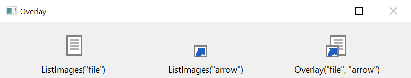

# ImageList class
{: .no_toc }

An **ImageList** is a list of pictures of one size, kept for other controls to show: a button takes its picture from it, a list its icons. The control itself shows nothing at run time.

```tb hidden
Public Type SquarePictDesc
    Size As Long
    Kind As Long
    Handle As LongPtr
    Palette As LongPtr
End Type
Public Type SquareGuid
    Data1 As Long
    Data2 As Integer
    Data3 As Integer
    Data4(0 To 7) As Byte
End Type
Public Declare PtrSafe Function SqGetDC Lib "user32" Alias "GetDC" (ByVal hWnd As LongPtr) As LongPtr
Public Declare PtrSafe Function SqReleaseDC Lib "user32" Alias "ReleaseDC" (ByVal hWnd As LongPtr, ByVal hDC As LongPtr) As Long
Public Declare PtrSafe Function SqCreateCompatibleDC Lib "gdi32" Alias "CreateCompatibleDC" (ByVal hDC As LongPtr) As LongPtr
Public Declare PtrSafe Function SqCreateCompatibleBitmap Lib "gdi32" Alias "CreateCompatibleBitmap" (ByVal hDC As LongPtr, ByVal W As Long, ByVal H As Long) As LongPtr
Public Declare PtrSafe Function SqSelectObject Lib "gdi32" Alias "SelectObject" (ByVal hDC As LongPtr, ByVal hObject As LongPtr) As LongPtr
Public Declare PtrSafe Function SqCreateSolidBrush Lib "gdi32" Alias "CreateSolidBrush" (ByVal Color As Long) As LongPtr
Public Declare PtrSafe Function SqPatBlt Lib "gdi32" Alias "PatBlt" (ByVal hDC As LongPtr, ByVal X As Long, ByVal Y As Long, ByVal W As Long, ByVal H As Long, ByVal Rop As Long) As Long
Public Declare PtrSafe Function SqDeleteObject Lib "gdi32" Alias "DeleteObject" (ByVal hObject As LongPtr) As Long
Public Declare PtrSafe Function SqDeleteDC Lib "gdi32" Alias "DeleteDC" (ByVal hDC As LongPtr) As Long
Public Declare PtrSafe Function SqOleCreatePictureIndirect Lib "oleaut32" Alias "OleCreatePictureIndirect" (ByRef Desc As SquarePictDesc, ByRef IID As SquareGuid, ByVal Own As Long, ByRef Pic As IPictureDisp) As Long

' A bitmap of one color.
Public Function ColorSquare(ByVal Color As Long, Optional ByVal Width As Long = 16, Optional ByVal Height As Long = 16) As StdPicture
    Dim screenDC As LongPtr, memDC As LongPtr, bmp As LongPtr, brush As LongPtr, oldBmp As LongPtr, oldBrush As LongPtr
    screenDC = SqGetDC(0)
    memDC = SqCreateCompatibleDC(screenDC)
    bmp = SqCreateCompatibleBitmap(screenDC, Width, Height)
    brush = SqCreateSolidBrush(Color)
    oldBmp = SqSelectObject(memDC, bmp)
    oldBrush = SqSelectObject(memDC, brush)
    SqPatBlt memDC, 0, 0, Width, Height, &HF00021
    SqSelectObject memDC, oldBrush
    SqSelectObject memDC, oldBmp
    SqDeleteObject brush
    SqDeleteDC memDC
    SqReleaseDC 0, screenDC
    Dim desc As SquarePictDesc, iid As SquareGuid, pic As IPictureDisp
    desc.Size = LenB(desc)
    desc.Kind = 1
    desc.Handle = bmp
    iid.Data1 = &H7BF80981
    iid.Data2 = &HBF32
    iid.Data3 = &H101A
    iid.Data4(0) = &H8B
    iid.Data4(1) = &HBB
    iid.Data4(3) = &HAA
    iid.Data4(5) = &H30
    iid.Data4(6) = &HC
    iid.Data4(7) = &HAB
    SqOleCreatePictureIndirect desc, iid, 1, pic
    Set ColorSquare = pic
End Function
```

```tb check_build check_run arch=win32,win64
ImageList1.ListImages.Add , "open", ColorSquare(vbRed)
ImageList1.ListImages.Add , "save", ColorSquare(vbBlue)
Debug.Print ImageList1.ListImages.Count
Debug.Print ImageList1.ImageWidth; ImageList1.ImageHeight
Debug.Print ImageList1.ListImages("save").Index
' Output:
'  2
'  16  16
'  2
```

**ColorSquare** in the samples of this page is a function of the program's own. It returns a bitmap of one color, 16 pixels wide and high unless it is given another size. A program takes its pictures from files with **LoadPicture**, or from the **Picture** of another control.

The control stands in place of the ImageList of the Microsoft common controls (`MSCOMCTL.OCX`). The [WinNativeCommonCtls](../../../WinNativeCommonCtls/ImageList/) package has an **ImageList** too. This one adds [**RightToLeftMirror**](#righttoleftmirror) and [**SystemColorDepth**](#systemcolordepth). It differs in three things: a new list keeps 24 bits for each pixel, not 32; it does not scale a bitmap to the size of the list; and a program can clear it while a control shows its pictures.

Of the [common members](../Common), the control has [**Name**](../Common#name), [**Parent**](../Common#parent) and [**Tag**](../Common#tag) alone. It has no window, so it has no place on the form at run time and no mouse or keyboard members.

Its sub-objects have pages of their own:

- [ImlListImages](ImlListImages) -- the collection of the pictures, which [**ListImages**](#listimages) returns
- [ImlListImage](ImlListImage) -- one picture

* TOC
{:toc}

## Filling the list

[**ListImages**](#listimages) returns the collection of the pictures, and its [**Add**](ImlListImages#add) method puts a picture into the list, with a key by which the program can name it later. The pictures are numbered from 1.

<!-- test: ImageListTests.ImageWidth_NewList_IsZero, ImageListTests.Add_FirstPicture_SetsImageWidthAndImageHeight, ImageListTests.ImageWidth_ListWithPictures_Raises35611, ImageListTests.ImageHeight_ListWithPictures_Raises35611 -->
Every picture of a list has the same size, [**ImageWidth**](#imagewidth) by [**ImageHeight**](#imageheight) pixels. In a new list both are 0, and the first picture added sets them to its own size. A program that wants another size sets both before it adds the first picture. While the list holds a picture, an assignment to either raises run-time error 35611, *Property is read-only if image list contains images*.

```tb check_build check_run arch=win32,win64
Debug.Print ImageList1.ImageWidth
ImageList1.ListImages.Add , , ColorSquare(vbRed, 24, 24)
Debug.Print ImageList1.ImageWidth
On Error Resume Next
ImageList1.ImageWidth = 32
Debug.Print Err.Number
' Output:
'  0
'  24
'  35611
```
<!-- /test -->

<!-- test: ImageListTests.Add_Icon_IsScaledToTheList -->
A picture is an icon or a bitmap. An icon of another size is scaled to the size of the list. A bitmap is not scaled, so a program gives the list bitmaps of the list's own size.
<!-- /test -->

<!-- test: ImageListTests.Add_BitmapSmallerThanTheList_IsInTheWindowsList, ImageListTests.Add_BitmapWiderThanTheList_AddsOnePicture -->
> [!WARNING] 1.8.140.0
> A bitmap smaller than the pictures of the list is not stored. The collection gets its [**ImlListImage**](ImlListImage) all the same, and from then on the items and the pictures do not match: that item draws the picture added after it, and the last item draws nothing. A bitmap wider than the pictures of the list is cut: its left part is the picture, and the rest stays in the image list of Windows as further pictures after the last one.

<!-- test: ImageListTests.Clear_ResetsTheSizeAndTheHandle, ImageListTests.Remove_LastPicture_ResetsTheSizeAndTheHandle -->
[**Clear**](ImlListImages#clear), and a [**Remove**](ImlListImages#remove) of the only picture left, make the list new again: **ImageWidth** and **ImageHeight** are 0, also where the program had set them, and [**hImageList**](#himagelist) is 0.
<!-- /test -->

## Transparent parts

An icon has its own transparent parts. For a bitmap, the list makes one color transparent as the bitmap is added: every pixel of the color [**MaskColor**](#maskcolor), while [**UseMaskColor**](#usemaskcolor) is **True**. Both are read at the time of [**Add**](ImlListImages#add), so a program sets them before it adds a bitmap, and a change does nothing to the pictures already in the list.

```tb check_build
ImageList1.MaskColor = vbMagenta                        ' magenta pixels are transparent
ImageList1.ListImages.Add , "open", ColorSquare(vbRed)
ImageList1.UseMaskColor = False                         ' the next bitmap has no transparent part
ImageList1.ListImages.Add , "photo", ColorSquare(vbMagenta)
```

<!-- test: ImageListTests.UseBackColor_True_DrawsTheTransparentPartsInBackColor -->
What is behind a picture shows through its transparent parts. With [**UseBackColor**](#usebackcolor) set to **True** the list fills them with [**BackColor**](#backcolor) wherever a picture is drawn, in a control or by [**Draw**](ImlListImage#draw).
<!-- /test -->

## Giving the list to a control

A control that shows pictures from an image list has a property that takes the list. On [**CheckBoxW**](../CheckBoxW#imagelist), [**OptionButtonW**](../OptionButtonW#imagelist), [**CommandButtonW**](../CommandButtonW#imagelist) and [**CommandLink**](../CommandLink#imagelist) it is **ImageList**, and so it is on [**CoolBar**](../CoolBar/#imagelist), [**ImageCombo**](../ImageCombo/#imagelist), [**TabStrip**](../TabStrip/#imagelist) and [**TreeView**](../TreeView/#imagelist). A [**ToolBar**](../ToolBar/) takes one in each of [**ImageList**](../ToolBar/#imagelist), [**HotImageList**](../ToolBar/#hotimagelist), [**PressedImageList**](../ToolBar/#pressedimagelist) and [**DisabledImageList**](../ToolBar/#disabledimagelist). A [**ListView**](../ListView/) takes one in each of [**Icons**](../ListView/Views#icons), [**SmallIcons**](../ListView/Views#smallicons), [**ColumnHeaderIcons**](../ListView/Columns#columnheadericons) and [**GroupIcons**](../ListView/Groups#groupicons). Such a property takes the **ImageList** control itself, the name of an **ImageList** control on the same form as a string, or the handle that [**hImageList**](#himagelist) returns.

<!-- test: ImageListTests.ImageList_OfAControl_EmptyList_IsNotTaken -->
The other control takes the image list of Windows that the **ImageList** control holds at the time of the assignment. An empty list holds none, so the program fills the list first and assigns it afterwards. An empty list leaves the other control without an image list, with no error.

```tb check_build check_run arch=win32,win64
CheckBoxW1.ImageList = ImageList1                       ' too early: the list is empty
Debug.Print TypeName(CheckBoxW1.ImageList)
ImageList1.ListImages.Add , , ColorSquare(vbRed)
CheckBoxW1.ImageList = ImageList1
Debug.Print TypeName(CheckBoxW1.ImageList)
' Output:
' Nothing
' ImageList
```
<!-- /test -->

A picture added to a list that a control already shows is in that control's list too. [**Clear**](ImlListImages#clear), and the removal of the only picture left, destroy the image list of Windows, and the other control is left with a handle that is no longer valid: assign the list to it again once the list has pictures.

## Pictures made from the list

The list also gives pictures back. The [**Draw**](ImlListImage#draw) method of a picture draws it on a device context, the [**ExtractIcon**](ImlListImage#extracticon) method returns it as an icon, and [**Overlay**](#overlay) returns an icon of one picture with another drawn over it, such as a file's icon with the arrow of a shortcut.

```tb check_build check_run arch=win32,win64
Dim Icon As StdPicture
ImageList1.ListImages.Add , "file", ColorSquare(vbWhite)
ImageList1.ListImages.Add , "arrow", ColorSquare(vbBlue)
Set Icon = ImageList1.Overlay("file", "arrow")
Debug.Print Icon.Type = vbPicTypeIcon
' Output:
' True
```

{:width="561" height="107"}

Properties
----------

### BackColor
{: .no_toc }

The color that fills the transparent parts of a picture where it is drawn, while [**UseBackColor**](#usebackcolor) is **True**. **OLE_COLOR**. Default: **vbWindowBackground**.

<!-- test: ImageListTests.BackColor_NotAColor_Raises380 -->
A value that is not a color, such as -1, raises run-time error 380.
<!-- /test -->

### ColorDepth
{: .no_toc }

The number of bits the list keeps for each pixel of a picture. A member of [**ImlColorDepthConstants**](#imlcolordepthconstants). Default: **ImlColorDepth24Bit**.

<!-- test: ImageListTests.ColorDepth_NotAMember_Raises380, ImageListTests.ColorDepth_ListWithPictures_Raises35611 -->
Another value raises run-time error 380. While the list holds a picture, an assignment raises run-time error 35611.
<!-- /test -->

### hImageList
{: .no_toc }

The handle of the image list of Windows that holds the pictures, for an API function or for the property of a control that takes a handle. **LongPtr**, read-only. The control owns the image list and destroys it: a program does not.

<!-- test: ImageListTests.hImageList_EmptyList_IsZero, ImageListTests.hImageList_ImageWidthAndImageHeightSet_IsNotZero -->
It is 0 while the list is empty, unless the program has set both [**ImageWidth**](#imagewidth) and [**ImageHeight**](#imageheight).
<!-- /test -->

### ImageHeight
{: .no_toc }

The height of every picture of the list, in pixels. **Long**. Default: 0, with which the first picture added sets it. See [Filling the list](#filling-the-list).

<!-- test: ImageListTests.ImageHeight_Negative_Raises380 -->
A negative value raises run-time error 380. While the list holds a picture, an assignment raises run-time error 35611.
<!-- /test -->

### ImageWidth
{: .no_toc }

The width of every picture of the list, in pixels. **Long**. Default: 0, with which the first picture added sets it. See [Filling the list](#filling-the-list).

<!-- test: ImageListTests.ImageWidth_Negative_Raises380 -->
A negative value raises run-time error 380. While the list holds a picture, an assignment raises run-time error 35611.
<!-- /test -->

### ListImages
{: .no_toc }

The pictures of the list. An [**ImlListImages**](ImlListImages) collection, read-only.

### MaskColor
{: .no_toc }

The color of a bitmap that becomes transparent as the bitmap is added, while [**UseMaskColor**](#usemaskcolor) is **True**. **OLE_COLOR**. Default: `&HC0C0C0`, a light gray. A system color, such as **vbButtonFace**, stands for the color it has at the time of the addition.

<!-- test: ImageListTests.Add_BitmapOfTheMaskColor_IsTransparent, ImageListTests.MaskColor_Changed_LeavesThePicturesInTheList -->
A change has no effect on the pictures already in the list.
<!-- /test -->

### RightToLeftMirror
{: .no_toc }

Whether Windows draws the pictures mirrored in a window that is laid out from right to left, so that a picture that points in a direction of the text still does. **Boolean**. Default: **False**. It has an effect when the program has visual styles.

<!-- test: ImageListTests.RightToLeftMirror_ListWithPictures_Raises35611 -->
While the list holds a picture, an assignment raises run-time error 35611.
<!-- /test -->

### SystemColorDepth
{: .no_toc }

The number of bits for each pixel of the display. **ImlColorDepthConstants**, read-only. A program can assign it to [**ColorDepth**](#colordepth) where it is one of that enumeration's members.

### UseBackColor
{: .no_toc }

Whether the transparent parts of a picture are filled with [**BackColor**](#backcolor) where the picture is drawn. **Boolean**. Default: **False**, with which they show what is behind the picture. A change applies at once to every picture of the list.

### UseMaskColor
{: .no_toc }

Whether the color [**MaskColor**](#maskcolor) of a bitmap becomes transparent as the bitmap is added. **Boolean**. Default: **True**.

<!-- test: ImageListTests.Add_UseMaskColorFalse_KeepsTheMaskColor -->
With **False** a bitmap is added whole, with no transparent part.
<!-- /test -->

Methods
-------

### Overlay
{: .no_toc }

Returns a new icon: one picture of the list with another drawn over it. The first picture shows through the transparent parts of the second.

Syntax: *object*.**Overlay**( *Index1*, *Index2* ) **As IPictureDisp**

*Index1*
: *required* The number or the key of the picture underneath.

*Index2*
: *required* The number or the key of the picture drawn over it.

<!-- test: ImageListTests.Overlay_TwoPictures_ReturnsAnIcon, ImageListTests.Overlay_EmptyList_ReturnsNothing -->
The icon has the size of the list's pictures, and it is the program's: it does not change when the list does. In an empty list the method returns **Nothing**. A number or a key that the list does not have raises the error that [**Item**](ImlListImages#item) raises for it.
<!-- /test -->

## ImlColorDepthConstants
{: #imlcolordepthconstants }

The values of [**ColorDepth**](#colordepth): the number of bits for each pixel.

| Member | Value | Description |
|---|---|---|
| **ImlColorDepth4Bit**{: #ImlColorDepthConstants_ImlColorDepth4Bit } | 4 | 16 colors. |
| **ImlColorDepth8Bit**{: #ImlColorDepthConstants_ImlColorDepth8Bit } | 8 | 256 colors. |
| **ImlColorDepth16Bit**{: #ImlColorDepthConstants_ImlColorDepth16Bit } | 16 | 65,536 colors. |
| **ImlColorDepth24Bit**{: #ImlColorDepthConstants_ImlColorDepth24Bit } | 24 | Every color, a byte each for red, green and blue. |
| **ImlColorDepth32Bit**{: #ImlColorDepthConstants_ImlColorDepth32Bit } | 32 | Every color, and a fourth byte that says how far a pixel is transparent: the depth for icons with soft edges. |

## ImlDrawConstants
{: #imldrawconstants }

The values of the *Style* argument of the [**Draw**](ImlListImage#draw) method of a picture. The members can be added together.

{:width="931" height="231"}

| Member | Value | Description |
|---|---|---|
| **ImlDrawNormal**{: #ImlDrawConstants_ImlDrawNormal } | 1 | The picture as the list holds it: its transparent parts are filled with [**BackColor**](#backcolor) while [**UseBackColor**](#usebackcolor) is **True**. |
| **ImlDrawTransparent**{: #ImlDrawConstants_ImlDrawTransparent } | 2 | The transparent parts are left as they are on the device context, whatever **UseBackColor** is. |
| **ImlDrawSelected**{: #ImlDrawConstants_ImlDrawSelected } | 4 | The picture mixed half and half with the highlight color of Windows, as a selected icon is shown. |
| **ImlDrawFocus**{: #ImlDrawConstants_ImlDrawFocus } | 8 | The picture mixed with a quarter of the highlight color. |
| **ImlDrawNoMask**{: #ImlDrawConstants_ImlDrawNoMask } | 16 | The picture without its transparent parts: the pixels of a bitmap that had the mask color are drawn black, or in [**BackColor**](#backcolor) when [**UseBackColor**](#usebackcolor) is **True**. |

## See Also

- [ImlListImages](ImlListImages) class -- the collection of the pictures
- [ImlListImage](ImlListImage) class -- one picture
- [Common members](../Common) -- the members this control shares with the package's other controls
- [ImageList](../../../WinNativeCommonCtls/ImageList/) -- the control of the same name in the WinNativeCommonCtls package
