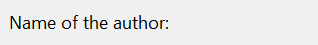

# LabelW class
{: .no_toc }

A **LabelW** is a text that the program shows on a form and the user cannot edit. It has no window of its own: the form, or the container it is in, draws it.

{:width="212" height="30"}

```tb check_build check_run arch=win32,win64
Dim OldWidth As Single
LabelW1.Caption = "Name:"
LabelW1.AutoSize = True
OldWidth = LabelW1.Width
LabelW1.Caption = "Name of the customer:"
Debug.Print LabelW1.Width > OldWidth     ' the label has grown with its caption
' Output:
' True
```

The control stands in place of the [**Label**](../../VB/Label/) of the VB package, the label of VB6. It holds its caption in Unicode, and adds [**SingleLine**](#singleline), [**EllipsisFormat**](#ellipsisformat) with [**DisplayedCaption**](#displayedcaption), [**MimicTextBox**](#mimictextbox), and borders other than a single line.

Of the [common members](Common), the control has those under [Name and place](Common#name-and-place) but **HelpContextID**, [**Font**](Common#font) and [**FontQuality**](Common#fontquality), [Mouse](Common#mouse), [Dragging the control](Common#dragging-the-control), [OLE drag and drop](Common#ole-drag-and-drop) and [Right-to-left](Common#right-to-left) but **RightToLeftLayout**. It has no window, so it has neither **hWnd** nor **hWndUserControl**, and it never takes the focus, so it has no keyboard events.

<!-- test: LabelWTests.Moved_IsDrawnAtItsNewPlace -->
> [!WARNING] 1.8.142.0
> A label that the program moves is no longer drawn. Once [**Left** or **Top**](Common#height-left-top-width) is set, or **Move** is called, the label reports its new place and shows nothing, there or where it was. A label is drawn while it stays where the designer put it. A [**WindowedLabel**](WindowedLabel), which has a window, can be moved.

* TOC
{:toc}

## LabelW or WindowedLabel

The package has the same label twice. [**WindowedLabel**](WindowedLabel) has the members of **LabelW**, with the same meanings, in a window of its own.

A **LabelW** is drawn on the window of its container. It costs no window, and with [**BackStyle**](#backstyle) set to **CCBackStyleTransparent** whatever the container draws behind it shows through. A control without a window is always behind the controls of its container that have one, and it has no handle to pass to an API function. Where the label must be in front of such a control, or a program needs its window handle, or another program reads the text of the form's windows, a **WindowedLabel** is the one to use.

## Lines, wrapping and size

The caption is drawn from the top left corner of the label, and a line break in it (**vbCrLf**) starts a new line. Three properties change that:

- [**WordWrap**](#wordwrap) also breaks a line between words where the label's width ends.
- [**SingleLine**](#singleline) draws the whole caption on one line, line breaks included.
- [**AutoSize**](#autosize) changes the label's size to fit the caption whenever the caption, the font or a property that changes the layout is set.

{:width="621" height="129"}

<!-- test: LabelWTests.WordWrap_WhileSingleLine_Raises383, LabelWTests.SingleLine_True_SetsWordWrapFalse -->
**WordWrap** and **SingleLine** exclude each other. Setting **SingleLine** to **True** sets **WordWrap** to **False**, and setting **WordWrap** to **True** while **SingleLine** is **True** raises run-time error 383.
<!-- /test -->

<!-- test: LabelWTests.AutoSize_LongerCaption_WidensTheLabel, LabelWTests.AutoSize_WordWrap_KeepsTheWidthAndGrowsDown, LabelWTests.AutoSize_RightAligned_KeepsTheRightEdge -->
A label with **AutoSize** takes the width and the height of its caption. With **WordWrap** as well it keeps its width, unless one word is wider, and takes the height that the wrapped caption needs. The label grows away from the side that [**Alignment**](#alignment) and [**VerticalAlignment**](#verticalalignment) name: a right-aligned label keeps its right edge, and a centered one its middle.
<!-- /test -->

```tb check_build check_run arch=win32,win64
Dim OldRight As Single
LabelW1.Alignment = vbRightJustify
LabelW1.AutoSize = True
LabelW1.Caption = "Total:"
OldRight = LabelW1.Left + LabelW1.Width
LabelW1.Caption = "Total of all the orders:"
Debug.Print Abs(LabelW1.Left + LabelW1.Width - OldRight) < 20    ' the right edge has not moved
' Output:
' True
```

## A caption too long for the label

A label without **AutoSize** shows as much of its caption as fits. [**EllipsisFormat**](#ellipsisformat) makes it say that something is missing, by an ellipsis (`...`) at the end of the caption, in the middle of a file path, or at the end of a word. [**DisplayedCaption**](#displayedcaption) then returns the caption as the label last drew it, with the ellipsis.

```tb check_build
LabelW1.AutoSize = False
LabelW1.SingleLine = True
LabelW1.EllipsisFormat = LblEllipsisFormatPath
LabelW1.Caption = "C:\Program Files\Some Vendor\Some Product\bin\program.exe"
LabelW1.ToolTipText = LabelW1.Caption        ' the whole path, for the mouse
```

## Border and colors

[**BorderStyle**](#borderstyle) draws a border inside the label's rectangle, and [**BackStyle**](#backstyle) says whether the label fills its rectangle with [**BackColor**](#backcolor) first. The caption is drawn in [**ForeColor**](#forecolor), or in the grey of disabled text while **Enabled** is **False**.

<!-- test: LabelWTests.Appearance_Flat_MakesABorderASingleLine, LabelWTests.Appearance_SetsForeColor -->
[**Appearance**](#appearance) is a shortcut for the two looks of VB6. Setting it changes a border, if the label has one, to a single line for **CCAppearanceFlat** and to a sunken edge for **CCAppearance3D**, and sets **ForeColor** to **vbWindowText** or to **vbButtonText**. A program that wants another border or color sets it after **Appearance**.
<!-- /test -->

```tb check_build check_run arch=win32,win64
LabelW1.BorderStyle = CCBorderStyleRaised
LabelW1.ForeColor = vbRed
LabelW1.Appearance = CCAppearanceFlat
Debug.Print LabelW1.BorderStyle = CCBorderStyleSingle
Debug.Print LabelW1.ForeColor = vbWindowText
' Output:
' True
' True
```

Properties
----------

### Alignment
{: .no_toc }

Where each line of the caption stands in the label's width. A member of [**AlignmentConstants**](../../VBRUN/Constants/AlignmentConstants): **vbLeftJustify** (the default), **vbRightJustify** or **vbCenter**. Another value raises run-time error 380.

### Appearance
{: .no_toc }

The look of the label. A member of [**CCAppearanceConstants**](Common#ccappearanceconstants). Default: **CCAppearance3D**. Another value raises run-time error 380. An assignment also sets [**ForeColor**](#forecolor) and changes a border: see [Border and colors](#border-and-colors).

### AutoSize
{: .no_toc }

Whether the label changes its size to fit its caption. **Boolean**. Default: **False**. See [Lines, wrapping and size](#lines-wrapping-and-size). The size does not take [**EllipsisFormat**](#ellipsisformat) into account.

### BackColor
{: .no_toc }

The color the label fills its rectangle with while [**BackStyle**](#backstyle) is **CCBackStyleOpaque**. **OLE_COLOR**. Default: **vbButtonFace**.

### BackStyle
{: .no_toc }

Whether the label fills its rectangle or lets what is behind it show. A member of [**CCBackStyleConstants**](Common#ccbackstyleconstants). Default: **CCBackStyleOpaque**. Another value raises run-time error 380.

### BorderStyle
{: .no_toc }

The border of the label. A member of [**CCBorderStyleConstants**](Common#ccborderstyleconstants). Default: **CCBorderStyleNone**. Another value raises run-time error 380. The border takes its width from the room the caption has.

### Caption
{: .no_toc }

The text of the label. **String**. A control newly drawn on a form has its own name. It is the control's default property.

<!-- test: LabelWTests.Caption_Assigned_RaisesChangeOnlyWhenItDiffers -->
An assignment of another text raises [**Change**](#change). Assigning the text the label already has does nothing.
<!-- /test -->

### DisplayedCaption
{: .no_toc }

The caption as the label last drew it: the caption itself, or, with an [**EllipsisFormat**](#ellipsisformat) and a caption too long for the label, the caption with the ellipsis in place of what does not fit. **String**, read-only. It is empty until the label has been drawn on the screen.

### EllipsisFormat
{: .no_toc }

Whether and where the label puts an ellipsis in a caption that is too long for it. A member of [**LblEllipsisFormatConstants**](#lblellipsisformatconstants). Default: **LblEllipsisFormatNone**. Another value raises run-time error 380.

### ForeColor
{: .no_toc }

The color of the caption. **OLE_COLOR**. A control newly drawn on a form has black. An assignment to [**Appearance**](#appearance) sets it again.

### MimicTextBox
{: .no_toc }

Whether the label lays its caption out as a multi-line text box does: a word too long for a line is broken between characters, and a last line that would show only in part is not drawn. **Boolean**. Default: **False**. It has an effect while [**WordWrap**](#wordwrap) is **True**.

### SingleLine
{: .no_toc }

Whether the whole caption is drawn on one line. **Boolean**. Default: **False**. Setting it to **True** sets [**WordWrap**](#wordwrap) to **False**. On one line, [**VerticalAlignment**](#verticalalignment) places the line in the label's height.

### UseMnemonic
{: .no_toc }

Whether an ampersand (`&`) in the caption makes the character after it the label's access key. **Boolean**. Default: **True**, with which that character is underlined, the ampersand is not drawn, and `&&` draws one ampersand. With **False** the caption is drawn as it is.

### VerticalAlignment
{: .no_toc }

Where the caption stands in the label's height. A member of [**CCVerticalAlignmentConstants**](Common#ccverticalalignmentconstants). Default: **CCVerticalAlignmentTop**. Another value raises run-time error 380.

### WordWrap
{: .no_toc }

Whether a line that is too long for the label's width is broken between words. **Boolean**. Default: **False**. Setting it to **True** while [**SingleLine**](#singleline) is **True** raises run-time error 383.

Events
------

### Change
{: .no_toc }

Raised when [**Caption**](#caption) has changed.

Syntax: *object*\_**Change**( )

## LblEllipsisFormatConstants
{: #lblellipsisformatconstants }

The values of [**EllipsisFormat**](#ellipsisformat).

{:width="821" height="95"}

| Member | Value | Description |
|---|---|---|
| **LblEllipsisFormatNone**{: #LblEllipsisFormatConstants_LblEllipsisFormatNone } | 0 | No ellipsis: the caption is cut where the label ends. |
| **LblEllipsisFormatEnd**{: #LblEllipsisFormatConstants_LblEllipsisFormatEnd } | 1 | An ellipsis in place of the end of the caption. |
| **LblEllipsisFormatPath**{: #LblEllipsisFormatConstants_LblEllipsisFormatPath } | 2 | An ellipsis in the middle of the caption, so that as much as fits of what follows the last backslash still shows: for a file path. |
| **LblEllipsisFormatWord**{: #LblEllipsisFormatConstants_LblEllipsisFormatWord } | 3 | An ellipsis in place of the end of a word that does not fit. |

## See Also

- [Common members](Common) -- the members this control shares with the package's other controls
- [WindowedLabel](WindowedLabel) -- the same label in a window of its own
- [Label](../../VB/Label/) -- the label of the VB package
