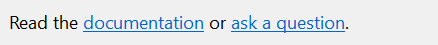

# LinkLabel class
{: .no_toc }

A **LinkLabel** is a text with links in it, which the user clicks or reaches with the Tab key as on a web page. The program says in an event what a link does.

{:width="292" height="30"}

```tb check_build check_run arch=win32,win64
LinkLabel1.Caption = "Read the <A HREF=""https://example.com/docs"">documentation</A> or <A ID=""ask"">ask a question</A>."
Debug.Print LinkLabel1.Links.Count
Debug.Print LinkLabel1.Links(1).Caption
Debug.Print LinkLabel1.Links(1).URL
Debug.Print LinkLabel1.Links(2).IDName
' Output:
'  2
' documentation
' https://example.com/docs
' ask
```

VB6 has no such control. It is the link control of Windows, which exists only in a program with visual styles.

Of the [common members](../Common), the control has those under [Name and place](../Common#name-and-place), [Window handles](../Common#window-handles), [Font and visual styles](../Common#font-and-visual-styles), [Mouse](../Common#mouse) but **DblClick**, [Keyboard and focus](../Common#keyboard-and-focus), [Dragging the control](../Common#dragging-the-control), [OLE drag and drop](../Common#ole-drag-and-drop) and [Right-to-left](../Common#right-to-left) but **RightToLeftLayout**.

Its sub-objects have pages of their own:

- [LlbLinks](LlbLinks) -- the collection of the links, which [**Links**](#links) returns
- [LlbLink](LlbLink) -- one link

* TOC
{:toc}

## The caption and its links

<!-- test: LinkLabelTests.Caption_Markup_MakesTheLinks, LinkLabelTests.Link_UrlAndIDName_ComeFromTheMarkup -->
[**Caption**](#caption) holds the text and marks the links in it, as HTML does: the text between `<A>` and `</A>` is a link. The opening mark can give the link an address, `<A HREF="https://example.com">`, a name of the program's own, `<A ID="ask">`, or both. The marks are not shown, and capital and small letters in them are the same.
<!-- /test -->

[**Links**](#links) returns the links as a collection of [**LlbLink**](LlbLink) objects, numbered from 1 in the order of the caption. A link's [**URL**](LlbLink#url) and [**IDName**](LlbLink#idname) are those of the marks, and the program can set them in code as well.

<!-- test: LinkLabelTests.Link_CaptionAssigned_RewritesTheControlsCaption, LinkLabelTests.Caption_Changed_ForgetsWhatCodeSetOnALink -->
The control makes its links again from the marks whenever its caption changes, by an assignment to **Caption** or to the [**Caption**](LlbLink#caption) of a link. A URL or a name that the program gave a link in code is lost then, and so are the links' states: every link is enabled again and not visited. A program that changes the caption sets those again afterwards, or keeps them in the marks.

```tb check_build check_run arch=win32,win64
LinkLabel1.Caption = "<A>Open</A> the file"
LinkLabel1.Links(1).URL = "C:\report.txt"       ' set in code, not in the marks
LinkLabel1.Links(1).Caption = "Print"
Debug.Print LinkLabel1.Caption
Debug.Print Len(LinkLabel1.Links(1).URL)
' Output:
' <A>Print</A> the file
'  0
```
<!-- /test -->

## What a link does

The control opens nothing by itself. When the user clicks a link, or presses Enter while a link has the keyboard focus, the control raises [**LinkActivate**](#linkactivate) with the link, and the handler does the work. A link is not drawn as visited until the program sets its [**Visited**](LlbLink#visited).

```tb check_build
Private Sub LinkLabel1_LinkActivate(ByVal Link As LlbLink, ByVal Reason As LlbLinkActivateReasonConstants)
    Link.Visited = True
    If Link.IDName = "ask" Then
        TextBoxW1.SetFocus
    Else
        Debug.Print "Open "; Link.URL
    End If
End Sub
```

<!-- test: LinkLabelTests.LinkActivate_Enter_IsRaisedForTheSelectedLink, LinkLabelTests.LinkActivate_Enter_NotRaisedForADisabledLink -->
A link whose [**Enabled**](LlbLink#enabled) is **False** takes neither a click nor the Enter key, and raises no **LinkActivate**.
<!-- /test -->

## The keyboard

The control takes the focus, and one of its links then has a focus rectangle: the selected link, which [**SelectedItem**](#selecteditem) returns. The Tab key moves the selection to the next link, and leaves the control after the last one. Enter activates the selected link.

<!-- test: LinkLabelTests.SelectedItem_Set_SelectsThatLinkAlone, LinkLabelTests.SelectedItem_Nothing_SelectsNoLink -->
Assigning a link to **SelectedItem**, or setting a link's [**Selected**](LlbLink#selected) to **True**, selects that link and no other. Assigning **Nothing** leaves no link selected.
<!-- /test -->

## The look of the links

Windows draws a link in its link color, underlined. Three properties and an event change that:

- [**UnderlineCold**](#underlinecold) and [**UnderlineHot**](#underlinehot) say whether a link is underlined while the pointer is elsewhere and while it is over the link. The second has an effect only with [**HotTracking**](#hottracking) set to **True**, which makes the link under the pointer the *hot* one.
- [**LinkForeColor**](#linkforecolor) is raised each time a link is drawn, with its color, which the handler can change.

```tb check_build
Private Sub LinkLabel1_LinkForeColor(ByVal Link As LlbLink, RGBColor As Long)
    If Link.Hot Then RGBColor = vbRed
End Sub
```

With [**ShowTips**](#showtips) set to **True** a link shows a tooltip while the pointer rests on it, with the text that a [**LinkGetTipText**](#linkgettiptext) handler gives.

```tb check_build
Private Sub LinkLabel1_LinkGetTipText(ByVal Link As LlbLink, Text As String)
    Text = Link.URL
End Sub
```

Properties
----------

### Alignment
{: .no_toc }

Whether the text stands at the left or at the right of the control. A member of [**CCLeftRightAlignmentConstants**](../Common#ccleftrightalignmentconstants). Default: **CCLeftRightAlignmentLeft**.

<!-- test: LinkLabelTests.Alignment_OutOfRange_Raises380, LinkLabelTests.Alignment_Changed_MakesANewWindow -->
Another value raises run-time error 380. For a change of **Alignment** or of [**UseMnemonic**](#usemnemonic) the control makes its window again, so [**hWnd**](../Common#hwnd) returns another handle afterwards and the links are made again from the marks of the caption.
<!-- /test -->

### BackColor
{: .no_toc }

The color behind the text. **OLE_COLOR**. Default: **vbButtonFace**.

### BorderStyle
{: .no_toc }

The border of the control. A member of [**CCBorderStyleConstants**](../Common#ccborderstyleconstants). Default: **CCBorderStyleNone**. Another value raises run-time error 380.

### Caption
{: .no_toc }

The text, with the marks of its links. **String**. A control newly drawn on a form has its own name as one link, `<A>LinkLabel1</A>`. See [The caption and its links](#the-caption-and-its-links).

### ForeColor
{: .no_toc }

The color of the text. **OLE_COLOR**. A control newly drawn on a form has black. A link has the link color of Windows, which a [**LinkForeColor**](#linkforecolor) handler can change.

### HotTracking
{: .no_toc }

Whether the link under the pointer becomes the hot one, so that its [**Hot**](LlbLink#hot) is **True** and [**UnderlineHot**](#underlinehot) applies to it. **Boolean**. Default: **False**.

### hWndToolTip
{: .no_toc }

The handle of the window of the links' tooltips. **LongPtr**, read-only. It is 0 while [**ShowTips**](#showtips) is **False**.

### Links
{: .no_toc }

The links of the caption. An [**LlbLinks**](LlbLinks) collection, read-only.

### SelectedItem
{: .no_toc }

The link that has the focus rectangle, or **Nothing** when no link has it. An [**LlbLink**](LlbLink). Assigned with **Set**, it selects a link, or none with **Nothing**.

### ShowTips
{: .no_toc }

Whether the links show tooltips, for which the control raises [**LinkGetTipText**](#linkgettiptext). **Boolean**. Default: **False**.

### Transparent
{: .no_toc }

Whether the control draws, in place of [**BackColor**](#backcolor), a copy of what its container shows behind it. **Boolean**. Default: **False**. The copy is made again when the control is resized and on [**Refresh**](../Common#refresh).

### UnderlineCold
{: .no_toc }

Whether a link that is not hot is underlined. **Boolean**. Default: **True**.

### UnderlineHot
{: .no_toc }

Whether the hot link is underlined. **Boolean**. Default: **True**. A link is hot only with [**HotTracking**](#hottracking).

### UseMnemonic
{: .no_toc }

Whether an ampersand (`&`) in the caption makes the character after it the control's access key. **Boolean**. Default: **True**, with which that character is underlined and the ampersand is not drawn. With **False** the caption is drawn as it is.

Methods
-------

### GetIdealHeight
{: .no_toc }

Returns the height the control needs to show its whole caption at its present width, border included, in the scale units of the control's container.

Syntax: *object*.**GetIdealHeight** **As Single**

### GetIdealSize
{: .no_toc }

Gives the width and the height the control needs to show its whole caption without making it wider than it is, border included, in the scale units of the control's container.

Syntax: *object*.**GetIdealSize** *Width*, *Height*

*Width*, *Height*
: *required* Two **Single** variables, which the method sets.

```tb check_build
Dim W As Single, H As Single
LinkLabel1.GetIdealSize W, H
LinkLabel1.Width = W
LinkLabel1.Height = H
```

### HitTest
{: .no_toc }

Returns the link at a point, or **Nothing** when there is none.

Syntax: *object*.**HitTest**( *X*, *Y* ) **As LlbLink**

*X*, *Y*
: *required* The point, measured from the top left corner of the control in the scale units of the control's container. **Single**.

Events
------

### ContextMenu
{: .no_toc }

Raised when the user asks for a menu on the control, with the right mouse button or with Shift+F10. The control has no menu of its own.

Syntax: *object*\_**ContextMenu**( **ByVal** *X* **As Single**, **ByVal** *Y* **As Single** )

*X*, *Y*
: The place of the click, measured from the top left corner of the control in the scale units of the control's container. Both are -1 when the user asked with the keyboard.

### LinkActivate
{: .no_toc }

Raised when the user clicks a link that is enabled, or presses Enter while it is selected.

Syntax: *object*\_**LinkActivate**( **ByVal** *Link* **As LlbLink**, **ByVal** *Reason* **As LlbLinkActivateReasonConstants** )

*Link*
: The [**LlbLink**](LlbLink) that was activated.

*Reason*
: A member of [**LlbLinkActivateReasonConstants**](#llblinkactivatereasonconstants): the mouse or the keyboard.

### LinkForeColor
{: .no_toc }

Raised each time the control draws a link, for the handler to choose its color.

Syntax: *object*\_**LinkForeColor**( **ByVal** *Link* **As LlbLink**, *RGBColor* **As Long** )

*Link*
: The [**LlbLink**](LlbLink) that is drawn.

*RGBColor*
: The color the link is about to be drawn in, as [**RGB**](../../../../Modules/Information/RGB) returns one. A handler that changes it sets the color. A system color, such as **vbHighlight**, is not a color of this kind.

### LinkGetTipText
{: .no_toc }

Raised when a link is about to show its tooltip, while [**ShowTips**](#showtips) is **True**.

Syntax: *object*\_**LinkGetTipText**( **ByVal** *Link* **As LlbLink**, *Text* **As String** )

*Link*
: The [**LlbLink**](LlbLink) under the pointer.

*Text*
: Empty when the event is raised. The handler sets it to the text of the tooltip; left empty, the link shows none.

### LinkMouseEnter, LinkMouseLeave
{: .no_toc }

Raised when the pointer moves onto a link and when it leaves the link, while [**MouseTrack**](../Common#mousetrack) is **True**.

Syntax: *object*\_**LinkMouseEnter**( **ByVal** *Link* **As LlbLink** )

*Link*
: The [**LlbLink**](LlbLink) that the pointer moved onto, or left.

## LlbLinkActivateReasonConstants
{: #llblinkactivatereasonconstants }

The values of the *Reason* argument of [**LinkActivate**](#linkactivate).

| Member | Value | Description |
|---|---|---|
| **LlbLinkActivateReasonClick**{: #LlbLinkActivateReasonConstants_LlbLinkActivateReasonClick } | 0 | The user clicked the link. |
| **LlbLinkActivateReasonReturn**{: #LlbLinkActivateReasonConstants_LlbLinkActivateReasonReturn } | 1 | The user pressed Enter while the link was selected. |

## See Also

- [Common members](../Common) -- the members this control shares with the package's other controls
- [LlbLinks](LlbLinks) class -- the collection of the links
- [LlbLink](LlbLink) class -- one link
- [LabelW](../LabelW) -- a label without links
