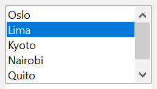
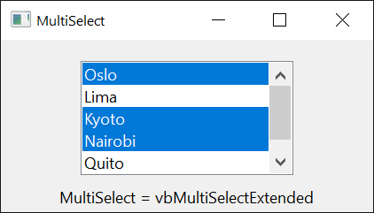
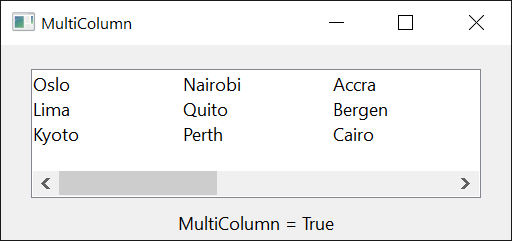
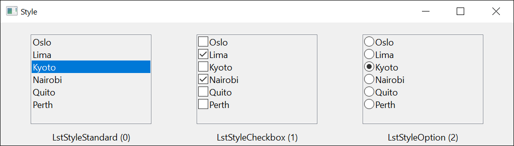

# ListBoxW class
{: .no_toc }

A **ListBoxW** is a list of text items, in one column or several, from which the user selects one item or many. Each item can have a check box or an option button.

{:width="172" height="98"}

```tb check_build check_run arch=win32,win64
ListBoxW1.AddItem "Oslo"
ListBoxW1.AddItem "Lima"
ListBoxW1.AddItem "Kyoto"
ListBoxW1.ListIndex = 1
Debug.Print ListBoxW1.Text; ListBoxW1.ListCount
' Output:
' Lima 3
```

The control stands in place of the [**ListBox**](../../VB/ListBox/) of VB6. It keeps its text in Unicode, and adds option buttons, an insertion mark between items for drag and drop, searching ([**FindItem**](#finditem), [**SelectItem**](#selectitem)), hit testing, the collections [**SelectedIndices**](#selectedindices) and [**CheckedIndices**](#checkedindices), dropped files, and items that the program draws.

Of the [common members](Common), the control has every member under [Name and place](Common#name-and-place), [Window handles](Common#window-handles), [Font and visual styles](Common#font-and-visual-styles), [Mouse](Common#mouse), [Keyboard and focus](Common#keyboard-and-focus), [Dragging the control](Common#dragging-the-control), [OLE drag and drop](Common#ole-drag-and-drop) and [Right-to-left](Common#right-to-left) but **RightToLeftLayout**. Its [**Click**](#click) has a meaning of its own, and its [mouse events](#mousedown-mousemove-mouseup) give the position in twips.

* TOC
{:toc}

## The list

[**AddItem**](#additem) adds an item at the end of the list or at an index, [**RemoveItem**](#removeitem) removes one and [**Clear**](#clear) removes all. [**ListCount**](#listcount) is the number of items, and [**List**](#list) is the text of one, by its index from 0. Each item also holds a number of the program's own, [**ItemData**](#itemdata), which stays with the item when others are added or removed.

<!-- test: ListBoxWTests.AddItem_NewIndex_IsWhereTheItemWent, ListBoxWTests.Sorted_NewItemsGoInOrder -->
[**NewIndex**](#newindex) is the index that the last **AddItem** gave its item. With [**Sorted**](#sorted) set to **True**, **AddItem** without an index puts each item in alphabetical order, without regard to case, so **NewIndex** is the way to find it again.

```tb check_build check_run arch=win32,win64
With ListBoxW1
    .Sorted = True
    .AddItem "pear"
    .AddItem "fig"
    .AddItem "apple"
    .ItemData(.NewIndex) = 500
    Debug.Print .List(0); " "; .List(1); " "; .List(2); .NewIndex; .ItemData(0)
End With
' Output:
' apple fig pear 0  500
```
<!-- /test -->

To add many items quickly, set [**Redraw**](#redraw) to **False**, add them, and set it to **True** again.

<!-- test: ListBoxWTests.Sorted_SetAtRunTime_RaisesClickForTheSelectedItem -->
A change of [**AllowSelection**](#allowselection), [**DisableNoScroll**](#disablenoscroll), [**MultiColumn**](#multicolumn), [**MultiSelect**](#multiselect), [**Sorted**](#sorted) or [**UseTabStops**](#usetabstops) at run time makes the control's window again. The items, their **ItemData** and the selection are kept, but [**hWnd**](Common#hwnd) is a new handle, and the control raises [**Click**](#click) once more when an item is selected.
<!-- /test -->

## Selecting one item

With [**MultiSelect**](#multiselect) at **vbMultiSelectNone**, its default, one item at most is selected. [**ListIndex**](#listindex) is its index, or -1, and [**Text**](#text) is its text.

<!-- test: ListBoxWTests.ListIndex_Assigned_SelectsAndRaisesClick, ListBoxWTests.Text_Assigned_SelectsTheItemWithThatText, ListBoxWTests.Selected_Assigned_RaisesClickWhenTheSelectionChanges -->
A program selects an item by its index with **ListIndex**, by its text with **Text**, or with [**Selected**](#selected). Each raises [**Click**](#click) when the selection changes, as the user's own choice does. A **Text** that no item has removes the selection.

```tb check_build check_run arch=win32,win64
With ListBoxW1
    .AddItem "red"
    .AddItem "green"
    .AddItem "blue"
    .ListIndex = 1
    Debug.Print .Text; .ListIndex; .SelCount
    .Text = "BLUE"                       ' case does not count
    Debug.Print .Text; .ListIndex
    .Text = "mauve"
    Debug.Print "["; .Text; "]"; .ListIndex; .SelCount
End With
' Output:
' green 1  1
' blue 2
' []-1  0
```
<!-- /test -->

## Selecting several items

With **MultiSelect** at **vbMultiSelectSimple** a click or the Spacebar selects an item or removes its selection. With **vbMultiSelectExtended** the user selects a range with the Shift key and single items with the Ctrl key, as in Windows Explorer.

{:width="281" height="161"}

<!-- test: ListBoxWTests.ListIndex_MultiSelect_MovesTheFocusOnly, ListBoxWTests.SelectedIndices_HoldsTheIndexesInOrder, ListBoxWTests.SetSelRange_SelectsOrRemovesTheSelection -->
[**Selected**](#selected) says whether an item is selected, and selects it or removes its selection. [**SelCount**](#selcount) is the number of selected items, [**SelectedIndices**](#selectedindices) returns their indexes, and [**SetSelRange**](#setselrange) selects a run of items in a single call. In such a list **ListIndex** is not the selection: it is the item with the focus rectangle, and an assignment moves the rectangle without selecting anything. **Text** is the text of that item.
<!-- /test -->

```tb check_build
Dim Index As Variant
With ListBoxW1
    .Selected(0) = True
    .Selected(2) = True
    For Each Index In .SelectedIndices
        Debug.Print .List(Index)
    Next
End With
```

## Check boxes and option buttons

[**Style**](#style), set at design time, gives each item a check box (**LstStyleCheckbox**) or an option button (**LstStyleOption**), at the left of its text. The user checks an item with a click on its box, a click on the selected item, or the Spacebar. With check boxes any number of items can be checked. With option buttons one item at most is checked, and checking another clears it.

[**ItemChecked**](#itemchecked) says whether an item is checked and checks it, [**CheckedIndices**](#checkedindices) returns the indexes of the checked items, and [**OptionIndex**](#optionindex) is the checked item of an option list. Each change, by the user or by the program, raises [**ItemBeforeCheck**](#itembeforecheck), whose handler can refuse it, and then [**ItemCheck**](#itemcheck).

```tb check_build
Private Sub ListBoxW1_ItemBeforeCheck(ByVal Item As Long, Cancel As Boolean)
    If ListBoxW1.List(Item) = "Required" Then Cancel = True     ' this item keeps its state
End Sub

Private Sub ListBoxW1_ItemCheck(ByVal Item As Long)
    Debug.Print ListBoxW1.List(Item); " is now "; IIf(ListBoxW1.ItemChecked(Item), "checked", "clear")
End Sub
```

Such a list selects one item at a time: **MultiSelect** stays **vbMultiSelectNone**, and [**DrawMode**](#drawmode) stays **LstDrawModeNormal**.

## Columns and scrolling

A list in one column scrolls up and down. With [**MultiColumn**](#multicolumn) set to **True** the items fill the control's height, go on in a next column, and the list scrolls sideways by columns; [**SetColumnWidth**](#setcolumnwidth) sets the width of the columns and [**ItemsPerColumn**](#itemspercolumn) returns how many items one holds.

{:width="341" height="161"}

[**TopIndex**](#topindex) is the first item shown, and the control raises [**Scroll**](#scroll) when it changes. A list in one column whose items are wider than the control gets a horizontal scroll bar from [**HorizontalExtent**](#horizontalextent).

## Dragging items

With [**OLEDragMode**](#oledragmode) set to **vbOLEDragAutomatic**, the user drags the selected items out of the list as text. While a drag is going on, [**OLEDraggedItem**](#oledraggeditem) is the item it began on.

A list that takes items shows where a drop would put them with an insertion mark, a line between two items. In [**OLEDragOver**](Common#oledragover) the handler asks [**HitTestInsertMark**](#hittestinsertmark) for the item under the pointer and sets [**InsertMark**](#insertmark); in [**OLEDragDrop**](Common#oledragdrop) it adds the item there and removes the mark. The list scrolls by itself while the pointer is near its top or bottom edge, unless [**OLEDragDropScroll**](#oledragdropscroll) is **False**.

```tb check_build
Private Sub ListBoxW1_OLEDragOver(Data As DataObject, Effect As Long, Button As Integer, Shift As Integer, X As Single, Y As Single, State As Integer)
    Dim After As Boolean, Index As Long
    If State = vbLeave Then
        ListBoxW1.InsertMark = -1
    Else
        Index = ListBoxW1.HitTestInsertMark(X, Y, After)
        ListBoxW1.InsertMark(After) = Index
    End If
End Sub

Private Sub ListBoxW1_OLEDragDrop(Data As DataObject, Effect As Long, Button As Integer, Shift As Integer, X As Single, Y As Single)
    Dim After As Boolean, Index As Long
    Index = ListBoxW1.InsertMark(After)
    ListBoxW1.InsertMark = -1
    If Index < 0 Then
        ListBoxW1.AddItem Data.GetData(vbCFText)
    Else
        ListBoxW1.AddItem Data.GetData(vbCFText), IIf(After, Index + 1, Index)
    End If
End Sub
```

## Drawing the items

With [**DrawMode**](#drawmode) set at design time to **LstDrawModeOwnerDrawFixed** or **LstDrawModeOwnerDrawVariable**, the control draws no item: it raises [**ItemDraw**](#itemdraw) for each item to show, and the handler draws into the device context it is given. With **LstDrawModeOwnerDrawVariable** the items can differ in height, and the control first raises [**ItemMeasure**](#itemmeasure) for each item as it is added. The items still hold their texts. [Drawing the items](ComboBoxW#drawing-the-items) of **ComboBoxW** has a handler; one for this control differs in the control's name only.

Properties
----------

### AllowDropFiles
{: .no_toc }

Whether the control takes files that the user drags onto it from Windows Explorer, and raises [**DropFiles**](#dropfiles). **Boolean**. Default: **False**. It has an effect while [**OLEDropMode**](Common#oledropmode) is **OLEDropModeNone**.

### AllowSelection
{: .no_toc }

Whether the list shows a selection. **Boolean**. Default: **True**. With **False** the user can look at the items and scroll, and a click selects nothing.

### AnchorIndex
{: .no_toc }

The item from which the user's next selection with the Shift key extends, in a list that selects several items. **Long**. A value less than -1, or one that is not an item, raises run-time error 380.

### BackColor
{: .no_toc }

The background color of the list. **OLE_COLOR**. A new control has **vbWindowBackground**.

### BorderStyle
{: .no_toc }

The border of the control. A member of [**CCBorderStyleConstants**](Common#ccborderstyleconstants). Default: **CCBorderStyleSunken**. Another value raises run-time error 380.

### DisableNoScroll
{: .no_toc }

Whether the list shows a disabled scroll bar when all its items fit. **Boolean**. Default: **False**, with which the list has a scroll bar only when it needs one.

### DrawMode
{: .no_toc }

Whether the control or the program draws the items. A member of [**LstDrawModeConstants**](#lstdrawmodeconstants). Default: **LstDrawModeNormal**. See [Drawing the items](#drawing-the-items).

<!-- test: ListBoxWTests.DrawMode_AtRunTime_Raises382 -->
It is set at design time. At run time an assignment raises run-time error 382, and a value that is not a member raises 380.
<!-- /test -->

### ForeColor
{: .no_toc }

The color of the items' text. **OLE_COLOR**.

### HorizontalExtent
{: .no_toc }

The width over which a list in one column can be scrolled sideways, in the scale units of the control's container. **Single**. Default: 0. The list has a horizontal scroll bar while this is greater than its own width. [**GetIdealHorizontalExtent**](#getidealhorizontalextent) returns the value that fits the items. A negative value raises run-time error 380.

### InsertMark
{: .no_toc }

The item at which the insertion mark is drawn, or -1 for no mark. **Long**. Default: -1. See [Dragging items](#dragging-items).

Syntax: *object*.**InsertMark**[( *After* )] [ = *value* ]

*After*
: *optional* A **Boolean** variable. In an assignment, **True** draws the mark below the item and **False**, the default, above it. When the property is read, the variable receives which of the two the mark is.

<!-- test: ListBoxWTests.InsertMark_AssignedAndRead, ListBoxWTests.InsertMark_NoSuchItem_Raises381 -->
A value that is not an item raises run-time error 381. The mark goes when [**RemoveItem**](#removeitem) leaves no item at its index.
<!-- /test -->

### InsertMarkColor
{: .no_toc }

The color of the insertion mark. **OLE_COLOR**. Default: black.

### IntegralHeight
{: .no_toc }

Whether the list shows whole items only. **Boolean**. Default: **True**, with which the control makes itself a little lower so that its last item is not cut. It is always **False** with **LstDrawModeOwnerDrawVariable**.

<!-- test: ListBoxWTests.IntegralHeight_AtRunTime_Raises382 -->
It is set at design time: an assignment at run time raises run-time error 382.
<!-- /test -->

### ItemChecked
{: .no_toc }

Whether an item is checked, in a list with check boxes or option buttons. **Boolean**.

Syntax: *object*.**ItemChecked**( *Index* ) [ = *value* ]

An assignment that changes the item raises [**ItemBeforeCheck**](#itembeforecheck) and, unless its handler refuses, [**ItemCheck**](#itemcheck). In a list with option buttons, checking an item clears the one checked before, and **False** for the checked item leaves none checked.

<!-- test: ListBoxWTests.ItemChecked_StandardStyle_IsAlwaysFalse, ListBoxWTests.ItemChecked_NoSuchItem_Raises381 -->
In a **LstStyleStandard** list the property is always **False**, and an assignment does nothing. An *Index* that is not an item raises run-time error 381.
<!-- /test -->

### ItemData
{: .no_toc }

A number of the program's own that an item holds, such as the key of the record the item stands for. **LongPtr**. A new item has 0.

Syntax: *object*.**ItemData**( *Index* ) [ = *value* ]

<!-- test: ListBoxWTests.ItemData_NoSuchItem_Raises381 -->
An *Index* that is not an item raises run-time error 381.
<!-- /test -->

### ItemHeight
{: .no_toc }

The height of an item, in the scale units of the control's container. **Single**.

Syntax: *object*.**ItemHeight**[( *Index* )] [ = *value* ]

*Index*
: *optional* The item, with **LstDrawModeOwnerDrawVariable**, where each item has its own height. With the other draw modes all items have one height, and an *Index* other than 0 raises run-time error 5.

A negative height raises run-time error 380.

### List
{: .no_toc }

The text of an item. **String**.

Syntax: *object*.**List**( *Index* ) [ = *value* ]

<!-- test: ListBoxWTests.List_NoSuchItem_Raises5, ListBoxWTests.List_AssignedToTheSelectedItem_RaisesClick -->
An assignment replaces the item's text and keeps its [**ItemData**](#itemdata) and the selection. When the item is the selected one, the control raises [**Click**](#click). An *Index* that is not an item raises run-time error 5.
<!-- /test -->

### ListCount
{: .no_toc }

The number of items in the list. **Long**, read-only.

### ListIndex
{: .no_toc }

The index of the selected item, or -1 when no item is selected. **Long**. Default: -1. In a list that selects several items it is the index of the item with the focus rectangle.

<!-- test: ListBoxWTests.ListIndex_NoSuchItem_Raises380, ListBoxWTests.ListIndex_SameValue_RaisesNothing -->
An assignment selects the item, or moves the focus rectangle, and raises [**Click**](#click) unless the value is the one the property has. -1 removes the selection. A value that is not an item raises run-time error 380.
<!-- /test -->

<!-- test: ListBoxWTests.ListIndex_MultiSelect_MovesTheFocusOnly -->
In a list that selects several items, -1 leaves the focus rectangle and the selection as they are, and raises **Click**.
<!-- /test -->

### MultiColumn
{: .no_toc }

Whether the items are laid out in columns and the list scrolls sideways. **Boolean**. Default: **False**. See [Columns and scrolling](#columns-and-scrolling). With **LstDrawModeOwnerDrawVariable** an assignment of **True** raises run-time error 383.

### MultiSelect
{: .no_toc }

Whether the user can select several items, and how. A member of [**MultiSelectConstants**](../../VBRUN/Constants/MultiSelectConstants). Default: **vbMultiSelectNone**. See [Selecting several items](#selecting-several-items). Another value raises run-time error 380, and a value other than **vbMultiSelectNone** raises 383 in a list with check boxes or option buttons.

<!-- test: ListBoxWTests.MultiSelect_AtRunTime_KeepsTheItemsAndTheSelection -->
It can be assigned at run time, and the list keeps its items and its selected item.
<!-- /test -->

<!-- test: ListBoxWTests.MultiSelect_AssignedToAnEmptyList_RaisesNoError, ListBoxWTests.Sorted_AssignedToAnEmptyMultiSelectList_RaisesNoError -->
> [!NOTE] 1.8.137.0
> An assignment of **vbMultiSelectSimple** or **vbMultiSelectExtended** at run time raises run-time error 380 while the list is empty, although the list then does select several items. While such a list is empty, an assignment to **AllowSelection**, **DisableNoScroll**, **MultiColumn**, **Sorted** or **UseTabStops** raises the same error and takes effect all the same. Add the items first, or set **MultiSelect** at design time.

### NewIndex
{: .no_toc }

The index of the item that [**AddItem**](#additem) added last. **Long**, read-only. It is -1 when no item was added, and after [**RemoveItem**](#removeitem) or [**Clear**](#clear).

### OLEDragDropScroll
{: .no_toc }

Whether the list scrolls by itself while data is dragged over it near an edge. **Boolean**. Default: **True**. It has an effect while [**OLEDropMode**](Common#oledropmode) is **OLEDropModeManual**.

### OLEDragMode
{: .no_toc }

Whether the user can drag items out of the list. A member of [**OLEDragConstants**](../../VBRUN/Constants/OLEDragConstants). Default: **vbOLEDragManual**, with which only [**OLEDrag**](Common#oledrag) starts a drag. With **vbOLEDragAutomatic** a drag that begins on a selected item carries the texts of the selected items, one to a line, to copy. Another value raises run-time error 380.

### OLEDraggedItem
{: .no_toc }

The index of the item on which the drag that is going on began. **Long**, read-only. It is -1 while no drag is going on.

### OptionIndex
{: .no_toc }

The index of the checked item of a **LstStyleOption** list, or -1 when none is checked. **Long**. An assignment checks the item as [**ItemChecked**](#itemchecked) does, and -1 clears the checked one. With another style it is -1 and an assignment does nothing. A value that is not an item raises run-time error 381.

### Redraw
{: .no_toc }

Whether the control draws itself when its items change. **Boolean**. Default: **True**. Setting it to **True** again draws the control.

### ScrollTrack
{: .no_toc }

Whether the list scrolls while the user drags the scroll box of a scroll bar. **Boolean**. Default: **True**. With **False** the list scrolls when the user releases the scroll box.

### SelCount
{: .no_toc }

The number of selected items. **Long**, read-only.

### Selected
{: .no_toc }

Whether an item is selected. **Boolean**.

Syntax: *object*.**Selected**( *Index* ) [ = *value* ]

<!-- test: ListBoxWTests.Selected_NoSuchItem_Raises381 -->
An assignment selects the item or removes its selection, and raises [**Click**](#click) when that changes the selection. In a list that selects one item, **True** takes the selection from the item that had it. An *Index* that is not an item raises run-time error 381.
<!-- /test -->

### Sorted
{: .no_toc }

Whether [**AddItem**](#additem) without an index puts each new item in alphabetical order. **Boolean**. Default: **False**. An **AddItem** with an index puts the item at that index all the same.

<!-- test: ListBoxWTests.Sorted_SetAtRunTime_LeavesTheItemsInPlace -->
> [!NOTE] 1.8.137.0
> An assignment of **True** at run time does not sort the items already in the list, and the items added afterward are placed as if the list were sorted. Set **Sorted** before the first item is added.

### Style
{: .no_toc }

Whether the items have check boxes or option buttons. A member of [**LstStyleConstants**](#lststyleconstants). Default: **LstStyleStandard**. See [Check boxes and option buttons](#check-boxes-and-option-buttons).

<!-- test: ListBoxWTests.Style_AtRunTime_Raises382 -->
It is set at design time: an assignment at run time raises run-time error 382.
<!-- /test -->

### Text
{: .no_toc }

The text of the selected item, or an empty string when none is selected. **String**. It is the control's default property. In a list that selects several items it is the text of the item with the focus rectangle.

<!-- test: ListBoxWTests.Text_MultiSelect_NoSuchText_ChangesNothing -->
An assignment selects the item whose whole text is the value, without regard to case. When no item has it, the selection is removed; in a list that selects several items the assignment changes nothing.
<!-- /test -->

### TopIndex
{: .no_toc }

The index of the first item shown. **Long**. An assignment scrolls the list. A negative value raises run-time error 380.

### UseTabStops
{: .no_toc }

Whether a tab character in an item's text moves the text after it to the next tab stop, which lines the items up in columns. **Boolean**. Default: **True**.

Methods
-------

### AddItem
{: .no_toc }

Adds an item to the list, and sets [**NewIndex**](#newindex) to its index.

Syntax: *object*.**AddItem** *Item* [, *Index* ]

*Item*
: *required* A **String**: the text of the item.

*Index*
: *optional* The index the item gets; the items from there on move down by one. Without it the item goes to the end of the list, or to its place in a [**Sorted**](#sorted) list.

<!-- test: ListBoxWTests.AddItem_IndexPastTheEnd_Raises5 -->
An *Index* that is negative or greater than [**ListCount**](#listcount) raises run-time error 5.
<!-- /test -->

### CheckedIndices
{: .no_toc }

Returns a **Collection** of the indexes of the checked items, in rising order. It is empty in a **LstStyleStandard** list.

Syntax: *object*.**CheckedIndices**

### Clear
{: .no_toc }

Removes every item. It raises no event.

Syntax: *object*.**Clear**

### FindItem
{: .no_toc }

Returns the index of the first item that has a text, or -1 when there is none. The search does not regard case.

Syntax: *object*.**FindItem**( *Text* [, *Index* [, *Partial* ] ] )

*Text*
: *required* A **String**: the text to look for.

*Index*
: *optional* A **Long**: the item after which the search starts. The search goes to the end of the list and on from its top, so this item is the last one looked at. The default, -1, searches from the top. A value that is not an item raises run-time error 381.

*Partial*
: *optional* A **Boolean**: **True** finds an item that begins with *Text*, **False** (the default) one whose whole text is *Text*.

<!-- test: ListBoxWTests.FindItem_WholeTextOrBeginning -->
```tb check_build check_run arch=win32,win64
With ListBoxW1
    .AddItem "red"
    .AddItem "green"
    .AddItem "blue"
    Debug.Print .FindItem("GREEN"); .FindItem("gr"); .FindItem("gr", , True)
End With
' Output:
'  1 -1  1
```
<!-- /test -->

### GetIdealHorizontalExtent
{: .no_toc }

Returns the [**HorizontalExtent**](#horizontalextent) with which the widest item can be scrolled into view, as a **Single** in the scale units of the control's container. It returns 0 for an empty list.

Syntax: *object*.**GetIdealHorizontalExtent**

### HitTest
{: .no_toc }

Returns the index of the item at a position, or -1 when no item is there.

Syntax: *object*.**HitTest**( *X*, *Y* )

*X*, *Y*
: *required* The position as two **Single** values, measured from the list's top left corner in the scale units of the control's container, as the OLE drag-and-drop events give it.

<!-- test: ListBoxWTests.HitTest_EmptyList_ReturnsMinus1 -->
> [!WARNING] 1.8.137.0
> In an empty list the method returns 0, not -1, for a position where the first item would be.

### HitTestInsertMark
{: .no_toc }

Returns the index of the item at a position, as [**HitTest**](#hittest) does, and says in which half of the item the position is.

Syntax: *object*.**HitTestInsertMark**( *X*, *Y* [, *After* ] )

*X*, *Y*
: *required* The position, as for **HitTest**.

*After*
: *optional* A **Boolean** variable that receives **True** when the position is in the lower half of the item, where an insertion mark belongs below it.

### ItemsPerColumn
{: .no_toc }

Returns the number of items that one column of a [**MultiColumn**](#multicolumn) list holds, as a **Long**.

Syntax: *object*.**ItemsPerColumn**

### RemoveItem
{: .no_toc }

Removes an item from the list, and sets [**NewIndex**](#newindex) to -1. Removing the selected item leaves no item selected and raises no event.

Syntax: *object*.**RemoveItem** *Index*

*Index*
: *required* A **Long**: the item to remove. A value that is not an item raises run-time error 5.

### SelectedIndices
{: .no_toc }

Returns a **Collection** of the indexes of the selected items, in rising order.

Syntax: *object*.**SelectedIndices**

### SelectItem
{: .no_toc }

Selects the first item that begins with a text, and returns its index. When no item does, it returns -1 and the selection stays. The search does not regard case.

Syntax: *object*.**SelectItem**( *Text* [, *Index* ] )

*Text*
: *required* A **String**: the beginning of the item's text.

*Index*
: *optional* A **Long**: the item after which the search starts, as in [**FindItem**](#finditem).

<!-- test: ListBoxWTests.SelectItem_SelectsAndRaisesNoClick -->
Unlike an assignment to [**ListIndex**](#listindex), the method raises no [**Click**](#click).
<!-- /test -->

### SetColumnWidth
{: .no_toc }

Sets the width of the columns of a [**MultiColumn**](#multicolumn) list.

Syntax: *object*.**SetColumnWidth** *Value*

*Value*
: *required* A **Single**: the width in the scale units of the control's container. A value that is not greater than 0 raises run-time error 380.

### SetSelRange
{: .no_toc }

Selects a run of items, or removes their selection, in a list that selects several items.

Syntax: *object*.**SetSelRange** *StartIndex*, *EndIndex*

*StartIndex*, *EndIndex*
: *required* Two **Long** indexes. When *StartIndex* is less than *EndIndex*, the items from the one to the other are selected as well as those selected already. When it is not less, as when the two are the same, the selection is removed from those items.

The method raises [**Click**](#click) when the number of selected items changes. In a list that selects one item it selects *StartIndex*. An index that is not an item raises run-time error 381.

Events
------

### Click
{: .no_toc }

Raised when the user selects an item, with the mouse or the keyboard, and when [**ListIndex**](#listindex), [**Selected**](#selected), [**SetSelRange**](#setselrange) or [**Text**](#text) changes the selection. A mouse click on the empty part of the list raises no **Click**.

Syntax: *object*\_**Click**( )

### ContextMenu
{: .no_toc }

Raised when the user asks for the control's shortcut menu, with the right mouse button or with Shift+F10.

Syntax: *object*\_**ContextMenu**( **ByVal** *X* **As Single**, **ByVal** *Y* **As Single** )

*X*, *Y*
: The position of the pointer, measured from the list's top left corner in the scale units of the control's container. Both are -1 when the user asked with the keyboard.

### DropFiles
{: .no_toc }

Raised when the user drops files on the control, while [**AllowDropFiles**](#allowdropfiles) is **True**.

Syntax: *object*\_**DropFiles**( *FileList* **As Variant**, **ByVal** *X* **As Single**, **ByVal** *Y* **As Single** )

*FileList*
: An array of **String**, from index 0: the full path of each file.

*X*, *Y*
: The position of the drop, measured from the list's top left corner in the scale units of the control's container.

### ItemBeforeCheck
{: .no_toc }

Raised when an item of a list with check boxes or option buttons is about to be checked or cleared.

Syntax: *object*\_**ItemBeforeCheck**( **ByVal** *Item* **As Long**, *Cancel* **As Boolean** )

*Item*
: The index of the item.

*Cancel*
: **False** when the event is raised. A handler that sets it to **True** leaves the item as it is, and [**ItemCheck**](#itemcheck) is not raised.

### ItemCheck
{: .no_toc }

Raised when an item of a list with check boxes or option buttons has been checked or cleared.

Syntax: *object*\_**ItemCheck**( **ByVal** *Item* **As Long** )

*Item*
: The index of the item. In a list with option buttons it is the item now checked; no event is raised for the item that lost its check.

### ItemDraw
{: .no_toc }

Raised when an item is to be drawn, while [**DrawMode**](#drawmode) is not **LstDrawModeNormal**. See [Drawing the items](#drawing-the-items).

Syntax: *object*\_**ItemDraw**( **ByVal** *Item* **As Long**, **ByVal** *ItemAction* **As Long**, **ByVal** *ItemState* **As Long**, **ByVal** *hDC* **As Long**, **ByVal** *Left* **As Long**, **ByVal** *Top* **As Long**, **ByVal** *Right* **As Long**, **ByVal** *Bottom* **As Long** )

*Item*
: The index of the item, or -1 when the list is empty and only the focus is to be drawn.

*ItemAction*
: What to draw, a sum of 1 (the whole item), 2 (the item was selected or the selection was removed) and 4 (the item received or lost the focus).

*ItemState*
: The state of the item, a sum of 1 (selected), 4 (disabled) and &H10 (it has the focus).

*hDC*
: The device context to draw into. In a 64-bit program it is the low 32 bits of the handle, which is all that a device context's handle uses.

*Left*, *Top*, *Right*, *Bottom*
: The rectangle of the item, in pixels.

### ItemMeasure
{: .no_toc }

Raised once for each item added, while [**DrawMode**](#drawmode) is **LstDrawModeOwnerDrawVariable**, to ask for the item's height.

Syntax: *object*\_**ItemMeasure**( **ByVal** *Item* **As Long**, *ItemHeight* **As Long** )

*Item*
: The index of the item.

*ItemHeight*
: The height of the item in pixels. The handler sets it.

### MouseDown, MouseMove, MouseUp
{: .no_toc }

<!-- test: ListBoxWTests.MouseMove_XAndY_AreInTwips -->
As the [common events](Common#mousedown-mousemove-mouseup) of these names, but *X* and *Y* are in twips, whatever the scale units of the control's container, and are measured from the top left corner of the list.
<!-- /test -->

### Scroll
{: .no_toc }

Raised when the list has scrolled, so that another item is the first one shown.

Syntax: *object*\_**Scroll**( )

## LstStyleConstants
{: #lststyleconstants }

The values of [**Style**](#style).

{:width="681" height="195"}

| Member | Value | Description |
|---|---|---|
| **LstStyleStandard**{: #LstStyleConstants_LstStyleStandard } | 0 | Items of text alone. |
| **LstStyleCheckbox**{: #LstStyleConstants_LstStyleCheckbox } | 1 | Each item has a check box. |
| **LstStyleOption**{: #LstStyleConstants_LstStyleOption } | 2 | Each item has an option button, and one item at most is checked. |

## LstDrawModeConstants
{: #lstdrawmodeconstants }

The values of [**DrawMode**](#drawmode).

| Member | Value | Description |
|---|---|---|
| **LstDrawModeNormal**{: #LstDrawModeConstants_LstDrawModeNormal } | 0 | The control draws the items. |
| **LstDrawModeOwnerDrawFixed**{: #LstDrawModeConstants_LstDrawModeOwnerDrawFixed } | 1 | The program draws the items, which all have one height. |
| **LstDrawModeOwnerDrawVariable**{: #LstDrawModeConstants_LstDrawModeOwnerDrawVariable } | 2 | The program draws the items and gives each its height. |

## See Also

- [Common members](Common) -- the members this control shares with the package's other controls
- [VListBox](VListBox) -- the same control without a list of its own, for a very long list
- [ComboBoxW](ComboBoxW) -- a text box with a drop-down list
- [ListBox](../../VB/ListBox/) -- the control of the VB package that this one stands in place of
