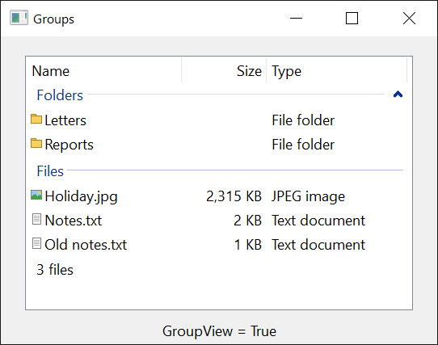

# Groups
{: .no_toc }

Shows the items of a [**ListView**](.) in groups, each under a header of its own, which the user can collapse.

```tb check_build check_run
Dim Folders As LvwGroup, Files As LvwGroup, Item As LvwListItem
With ListView1
    .View = LvwViewReport
    .ColumnHeaders.Add , , "Name"
    Set Folders = .Groups.Add(, "dirs", "Folders")
    Set Files = .Groups.Add(, "files", "Files")
    .GroupView = True
    Set Item = .ListItems.Add(, , "Documents")
    Set Item.Group = Folders
    Set Item = .ListItems.Add(, , "readme.txt")
    Set Item.Group = Files
    Set Item = .ListItems.Add(, , "notes.txt")
    Set Item.Group = Files
    Debug.Print Folders.ListItemCount; Files.ListItemCount
    Debug.Print .ListItems(3).Group.Header
End With
' Output:
'  1  2
' Files
```

* TOC
{:toc}

## Groups and their items

[**Groups**](#groups) returns the groups as an [**LvwGroups**](LvwGroups) collection, and its [**Add**](LvwGroups#add) method adds one, with the text of its header and of its footer. Each group is an [**LvwGroup**](LvwGroup). An item joins a group by its [**Group**](LvwListItem#group), and leaves it when that is set to **Nothing**.

<!-- test: ListViewGroupsTests.Group_Assigned_PutsTheItemInTheGroup -->
> [!WARNING] 1.8.137.0
> In a 64-bit program an item cannot join a group: an assignment to its **Group** does nothing, **Group** returns **Nothing**, and every group's [**ListItemCount**](LvwGroup#listitemcount) is 0. The groups themselves, their headers and their states, work.

The control shows the groups while [**GroupView**](#groupview) is **True**, in every view but the list view. With **GroupView** **False** the items are shown as they would be without groups, and the groups keep their items.

The groups need visual styles: in a program without them, reading [**Groups**](#groups) raises run-time error 91, and **GroupView** stays **False**.

<!-- test: ListViewGroupsTests.Groups_Clear_KeepsGroupView -->
Removing every group with [**Clear**](LvwGroups#clear) leaves **GroupView** as it was.
<!-- /test -->

## What a group shows

A group has a header, with an icon from [**GroupIcons**](#groupicons) and an optional [**Hint**](LvwGroup#hint) under it, a [**Link**](LvwGroup#link) that raises [**GroupLinkClick**](#grouplinkclick), and a footer. A group that is [**Collapsible**](LvwGroup#collapsible) has a button in its header with which the user hides and shows its items.

{:width="361" height="285"}

<!-- test: ListViewGroupsTests.Collapsed_Assigned_RaisesGroupCollapsedChanged -->
Each change of a group's [**Collapsed**](LvwGroup#collapsed), by the user or by code, raises [**GroupCollapsedChanged**](#groupcollapsedchanged), and each change of its [**Selected**](LvwGroup#selected) raises [**GroupSelectedChanged**](#groupselectedchanged).
<!-- /test -->

A group that is [**Subseted**](LvwGroup#subseted) shows only its first [**GroupSubsetCount**](#groupsubsetcount) items, and its [**SubsetLink**](LvwGroup#subsetlink) under them, with which the user shows the rest.

Properties
----------

### GroupIcons
{: .no_toc }

The image list of the icons of the group headers. **Variant**: an [**ImageList**](../ImageList/) control, its name or the handle of an image list, as for [**Icons**](Views#icons). Default: none. A group names its icon by its [**Icon**](LvwGroup#icon). It has an effect when the program has visual styles.

### Groups
{: .no_toc }

The groups of the control, as an [**LvwGroups**](LvwGroups) collection. Read-only.

In [virtual mode](VirtualMode), and in a program without visual styles, reading it raises run-time error 91.

### GroupSubsetCount
{: .no_toc }

The number of items a [**Subseted**](LvwGroup#subseted) group shows. **Long**. Default: 0, with which every group shows all its items.

<!-- test: ListViewGroupsTests.GroupSubsetCount_Negative_Raises380 -->
A negative number raises run-time error 380.
<!-- /test -->

### GroupView
{: .no_toc }

Whether the items are shown in their groups. **Boolean**. Default: **False**. In [virtual mode](VirtualMode) **True** raises run-time error 383.

### SelectedGroup
{: .no_toc }

The group that has the focus. An [**LvwGroup**](LvwGroup), or **Nothing**. Setting it to a group selects that group and gives it the focus; **Nothing** takes the focus from the group that has it. In [virtual mode](VirtualMode) reading or setting it raises run-time error 5.

Events
------

### GroupCollapsedChanged
{: .no_toc }

Raised when a group is collapsed or expanded, by the user or by code.

Syntax: *object*\_**GroupCollapsedChanged**( **ByVal** *Group* **As LvwGroup** )

### GroupLinkClick
{: .no_toc }

Raised when the user clicks the [**Link**](LvwGroup#link) of a group.

Syntax: *object*\_**GroupLinkClick**( **ByVal** *Group* **As LvwGroup** )

### GroupSelectedChanged
{: .no_toc }

Raised when a group is selected or is no longer selected, by the user or by code.

Syntax: *object*\_**GroupSelectedChanged**( **ByVal** *Group* **As LvwGroup** )

## LvwGroupHeaderAlignmentConstants
{: #lvwgroupheaderalignmentconstants }

The values of a group's [**HeaderAlignment**](LvwGroup#headeralignment).

| Member | Value | Description |
|---|---|---|
| **LvwGroupHeaderAlignmentLeft**{: #LvwGroupHeaderAlignmentConstants_LvwGroupHeaderAlignmentLeft } | 0 | The header's text is at the left. |
| **LvwGroupHeaderAlignmentRight**{: #LvwGroupHeaderAlignmentConstants_LvwGroupHeaderAlignmentRight } | 1 | At the right. |
| **LvwGroupHeaderAlignmentCenter**{: #LvwGroupHeaderAlignmentConstants_LvwGroupHeaderAlignmentCenter } | 2 | In the middle. |

## LvwGroupFooterAlignmentConstants
{: #lvwgroupfooteralignmentconstants }

The values of a group's [**FooterAlignment**](LvwGroup#footeralignment).

| Member | Value | Description |
|---|---|---|
| **LvwGroupFooterAlignmentLeft**{: #LvwGroupFooterAlignmentConstants_LvwGroupFooterAlignmentLeft } | 0 | The footer's text is at the left. |
| **LvwGroupFooterAlignmentRight**{: #LvwGroupFooterAlignmentConstants_LvwGroupFooterAlignmentRight } | 1 | At the right. |
| **LvwGroupFooterAlignmentCenter**{: #LvwGroupFooterAlignmentConstants_LvwGroupFooterAlignmentCenter } | 2 | In the middle. |

## See Also

- [ListView](.) control
- [LvwGroups](LvwGroups) class -- the collection of the groups
- [LvwGroup](LvwGroup) class -- one group
