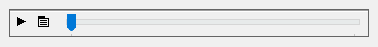

# MCIWnd class
{: .no_toc }

An **MCIWnd** is a player for sound files, video files and the other media devices of Windows: a window with a play bar and a menu, which shows the picture of a video, and which the user or the program controls.

{:width="252" height="31"}

```tb hidden
' Writes a WAV file of a tenth of a second of silence: 8-bit mono samples at 8000 Hz, each 128.
Public Sub WriteSilentWav(ByVal Path As String)
    Const Samples As Long = 800
    Dim Header As String = "RIFF" & MkLong(36 + Samples) & "WAVEfmt " & MkLong(16) & _
        MkWord(1) & MkWord(1) & MkLong(8000) & MkLong(8000) & MkWord(1) & MkWord(8) & _
        "data" & MkLong(Samples)
    Dim Bytes() As Byte
    ReDim Bytes(0 To Len(Header) + Samples - 1)
    Dim i As Long
    For i = 1 To Len(Header)
        Bytes(i - 1) = Asc(Mid$(Header, i, 1))
    Next
    For i = Len(Header) To UBound(Bytes)
        Bytes(i) = 128
    Next
    If Len(Dir$(Path)) > 0 Then Kill Path
    Dim F As Integer = FreeFile
    Open Path For Binary Access Write As #F
    Put #F, 1, Bytes
    Close #F
End Sub
Private Function MkLong(ByVal Value As Long) As String
    MkLong = MkWord(Value And &HFFFF&) & MkWord((Value \ &H10000) And &HFFFF&)
End Function
Private Function MkWord(ByVal Value As Long) As String
    MkWord = Chr$(Value And &HFF&) & Chr$((Value \ &H100&) And &HFF&)
End Function
```

```tb check_build check_run arch=win32,win64
Dim Path As String = Environ$("TEMP") & "\silence.wav"
WriteSilentWav Path                      ' a tenth of a second of silence
MCIWnd1.FileName = Path
Debug.Print MCIWnd1.Device; MCIWnd1.Length; " ms, "; MCIWnd1.ModeString
MCIWnd1.Command = "close"
Kill Path
' Output:
' WaveAudio 100  ms, stopped
```

**WriteSilentWav**, in the samples of this page, is a procedure of the program's own that writes a WAV file. The program then gives the control a file, and the user plays it with the play bar.

The control is the MCIWnd window of Windows, the window class `MCIWndClass` of Video for Windows (`msvfw32.dll`), which plays a file through the Media Control Interface (MCI). VB6 has no such control; its Multimedia control of `MCI32.OCX` sends the same MCI commands, but has a row of buttons where this control has a play bar with a track.

Of the [common members](Common), the control has those under [Name and place](Common#name-and-place), [Window handles](Common#window-handles), **VisualStyles** of [Font and visual styles](Common#font-and-visual-styles), [Mouse](Common#mouse), [Keyboard and focus](Common#keyboard-and-focus), [Dragging the control](Common#dragging-the-control) and [OLE drag and drop](Common#ole-drag-and-drop). It has no font and none of the right-to-left members.

* TOC
{:toc}

## Opening a file or a device

<!-- test: MCIWndTests.FileName_Wav_OpensTheFile, MCIWndTests.FileName_Wav_RaisesMediaChange, MCIWndTests.FileName_MissingFile_Raises53 -->
Assigning a path to [**FileName**](#filename) opens the file with the MCI device that plays files of its type: [**Device**](#device) is then `WaveAudio` for a WAV file, and [**Mode**](#mode) is **MciModeStop**. The control raises [**MediaChange**](#mediachange) with the name. A file that cannot be opened raises run-time error 53, *File not found*, after the [**Error**](#error-1) event with the MCI error, and the control then has no file.
<!-- /test -->

[**ShowOpen**](#showopen) lets the user choose the file in the Open dialog instead, and [**NewDevice**](#newdevice) opens a device with no file, for a new recording. The user can also open a file from the control's menu, while [**AllowOpen**](#allowopen) is **True**.

<!-- test: MCIWndTests.FileName_AutoSizeWindow_ChangesTheHeight, MCIWndTests.FileName_AutoSizeWindowFalse_KeepsTheHeight -->
While [**AutoSizeWindow**](#autosizewindow) is **True**, opening a file gives the control the size of the media's picture with the play bar under it, or of the play bar alone for a sound file, and raises [**Resize**](#resize). With **False** the control keeps its size.
<!-- /test -->

```tb check_build check_run arch=win32,win64
Dim Path As String = Environ$("TEMP") & "\silence.wav"
WriteSilentWav Path
On Error Resume Next
MCIWnd1.FileName = Environ$("TEMP") & "\no such file.wav"
Debug.Print Err.Number; MCIWnd1.Error
On Error GoTo 0
MCIWnd1.FileName = Path
Debug.Print (MCIWnd1.FileName = Path) & " " & MCIWnd1.CanPlay & " " & MCIWnd1.CanEject
MCIWnd1.Command = "close"
Kill Path
' Output:
'  53  275
' True True False
```

The device closes when the control is unloaded, and when the program sends it the MCI command `close` through [**Command**](#command), as the samples of this page do before they delete their file.

## Playing and recording

The play bar has a button that plays and stops, a track whose thumb shows and sets the position, and the menu button; with [**Record**](#record) a record button too. A program plays with [**PlayFrom**](#playfrom), [**PlayTo**](#playto) and [**PlayReverse**](#playreverse), and sends the other MCI commands, such as `play`, `pause`, `stop` and `record`, through [**Command**](#command).

```tb check_build
Private Sub cmdPlay_Click()
    MCIWnd1.Repeat = False
    If MCIWnd1.CanPlay Then MCIWnd1.PlayFrom 0
End Sub

Private Sub cmdPause_Click()
    MCIWnd1.Command = "pause"
End Sub
```

[**Mode**](#mode) is what the device is doing, and [**ModeChange**](#modechange) is raised when it changes. [**Position**](#position) is where the device is, and [**PositionChange**](#positionchange) is raised as it moves, checked every [**TimerFreq**](#timerfreq) milliseconds. [**Repeat**](#repeat) makes the play bar's button play the media again and again. [**Volume**](#volume) and [**Speed**](#speed) are 1000 for the normal level and speed, where the device has them.

## Positions and time formats

[**Position**](#position), [**Length**](#length), [**StartPositon**](#startpositon) and [**EndPosition**](#endposition), and the arguments of the play methods, are in the device's [**TimeFormat**](#timeformat): milliseconds, unless the program sets another format that the device has, such as bytes or samples for a sound file.

<!-- test: MCIWndTests.TimeFormat_Bytes_GivesTheLengthInBytes -->
```tb check_build check_run arch=win32,win64
Dim Path As String = Environ$("TEMP") & "\silence.wav"
WriteSilentWav Path                      ' 800 samples of one byte
MCIWnd1.FileName = Path
Debug.Print MCIWnd1.Length; MCIWnd1.EndPosition
MCIWnd1.TimeFormat = MciFormatBytes
Debug.Print MCIWnd1.TimeFormat; MCIWnd1.Length
MCIWnd1.Command = "close"
Kill Path
' Output:
'  100  100
'  8  800
```
<!-- /test -->

<!-- test: MCIWndTests.TimeFormat_NotOfTheDevice_RaisesTheErrorEvent -->
A format the device does not have, such as **MciFormatFrames** for a sound file, raises the [**Error**](#error-1) event and leaves **TimeFormat** as it was.
<!-- /test -->

## MCI command strings

[**Command**](#command) sends an MCI command string to the open device, the string the Windows function `mciSendString` takes, without the device's name: the control adds the alias of its device. [**CommandReturn**](#commandreturn) is what the last command returned, and [**Error**](#error) and [**ErrorString**](#errorstring) are its MCI error, 0 and the text of success after a command that worked. A command that fails raises the [**Error**](#error-1) event; it raises no run-time error.

<!-- test: MCIWndTests.Command_Status_SetsCommandReturn, MCIWndTests.Command_Unknown_RaisesTheErrorEvent -->
```tb check_build check_run arch=win32,win64
Dim Path As String = Environ$("TEMP") & "\silence.wav"
WriteSilentWav Path
MCIWnd1.FileName = Path
MCIWnd1.Command = "status mode"
Debug.Print MCIWnd1.CommandReturn
MCIWnd1.Command = "rewind"
Debug.Print MCIWnd1.Error; MCIWnd1.ErrorString
MCIWnd1.Command = "close"
Kill Path
' Output:
' stopped
'  261 The driver cannot recognize the specified command.
```
<!-- /test -->

## What the user sees

[**Playbar**](#playbar) shows the play bar, [**Menu**](#menu) its menu button, and [**Record**](#record) its record button. [**Caption**](#caption) gives the control a title bar that shows the file's name, the position or the mode. For a video, [**Zoom**](#zoom) is the size of the picture as a percentage of its own size, and [**AutoSizeMovie**](#autosizemovie) makes the picture follow the control's size. [**ErrorDlg**](#errordlg) shows the MCI errors to the user in a message box.

{:width="861" height="119"}

Properties
----------

### AllowOpen
{: .no_toc }

Whether the control's menu has the commands that open a file and close it. **Boolean**. Default: **True**. It has an effect at run time.

### AutoSizeMovie
{: .no_toc }

Whether the picture of a video takes the size of the control when the control is resized. **Boolean**. Default: **True**. With **False** the picture keeps its size.

### AutoSizeWindow
{: .no_toc }

Whether the control takes the size of the media when the program opens a file or changes [**Zoom**](#zoom). **Boolean**. Default: **True**. See [Opening a file or a device](#opening-a-file-or-a-device).

### BackColor
{: .no_toc }

The color of the control's window behind the play bar and the picture. **OLE_COLOR**. Default: **vbWindowBackground**.

### BorderStyle
{: .no_toc }

The border of the control. A member of [**CCBorderStyleConstants**](Common#ccborderstyleconstants). Default: **CCBorderStyleSingle**. Another value raises run-time error 380. While [**Caption**](#caption) is not **MciCaptionNone**, the control has a title bar and no other border.

### Caption
{: .no_toc }

What the title bar of the control shows. A member of [**MciCaptionConstants**](#mcicaptionconstants). Default: **MciCaptionNone**, with which the control has no title bar. Another value raises run-time error 380.

### Command
{: .no_toc }

An MCI command string, sent to the open device when it is assigned. **String**. It returns the last command sent. See [MCI command strings](#mci-command-strings).

### CommandReturn
{: .no_toc }

What the device returned for the last [**Command**](#command). **String**, read-only: assigning it raises run-time error 383.

### Device
{: .no_toc }

The type of the open device, such as `WaveAudio` for a WAV file. **String**, read-only: assigning it raises run-time error 383. It is empty while no device is open.

### DeviceAlias
{: .no_toc }

The alias by which the control names its device in MCI commands. **Long**, read-only: assigning it raises run-time error 383.

### DeviceID
{: .no_toc }

The MCI device identifier of the open device, for the Windows function `mciSendCommand`. **Long**, read-only: assigning it raises run-time error 383. It is 0 while no device is open.

### EndPosition
{: .no_toc }

The position of the end of the media, in the [**TimeFormat**](#timeformat). **Long**, read-only: assigning it raises run-time error 383.

### Error
{: .no_toc }

The MCI error number of the last command the control sent to its device. **Long**, read-only: assigning it raises run-time error 383. It is 0 after a command that worked.

### ErrorDlg
{: .no_toc }

Whether the control shows each MCI error to the user in a message box. **Boolean**. Default: **False**. The [**Error**](#error-1) event is raised either way.

### ErrorString
{: .no_toc }

The text of the MCI error of the last command, such as *The driver cannot recognize the specified command.* **String**, read-only: assigning it raises run-time error 383.

### FileName
{: .no_toc }

The file the device has open. **String**. It is empty while no file is open. Assigning a path opens that file; one that cannot be opened raises run-time error 53. See [Opening a file or a device](#opening-a-file-or-a-device).

### Length
{: .no_toc }

The length of the media, in the [**TimeFormat**](#timeformat). **Long**, read-only: assigning it raises run-time error 383.

### Menu
{: .no_toc }

Whether the play bar has a menu button, and a right click on the control shows the same menu. **Boolean**. Default: **True**. The menu has the commands of the device, such as the volume and the speed and, with [**AllowOpen**](#allowopen), opening and closing a file.

### Mode
{: .no_toc }

What the device is doing. A member of [**MciModeConstants**](#mcimodeconstants), read-only: assigning it raises run-time error 383. It is **MciModeNotReady** while no device is open.

### ModeString
{: .no_toc }

[**Mode**](#mode) as the device names it, such as `stopped` or `playing`. **String**, read-only: assigning it raises run-time error 383.

### NewDevice
{: .no_toc }

Opens a device of the type assigned, such as `waveaudio`, with no file, for a new recording that [**ShowSave**](#showsave) can then save. **String**, write-only: reading it raises run-time error 394.

### Playbar
{: .no_toc }

Whether the control shows its play bar. **Boolean**. Default: **True**.

### Position
{: .no_toc }

The position of the device in the media, in the [**TimeFormat**](#timeformat). **Long**, read-only: assigning it raises run-time error 383.

### PositionString
{: .no_toc }

[**Position**](#position) as the device writes it, in its time format: for a device with tracks, the track, minutes, seconds and frames. **String**, read-only: assigning it raises run-time error 383.

### Record
{: .no_toc }

Whether the play bar has a record button and the menu the commands to record. **Boolean**. Default: **False**.

### Repeat
{: .no_toc }

Whether the play bar's button plays the media again from the start each time it reaches the end. **Boolean**. Default: **False**.

### Speed
{: .no_toc }

The speed at which the device plays, 1000 for the normal speed. **Long**. A device that has no such setting, such as `WaveAudio`, keeps 1000 and raises the [**Error**](#error-1) event.

### StartPositon
{: .no_toc }

The position of the start of the media, in the [**TimeFormat**](#timeformat). **Long**, read-only: assigning it raises run-time error 383. The name is spelt as the package spells it.

### TimeFormat
{: .no_toc }

The unit of the positions and the length. A member of [**MciFormatConstants**](#mciformatconstants). A device starts with **MciFormatMilliseconds**. A value that is not a member raises run-time error 380; one that the device does not have raises the [**Error**](#error-1) event and leaves the format as it was.

### TimerFreq
{: .no_toc }

How often the control checks the device's mode and position, in milliseconds, and so how often it can raise [**ModeChange**](#modechange) and [**PositionChange**](#positionchange). **Integer**. Default: 500.

<!-- test: MCIWndTests.TimerFreq_Zero_Raises380 -->
A value of 0 or less raises run-time error 380.
<!-- /test -->

### Volume
{: .no_toc }

The volume of the device, 1000 for the normal level. **Long**. A device that has no such setting, such as `WaveAudio`, keeps 1000 and raises the [**Error**](#error-1) event.

### Zoom
{: .no_toc }

The size of the picture of a video, as a percentage of its own size. **Long**. Default: 100.

<!-- test: MCIWndTests.Zoom_Zero_Raises380 -->
A value of 0 or less raises run-time error 380.
<!-- /test -->

Methods
-------

### CanConfig, CanEject, CanPlay, CanRecord, CanSave, CanWindow
{: .no_toc }

Whether the open device can show a dialog box of its settings, eject its media, play, record, save its media to a file, and show a picture in a window. Each returns **False** while no device is open. For a WAV file **CanPlay**, **CanRecord** and **CanSave** are **True** and the others **False**.

Syntax: *object*.**CanPlay** **As Boolean**

### Eject
{: .no_toc }

Ejects the device's media, such as a CD. Returns **True** when the device did it. A device that cannot eject returns **False** and raises the [**Error**](#error-1) event.

Syntax: *object*.**Eject** **As Boolean**

### PlayFrom
{: .no_toc }

Plays from a position to the end of the media. Returns **True** when the device started to play.

Syntax: *object*.**PlayFrom** ( *StartPosition* ) **As Boolean**

*StartPosition*
: *required* A **Long**: the position to start at, in the [**TimeFormat**](#timeformat).

### PlayReverse
{: .no_toc }

Plays backward from the current position to the start of the media, where the device can. Returns **True** when the device started to play.

Syntax: *object*.**PlayReverse** **As Boolean**

### PlayTo
{: .no_toc }

Plays from the current position to a position. Returns **True** when the device started to play.

Syntax: *object*.**PlayTo** ( *EndPosition* ) **As Boolean**

*EndPosition*
: *required* A **Long**: the position to stop at, in the [**TimeFormat**](#timeformat).

### Refresh
{: .no_toc }

Draws the control again, as the [common](Common#refresh) **Refresh** does, and has the device check its media again, so that the play bar shows the current length and position.

Syntax: *object*.**Refresh**

### ShowOpen
{: .no_toc }

Shows the Open dialog of the package's [**CommonDialog**](CommonDialog) class, with the file types that MCI plays, and opens the file the user chooses. Returns **True** when a file was opened, and **False** when the user cancelled.

Syntax: *object*.**ShowOpen** **As Boolean**

### ShowSave
{: .no_toc }

Shows the Save As dialog of the package's [**CommonDialog**](CommonDialog) class, and saves the device's media, such as a recording, to the file the user chooses. Returns **True** when the media was saved, and **False** when the user cancelled.

Syntax: *object*.**ShowSave** **As Boolean**

Events
------

### Error
{: .no_toc }

Raised when a command that the control or the user sent to the device fails.

Syntax: *object*\_**Error**( **ByVal** *ErrorCode* **As Long** )

*ErrorCode*
: The MCI error number, the same as the [**Error**](#error) property.

### MediaChange
{: .no_toc }

Raised when the device opens a file or a new device, and when it closes.

Syntax: *object*\_**MediaChange**( **ByVal** *NewFileName* **As String** )

*NewFileName*
: The file now open, or the device type for a device with no file. It is empty when the device has closed.

### ModeChange
{: .no_toc }

Raised when the device's [**Mode**](#mode) changes, such as when it starts or stops playing.

Syntax: *object*\_**ModeChange**( **ByVal** *NewMode* **As MciModeConstants** )

*NewMode*
: The new mode, a member of [**MciModeConstants**](#mcimodeconstants).

### Notify
{: .no_toc }

Raised when a command sent with the MCI `notify` flag, such as `play notify` through [**Command**](#command), has ended.

Syntax: *object*\_**Notify**( **ByVal** *NotifyCode* **As MciNotifyConstants** )

*NotifyCode*
: How the command ended, a member of [**MciNotifyConstants**](#mcinotifyconstants).

### PositionChange
{: .no_toc }

Raised when the device's [**Position**](#position) has changed, at most once each [**TimerFreq**](#timerfreq) milliseconds.

Syntax: *object*\_**PositionChange**( **ByVal** *NewPosition* **As Long** )

*NewPosition*
: The new position, in the [**TimeFormat**](#timeformat).

### Resize
{: .no_toc }

Raised when the size of the control has changed: when the program sets it, and when the control takes the size of the media.

Syntax: *object*\_**Resize**( )

### Signal
{: .no_toc }

Raised when the device reaches a position that an MCI `signal` command set.

Syntax: *object*\_**Signal**( **ByVal** *DeviceID* **As Long**, **ByVal** *dwUserParam* **As Long** )

*DeviceID*
: The identifier of the device, as [**DeviceID**](#deviceid).

*dwUserParam*
: The number that the `signal` command gave with its `uservalue` keyword.

## MciCaptionConstants
{: #mcicaptionconstants }

The values of [**Caption**](#caption).

| Member | Value | Description |
|---|---|---|
| **MciCaptionNone**{: #MciCaptionConstants_MciCaptionNone } | 0 | No title bar. |
| **MciCaptionName**{: #MciCaptionConstants_MciCaptionName } | 1 | The name of the file. |
| **MciCaptionNamePos**{: #MciCaptionConstants_MciCaptionNamePos } | 2 | The name and the position. |
| **MciCaptionNameMode**{: #MciCaptionConstants_MciCaptionNameMode } | 3 | The name and the mode. |
| **MciCaptionNamePosMode**{: #MciCaptionConstants_MciCaptionNamePosMode } | 4 | The name, the position and the mode. |
| **MciCaptionPos**{: #MciCaptionConstants_MciCaptionPos } | 5 | The position. |
| **MciCaptionPosMode**{: #MciCaptionConstants_MciCaptionPosMode } | 6 | The position and the mode. |
| **MciCaptionMode**{: #MciCaptionConstants_MciCaptionMode } | 7 | The mode. |

## MciFormatConstants
{: #mciformatconstants }

The values of [**TimeFormat**](#timeformat). Each is the MCI time format of that name, and a device has only some of them.

| Member | Value | Description |
|---|---|---|
| **MciFormatMilliseconds**{: #MciFormatConstants_MciFormatMilliseconds } | 0 | Milliseconds. |
| **MciFormatHms**{: #MciFormatConstants_MciFormatHms } | 1 | Hours, minutes and seconds, a byte each in one number. |
| **MciFormatMsf**{: #MciFormatConstants_MciFormatMsf } | 2 | Minutes, seconds and frames, a byte each in one number. |
| **MciFormatFrames**{: #MciFormatConstants_MciFormatFrames } | 3 | Frames of a video. |
| **MciFormatSmpte24**{: #MciFormatConstants_MciFormatSmpte24 } | 4 | SMPTE time at 24 frames a second. |
| **MciFormatSmpte25**{: #MciFormatConstants_MciFormatSmpte25 } | 5 | SMPTE time at 25 frames a second. |
| **MciFormatSmpte30**{: #MciFormatConstants_MciFormatSmpte30 } | 6 | SMPTE time at 30 frames a second. |
| **MciFormatSmpte30Drop**{: #MciFormatConstants_MciFormatSmpte30Drop } | 7 | SMPTE time at 30 frames a second, dropping frames. |
| **MciFormatBytes**{: #MciFormatConstants_MciFormatBytes } | 8 | Bytes of a sound file's samples. |
| **MciFormatSamples**{: #MciFormatConstants_MciFormatSamples } | 9 | Samples of a sound file. |
| **MciFormatTmsf**{: #MciFormatConstants_MciFormatTmsf } | 10 | Tracks, minutes, seconds and frames, a byte each in one number. |

## MciModeConstants
{: #mcimodeconstants }

The values of [**Mode**](#mode) and of the [**ModeChange**](#modechange) event's argument.

| Member | Value | Description |
|---|---|---|
| **MciModeNotReady**{: #MciModeConstants_MciModeNotReady } | 524 | No device is open, or the device is not ready. |
| **MciModeStop**{: #MciModeConstants_MciModeStop } | 525 | Stopped. |
| **MciModePlay**{: #MciModeConstants_MciModePlay } | 526 | Playing. |
| **MciModeRecord**{: #MciModeConstants_MciModeRecord } | 527 | Recording. |
| **MciModeSeek**{: #MciModeConstants_MciModeSeek } | 528 | Moving to a position. |
| **MciModePause**{: #MciModeConstants_MciModePause } | 529 | Paused. |
| **MciModeOpen**{: #MciModeConstants_MciModeOpen } | 530 | The device's door is open, as a CD drive's. |

## MciNotifyConstants
{: #mcinotifyconstants }

The values of the [**Notify**](#notify) event's argument.

| Member | Value | Description |
|---|---|---|
| **MciNotifySuccessful**{: #MciNotifyConstants_MciNotifySuccessful } | 1 | The command ended as it should. |
| **MciNotifySuperseded**{: #MciNotifyConstants_MciNotifySuperseded } | 2 | Another command with the `notify` flag was sent before it ended. |
| **MciNotifyAborted**{: #MciNotifyConstants_MciNotifyAborted } | 4 | Another command stopped it. |
| **MciNotifyFailure**{: #MciNotifyConstants_MciNotifyFailure } | 8 | The device failed. |

## See Also

- [Common members](Common) -- the members this control shares with the package's other controls
- [CommonDialog](CommonDialog) -- the class whose dialogs **ShowOpen** and **ShowSave** show
