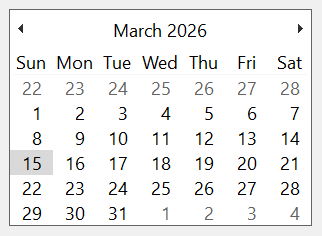
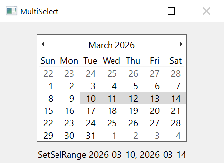
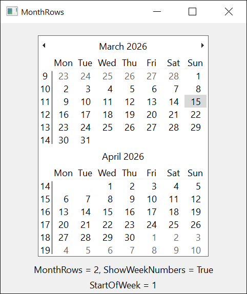
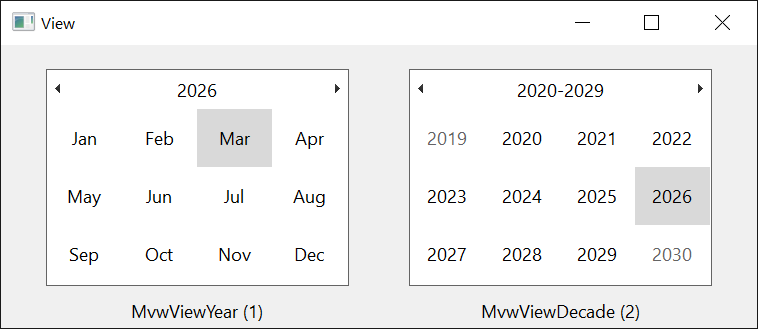

# MonthView class
{: .no_toc }

A **MonthView** is a calendar that stays on the form. It shows one month or several, and the user selects a date, or a range of dates, by clicking it.

{:width="215" height="157"}

```tb check_build check_run arch=win32,win64
MonthView1.Value = DateSerial(2026, 3, 15) + TimeSerial(10, 20, 30)
Debug.Print Format$(MonthView1.Value, "yyyy-mm-dd")
MonthView1.Month = 11
MonthView1.Day = 30
Debug.Print Format$(MonthView1.Value, "yyyy-mm-dd")
' Output:
'  2026-03-15
'  2026-11-30
```

The control stands in place of the MonthView of the Microsoft common controls (`MSCOMCT2.OCX`). The [WinNativeCommonCtls](../../WinNativeCommonCtls/MonthView) package has a **MonthView** too; this one adds [**View**](#view), [**Today**](#today), [**UseShortestDayNames**](#useshortestdaynames), [**CalendarCount**](#calendarcount), [**ComputeControlSize**](#computecontrolsize), [**HitTest**](#hittest), [**SetSelRange**](#setselrange) and the event [**ViewChange**](#viewchange).

Of the [common members](Common), the control has those under [Name and place](Common#name-and-place), [Window handles](Common#window-handles), [Font and visual styles](Common#font-and-visual-styles), [Mouse](Common#mouse) but its **DblClick** event, [Keyboard and focus](Common#keyboard-and-focus), [Dragging the control](Common#dragging-the-control), [OLE drag and drop](Common#ole-drag-and-drop) and [Right-to-left](Common#right-to-left), **RightToLeftLayout** included.

* TOC
{:toc}

## The selected date

[**Value**](#value) is the selected date, a **Date** without a time of day: an assignment keeps the day and drops the time. A new control has the date of the day it is made selected. [**Year**](#year), [**Month**](#month), [**Day**](#day) and [**Week**](#week) read and change one part of it, and [**DayCount**](#daycount) and [**DayOfWeek**](#dayofweek) read the length of its month and its weekday.

<!-- test: MonthViewTests.Value_Assigned_DropsTheTimeOfDay, MonthViewTests.Value_OutsideTheRange_Raises35773, MonthViewTests.MinDate_AboveMaxDate_Raises35775, MonthViewTests.MaxDate_BelowMinDate_Raises35774, MonthViewTests.MinDate_BeforeTheYear1900_Raises380 -->
[**MinDate**](#mindate) and [**MaxDate**](#maxdate) limit the dates, from 1 January 1900 to 31 December 9999 by default. A **Value** outside them raises run-time error 35773. A **MinDate** after **MaxDate** raises 35775, a **MaxDate** before **MinDate** raises 35774, and a date before 1900 raises 380.
<!-- /test -->

<!-- test: MonthViewTests.Parts_OutOfRange_Raise380 -->
A **Month** outside 1 to 12, a **Day** outside the month and a **Week** outside 1 to 53 raise run-time error 380.
<!-- /test -->

## Selecting a range

With [**MultiSelect**](#multiselect) set to **True** the user selects several days in a row, by dragging or with the Shift key, up to [**MaxSelCount**](#maxselcount) days. [**SelStart**](#selstart) and [**SelEnd**](#selend) are the first and the last of them, and **Value** is the first. [**SetSelRange**](#setselrange) selects a range from the program.

{:width="301" height="219"}

<!-- test: MonthViewTests.SetSelRange_MultiSelect_SelectsTheRange, MonthViewTests.SetSelRange_LongerThanMaxSelCount_Raises35770, MonthViewTests.SetSelRange_OutsideTheRange_Raises35770, MonthViewTests.SetSelRange_WithoutMultiSelect_SelectsTheFirstDate -->
A range of more than **MaxSelCount** days, or one that has a date outside **MinDate** and **MaxDate**, raises run-time error 35770, *An invalid date range was specified*. Without **MultiSelect**, **SetSelRange** selects its first date only, and **SelStart** and **SelEnd** are both **Value**.

```tb check_build check_run arch=win32,win64
MonthView1.MultiSelect = True
MonthView1.SetSelRange DateSerial(2026, 3, 10), DateSerial(2026, 3, 14)
Debug.Print Format$(MonthView1.SelStart, "yyyy-mm-dd"), Format$(MonthView1.SelEnd, "yyyy-mm-dd")
On Error Resume Next
MonthView1.SetSelRange DateSerial(2026, 3, 10), DateSerial(2026, 3, 17)     ' 8 days, MaxSelCount is 7
Debug.Print Err.Number
' Output:
'  2026-03-10    2026-03-14
'  35770
```
<!-- /test -->

<!-- test: MonthViewTests.MultiSelect_Changed_SelectsTheFirstDateOnly -->
Setting **MultiSelect**, **DayState** or **BorderStyle** makes the control draw again from a new window, and the selection becomes the single date **Value**.
<!-- /test -->

## Several months

[**MonthColumns**](#monthcolumns) and [**MonthRows**](#monthrows) say how many months the control shows across and down. The control sets its own size to hold them: an assignment to **Width** or **Height** has no lasting effect, and a change of the number of months, of the font, of [**ShowToday**](#showtoday) or of [**ShowWeekNumbers**](#showweeknumbers) changes the size. [**ComputeControlSize**](#computecontrolsize) tells what size a number of months needs, and [**CalendarCount**](#calendarcount) how many months are shown.

{:width="321" height="383"}

<!-- test: MonthViewTests.MonthColumns_Changed_ResizesTheControl, MonthViewTests.Width_Assigned_HasNoLastingEffect, MonthViewTests.MonthColumns_OutOfRange_Raises35776, MonthViewTests.MonthColumnsTimesRows_OverTwelve_Raises35777, MonthViewTests.MonthColumns_Zero_Raises380 -->
Each of the two is from 1 to 12, and together they make at most 12 months. A value above 12 raises run-time error 35776, a product above 12 raises 35777, and 0 raises 380. [**ComputeControlSize**](#computecontrolsize) raises the same two errors.

```tb check_build check_run arch=win32,win64
Dim Before As Single
Before = MonthView1.Height
MonthView1.MonthRows = 3
Debug.Print MonthView1.CalendarCount, MonthView1.Height > Before
' Output:
'  3            True
```
<!-- /test -->

<!-- test: MonthViewTests.MonthColumns_Three_ShowsThreeMonths -->
> [!WARNING] 1.8.140.0
> With visual styles, a **MonthColumns** of 2 or more can make the control show fewer months across than it says. The control asks Windows for the room of that many months side by side, but leaves out the gap that Windows puts between two months, so Windows may fit one month fewer. Whether it does depends on the font and the scaling of the screen: in a program run from the IDE, 2 shows one month, 3 shows two, and so on, while a built program can show them all, or all but the last for a larger number. Without visual styles the control adds the gaps itself and shows them all. **MonthRows** is right, and so are the control's width and the result of [**ComputeControlSize**](#computecontrolsize), which are those of the months shown.
>
> [**CalendarCount**](#calendarcount) tells how many months are shown. A program that needs *n* months across sets **MonthColumns** to *n*, and to *n* + 1 if **CalendarCount** is then short, keeping the product with **MonthRows** at 12 or less.

```tb check_build check_run arch=win32,win64
MonthView1.MonthColumns = 3
If MonthView1.CalendarCount < 3 Then MonthView1.MonthColumns = 4
Debug.Print MonthView1.CalendarCount       ' three months across
' Output:
'  3
```

## Views

With visual styles, the user clicks the title of the calendar to zoom out, from the days of a month to the months of a year, the years of a decade and the decades of a century. [**View**](#view) reads and sets what is shown, and [**ViewChange**](#viewchange) is raised when it changes. A program without visual styles has the month view only.

{:width="505" height="219"}

## Bold days

With [**DayState**](#daystate) set to **True**, the control raises [**GetDayBold**](#getdaybold) before it shows days, and draws in bold those the handler marks:

```tb check_build
Private Sub MonthView1_GetDayBold(ByVal StartDate As Date, ByVal Count As Long, State() As Boolean)
    Dim I As Long
    For I = 1 To Count
        If Day(StartDate + I - 1) = 1 Then State(I) = True      ' the first of every month
    Next
End Sub
```

## What is under the pointer

[**HitTest**](#hittest) tells which part of the calendar is at a place, and the date there if it is a day. On a form whose scale is twips, the unit of the mouse events, a handler of **MouseMove** or **MouseDown** gives it the place of the event:

```tb check_build
Private Sub MonthView1_MouseMove(Button As Integer, Shift As Integer, X As Single, Y As Single)
    Dim Hit As Date
    If MonthView1.HitTest(X, Y, Hit) = MvwHitResultCalendarDate Then Debug.Print Hit
End Sub
```

Properties
----------

### BackColor
{: .no_toc }

The background color of the days. **OLE_COLOR**. Default: **vbWindowBackground**. Windows ignores it while the control is drawn with visual styles, so it shows with [**VisualStyles**](Common#visualstyles) set to **False**.

### BorderStyle
{: .no_toc }

The border of the control. A member of [**CCBorderStyleConstants**](Common#ccborderstyleconstants). Default: **CCBorderStyleSingle**. Any other value raises run-time error 380. A change makes the control draw again from a new window.

### CalendarCount
{: .no_toc }

The number of months the control shows. **Byte**, read-only. It is [**MonthColumns**](#monthcolumns) times [**MonthRows**](#monthrows), but for the warning under [Several months](#several-months).

### Day
{: .no_toc }

The day of the month of [**Value**](#value), from 1 to [**DayCount**](#daycount). **Integer**.

### DayCount
{: .no_toc }

The number of days in the month of [**Value**](#value). **Long**, read-only.

### DayOfWeek
{: .no_toc }

The day of the week of [**Value**](#value), from 0 for Sunday to 6 for Saturday. **Integer**, read-only.

### DayState
{: .no_toc }

Whether the control asks the program which days to draw in bold. **Boolean**. Default: **False**. With **True** it raises [**GetDayBold**](#getdaybold). A change makes the control draw again from a new window.

### ForeColor
{: .no_toc }

The color of the text of the days. **OLE_COLOR**. Default: **vbButtonText**. It shows with visual styles off, as [**BackColor**](#backcolor) does.

### MaxDate
{: .no_toc }

The last date the control accepts. **Date**. Default: 31 December 9999. See [The selected date](#the-selected-date).

### MaxSelCount
{: .no_toc }

The most days a selected range can have. **Integer**. Default: 7. A value of 0 or less raises run-time error 380. It has an effect with [**MultiSelect**](#multiselect).

### MinDate
{: .no_toc }

The first date the control accepts. **Date**. Default: 1 January 1900. See [The selected date](#the-selected-date).

### Month
{: .no_toc }

The month of [**Value**](#value), from 1 to 12. **Integer**.

### MonthColumns
{: .no_toc }

The number of months to show across. **Byte**. Default: 1. See [Several months](#several-months), which has a warning about it.

### MonthRows
{: .no_toc }

The number of months shown down. **Byte**. Default: 1. See [Several months](#several-months).

### MultiSelect
{: .no_toc }

Whether the user can select a range of days. **Boolean**. Default: **False**. See [Selecting a range](#selecting-a-range). A change makes the control draw again from a new window.

### ScrollRate
{: .no_toc }

The number of months the calendar moves when the user clicks an arrow in the title. **Long**. Default: 1. A value of 0 gives the number of months the control shows, and a negative value raises run-time error 380.

### SelEnd
{: .no_toc }

The last date of the selected range. **Date**. Without [**MultiSelect**](#multiselect) it is [**Value**](#value). An assignment is a [**SetSelRange**](#setselrange) from [**SelStart**](#selstart) to the new date.

### SelStart
{: .no_toc }

The first date of the selected range. **Date**. Without [**MultiSelect**](#multiselect) it is [**Value**](#value). An assignment is a [**SetSelRange**](#setselrange) from the new date to [**SelEnd**](#selend).

### ShowToday
{: .no_toc }

Whether the control shows a line with the current date at its bottom. **Boolean**. Default: **True**.

### ShowTodayCircle
{: .no_toc }

Whether the control draws a circle round the current date. **Boolean**. Default: **True**.

### ShowTrailingDates
{: .no_toc }

Whether the control shows the days of the months before and after the one it displays, in the cells that month leaves free. **Boolean**. Default: **True**.

### ShowWeekNumbers
{: .no_toc }

Whether the control shows the week numbers at the left of the weeks. **Boolean**. Default: **False**.

### StartOfWeek
{: .no_toc }

The day shown in the leftmost column. **Integer**: 0 for the first day of the week of the user's language (the default), or 1 for Monday to 7 for Sunday. Any other value raises run-time error 380. It reads the day the control shows, from 1 to 7.

### SystemStartOfWeek
{: .no_toc }

The first day of the week of the user's language, from 1 for Monday to 7 for Sunday. **Integer**, read-only.

### Today
{: .no_toc }

The date the control takes for the current day, which it marks with the circle and shows in the line at the bottom. **Variant**, a **Date**. A new control has the date of the system. Assigning **Null** or **Empty** gives it the date of the system again, and any other value that is not a date or a number raises run-time error 380.

### TitleBackColor
{: .no_toc }

The background color of the title, with the month and the year. **OLE_COLOR**. Default: **vbActiveTitleBar**. It shows with visual styles off.

### TitleForeColor
{: .no_toc }

The color of the text of the title. **OLE_COLOR**. Default: **vbActiveTitleBarText**. It shows with visual styles off.

### TrailingForeColor
{: .no_toc }

The color of the days of the neighbouring months. **OLE_COLOR**. Default: **vbGrayText**. It shows with visual styles off.

### UseShortestDayNames
{: .no_toc }

Whether the control writes the names of the weekdays with the shortest form the user's language has, in place of the short form. **Boolean**. Default: **False**.

### Value
{: .no_toc }

The selected date; with [**MultiSelect**](#multiselect), the first selected date. **Date**, without a time of day. It is the control's default property. See [The selected date](#the-selected-date).

Assigning a date other than the selected one raises [**SelChange**](#selchange).

### View
{: .no_toc }

What the calendar shows. A member of [**MvwViewConstants**](#mvwviewconstants). Default: **MvwViewMonth**. Any other value raises run-time error 380. It has an effect with visual styles. A change by an assignment or by the user raises [**ViewChange**](#viewchange).

### Week
{: .no_toc }

The week of the year of [**Value**](#value), from 1 to 53, counted as [**StartOfWeek**](#startofweek) says, with the first week the one that has at least four days of the new year. **Integer**. An assignment moves **Value** by the number of weeks between the two numbers.

### Year
{: .no_toc }

The year of [**Value**](#value). **Integer**.

Methods
-------

### ComputeControlSize
{: .no_toc }

Gives the width and the height the control needs for a number of months.

Syntax: *object*.**ComputeControlSize** *MonthColumns*, *MonthRows*, *Width*, *Height*

*MonthColumns*, *MonthRows*
: *required* **Byte** values: the months across and down. See [Several months](#several-months) for the errors.

*Width*, *Height*
: *required* **Single** variables that receive the size, in the scale units of the control's container.

### GetMonthRange
{: .no_toc }

Gives the first and the last date the control shows, and the number of months they span.

Syntax: *object*.**GetMonthRange**( *IncludeTrailing*, [ *StartDate* ], [ *EndDate* ] ) **As Long**

*IncludeTrailing*
: *required* A **Boolean**. With **False** the range is the shown months in full. With **True** it also covers the days of the neighbouring months that the cells around them show.

*StartDate*, *EndDate*
: *optional* **Date** variables that receive the first and the last date.

The result is the number of months the range spans: with **True** it counts the neighbouring months too.

```tb check_build check_run arch=win32,win64
Dim First As Date, Last As Date
MonthView1.Value = DateSerial(2026, 3, 16)
Debug.Print MonthView1.GetMonthRange(False, First, Last)
Debug.Print Format$(First, "yyyy-mm-dd"), Format$(Last, "yyyy-mm-dd")
' Output:
'  1
'  2026-03-01    2026-03-31
```

### HitTest
{: .no_toc }

Tells which part of the calendar is at a place.

Syntax: *object*.**HitTest**( *X*, *Y*, [ *HitDate* ] ) **As** [**MvwHitResultConstants**](#mvwhitresultconstants)

*X*, *Y*
: *required* **Single** values: the place, measured from the top left corner of the control in the scale units of the control's container.

*HitDate*
: *optional* A **Date** variable that receives the date, when the result is **MvwHitResultCalendarDate**, **MvwHitResultCalendarDay** or **MvwHitResultCalendarWeekNum**.

<!-- test: MonthViewTests.HitTest_OutsideTheControl_IsNoWhere, MonthViewTests.HitTest_OnADay_GivesTheDate -->
A place outside the control gives **MvwHitResultNoWhere**.
<!-- /test -->

### SetSelRange
{: .no_toc }

Selects a range of dates. See [Selecting a range](#selecting-a-range) for the errors.

Syntax: *object*.**SetSelRange** *StartDate*, *EndDate*

*StartDate*, *EndDate*
: *required* **Date** values. The time of day is dropped. With **MultiSelect** and *EndDate* before *StartDate* the control selects one of them.

Raises [**SelChange**](#selchange) when the selection changes.

Events
------

### ContextMenu
{: .no_toc }

Raised when the user asks for the menu of the control, with the right mouse button or with Shift+F10.

Syntax: *object*\_**ContextMenu**( *Handled* **As Boolean**, **ByVal** *X* **As Single**, **ByVal** *Y* **As Single** )

*Handled*
: **False** when the event is raised. A handler that sets it to **True** keeps the control from going on with the request.

*X*, *Y*
: The place of the click, measured from the top left corner of the control in the scale units of the control's container. Both are -1 when the user asked with the keyboard.

### DateClick
{: .no_toc }

Raised when the user selects a date explicitly, by clicking it or by pressing Enter on it.

Syntax: *object*\_**DateClick**( **ByVal** *DateClicked* **As Date** )

*DateClicked*
: The date selected.

<!-- test: MonthViewTests.Click_OnADay_RaisesClickSelChangeAndDateClick -->
A click on a day raises **Click**, then [**SelChange**](#selchange), then **DateClick**. The last two are raised after the click, when the program next processes messages.
<!-- /test -->

### GetDayBold
{: .no_toc }

Raised when the control needs to know which days to draw in bold, with [**DayState**](#daystate) set to **True**. See [Bold days](#bold-days).

Syntax: *object*\_**GetDayBold**( **ByVal** *StartDate* **As Date**, **ByVal** *Count* **As Long**, *State*() **As Boolean** )

*StartDate*
: The first day the control shows, which can be a day of the previous month.

*Count*
: The number of days.

*State*
: An array of *Count* elements, indexed from 1, one for each day from *StartDate*. A handler sets an element to **True** to draw that day in bold.

<!-- test: MonthViewTests.DayState_Set_RaisesGetDayBold -->
The control also raises it when **DayState** is set.
<!-- /test -->

### SelChange
{: .no_toc }

<!-- test: MonthViewTests.SelChange_ForEachChangeOfTheSelection -->
Raised when the selected date or range has changed, by an assignment or by the user. Assigning the date that is selected raises nothing.
<!-- /test -->

Syntax: *object*\_**SelChange**( **ByVal** *StartDate* **As Date**, **ByVal** *EndDate* **As Date** )

*StartDate*, *EndDate*
: The first and the last date selected. Both are the selected date without **MultiSelect**.

### ViewChange
{: .no_toc }

Raised when the view has changed.

Syntax: *object*\_**ViewChange**( **ByVal** *OldView* **As** [**MvwViewConstants**](#mvwviewconstants), **ByVal** *NewView* **As** [**MvwViewConstants**](#mvwviewconstants) )

<!-- test: MonthViewTests.View_Changed_RaisesViewChange -->
A change of [**View**](#view) by an assignment raises it too.
<!-- /test -->

## MvwViewConstants
{: #mvwviewconstants }

The values of [**View**](#view).

| Member | Value | Description |
|---|---|---|
| **MvwViewMonth**{: #MvwViewConstants_MvwViewMonth } | 0 | The days of a month. |
| **MvwViewYear**{: #MvwViewConstants_MvwViewYear } | 1 | The months of a year. |
| **MvwViewDecade**{: #MvwViewConstants_MvwViewDecade } | 2 | The years of a decade. |
| **MvwViewCentury**{: #MvwViewConstants_MvwViewCentury } | 3 | The decades of a century. |

## MvwHitResultConstants
{: #mvwhitresultconstants }

The values [**HitTest**](#hittest) gives.

| Member | Value | Description |
|---|---|---|
| **MvwHitResultNoWhere**{: #MvwHitResultConstants_MvwHitResultNoWhere } | 0 | Outside the calendar. |
| **MvwHitResultCalendarBack**{: #MvwHitResultConstants_MvwHitResultCalendarBack } | 1 | The background of the calendar. |
| **MvwHitResultCalendarControl**{: #MvwHitResultConstants_MvwHitResultCalendarControl } | 2 | The calendar of a view other than the month view. |
| **MvwHitResultCalendarDate**{: #MvwHitResultConstants_MvwHitResultCalendarDate } | 3 | A day of the month shown. |
| **MvwHitResultCalendarDateNext**{: #MvwHitResultConstants_MvwHitResultCalendarDateNext } | 4 | A day of the next month. |
| **MvwHitResultCalendarDatePrev**{: #MvwHitResultConstants_MvwHitResultCalendarDatePrev } | 5 | A day of the previous month. |
| **MvwHitResultCalendarDay**{: #MvwHitResultConstants_MvwHitResultCalendarDay } | 6 | The name of a weekday. |
| **MvwHitResultCalendarWeekNum**{: #MvwHitResultConstants_MvwHitResultCalendarWeekNum } | 7 | A week number. |
| **MvwHitResultTitleBack**{: #MvwHitResultConstants_MvwHitResultTitleBack } | 8 | The background of the title. |
| **MvwHitResultTitleBtnNext**{: #MvwHitResultConstants_MvwHitResultTitleBtnNext } | 9 | The arrow that moves to the next months. |
| **MvwHitResultTitleBtnPrev**{: #MvwHitResultConstants_MvwHitResultTitleBtnPrev } | 10 | The arrow that moves to the previous months. |
| **MvwHitResultTitleMonth**{: #MvwHitResultConstants_MvwHitResultTitleMonth } | 11 | The month in the title. |
| **MvwHitResultTitleYear**{: #MvwHitResultConstants_MvwHitResultTitleYear } | 12 | The year in the title. |
| **MvwHitResultTodayLink**{: #MvwHitResultConstants_MvwHitResultTodayLink } | 13 | The line with the current date. |

## See Also

- [Common members](Common) -- the members this control shares with the package's other controls
- [DTPicker](DTPicker) -- a box that shows one date and drops a calendar down
- [MonthView](../../WinNativeCommonCtls/MonthView) -- the control of the same name in the WinNativeCommonCtls package
