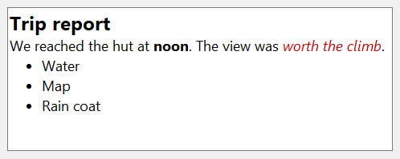

# RichTextBox class
{: .no_toc }

A **RichTextBox** is a box in which the user types and edits formatted text: characters in several fonts, sizes and colors, paragraphs with their own alignment, indents and bullets, links, and pictures. The program reads and writes the text as plain text or in the Rich Text Format (RTF), and loads it from a file or saves it to one.

{:width="332" height="133"}

<!-- test: RichTextBoxFormatTests.SelBold_Assigned_MakesTheSelectionBold -->
```tb check_build check_run arch=win32,win64
RichTextBox1.Text = "Hello world"
RichTextBox1.SelStart = 6
RichTextBox1.SelLength = 5
RichTextBox1.SelBold = True             ' "world" in bold
RichTextBox1.SelColor = vbRed           ' and in red
Debug.Print RichTextBox1.SelText; RichTextBox1.SelBold
RichTextBox1.SelStart = 0
RichTextBox1.SelLength = 11
Debug.Print IsNull(RichTextBox1.SelBold) ' a part is bold, a part is not
' Output:
' worldTrue
' True
```
<!-- /test -->

The control stands in place of the RichTextBox of the Microsoft Rich Textbox control (`RICHTX32.OCX`). It is the rich edit control of Windows in its current version, and holds its text in Unicode. Much of it works as the [**TextBoxW**](../TextBoxW) of the same package does, and the topic pages say where.

Of the [common members](../Common), the control has those under [Name and place](../Common#name-and-place), [Window handles](../Common#window-handles), [Font and visual styles](../Common#font-and-visual-styles), [Mouse](../Common#mouse), [Keyboard and focus](../Common#keyboard-and-focus), [Dragging the control](../Common#dragging-the-control), [OLE drag and drop](../Common#ole-drag-and-drop) and [Right-to-left](../Common#right-to-left) but **RightToLeftLayout**. Its [**OLEDropMode**](DragAndDrop#oledropmode) can refuse a value that the common one takes, and is on the page [Drag and Drop](DragAndDrop).

* TOC
{:toc}

## Topics

The members of the control are on these pages, by what they do:

- [Text and Typing](Text) -- the text as plain text and as RTF, what the user may type, password characters and the **Change** event
- [Selection](Selection) -- the selected text and its place, the text of a range, and the **SelChange** event
- [Character Formatting](CharacterFormatting) -- the font, the size, the color and the effects of the selected characters
- [Paragraph Formatting](ParagraphFormatting) -- alignment, indents, bullets and tab stops
- [Links and Protected Text](LinksAndProtection) -- links found in the text or set by the program, and text the user cannot change
- [Finding Text](Finding) -- finding a string, and moving the selection over a set of characters
- [Clipboard and Undo](ClipboardAndUndo) -- cutting, copying and pasting, and taking changes back and putting them back
- [Lines, Scrolling and Zoom](LinesAndView) -- the lines of the text, the scroll bars, the margins and the zoom
- [Loading and Saving](Files) -- reading the text from a file and writing it to one
- [Printing](Printing) -- the text or the selection on a printer or another device
- [OLE Objects and Pictures](OLEObjects) -- pictures and other objects inside the text
- [Shortcut Menus](ShortcutMenu) -- the menu that a right click opens
- [Drag and Drop](DragAndDrop) -- dragging text out of the box and into it, and dropping files

## RTF and plain text

<!-- test: RichTextBoxTextTests.Text_Paragraphs_EndWithACarriageReturn, RichTextBoxTextTests.TextRTF_Assigned_GivesTheFormattedText -->
The box holds its text in paragraphs. [**Text**](Text#text) returns the characters alone, and [**TextRTF**](Text#textrtf) the same text with its formatting, as a document in the Rich Text Format, a string that starts with `{\rtf1`. The control's default member is **TextRTF**, so `RichTextBox1` alone in an expression is the RTF.
<!-- /test -->

```tb check_build check_run arch=win32,win64
RichTextBox1.TextRTF = "{\rtf1 plain and \b bold\b0  text}"
Debug.Print RichTextBox1.Text
RichTextBox1.SelStart = 10
RichTextBox1.SelLength = 4
Debug.Print RichTextBox1.SelText; RichTextBox1.SelBold
Debug.Print Left$(RichTextBox1, 6)
' Output:
' plain and bold text
' boldTrue
' {\rtf1
```

The properties whose names start with `Sel` read and change the selection, or the text typed next at the insertion point when nothing is selected. Each of them that describes a format is a **Variant**, and returns **Null** while the selection holds more than one value of it.

Properties
----------

### BackColor
{: .no_toc }

The color behind the text. **OLE_COLOR**. Default: **vbWindowBackground**. Text can have a background color of its own, [**SelBkColor**](CharacterFormatting#selbkcolor), in front of it. The border that the control draws with visual styles takes the same color.

### BorderStyle
{: .no_toc }

Whether the control has a border. **Integer**: 0 for none or 1 for a border (the default), which is the border of a text box in the visual style of Windows while [**VisualStyles**](../Common#visualstyles) is **True**.

<!-- test: RichTextBoxTests.BorderStyle_Two_Raises380 -->
Another value raises run-time error 380.
<!-- /test -->

## See Also

- [Common members](../Common) -- the members this control shares with the package's other controls
- [TextBoxW](../TextBoxW) control -- the text box of the same package, for text without formatting
