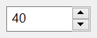

# SpinBox class
{: .no_toc }

A **SpinBox** is a text box that holds a whole number, with a pair of arrow buttons beside it that raise and lower the number. The user types the number or uses the arrows.

{:width="92" height="36"}

```tb check_build check_run arch=win32,win64
SpinBox1.Min = 0
SpinBox1.Max = 100
SpinBox1.Value = 40
Debug.Print SpinBox1.Text
SpinBox1.Value = 500                       ' above Max
Debug.Print SpinBox1.Value, SpinBox1.Text
' Output:
'  40
'  100          100
```

No control of the Microsoft common controls has this shape, and the [WinNativeCommonCtls](../../WinNativeCommonCtls/) package has none. A **SpinBox** is what a program builds from a text box and an [**UpDown**](UpDown) with the text box as its buddy: the control makes both, joins them, and shows the number in the box by itself. It has the range, the **Increment** and the events of the **UpDown**, and the text and selection members of a text box, so a program needs no buddy and no code that moves the number between the two.

Of the [common members](Common), the control has those under [Name and place](Common#name-and-place), [Window handles](Common#window-handles), [Font and visual styles](Common#font-and-visual-styles), [Mouse](Common#mouse) but its **Click** and **DblClick** events, [Keyboard and focus](Common#keyboard-and-focus), [Dragging the control](Common#dragging-the-control), [OLE drag and drop](Common#ole-drag-and-drop) and [Right-to-left](Common#right-to-left) but **RightToLeftLayout**. Its [**hWnd**](Common#hwnd) is the window of the arrow buttons, and [**hWndEdit**](#hwndedit) is that of the text box.

* TOC
{:toc}

## The value and the text

[**Value**](#value) is the number, from [**Min**](#min) to [**Max**](#max): 0 to 100 for a new control. [**Text**](#text) is what the box holds, and the control keeps the two together. An assignment to **Value** writes the number in the box, and when the text in the box changes, the control reads the number from it.

<!-- test: SpinBoxTests.Value_Assigned_ShowsTheNumber, SpinBoxTests.Value_OutsideTheRange_IsTheNearestEnd, SpinBoxTests.Min_AboveMax_Raises380, SpinBoxTests.Max_BelowMin_Raises380, SpinBoxTests.Min_AboveValue_MovesTheValue -->
A **Value** outside the range becomes the nearest end of it. A **Min** above **Max**, or a **Max** below **Min**, raises run-time error 380. A new **Min** above **Value**, or a new **Max** below it, moves **Value** to that end.
<!-- /test -->

<!-- test: SpinBoxTests.Text_Assigned_ChangesTheValue, SpinBoxTests.Text_NotANumber_LeavesTheValue, SpinBoxTests.Text_OutsideTheRange_ClampsTheValueNotTheText, SpinBoxTests.ValidateText_ReplacesTheText -->
Text that is a number changes **Value**, when the program next processes messages, and a number outside the range makes **Value** the nearest end while the text stays as typed. Text that is not a number leaves **Value** as it was. [**ValidateText**](#validatetext) writes **Value** in the box in place of the text.

```tb check_build check_run arch=win32,win64
SpinBox1.Text = "250"                      ' Max is 100
DoEvents                                   ' the control reads the text now
Debug.Print SpinBox1.Value, SpinBox1.Text
SpinBox1.ValidateText
Debug.Print SpinBox1.Value, SpinBox1.Text
SpinBox1.Text = "abc"
DoEvents
Debug.Print SpinBox1.Value, SpinBox1.Text
' Output:
'  100          250
'  100          100
'  100          abc
```
<!-- /test -->

<!-- test: SpinBoxTests.NumberStyle_Hexadecimal_ShowsEightDigits, SpinBoxTests.NumberStyle_Hexadecimal_SmallRange_ShowsFourDigits, SpinBoxTests.ThousandsSeparator_False_ShowsNoSeparator, SpinBoxTests.ThousandsSeparator_True_ShowsTheSeparatorOfTheUser -->
With [**NumberStyle**](#numberstyle) hexadecimal the box shows the number as `0x` and four hexadecimal digits, or eight when the range needs more than four: with **Max** at 1000, 255 shows as `0x00FF`, and with **Max** at 100000 as `0x000000FF`. In decimal it groups the digits by thousands when [**ThousandsSeparator**](#thousandsseparator) is **True**, with the separator of the user's language.

{:width="801" height="119"}
<!-- /test -->

## What a click raises

An arrow works as it does on an [**UpDown**](UpDown#what-a-click-raises): [**BeforeChange**](#beforechange), then the new text in the box and [**TextChange**](#textchange), then [**Change**](#change), and [**UpClick**](#upclick) or [**DownClick**](#downclick) when the user lets the button go.

<!-- test: SpinBoxTests.Click_Up_RaisesBeforeChangeTextChangeChangeUpClick, SpinBoxTests.Click_Down_RaisesBeforeChangeTextChangeChangeDownClick, SpinBoxTests.BeforeChange_DeltaZero_CancelsTheClick -->
A handler of **BeforeChange** can change *Delta*, the amount the click adds, and sets it to 0 to cancel the click.
<!-- /test -->

With [**ArrowKeysChange**](#arrowkeyschange) set to **True** the Up and Down keys do what the arrows do, and [**SetAcceleration**](#setacceleration) makes the value move faster the longer the user holds a button.

<!-- test: SpinBoxTests.ArrowKeysChange_UpKey_RaisesTheValue -->
With **ArrowKeysChange** the Up key in the box adds [**Increment**](#increment) to **Value**.
<!-- /test -->

Properties
----------

### Alignment
{: .no_toc }

Which side of the box the arrows are on. A member of [**CCLeftRightAlignmentConstants**](Common#ccleftrightalignmentconstants). Default: **CCLeftRightAlignmentRight**, or **CCLeftRightAlignmentLeft** for a control made with [**RightToLeft**](Common#righttoleft) set.

<!-- test: SpinBoxTests.Alignment_OutOfRange_Raises380 -->
Any other value raises run-time error 380. A change makes the control draw again from new windows. A change of **RightToLeft** moves the arrows and the text to the side that suits the direction, when they are on the side that suits the other.
<!-- /test -->

### AllowOnlyNumbers
{: .no_toc }

Whether the box takes digits only from the user. **Boolean**. Default: **False**. It does not limit what the program assigns to [**Text**](#text).

### ArrowKeysChange
{: .no_toc }

Whether the Up and Down keys change [**Value**](#value) while the box has the focus. **Boolean**. Default: **True**. A change makes the control draw again from new windows.

### BackColor
{: .no_toc }

The background color of the control. **OLE_COLOR**. Default: **vbWindowBackground**.

### ForeColor
{: .no_toc }

The foreground color of the control. **OLE_COLOR**. Default: **vbWindowText**.

### HideSelection
{: .no_toc }

Whether the selected text stops being shown when the box loses the focus. **Boolean**. Default: **True**. A change makes the control draw again from new windows.

### HotTracking
{: .no_toc }

Whether the arrow under the mouse pointer is drawn highlighted. **Boolean**. Default: **True**. A theme can override it. A change makes the control draw again from new windows.

### hWndEdit
{: .no_toc }

The handle of the window of the text box. **LongPtr**, read-only.

### Increment
{: .no_toc }

What a click on an arrow adds to or subtracts from [**Value**](#value). **Long**. Default: 1. It is not checked, so 0 and a negative number are accepted. While [**SetAcceleration**](#setacceleration) has given a list, it reads the first increment of the list.

### Locked
{: .no_toc }

Whether the user is kept from typing in the box. **Boolean**. Default: **False**. The arrows still work, and the program can still change [**Text**](#text).

### Max
{: .no_toc }

The upper end of the range. **Long**. Default: 100. See [The value and the text](#the-value-and-the-text).

### Min
{: .no_toc }

The lower end of the range. **Long**. Default: 0. See [The value and the text](#the-value-and-the-text).

### NumberStyle
{: .no_toc }

How the box shows the number. A member of [**SpbNumberStyleConstants**](#spbnumberstyleconstants). Default: **SpbNumberStyleDecimal**.

<!-- test: SpinBoxTests.NumberStyle_OutOfRange_Raises380 -->
Any other value raises run-time error 380.
<!-- /test -->

### SelLength
{: .no_toc }

The number of selected characters in the box. **Long**. An assignment selects that many characters from [**SelStart**](#selstart).

<!-- test: SpinBoxTests.SelLength_Negative_Raises380 -->
A negative value raises run-time error 380.
<!-- /test -->

### SelStart
{: .no_toc }

The place of the first selected character, counted from 0, or of the insertion point when nothing is selected. **Long**. An assignment puts the insertion point there.

<!-- test: SpinBoxTests.SelStart_Negative_Raises380, SpinBoxTests.SelText_Assigned_ReplacesTheSelection -->
A negative value raises run-time error 380.
<!-- /test -->

### SelText
{: .no_toc }

The selected text. **String**. An assignment replaces the selection with the new text, or inserts the text at the insertion point.

### Text
{: .no_toc }

What the box holds. **String**. An assignment raises [**TextChange**](#textchange), and [**Change**](#change) when [**Value**](#value) changes with it. See [The value and the text](#the-value-and-the-text).

### TextAlignment
{: .no_toc }

Where the text stands in the box. A member of [**AlignmentConstants**](../../VBRUN/Constants/AlignmentConstants): **vbLeftJustify** (the default, or **vbRightJustify** for a control made with **RightToLeft** set), **vbCenter** or **vbRightJustify**.

<!-- test: SpinBoxTests.TextAlignment_OutOfRange_Raises380 -->
Another value raises run-time error 380.
<!-- /test -->

### ThousandsSeparator
{: .no_toc }

Whether a decimal number in the box is grouped by thousands. **Boolean**. Default: **True**. A change makes the control draw again from new windows.

### Value
{: .no_toc }

The number. **Long**. Default: 0. It is the control's default property. See [The value and the text](#the-value-and-the-text).

An assignment changes the text in the box, and raises [**TextChange**](#textchange) and then [**Change**](#change) if the value changed.

### Wrap
{: .no_toc }

Whether the value goes round to the other end of the range when an arrow passes one. **Boolean**. Default: **False**. A change makes the control draw again from new windows.

Methods
-------

### SetAcceleration
{: .no_toc }

Makes the arrows add more the longer the user holds a button.

Syntax: *object*.**SetAcceleration** *Delays*, *Increments*

*Delays*
: *required* An array of numbers: for each step, the seconds the button has been held before the step's increment starts.

*Increments*
: *required* An array of numbers of the same size: the increment of each step.

<!-- test: SpinBoxTests.SetAcceleration_BadArrays_RaiseErrors, SpinBoxTests.SetAcceleration_Empty_RestoresIncrement -->
The two arrays have one dimension and the same bounds, or the method raises run-time error 5. An array that is not an array, and is not **Empty**, raises 380, and an array that is not allocated raises 91. Two **Empty** values take the list away and bring back [**Increment**](#increment).
<!-- /test -->

```tb check_build
SpinBox1.SetAcceleration Array(0, 2, 5), Array(1, 5, 20)   ' 1 at first, 5 after 2 s, 20 after 5 s
```

### ValidateText
{: .no_toc }

Writes [**Value**](#value) in the box when the box holds other text. See [The value and the text](#the-value-and-the-text).

Syntax: *object*.**ValidateText**

Events
------

### BeforeChange
{: .no_toc }

Raised when the user's click on an arrow is about to change the value, before it does.

Syntax: *object*\_**BeforeChange**( **ByVal** *Value* **As Long**, *Delta* **As Long** )

*Value*
: The value before the click.

*Delta*
: What the click will add: [**Increment**](#increment) for the up arrow, and its negative for the down arrow. A handler changes it, and sets it to 0 to cancel the click.

### Change
{: .no_toc }

Raised when [**Value**](#value) has changed, by a click, by typing, or by an assignment to **Value** or [**Text**](#text). An assignment of the value the control has raises nothing.

<!-- test: SpinBoxTests.Value_Assigned_ShowsTheNumber -->
**Change** follows **TextChange** when an assignment to **Value** changes both.
<!-- /test -->

Syntax: *object*\_**Change**( )

### ContextMenu
{: .no_toc }

Raised when the user asks for the menu of the box, with the right mouse button or with Shift+F10, before the box shows the menu that Windows gives every text box.

Syntax: *object*\_**ContextMenu**( *Handled* **As Boolean**, **ByVal** *X* **As Single**, **ByVal** *Y* **As Single** )

*Handled*
: **False** when the event is raised. A handler that sets it to **True** keeps the box from showing its own menu, to show another one or none.

*X*, *Y*
: The place of the click, measured from the top left corner of the control in the scale units of the control's container. Both are -1 when the user asked with the keyboard.

### DownClick
{: .no_toc }

Raised when the user lets go of the down arrow after a click that lowered the value, or tried to.

Syntax: *object*\_**DownClick**( )

### TextChange
{: .no_toc }

Raised when the text in the box has changed, by typing or by an assignment to [**Text**](#text) or to [**Value**](#value).

Syntax: *object*\_**TextChange**( )

### UpClick
{: .no_toc }

Raised when the user lets go of the up arrow after a click that raised the value, or tried to.

Syntax: *object*\_**UpClick**( )

## SpbNumberStyleConstants
{: #spbnumberstyleconstants }

The values of [**NumberStyle**](#numberstyle).

| Member | Value | Description |
|---|---|---|
| **SpbNumberStyleDecimal**{: #SpbNumberStyleConstants_SpbNumberStyleDecimal } | 0 | Decimal, grouped by thousands if [**ThousandsSeparator**](#thousandsseparator) is **True**. |
| **SpbNumberStyleHexadecimal**{: #SpbNumberStyleConstants_SpbNumberStyleHexadecimal } | 1 | Hexadecimal, as `0x` and four or eight digits. |

## See Also

- [Common members](Common) -- the members this control shares with the package's other controls
- [UpDown](UpDown) -- the arrow buttons alone, joined to a control of the program's choice
- [TextBoxW](TextBoxW) -- a text box without arrows
