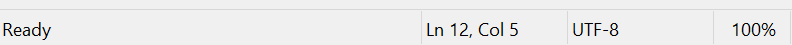

# StatusBar class
{: .no_toc }

A **StatusBar** is a bar along the edge of a form that shows short pieces of information in panels: a message, the state of the Caps Lock key, the time. It can also show one piece of text across its whole width.

{:width="528" height="30"}

```tb check_build check_run arch=win32,win64
StatusBar1.Panels(1).Text = "Ready"
StatusBar1.Panels.Add , "pos", "Ln 1"
StatusBar1.Panels.Add , "caps", , SbrPanelStyleCaps
Debug.Print StatusBar1.Panels.Count
Debug.Print StatusBar1.Panels("pos").Index
' Output:
'  3
'  2
```

The control stands in place of the StatusBar of the Microsoft common controls (`MSCOMCTL.OCX`).

Of the [common members](../Common), the control has those under [Name and place](../Common#name-and-place) but **HelpContextID**, [Window handles](../Common#window-handles), [Font and visual styles](../Common#font-and-visual-styles), [Mouse](../Common#mouse), [Dragging the control](../Common#dragging-the-control), [OLE drag and drop](../Common#ole-drag-and-drop) and [Right-to-left](../Common#right-to-left), **RightToLeftLayout** included. It never takes the focus, so it has no keyboard events.

Its sub-objects have pages of their own:

- [SbrPanels](SbrPanels) -- the collection of the panels, which [**Panels**](#panels) returns
- [SbrPanel](SbrPanel) -- one panel

* TOC
{:toc}

## Panels

<!-- test: StatusBarTests.Panels_NewBar_HasOneEmptyPanel -->
A status bar drawn on a form has one panel, with no text and a sunken border. [**Panels**](#panels) returns the collection, and its [**Add**](SbrPanels#add) method makes more. The panels are numbered from 1, from the left, and a program can also name each by a key.
<!-- /test -->

Each panel has its own text, picture, colors, alignment and border, and its own width: see [SbrPanel](SbrPanel).

## What a panel shows

A panel's [**Style**](SbrPanel#style) says what it shows. **SbrPanelStyleText**, the default, shows the panel's [**Text**](SbrPanel#text). The other styles show something the control works out itself, so [**Text**](SbrPanel#text) has no effect on what is drawn:

- the name of a key (**CAPS**, **NUM**, **INS**, **SCRL**, and the keys of East Asian keyboards), drawn in the gray of disabled text while the key is not on;
- the current time, the current date, or both, in the format of [**DTFormat**](SbrPanel#dtformat). The control changes the text as the time passes.

<!-- test: StatusBarTests.Text_KeyStyle_KeepsTheAssignedText, StatusBarTests.Enabled_KeyStyle_FollowsTheKey -->
For these styles [**Text**](SbrPanel#text) still returns the string that was assigned, and the panel's [**Enabled**](SbrPanel#enabled) is the state of the key: an assignment to it does not last.
<!-- /test -->

```tb check_build check_run arch=win32,win64
StatusBar1.Panels(1).Style = SbrPanelStyleDate
StatusBar1.Panels(1).DTFormat = SbrPanelDTFormatCustom
StatusBar1.Panels(1).Text = "yyyy"            ' with a custom format, Text is the format
Debug.Print StatusBar1.Panels(1).Text
' Output:
' yyyy
```

## The width of a panel

A panel's [**AutoSize**](SbrPanel#autosize) decides its width:

- **SbrPanelAutoSizeNone**, the default: the panel is [**MinWidth**](SbrPanel#minwidth) wide, or as wide as the program sets with [**Width**](SbrPanel#width).
- **SbrPanelAutoSizeContent**: the panel is as wide as its text and its picture need, but not narrower than [**MinWidth**](SbrPanel#minwidth).
- **SbrPanelAutoSizeSpring**: the panel starts at [**MinWidth**](SbrPanel#minwidth) and the panels that have this value share the free width of the bar.

```tb check_build check_run arch=win32,win64
StatusBar1.Panels(1).AutoSize = SbrPanelAutoSizeContent
StatusBar1.Panels(1).Text = String$(200, "W")
Debug.Print StatusBar1.Panels(1).Width > StatusBar1.Panels(1).MinWidth
' Output:
' True
```

A panel that is not [**Visible**](SbrPanel#visible) has no width, and the panels after it move up.

## One piece of text

With [**Style**](#style) set to **SbrStyleSimple** the bar shows [**SimpleText**](#simpletext) across its whole width, and the panels are not shown. They keep their values, and **SbrStyleNormal** shows them again.

<!-- test: StatusBarTests.SimpleText_KeptWhileTheStyleIsNormal, StatusBarTests.StyleChange_RaisedForEachChangeOfStyle -->
[**SimpleText**](#simpletext) keeps its text while the style is normal, and each change of [**Style**](#style) raises [**StyleChange**](#stylechange).
<!-- /test -->

## Clicks

A click on the bar raises the mouse events of [Mouse](../Common#mouse) and, when the pointer is over a panel, [**PanelClick**](#panelclick). A double click raises [**PanelDblClick**](#paneldblclick) and then **DblClick**. [**PanelMouseEnter**](#panelmouseenter) and [**PanelMouseLeave**](#panelmouseleave) are raised while [**MouseTrack**](../Common#mousetrack) is **True**, and [**HitTest**](#hittest) names the panel at a point.

```tb hidden
Public Declare PtrSafe Function SbSendMessage Lib "user32" Alias "SendMessageW" (ByVal hWnd As LongPtr, ByVal Msg As Long, ByVal wParam As LongPtr, ByVal lParam As LongPtr) As LongPtr

' A press and release of the left mouse button, X pixels from the left edge of the bar.
Public Sub SbClick(ByVal Bar As VBCCR18.StatusBar, ByVal X As Long)
    SbSendMessage Bar.hWnd, &H201, 1, X + 5 * 65536
    SbSendMessage Bar.hWnd, &H202, 0, X + 5 * 65536
End Sub
```

```tb hidden
Class StatusBarWatcher
    Public WithEvents Bar As VBCCR18.StatusBar
    Private Sub Bar_MouseDown(Button As Integer, Shift As Integer, X As Single, Y As Single) Handles Bar.MouseDown
        Debug.Print "MouseDown"
    End Sub
    Private Sub Bar_PanelClick(ByVal Panel As SbrPanel, ByVal Button As Integer) Handles Bar.PanelClick
        Debug.Print "PanelClick " & Panel.Index
    End Sub
    Private Sub Bar_MouseUp(Button As Integer, Shift As Integer, X As Single, Y As Single) Handles Bar.MouseUp
        Debug.Print "MouseUp"
    End Sub
    Private Sub Bar_Click() Handles Bar.Click
        Debug.Print "Click"
    End Sub
End Class
```

<!-- test: StatusBarTests.Click_ByTheUser_RaisesPanelClickBetweenMouseDownAndMouseUp, StatusBarTests.DblClick_ByTheUser_RaisesPanelDblClickThenDblClick -->
**PanelClick** comes after **MouseDown** and before **MouseUp**, and **Click** comes last.

```tb check_build check_run arch=win32,win64
Dim Watch As New StatusBarWatcher
Set Watch.Bar = StatusBar1
SbClick StatusBar1, 10                  ' a click on the first panel
' Output:
' MouseDown
' PanelClick 1
' MouseUp
' Click
```
<!-- /test -->

**SbClick** in this sample is a procedure of the program's own that sends the messages Windows sends to the bar for a click of the left button, and **StatusBarWatcher** is a class of the program's own that holds the control **WithEvents** and prints its events.

Properties
----------

### Align
{: .no_toc }

The edge of the form that the control is attached to, where it takes the form's whole width. A member of [**AlignConstants**](../../../VBRUN/Constants/AlignConstants).

<!-- test: sample statusbar-align -->
> [!NOTE] 1.8.141.0, BETA 1042
> twinBASIC has not implemented **Align**: an assignment compiles with the warning TB0009 and changes nothing, and the property goes on returning **vbAlignNone**, also for a status bar drawn on a form. A program places and sizes the status bar itself.

```tb probe check_run arch=win32,win64 id=statusbar-align
Debug.Print StatusBar1.Align
StatusBar1.Align = vbAlignTop
Debug.Print StatusBar1.Align
' Output:
'  0
'  0
```

### AllowSizeGrip
{: .no_toc }

Whether the bar may have a size grip at its right end, the corner by which the user changes the size of the form. **Boolean**. Default: **True**. The grip is there when the bar is attached to the bottom edge of a form whose border the user can drag, and it is hidden while the form is maximized. [**IncludesSizeGrip**](#includessizegrip) says whether it is there. A change makes the bar's window again.

### BackColor
{: .no_toc }

The color of the bar behind the panels. **OLE_COLOR**. Default: **vbButtonFace**. It shows only while the control is drawn without visual styles, with [**VisualStyles**](../Common#visualstyles) set to **False**.

### ContainedControls
{: .no_toc }

The controls that were put inside the status bar when the form was designed. A **ContainedControls** collection, read-only.

### DoubleBuffer
{: .no_toc }

Whether the control draws itself in a bitmap off the screen first, which reduces flicker. **Boolean**. Default: **True**.

### hWndToolTip
{: .no_toc }

The handle of the tool tip window that shows the panels' [**ToolTipText**](SbrPanel#tooltiptext). **LongPtr**, read-only. It is 0 while [**ShowTips**](#showtips) is **False**.

### Panels
{: .no_toc }

The collection of the panels. An [**SbrPanels**](SbrPanels) object, read-only.

### ShowTips
{: .no_toc }

Whether a panel shows its [**ToolTipText**](SbrPanel#tooltiptext) when the pointer rests on it. **Boolean**. Default: **False**.

<!-- test: StatusBarTests.ShowTips_True_MakesTheToolTipWindow -->
Setting it to **True** makes the tool tip window, and **False** removes it again: [**hWndToolTip**](#hwndtooltip) shows which.
<!-- /test -->

### SimpleText
{: .no_toc }

The text that the bar shows across its width while [**Style**](#style) is **SbrStyleSimple**. **String**. Default: empty. See [One piece of text](#one-piece-of-text).

### Style
{: .no_toc }

Whether the bar shows its panels or one piece of text. A member of [**SbrStyleConstants**](#sbrstyleconstants). Default: **SbrStyleNormal**. A change raises [**StyleChange**](#stylechange).

<!-- test: StatusBarTests.Panel_ValuesOutsideTheEnumerations_Raise380 -->
A value that is not a member raises run-time error 380.
<!-- /test -->

Methods
-------

### HitTest
{: .no_toc }

Returns the panel at a point of the bar, or **Nothing** where there is none.

Syntax: *object*.**HitTest**( *X*, *Y* ) **As SbrPanel**

<!-- test: StatusBarTests.HitTest_ReturnsThePanelAtThePoint -->
*X*, *Y*
: *required* **Single**: the point, measured from the top left corner of the control in the scale units of the control's container.
<!-- /test -->

### IncludesSizeGrip
{: .no_toc }

Returns whether the bar has a size grip at its right end now. See [**AllowSizeGrip**](#allowsizegrip) for when it has.

Syntax: *object*.**IncludesSizeGrip** **As Boolean**

Events
------

### PanelClick
{: .no_toc }

Raised when the user clicks a panel with the left or the right mouse button. It comes between **MouseDown** and **MouseUp**, see [Clicks](#clicks).

Syntax: *object*\_**PanelClick**( *Panel* **As SbrPanel**, *Button* **As Integer** )

*Panel*
: The [**SbrPanel**](SbrPanel) that was clicked.

*Button*
: **vbLeftButton** or **vbRightButton**, members of [**MouseButtonConstants**](../../../VBRUN/Constants/MouseButtonConstants).

### PanelDblClick
{: .no_toc }

Raised when the user double-clicks a panel with the left or the right mouse button, before **DblClick**.

Syntax: *object*\_**PanelDblClick**( *Panel* **As SbrPanel**, *Button* **As Integer** )

*Panel*, *Button*
: As in [**PanelClick**](#panelclick).

### PanelMouseEnter
{: .no_toc }

<!-- test: StatusBarTests.MouseTrack_True_RaisesThePanelEnterAndLeaveEvents -->
Raised when the pointer moves onto a panel, while [**MouseTrack**](../Common#mousetrack) is **True**. When the pointer moves from one panel to another, [**PanelMouseLeave**](#panelmouseleave) of the first comes before **PanelMouseEnter** of the second.
<!-- /test -->

Syntax: *object*\_**PanelMouseEnter**( *Panel* **As SbrPanel** )

*Panel*
: The [**SbrPanel**](SbrPanel) the pointer is on.

### PanelMouseLeave
{: .no_toc }

Raised when the pointer leaves a panel, while [**MouseTrack**](../Common#mousetrack) is **True**.

Syntax: *object*\_**PanelMouseLeave**( *Panel* **As SbrPanel** )

*Panel*
: The [**SbrPanel**](SbrPanel) the pointer was on.

### Resize
{: .no_toc }

Raised when the size of the control changes.

Syntax: *object*\_**Resize**( )

### StyleChange
{: .no_toc }

Raised when the [**Style**](#style) of the bar changes.

Syntax: *object*\_**StyleChange**( )

## SbrStyleConstants
{: #sbrstyleconstants }

The values of [**Style**](#style).

| Member | Value | Description |
|---|---|---|
| **SbrStyleNormal**{: #SbrStyleConstants_SbrStyleNormal } | 0 | The bar shows its panels. |
| **SbrStyleSimple**{: #SbrStyleConstants_SbrStyleSimple } | 1 | The bar shows [**SimpleText**](#simpletext) across its width. |

## SbrPanelStyleConstants
{: #sbrpanelstyleconstants }

The values of the [**Style**](SbrPanel#style) of a panel.

| Member | Value | Description |
|---|---|---|
| **SbrPanelStyleText**{: #SbrPanelStyleConstants_SbrPanelStyleText } | 0 | The panel shows its [**Text**](SbrPanel#text). |
| **SbrPanelStyleCaps**{: #SbrPanelStyleConstants_SbrPanelStyleCaps } | 1 | The text **CAPS**, dimmed while Caps Lock is off. |
| **SbrPanelStyleNum**{: #SbrPanelStyleConstants_SbrPanelStyleNum } | 2 | The text **NUM**, dimmed while Num Lock is off. |
| **SbrPanelStyleIns**{: #SbrPanelStyleConstants_SbrPanelStyleIns } | 3 | The text **INS**, dimmed while Insert mode is off. |
| **SbrPanelStyleScrl**{: #SbrPanelStyleConstants_SbrPanelStyleScrl } | 4 | The text **SCRL**, dimmed while Scroll Lock is off. |
| **SbrPanelStyleTime**{: #SbrPanelStyleConstants_SbrPanelStyleTime } | 5 | The current time, in the format of [**DTFormat**](SbrPanel#dtformat). |
| **SbrPanelStyleDate**{: #SbrPanelStyleConstants_SbrPanelStyleDate } | 6 | The current date, in the format of [**DTFormat**](SbrPanel#dtformat). |
| **SbrPanelStyleKana**{: #SbrPanelStyleConstants_SbrPanelStyleKana } | 7 | The text **KANA**, dimmed while the Kana key is off. |
| **SbrPanelStyleHangul**{: #SbrPanelStyleConstants_SbrPanelStyleHangul } | 8 | The text **HANGUL**, dimmed while the Hangul key is off. |
| **SbrPanelStyleJunja**{: #SbrPanelStyleConstants_SbrPanelStyleJunja } | 9 | The text **JUNJA**, dimmed while the Junja key is off. |
| **SbrPanelStyleFinal**{: #SbrPanelStyleConstants_SbrPanelStyleFinal } | 10 | The text **FINAL**, dimmed while the Final key is not held down. |
| **SbrPanelStyleKanji**{: #SbrPanelStyleConstants_SbrPanelStyleKanji } | 11 | The text **KANJI**, dimmed while the Kanji key is not held down. |
| **SbrPanelStyleHanja**{: #SbrPanelStyleConstants_SbrPanelStyleHanja } | 12 | The text **HANJA**, dimmed while the Hanja key is not held down. |
| **SbrPanelStyleDateTime**{: #SbrPanelStyleConstants_SbrPanelStyleDateTime } | 13 | The current date and time, in the format of [**DTFormat**](SbrPanel#dtformat). |

## SbrPanelBevelConstants
{: #sbrpanelbevelconstants }

The values of the [**Bevel**](SbrPanel#bevel) of a panel.

| Member | Value | Description |
|---|---|---|
| **SbrPanelBevelFlat**{: #SbrPanelBevelConstants_SbrPanelBevelFlat } | 0 | No border. |
| **SbrPanelBevelInset**{: #SbrPanelBevelConstants_SbrPanelBevelInset } | 1 | A sunken border. |
| **SbrPanelBevelRaised**{: #SbrPanelBevelConstants_SbrPanelBevelRaised } | 2 | A raised border. |

## SbrPanelAutoSizeConstants
{: #sbrpanelautosizeconstants }

The values of the [**AutoSize**](SbrPanel#autosize) of a panel. See [The width of a panel](#the-width-of-a-panel).

| Member | Value | Description |
|---|---|---|
| **SbrPanelAutoSizeNone**{: #SbrPanelAutoSizeConstants_SbrPanelAutoSizeNone } | 0 | The width is [**MinWidth**](SbrPanel#minwidth), or the one the program sets. |
| **SbrPanelAutoSizeSpring**{: #SbrPanelAutoSizeConstants_SbrPanelAutoSizeSpring } | 1 | The panel takes a share of the free width of the bar. |
| **SbrPanelAutoSizeContent**{: #SbrPanelAutoSizeConstants_SbrPanelAutoSizeContent } | 2 | The panel is as wide as its text and picture need. |

## SbrPanelAlignmentConstants
{: #sbrpanelalignmentconstants }

The values of the [**Alignment**](SbrPanel#alignment) of a panel.

| Member | Value | Description |
|---|---|---|
| **SbrPanelAlignmentLeft**{: #SbrPanelAlignmentConstants_SbrPanelAlignmentLeft } | 0 | The text is at the left edge. |
| **SbrPanelAlignmentCenter**{: #SbrPanelAlignmentConstants_SbrPanelAlignmentCenter } | 1 | The text is in the middle. |
| **SbrPanelAlignmentRight**{: #SbrPanelAlignmentConstants_SbrPanelAlignmentRight } | 2 | The text is at the right edge. |
| **SbrPanelAlignmentLeftRight**{: #SbrPanelAlignmentConstants_SbrPanelAlignmentLeftRight } | 3 | The text and the picture are at opposite edges. A panel without a picture has its text at the left. |

## SbrPanelDTFormatConstants
{: #sbrpaneldtformatconstants }

The values of the [**DTFormat**](SbrPanel#dtformat) of a panel.

| Member | Value | Description |
|---|---|---|
| **SbrPanelDTFormatShort**{: #SbrPanelDTFormatConstants_SbrPanelDTFormatShort } | 0 | The short format of the user's settings. |
| **SbrPanelDTFormatLong**{: #SbrPanelDTFormatConstants_SbrPanelDTFormatLong } | 1 | The long format of the user's settings. |
| **SbrPanelDTFormatMedium**{: #SbrPanelDTFormatConstants_SbrPanelDTFormatMedium } | 2 | The medium format. |
| **SbrPanelDTFormatGeneral**{: #SbrPanelDTFormatConstants_SbrPanelDTFormatGeneral } | 3 | The general format of the user's settings. |
| **SbrPanelDTFormatCustom**{: #SbrPanelDTFormatConstants_SbrPanelDTFormatCustom } | 4 | The format string that is the panel's [**Text**](SbrPanel#text). |

## See Also

- [Common members](../Common) -- the members this control shares with the package's other controls
- [SbrPanels](SbrPanels) -- the collection of the panels
- [SbrPanel](SbrPanel) -- one panel
