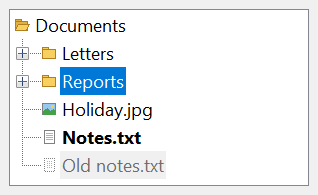
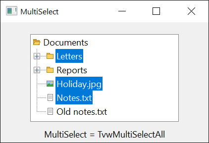
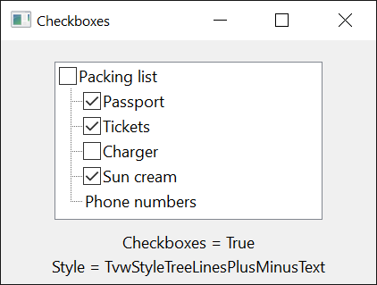
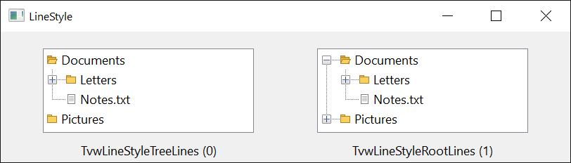

# TreeView class
{: .no_toc }

A **TreeView** shows a hierarchy as a tree of nodes. Each node has a label and can hold other nodes. The user opens and closes the branches, selects a node, or several, ticks a check box beside it and edits its label. A node can show pictures from an image list.

{:width="212" height="130"}

```tb hidden
Public Type SquarePictDesc
    Size As Long
    Kind As Long
    Handle As LongPtr
    Palette As LongPtr
End Type
Public Type SquareGuid
    Data1 As Long
    Data2 As Integer
    Data3 As Integer
    Data4(0 To 7) As Byte
End Type
Public Declare PtrSafe Function SqGetDC Lib "user32" Alias "GetDC" (ByVal hWnd As LongPtr) As LongPtr
Public Declare PtrSafe Function SqReleaseDC Lib "user32" Alias "ReleaseDC" (ByVal hWnd As LongPtr, ByVal hDC As LongPtr) As Long
Public Declare PtrSafe Function SqCreateCompatibleDC Lib "gdi32" Alias "CreateCompatibleDC" (ByVal hDC As LongPtr) As LongPtr
Public Declare PtrSafe Function SqCreateCompatibleBitmap Lib "gdi32" Alias "CreateCompatibleBitmap" (ByVal hDC As LongPtr, ByVal W As Long, ByVal H As Long) As LongPtr
Public Declare PtrSafe Function SqSelectObject Lib "gdi32" Alias "SelectObject" (ByVal hDC As LongPtr, ByVal hObject As LongPtr) As LongPtr
Public Declare PtrSafe Function SqCreateSolidBrush Lib "gdi32" Alias "CreateSolidBrush" (ByVal Color As Long) As LongPtr
Public Declare PtrSafe Function SqPatBlt Lib "gdi32" Alias "PatBlt" (ByVal hDC As LongPtr, ByVal X As Long, ByVal Y As Long, ByVal W As Long, ByVal H As Long, ByVal Rop As Long) As Long
Public Declare PtrSafe Function SqDeleteObject Lib "gdi32" Alias "DeleteObject" (ByVal hObject As LongPtr) As Long
Public Declare PtrSafe Function SqDeleteDC Lib "gdi32" Alias "DeleteDC" (ByVal hDC As LongPtr) As Long
Public Declare PtrSafe Function SqOleCreatePictureIndirect Lib "oleaut32" Alias "OleCreatePictureIndirect" (ByRef Desc As SquarePictDesc, ByRef IID As SquareGuid, ByVal Own As Long, ByRef Pic As IPictureDisp) As Long

' A bitmap of one color.
Public Function ColorSquare(ByVal Color As Long, Optional ByVal Width As Long = 16, Optional ByVal Height As Long = 16) As StdPicture
    Dim screenDC As LongPtr, memDC As LongPtr, bmp As LongPtr, brush As LongPtr, oldBmp As LongPtr, oldBrush As LongPtr
    screenDC = SqGetDC(0)
    memDC = SqCreateCompatibleDC(screenDC)
    bmp = SqCreateCompatibleBitmap(screenDC, Width, Height)
    brush = SqCreateSolidBrush(Color)
    oldBmp = SqSelectObject(memDC, bmp)
    oldBrush = SqSelectObject(memDC, brush)
    SqPatBlt memDC, 0, 0, Width, Height, &HF00021
    SqSelectObject memDC, oldBrush
    SqSelectObject memDC, oldBmp
    SqDeleteObject brush
    SqDeleteDC memDC
    SqReleaseDC 0, screenDC
    Dim desc As SquarePictDesc, iid As SquareGuid, pic As IPictureDisp
    desc.Size = LenB(desc)
    desc.Kind = 1
    desc.Handle = bmp
    iid.Data1 = &H7BF80981
    iid.Data2 = &HBF32
    iid.Data3 = &H101A
    iid.Data4(0) = &H8B
    iid.Data4(1) = &HBB
    iid.Data4(3) = &HAA
    iid.Data4(5) = &H30
    iid.Data4(6) = &HC
    iid.Data4(7) = &HAB
    SqOleCreatePictureIndirect desc, iid, 1, pic
    Set ColorSquare = pic
End Function
```

```tb check_build check_run arch=win32,win64
Dim Root As TvwNode
Set Root = TreeView1.Nodes.Add(, , "docs", "Documents")
TreeView1.Nodes.Add Root, TvwNodeRelationshipChild, "letters", "Letters"
TreeView1.Nodes.Add Root, TvwNodeRelationshipChild, "reports", "Reports"
Root.Expanded = True
Debug.Print TreeView1.Nodes.Count
Debug.Print TreeView1.Nodes("reports").FullPath
' Output:
'  3
'  Documents\Reports
```

**ColorSquare** in the samples of this page is a function of the program's own. It returns a bitmap of one color, 16 pixels wide and high.

The control stands in place of the TreeView of the Microsoft common controls (`MSCOMCTL.OCX`). The [WinNativeCommonCtls](../../../WinNativeCommonCtls/TreeView/) package has a **TreeView** too. This one adds [**MultiSelect**](#multiselect) with [**SelectedNodes**](#selectednodes), a picture for an expanded node ([**ExpandedImage**](TvwNode#expandedimage)), a color, a bold or a gray font and a tool tip for each node, the [**InsertMark**](#insertmark), [**LineColor**](#linecolor), [**LineHeight**](#lineheight), [**Redraw**](#redraw) and [**VisualTheme**](#visualtheme) properties, and the events [**NodeBeforeCheck**](#nodebeforecheck), [**NodeBeforeSelect**](#nodebeforeselect), [**NodeDblClick**](#nodedblclick), [**NodeDrag**](#nodedrag) and [**NodeRangeSelect**](#noderangeselect).

Of the [common members](../Common), the control has those under [Name and place](../Common#name-and-place), [Window handles](../Common#window-handles), [Font and visual styles](../Common#font-and-visual-styles), [Mouse](../Common#mouse), [Keyboard and focus](../Common#keyboard-and-focus), [Dragging the control](../Common#dragging-the-control), [OLE drag and drop](../Common#ole-drag-and-drop) and [Right-to-left](../Common#right-to-left), **RightToLeftLayout** included.

Its sub-objects have pages of their own:

- [TvwNodes](TvwNodes) -- the collection of the nodes, which [**Nodes**](#nodes) returns
- [TvwNode](TvwNode) -- one node
- [TvwSelectedNodes](TvwSelectedNodes) -- the collection of the selected nodes of a tree that allows several, which [**SelectedNodes**](#selectednodes) returns

* TOC
{:toc}

## Nodes and branches

[**Nodes**](#nodes) returns the [**TvwNodes**](TvwNodes) collection. Its [**Add**](TvwNodes#add) method puts a [**TvwNode**](TvwNode) into the tree, in the place that its *Relationship* argument names, counted from a *Relative* node: the first, the last, the next or the previous node of the same branch, or a child of the *Relative*. A node needs no *Relative* to go to the root level. A node has a text, and it can have a key, a string by which the program names it later.

<!-- test: TreeViewTests.Add_Relationships_PlaceTheNewNode -->
```tb check_build check_run arch=win32,win64
Dim Fruit As TvwNode, Node As TvwNode
Set Fruit = TreeView1.Nodes.Add(, , "fruit", "Fruit")
TreeView1.Nodes.Add Fruit, TvwNodeRelationshipChild, "pear", "Pear"
TreeView1.Nodes.Add Fruit, TvwNodeRelationshipChild, "apple", "Apple"
TreeView1.Nodes.Add "pear", TvwNodeRelationshipPrevious, "fig", "Fig"
Set Node = Fruit.Child
Do While Not Node Is Nothing
    Debug.Print Node.Text
    Set Node = Node.NextSibling
Loop
' Output:
'  Fig
'  Pear
'  Apple
```
<!-- /test -->

A node with children shows a button that opens and closes its branch, when [**Style**](#style) has one. A node can be taken from one place to another with [**Move**](TvwNode#move), with the children it has, and removed with [**Remove**](TvwNodes#remove).

## Pictures

A node shows a picture beside its text when the tree has an [**ImageList**](../ImageList/) and a [**Style**](#style) with a picture in its name. [**ImageList**](#imagelist) takes the control, the name of a control on the same form, or the handle of an image list of Windows. Each node's [**Image**](TvwNode#image) is the number or the key of a picture of that list, and its [**SelectedImage**](TvwNode#selectedimage) and [**ExpandedImage**](TvwNode#expandedimage) are the pictures it shows while it is selected and while it is expanded. A picture number is counted from 1, and 0 means no picture.

```tb check_build check_run arch=win32,win64
ImageList1.ListImages.Add , "folder", ColorSquare(vbYellow)
ImageList1.ListImages.Add , "open", ColorSquare(vbGreen)
ImageList1.ListImages.Add , "file", ColorSquare(vbWhite)
Set TreeView1.ImageList = ImageList1
Dim Folder As TvwNode
Set Folder = TreeView1.Nodes.Add(, , "docs", "Documents", "folder")
Folder.ExpandedImage = "open"
TreeView1.Nodes.Add Folder, TvwNodeRelationshipChild, "readme", "Readme.txt", "file"
Debug.Print Folder.ImageIndex
Debug.Print Folder.ExpandedImageIndex
Debug.Print TreeView1.Nodes("readme").ImageIndex
' Output:
'  1
'  2
'  3
```

<!-- test: TreeViewTests.Style_WithoutPicture_TakesTheImageListFromTheWindow -->
With a **Style** that has no picture in its name, the tree keeps the image list that was assigned and shows no picture. The control gives the list to the window of Windows when **Style** changes to one that has a picture.
<!-- /test -->

<!-- test: TreeViewTests.Image_KeyWithoutAnImageListControl_Raises35601 -->
A key names a picture only while [**ImageList**](#imagelist) holds the **ImageList** control, so that the tree can look the key up. Without it, or with a handle, a picture is named by its number, and a key raises run-time error 35601.
<!-- /test -->

## Opening and closing branches

[**Expanded**](TvwNode#expanded) is whether the branch of a node is open. The user changes it with the button beside the node and with the keyboard, and the program with the property. Each change raises [**BeforeExpand**](#beforeexpand) and [**Expand**](#expand) or [**BeforeCollapse**](#beforecollapse) and [**Collapse**](#collapse), also when it comes from the program. An assignment that does not change the state raises nothing. A handler of a **Before** event refuses the change by setting *Cancel* to **True**.

<!-- test: TreeViewTests.Expanded_Change_RaisesTheEvents -->
Selecting a node that is inside a closed branch opens the branches above it, and raises their events before [**NodeSelect**](#nodeselect).
<!-- /test -->

```tb check_build
Private Sub TreeView1_BeforeExpand(ByVal Node As TvwNode, Cancel As Boolean)
    If Node.Tag = "locked" Then Cancel = True
End Sub
```

<!-- test: TreeViewTests.Expanded_NodeWithoutChildren_IsRememberedUntilItGetsOne -->
A node without children can be set to **Expanded** at once. It reads **True**, raises no event, and shows its first child as soon as one is added.
<!-- /test -->

<!-- test: TreeViewTests.Expanded_BeforeExpandCancelled_LeavesTheNodeCollapsed -->
> [!WARNING] 1.8.136.0
> A program that sets **Expanded** to **True** on a node with children that has never been open, and whose **BeforeExpand** handler sets *Cancel*, is told the node is open. The children stay hidden and **Expanded** reads **True**. Setting **Expanded** to **False** resets it, without events. A node that was open once and was closed is not affected: its **BeforeExpand** is honoured.

## Selecting nodes

A tree selects one node at a time. [**SelectedItem**](#selecteditem) is that node, or **Nothing**, and [**Selected**](TvwNode#selected) of a node selects it. A change raises [**NodeBeforeSelect**](#nodebeforeselect), which can refuse it, and then [**NodeSelect**](#nodeselect).

<!-- test: TreeViewTests.Selected_Change_RaisesTheEvents, TreeViewTests.Selected_BeforeSelectCancelled_KeepsTheSelection, TreeViewTests.Selected_False_KeepsTheSelectedItem -->
Selecting the node that is selected raises nothing. A handler of **NodeBeforeSelect** that sets *Cancel* to **True** leaves the selection as it was. Setting **Selected** of the selected node to **False** removes its highlight, but [**SelectedItem**](#selecteditem) still returns it. Setting **SelectedItem** to **Nothing** deselects.
<!-- /test -->

```tb check_build check_run arch=win32,win64
Dim Node As TvwNode
Set Node = TreeView1.Nodes.Add(, , "a", "First")
Set Node = TreeView1.Nodes.Add(, , "b", "Second")
Debug.Print TypeName(TreeView1.SelectedItem)
Node.Selected = True
Debug.Print TreeView1.SelectedItem.Text
Set TreeView1.SelectedItem = TreeView1.Nodes("a")
Debug.Print TreeView1.SelectedItem.Key
Set TreeView1.SelectedItem = Nothing
Debug.Print TypeName(TreeView1.SelectedItem)
' Output:
'  Nothing
'  Second
'  a
'  Nothing
```

## Selecting several nodes

With [**MultiSelect**](#multiselect) other than **TvwMultiSelectNone** the user selects several nodes: with the Ctrl key one node at a time, and with the Shift key every node from the [**AnchorItem**](#anchoritem) to the node clicked. The kinds of range are in [**TvwMultiSelectConstants**](#tvwmultiselectconstants). [**NodeRangeSelect**](#noderangeselect) is raised for each node a range adds. [**SelectedNodes**](#selectednodes) is the collection of the selected nodes, with the node selected last first, and [**SelectedIndex**](TvwNode#selectedindex) of a node is its place in it.

{:width="281" height="193"}

<!-- test: TreeViewTests.SelectedNodes_ProgramSelecting_ListsTheNewestFirst, TreeViewTests.SelectedNodes_MultiSelectNone_Raises91, TreeViewTests.MultiSelect_Changed_KeepsOnlyTheFocusedNode -->
A program selects each node by setting its **Selected** to **True**. [**SelectedItem**](#selecteditem) is the node that has the focus, which a program's selection does not move: it stays the node that was first selected. Setting **MultiSelect** deselects every node but the one that has the focus, and **SelectedNodes** raises run-time error 91 while it is **TvwMultiSelectNone**.

```tb check_build check_run arch=win32,win64
Dim Node As TvwNode, Chosen As TvwNode
Set Node = TreeView1.Nodes.Add(, , "a", "A")
TreeView1.Nodes.Add , , "b", "B"
TreeView1.Nodes.Add , , "c", "C"
TreeView1.MultiSelect = TvwMultiSelectAll
Node.Selected = True
TreeView1.Nodes("c").Selected = True
TreeView1.Nodes("b").Selected = True
For Each Chosen In TreeView1.SelectedNodes
    Debug.Print Chosen.Text
Next
Debug.Print TreeView1.SelectedItem.Text
' Output:
'  B
'  C
'  A
'  A
```
<!-- /test -->

## Check boxes

With [**Checkboxes**](#checkboxes) set to **True** every node has a check box. The user changes it with the mouse and with the space key. [**Checked**](TvwNode#checked) of a node is its state, and [**CheckBox**](TvwNode#checkbox) says whether the node has a box.

{:width="281" height="213"}

<!-- test: TreeViewTests.Checked_Change_RaisesTheEvents, TreeViewTests.Checked_BeforeCheckCancelled_KeepsTheState -->
The program changes **Checked** too, and the change raises [**NodeBeforeCheck**](#nodebeforecheck) and [**NodeCheck**](#nodecheck) as the user's does. A handler of **NodeBeforeCheck** that sets *Cancel* to **True** leaves the box as it was. Assigning the state the box has raises nothing.
<!-- /test -->

```tb check_build check_run arch=win32,win64
Dim Node As TvwNode
TreeView1.Checkboxes = True
Set Node = TreeView1.Nodes.Add(, , "a", "Include")
Debug.Print Node.CheckBox; Node.Checked
Node.Checked = True
Debug.Print Node.Checked
Node.CheckBox = False
Debug.Print Node.CheckBox; Node.Checked
' Output:
'  TrueFalse
'  True
'  FalseFalse
```

## Editing labels

[**LabelEdit**](#labeledit) says who may edit a label: the user, the program alone with [**StartLabelEdit**](#startlabeledit), or nobody. The editing raises [**BeforeLabelEdit**](#beforelabeledit), which can refuse it, and [**AfterLabelEdit**](#afterlabeledit), which can reject the new text. [**hWndLabelEdit**](#hwndlabeledit) is the window of the edit box while one is open.

<!-- test: TreeViewTests.StartLabelEdit_RaisesBeforeLabelEdit, TreeViewTests.StartLabelEdit_LabelEditDisabled_StartsNothing -->
**StartLabelEdit** edits the selected node, and does nothing while no node is selected. With **TvwLabelEditDisabled** it starts no editing and raises no event.
<!-- /test -->

## Sorting

[**Sorted**](#sorted) of the tree sorts the nodes of the root level, by text, in the order of [**SortOrder**](#sortorder) and the comparison of [**SortType**](#sorttype). Nodes added afterwards go to their sorted place. The branches below are sorted by the **Sorted**, **SortOrder** and **SortType** of their parent [**TvwNode**](TvwNode#sorted), and the tree's settings do not apply to them.

<!-- test: TreeViewTests.Sorted_SortsTheRootLevel, TreeViewTests.Sorted_OfANode_SortsItsChildren -->
```tb check_build check_run arch=win32,win64
Dim Node As TvwNode
Set Node = TreeView1.Nodes.Add(, , "p", "pear")
TreeView1.Nodes.Add , , "a", "apple"
TreeView1.Nodes.Add , , "f", "fig"
TreeView1.Nodes.Add Node, TvwNodeRelationshipChild, "k", "kiwi"
TreeView1.Nodes.Add Node, TvwNodeRelationshipChild, "b", "banana"
TreeView1.Sorted = True
Debug.Print TreeView1.Nodes("p").FirstSibling.Text
Debug.Print Node.Child.Text
Node.Sorted = True
Debug.Print Node.Child.Text
TreeView1.SortOrder = TvwSortOrderDescending
Debug.Print TreeView1.Nodes("a").FirstSibling.Text
' Output:
'  apple
'  kiwi
'  banana
'  pear
```
<!-- /test -->

## Dragging nodes

The user starts a drag by pressing the mouse button on a node and moving. The tree raises [**NodeDrag**](#nodedrag), with the button, and a program that wants to drag the node to another control calls [**OLEDrag**](../Common#oledrag) in that handler. With [**OLEDragMode**](#oledragmode) set to **vbOLEDragAutomatic** the tree starts the drag itself and carries the node's text, to copy, to move or to link. The tree raises the [OLE drag-and-drop events](../Common#ole-drag-and-drop) as every control does, and [**OLEDraggedItem**](#oledraggeditem) is the node being dragged.

A tree that takes drops can show where the node would go: [**HitTest**](#hittest) and [**HitTestInsertMark**](#hittestinsertmark) give the node under the pointer in the container's scale units, the [**DropHighlight**](#drophighlight) is a node drawn as the target of a drop, and the [**InsertMark**](#insertmark) is a line drawn above or below a node. While a drag is over the plus button of a closed branch long enough ([**OLEDragExpandTime**](#oledragexpandtime)) the tree opens it, and while it is near an edge the tree scrolls, unless [**OLEDragDropScroll**](#oledragdropscroll) is **False**.

```tb check_build
Private Sub TreeView1_OLEDragOver(Data As DataObject, Effect As Long, Button As Integer, Shift As Integer, X As Single, Y As Single, State As Integer)
    Dim After As Boolean
    Set TreeView1.InsertMark(After) = TreeView1.HitTestInsertMark(X, Y, After)
End Sub
```

## Finding a node by position

<!-- test: TreeViewTests.HitTest_GivesTheNodeUnderThePosition -->
**HitTest** gives the node whose label or picture is at a position, measured from the control's top left corner in the scale units of its container, as the OLE drag-and-drop events give it. At a position where no node is, it returns **Nothing**. **HitTestInsertMark** does the same and also says whether the position is in the lower half of the node's row.
<!-- /test -->

```tb check_build check_run arch=win32,win64
TreeView1.Nodes.Add , , "a", "A first row with a long label to point at"
TreeView1.Nodes.Add , , "b", "A second row with a long label to point at"
Debug.Print TreeView1.HitTest(500, 100).Key
Debug.Print TreeView1.HitTest(500, 350).Key
Debug.Print TypeName(TreeView1.HitTest(500, 3000))
' Output:
'  a
'  b
'  Nothing
```

Properties
----------

### Align
{: .no_toc }

The edge of the form that the control is attached to, where it takes the form's whole width or height. A member of [**AlignConstants**](../../../VBRUN/Constants/AlignConstants). Default: **vbAlignNone**.

<!-- test: sample treeview-align -->
> [!NOTE] 1.8.136.0, BETA 1042
> twinBASIC has not implemented **Align**: an assignment compiles with the warning TB0009 and changes nothing, and the property goes on returning **vbAlignNone**. A program places and sizes the tree itself.

```tb probe check_run arch=win32,win64 id=treeview-align
TreeView1.Align = vbAlignTop
Debug.Print TreeView1.Align
' Output:
'  0
```

### AnchorItem
{: .no_toc }

<!-- test: TreeViewTests.AnchorItem_SetAndCleared -->
The node from which a range of nodes is selected with the Shift key. A **TvwNode**, or **Nothing**. A program changes it with **Set**, and a click that is not made with the Shift key sets it again. It matters while [**MultiSelect**](#multiselect) is not **TvwMultiSelectNone**. A change of that property makes the node that has the focus the anchor.
<!-- /test -->

### BackColor
{: .no_toc }

The background color of the tree, and of every node that has no [**BackColor**](TvwNode#backcolor) of its own. **OLE_COLOR**. Default: **vbWindowBackground**.

### BorderStyle
{: .no_toc }

<!-- test: TreeViewTests.Properties_NotAMember_Raise380, TreeViewTests.Defaults_OfANewTree -->
The border of the control. A member of [**CCBorderStyleConstants**](../Common#ccborderstyleconstants). Default: **CCBorderStyleSunken**. Another value raises run-time error 380.
<!-- /test -->

### Checkboxes
{: .no_toc }

Whether every node has a check box. **Boolean**. Default: **False**. See [Check boxes](#check-boxes).

### DoubleBuffer
{: .no_toc }

Whether the control draws itself in a buffer first, which keeps it from flickering. **Boolean**. Default: **True**. It has an effect when the program has visual styles.

### DropHighlight
{: .no_toc }

<!-- test: TreeViewTests.DropHighlight_SetAndCleared -->
The node drawn as the target of a drop, in the highlight color. A **TvwNode**, or **Nothing** for none. A program changes it with **Set**.
<!-- /test -->

### ForeColor
{: .no_toc }

The color of the nodes' text, for every node that has no [**ForeColor**](TvwNode#forecolor) of its own. **OLE_COLOR**. Default: **vbWindowText**.

### FullRowSelect
{: .no_toc }

Whether the highlight of a selected node covers the whole row. **Boolean**. Default: **False**. The row is highlighted as a whole only while the tree draws no lines, that is with a [**Style**](#style) that has no **TreeLines** in its name.

### HideSelection
{: .no_toc }

Whether the selected node is drawn as not selected while the control does not have the focus. **Boolean**. Default: **True**. With **False** the node stays highlighted.

### HotTracking
{: .no_toc }

Whether the node under the pointer is highlighted as the pointer passes over it. **Boolean**. Default: **False**.

### hWndLabelEdit
{: .no_toc }

The handle of the edit box of Windows in which a label is being edited, or 0 when none is open. **LongPtr**, read-only.

### hWndToolTip
{: .no_toc }

The handle of the tool tip window that Windows' own control uses for the full text of a label that does not fit and for the [**ToolTipText**](TvwNode#tooltiptext) of the nodes. **LongPtr**, read-only.

### ImageList
{: .no_toc }

The image list whose pictures the nodes show. See [Pictures](#pictures).

<!-- test: TreeViewTests.ImageList_TakesAControlANameOrAHandle, TreeViewTests.ImageList_EmptyList_IsNotTaken, TreeViewTests.ImageList_NotAnImageList_Raises -->
The property takes one of three things:

- an [**ImageList**](../ImageList/) control of the package. The property then returns the control.
- a **String**: the name of an **ImageList** control on the same form. The property then returns the control. A name that no control of the form has leaves the tree without an image list.
- a **Long** or a **LongLong**: the handle of an image list of Windows. The property then returns the handle.

An empty image list, one whose [**hImageList**](../ImageList/#himagelist) is 0, is not taken. **Nothing** removes the image list. An object that is not an **ImageList** raises run-time error 35610, and another type of value, such as a **Double**, raises run-time error 13.
<!-- /test -->

### IMEMode
{: .no_toc }

<!-- test: TreeViewTests.Properties_NotAMember_Raise380, TreeViewTests.Defaults_OfANewTree -->
The state of the Input Method Editor while the tree, or its edit box, has the focus. A member of [**CCIMEModeConstants**](../Common#ccimemodeconstants). Default: **CCIMEModeNoControl**. Another value raises run-time error 380.
<!-- /test -->

### IncrementalSearchString
{: .no_toc }

The characters the user has typed to find a node by its first letters, or an empty string when the tree is not searching. **String**, read-only.

### Indentation
{: .no_toc }

<!-- test: TreeViewTests.Properties_NotAMember_Raise380, TreeViewTests.Defaults_OfANewTree -->
The width by which each level of the tree is indented, in the scale units of the control's container. **Single**. Default: 0, which is the width Windows gives it. A negative value raises run-time error 380.
<!-- /test -->

### InsertMark
{: .no_toc }

<!-- test: TreeViewTests.InsertMark_SetAndRead -->
The node at which the insertion mark is drawn: a line above or below the node, in the color of [**InsertMarkColor**](#insertmarkcolor). A **TvwNode**, or **Nothing** for no mark. Default: **Nothing**.
<!-- /test -->

Syntax: *object*.**InsertMark**[( *After* )] [ = *value* ]

*After*
: *optional* A **Boolean** variable. In an assignment, **True** draws the mark below the node and **False**, the default, above it. When the property is read, the variable receives which of the two the mark is.

A program changes it with **Set**, as [**HitTestInsertMark**](#hittestinsertmark) shows in [Dragging nodes](#dragging-nodes).

### InsertMarkColor
{: .no_toc }

The color of the insertion mark. **OLE_COLOR**. Default: **vbBlack**.

### LabelEdit
{: .no_toc }

<!-- test: TreeViewTests.Properties_NotAMember_Raise380, TreeViewTests.Defaults_OfANewTree -->
Who may edit the label of a node. A member of [**TvwLabelEditConstants**](#tvwlabeleditconstants). Default: **TvwLabelEditAutomatic**. Another value raises run-time error 380.
<!-- /test -->

### LineColor
{: .no_toc }

The color of the lines between the nodes. **OLE_COLOR**. Default: **vbGrayText**.

### LineHeight
{: .no_toc }

<!-- test: TreeViewTests.Properties_NotAMember_Raise380, TreeViewTests.Defaults_OfANewTree -->
The height of a row, in the scale units of the control's container. **Single**. The value -1 gives the height Windows chooses from the font, which is what a new control has. Another negative value raises run-time error 380.
<!-- /test -->

### LineStyle
{: .no_toc }

<!-- test: TreeViewTests.Properties_NotAMember_Raise380, TreeViewTests.Defaults_OfANewTree -->
Which nodes are joined by lines. A member of [**TvwLineStyleConstants**](#tvwlinestyleconstants). Default: **TvwLineStyleTreeLines**. It shows with a [**Style**](#style) that has **TreeLines** in its name. Another value raises run-time error 380.
<!-- /test -->

### MultiSelect
{: .no_toc }

<!-- test: TreeViewTests.Properties_NotAMember_Raise380, TreeViewTests.Defaults_OfANewTree -->
Whether the user can select several nodes, and which ranges the Shift key selects. A member of [**TvwMultiSelectConstants**](#tvwmultiselectconstants). Default: **TvwMultiSelectNone**. Another value raises run-time error 380. See [Selecting several nodes](#selecting-several-nodes).
<!-- /test -->

### Nodes
{: .no_toc }

The nodes of the tree. A [**TvwNodes**](TvwNodes) collection, read-only.

### OLEDragDropScroll
{: .no_toc }

Whether the tree scrolls while data is dragged near its edge. **Boolean**. Default: **True**.

### OLEDragExpandTime
{: .no_toc }

<!-- test: TreeViewTests.Properties_NotAMember_Raise380, TreeViewTests.Defaults_OfANewTree -->
How long data dragged over the plus button of a closed branch waits before the branch opens, in milliseconds. **Long**. Default: -1, with which the wait is twice the double-click time of the system. A value of 0 opens no branch. A value below -1 raises run-time error 380.
<!-- /test -->

### OLEDragMode
{: .no_toc }

<!-- test: TreeViewTests.Properties_NotAMember_Raise380, TreeViewTests.Defaults_OfANewTree -->
Whether the user can drag nodes out of the tree. A member of [**OLEDragConstants**](../../../VBRUN/Constants/OLEDragConstants). Default: **vbOLEDragManual**, with which only [**OLEDrag**](../Common#oledrag) starts a drag. With **vbOLEDragAutomatic** a drag of a node carries its text, as text and as Unicode text, to copy, to move or to link. The tree removes no node itself. Another value raises run-time error 380.
<!-- /test -->

### OLEDraggedItem
{: .no_toc }

The node that a drag started on, while the drag goes on. A **TvwNode**, or **Nothing** at other times and while the drag was not started by a node. Read-only.

### PathSeparator
{: .no_toc }

<!-- test: TreeViewTests.PathSeparator_AnyString_IsUsedByFullPath, TreeViewTests.Defaults_OfANewTree -->
The string that [**FullPath**](TvwNode#fullpath) puts between the texts of the nodes. **String**. Default: `\`. It can be any string, an empty one included.
<!-- /test -->

### Redraw
{: .no_toc }

Whether the tree draws itself while its nodes change. **Boolean**. Default: **True**. A program that adds many nodes sets it to **False** first and to **True** afterwards, which is faster.

### Scroll
{: .no_toc }

Whether the tree has scroll bars and scrolls. **Boolean**. Default: **True**.

### SelectedItem
{: .no_toc }

The selected node: with [**MultiSelect**](#multiselect), the node that has the focus. A **TvwNode**, or **Nothing**. Assigning a node selects it, with the events of [Selecting nodes](#selecting-nodes), and **Nothing** deselects.

### SelectedNodes
{: .no_toc }

<!-- test: TreeViewTests.SelectedNodes_MultiSelectNone_Raises91 -->
The selected nodes of a tree that allows several. A [**TvwSelectedNodes**](TvwSelectedNodes) collection, read-only. While [**MultiSelect**](#multiselect) is **TvwMultiSelectNone** it raises run-time error 91.
<!-- /test -->

### ShowTips
{: .no_toc }

Whether a node shows its [**ToolTipText**](TvwNode#tooltiptext) while the pointer rests on it. **Boolean**. Default: **False**.

### SingleSel
{: .no_toc }

Whether selecting a node opens its branch and closes that of the node selected before. **Boolean**. Default: **False**.

### Sorted
{: .no_toc }

Whether the nodes of the root level are kept sorted. **Boolean**. Default: **False**. See [Sorting](#sorting).

### SortOrder
{: .no_toc }

<!-- test: TreeViewTests.Properties_NotAMember_Raise380, TreeViewTests.Defaults_OfANewTree -->
The direction of the sorting of the root level. A member of [**TvwSortOrderConstants**](#tvwsortorderconstants). Default: **TvwSortOrderAscending**. Another value raises run-time error 380. A change sorts the nodes again when [**Sorted**](#sorted) is **True**.
<!-- /test -->

### SortType
{: .no_toc }

<!-- test: TreeViewTests.Properties_NotAMember_Raise380, TreeViewTests.Defaults_OfANewTree -->
How the texts are compared for the sorting of the root level. A member of [**TvwSortTypeConstants**](#tvwsorttypeconstants). Default: **TvwSortTypeBinary**. Another value raises run-time error 380. A change sorts the nodes again when [**Sorted**](#sorted) is **True**.
<!-- /test -->

### Style
{: .no_toc }

<!-- test: TreeViewTests.Properties_NotAMember_Raise380, TreeViewTests.Defaults_OfANewTree -->
Which of lines, buttons and pictures the tree draws. A member of [**TvwStyleConstants**](#tvwstyleconstants). Default: **TvwStyleTreeLinesPlusMinusPictureText**. Another value raises run-time error 380. See [Pictures](#pictures).
<!-- /test -->

### TopItem
{: .no_toc }

<!-- test: TreeViewTests.TopItem_Set_ScrollsTheNodeToTheTop, TreeViewTests.TopItem_SetToNothing_Raises380 -->
The node at the top of the visible part of the tree. A **TvwNode**. A program changes it with **Set**, which scrolls the tree so that the node is the first one shown. **Nothing** raises run-time error 380.
<!-- /test -->

### VisualTheme
{: .no_toc }

<!-- test: TreeViewTests.Properties_NotAMember_Raise380, TreeViewTests.Defaults_OfANewTree -->
The visual theme of the control, when the program has visual styles. A member of [**TvwVisualThemeConstants**](#tvwvisualthemeconstants). Default: **TvwVisualThemeStandard**. Another value raises run-time error 380.
<!-- /test -->

Methods
-------

### EndLabelEdit
{: .no_toc }

Ends the editing of a label. With *Discard* **True** the text the user typed is thrown away; otherwise it is accepted, as if the user had pressed Enter.

Syntax: *object*.**EndLabelEdit** [ *Discard* ]

*Discard*
: *optional* A **Boolean**. The default is **False**.

### GetVisibleCount
{: .no_toc }

Returns how many rows of nodes fit in the control without being cut off, as a **Long**. It does not count the nodes of the tree.

Syntax: *object*.**GetVisibleCount**

### HitTest
{: .no_toc }

Returns the node whose label or picture is at a position, or **Nothing** where there is none. See [Finding a node by position](#finding-a-node-by-position).

Syntax: *object*.**HitTest**( *X*, *Y* ) **As TvwNode**

*X*, *Y*
: *required* The position as two **Single** values, measured from the control's top left corner in the scale units of the control's container.

### HitTestInsertMark
{: .no_toc }

Returns the node at a position, as [**HitTest**](#hittest) does, and says in which half of its row the position is.

Syntax: *object*.**HitTestInsertMark**( *X*, *Y* [, *After* ] ) **As TvwNode**

*X*, *Y*
: *required* The position, as for **HitTest**.

*After*
: *optional* A **Boolean** variable that receives **True** when the position is in the lower half of the row, where an insertion mark belongs below the node. It is left as it is when no node is at the position.

### ResetForeColors
{: .no_toc }

Gives every node the color of the tree's [**ForeColor**](#forecolor) again, taking away the colors set with [**ForeColor**](TvwNode#forecolor) of a node. The nodes' background colors are not touched.

Syntax: *object*.**ResetForeColors**

### StartLabelEdit
{: .no_toc }

Starts the editing of the label of the selected node. It raises [**BeforeLabelEdit**](#beforelabeledit) and does nothing while no node is selected or [**LabelEdit**](#labeledit) is **TvwLabelEditDisabled**.

Syntax: *object*.**StartLabelEdit**

Events
------

### AfterLabelEdit
{: .no_toc }

Raised when the user has finished editing a label, before the node takes the new text.

Syntax: *object*\_**AfterLabelEdit**( *Cancel* **As Boolean**, *NewString* **As String** )

*Cancel*
: **False** when the event is raised. A handler that sets it to **True** throws the new text away: the node keeps its old one.

*NewString*
: The text the user typed. The node gets that text: assigning to this argument does not change it.

### BeforeCollapse
{: .no_toc }

Raised when a branch is about to be closed. See [Opening and closing branches](#opening-and-closing-branches).

Syntax: *object*\_**BeforeCollapse**( **ByVal** *Node* **As TvwNode**, *Cancel* **As Boolean** )

*Node*
: The node whose branch closes.

*Cancel*
: **False** when the event is raised. A handler that sets it to **True** leaves the branch open, and [**Collapse**](#collapse) is not raised.

### BeforeExpand
{: .no_toc }

Raised when a branch is about to be opened.

Syntax: *object*\_**BeforeExpand**( **ByVal** *Node* **As TvwNode**, *Cancel* **As Boolean** )

*Node*
: The node whose branch opens.

*Cancel*
: **False** when the event is raised. A handler that sets it to **True** leaves the branch closed, and [**Expand**](#expand) is not raised.

### BeforeLabelEdit
{: .no_toc }

Raised when the editing of a label is about to start, by the user or by [**StartLabelEdit**](#startlabeledit).

Syntax: *object*\_**BeforeLabelEdit**( *Cancel* **As Boolean** )

*Cancel*
: **False** when the event is raised. A handler that sets it to **True** keeps the editing from starting. The node being edited is the [**SelectedItem**](#selecteditem).

### Collapse
{: .no_toc }

Raised when a branch has been closed.

Syntax: *object*\_**Collapse**( **ByVal** *Node* **As TvwNode** )

### Expand
{: .no_toc }

Raised when a branch has been opened.

Syntax: *object*\_**Expand**( **ByVal** *Node* **As TvwNode** )

### NodeBeforeCheck
{: .no_toc }

Raised when the check box of a node is about to change, by the user or by the program.

Syntax: *object*\_**NodeBeforeCheck**( **ByVal** *Node* **As TvwNode**, *Cancel* **As Boolean** )

*Node*
: The node whose box changes.

*Cancel*
: **False** when the event is raised. A handler that sets it to **True** leaves the box as it is, and [**NodeCheck**](#nodecheck) is not raised.

### NodeBeforeSelect
{: .no_toc }

Raised when a node is about to be selected.

Syntax: *object*\_**NodeBeforeSelect**( **ByVal** *Node* **As TvwNode**, *Cancel* **As Boolean** )

*Node*
: The node about to be selected.

*Cancel*
: **False** when the event is raised. A handler that sets it to **True** leaves the selection as it is, and [**NodeSelect**](#nodeselect) is not raised.

### NodeCheck
{: .no_toc }

Raised when the check box of a node has changed.

Syntax: *object*\_**NodeCheck**( **ByVal** *Node* **As TvwNode** )

### NodeClick
{: .no_toc }

Raised when the user clicks the label or the picture of a node, with the left or the right button. A click on a check box or on the button of a branch raises none.

Syntax: *object*\_**NodeClick**( **ByVal** *Node* **As TvwNode**, **ByVal** *Button* **As Integer** )

*Node*
: The node that was clicked.

*Button*
: **vbLeftButton** or **vbRightButton**.

### NodeDblClick
{: .no_toc }

Raised when the user double-clicks the label or the picture of a node, with the left or the right button.

Syntax: *object*\_**NodeDblClick**( **ByVal** *Node* **As TvwNode**, **ByVal** *Button* **As Integer** )

*Node*, *Button*
: As in [**NodeClick**](#nodeclick).

### NodeDrag
{: .no_toc }

Raised when the user starts to drag a node with the left or the right button. See [Dragging nodes](#dragging-nodes).

Syntax: *object*\_**NodeDrag**( **ByVal** *Node* **As TvwNode**, **ByVal** *Button* **As Integer** )

*Node*, *Button*
: As in [**NodeClick**](#nodeclick).

### NodeRangeSelect
{: .no_toc }

Raised for each node that a Shift-selected range would add, except for the first and the last of the range, while [**MultiSelect**](#multiselect) is not **TvwMultiSelectNone**.

Syntax: *object*\_**NodeRangeSelect**( **ByVal** *Node* **As TvwNode**, *Cancel* **As Boolean** )

*Node*
: The node that the range holds.

*Cancel*
: **False** when the event is raised. A handler that sets it to **True** leaves the node out of the selection.

### NodeSelect
{: .no_toc }

Raised when a node has been selected.

Syntax: *object*\_**NodeSelect**( **ByVal** *Node* **As TvwNode** )

## TvwStyleConstants
{: #tvwstyleconstants }

The values of [**Style**](#style). The names that have **PlusMinus** show a button on each node that has children; **TreeLines** draws lines between the nodes; **Picture** shows the pictures of the [**ImageList**](#imagelist).

| Member | Value | Description |
|---|---|---|
| **TvwStyleTextOnly**{: #TvwStyleConstants_TvwStyleTextOnly } | 0 | Text alone. |
| **TvwStylePictureText**{: #TvwStyleConstants_TvwStylePictureText } | 1 | A picture and text. |
| **TvwStylePlusMinusText**{: #TvwStyleConstants_TvwStylePlusMinusText } | 2 | Buttons and text. |
| **TvwStylePlusMinusPictureText**{: #TvwStyleConstants_TvwStylePlusMinusPictureText } | 3 | Buttons, a picture and text. |
| **TvwStyleTreeLinesText**{: #TvwStyleConstants_TvwStyleTreeLinesText } | 4 | Lines and text. |
| **TvwStyleTreeLinesPictureText**{: #TvwStyleConstants_TvwStyleTreeLinesPictureText } | 5 | Lines, a picture and text. |
| **TvwStyleTreeLinesPlusMinusText**{: #TvwStyleConstants_TvwStyleTreeLinesPlusMinusText } | 6 | Lines, buttons and text. |
| **TvwStyleTreeLinesPlusMinusPictureText**{: #TvwStyleConstants_TvwStyleTreeLinesPlusMinusPictureText } | 7 | Lines, buttons, a picture and text. |

## TvwLineStyleConstants
{: #tvwlinestyleconstants }

The values of [**LineStyle**](#linestyle).

{:width="541" height="155"}

| Member | Value | Description |
|---|---|---|
| **TvwLineStyleTreeLines**{: #TvwLineStyleConstants_TvwLineStyleTreeLines } | 0 | Lines join each node below the root level to its parent. |
| **TvwLineStyleRootLines**{: #TvwLineStyleConstants_TvwLineStyleRootLines } | 1 | As **TvwLineStyleTreeLines**, and lines join the nodes of the root level as well. |

## TvwLabelEditConstants
{: #tvwlabeleditconstants }

The values of [**LabelEdit**](#labeledit).

| Member | Value | Description |
|---|---|---|
| **TvwLabelEditAutomatic**{: #TvwLabelEditConstants_TvwLabelEditAutomatic } | 0 | The user can edit a label, and the program can with [**StartLabelEdit**](#startlabeledit). |
| **TvwLabelEditManual**{: #TvwLabelEditConstants_TvwLabelEditManual } | 1 | Only [**StartLabelEdit**](#startlabeledit) starts an editing. The user cannot. |
| **TvwLabelEditDisabled**{: #TvwLabelEditConstants_TvwLabelEditDisabled } | 2 | No label can be edited. |

## TvwNodeRelationshipConstants
{: #tvwnoderelationshipconstants }

The values of the *Relationship* argument of [**Add**](TvwNodes#add) and [**Move**](TvwNode#move).

| Member | Value | Description |
|---|---|---|
| **TvwNodeRelationshipFirst**{: #TvwNodeRelationshipConstants_TvwNodeRelationshipFirst } | 0 | The node becomes the first of the nodes that are at the level of *Relative*. |
| **TvwNodeRelationshipLast**{: #TvwNodeRelationshipConstants_TvwNodeRelationshipLast } | 1 | The node becomes the last of the nodes that are at the level of *Relative*. |
| **TvwNodeRelationshipNext**{: #TvwNodeRelationshipConstants_TvwNodeRelationshipNext } | 2 | The node goes right after *Relative*, at its level. |
| **TvwNodeRelationshipPrevious**{: #TvwNodeRelationshipConstants_TvwNodeRelationshipPrevious } | 3 | The node goes right before *Relative*, at its level. |
| **TvwNodeRelationshipChild**{: #TvwNodeRelationshipConstants_TvwNodeRelationshipChild } | 4 | The node becomes the last child of *Relative*. |

## TvwSortOrderConstants
{: #tvwsortorderconstants }

The values of [**SortOrder**](#sortorder) and of the **SortOrder** of a [**TvwNode**](TvwNode#sortorder).

| Member | Value | Description |
|---|---|---|
| **TvwSortOrderAscending**{: #TvwSortOrderConstants_TvwSortOrderAscending } | 0 | From the smallest text to the greatest. |
| **TvwSortOrderDescending**{: #TvwSortOrderConstants_TvwSortOrderDescending } | 1 | From the greatest text to the smallest. |

## TvwSortTypeConstants
{: #tvwsorttypeconstants }

The values of [**SortType**](#sorttype) and of the **SortType** of a [**TvwNode**](TvwNode#sorttype).

| Member | Value | Description |
|---|---|---|
| **TvwSortTypeBinary**{: #TvwSortTypeConstants_TvwSortTypeBinary } | 0 | The texts are compared as Windows compares strings, where a capital letter and a small one are different. |
| **TvwSortTypeText**{: #TvwSortTypeConstants_TvwSortTypeText } | 1 | The comparison ignores the difference between capital and small letters. |

## TvwMultiSelectConstants
{: #tvwmultiselectconstants }

The values of [**MultiSelect**](#multiselect).

| Member | Value | Description |
|---|---|---|
| **TvwMultiSelectNone**{: #TvwMultiSelectConstants_TvwMultiSelectNone } | 0 | One node at a time. |
| **TvwMultiSelectAll**{: #TvwMultiSelectConstants_TvwMultiSelectAll } | 1 | Several nodes. A range selected with the Shift key holds every node between the anchor and the node clicked, in closed branches too. |
| **TvwMultiSelectVisibleOnly**{: #TvwMultiSelectConstants_TvwMultiSelectVisibleOnly } | 2 | Several nodes. A range holds the nodes that are shown, and none in a closed branch. |
| **TvwMultiSelectRestrictSiblings**{: #TvwMultiSelectConstants_TvwMultiSelectRestrictSiblings } | 3 | Several nodes, but only nodes of one branch. A range holds only the nodes of the anchor's branch, and a node of another branch starts a new selection. |

## TvwVisualThemeConstants
{: #tvwvisualthemeconstants }

The values of [**VisualTheme**](#visualtheme).

{:width="541" height="237"}

| Member | Value | Description |
|---|---|---|
| **TvwVisualThemeStandard**{: #TvwVisualThemeConstants_TvwVisualThemeStandard } | 0 | The visual style of the program. |
| **TvwVisualThemeExplorer**{: #TvwVisualThemeConstants_TvwVisualThemeExplorer } | 1 | The theme of Windows Explorer's folder tree. |

## See Also

- [TvwNodes](TvwNodes) class -- the collection of the nodes
- [TvwNode](TvwNode) class -- one node
- [TvwSelectedNodes](TvwSelectedNodes) class -- the selected nodes of a tree that allows several
- [Common members](../Common) -- the members this control shares with the package's other controls
- [ImageList](../ImageList/) -- the control that holds the pictures of the nodes
- [TreeView](../../../WinNativeCommonCtls/TreeView/) -- the control of the same name in the WinNativeCommonCtls package
