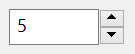
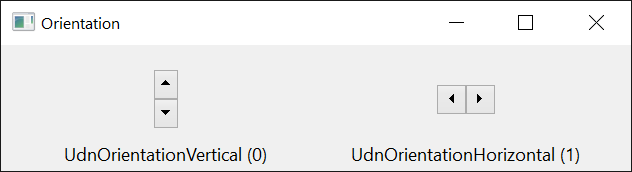

# UpDown class
{: .no_toc }

An **UpDown** is a pair of arrow buttons that raise and lower a number in a range. It draws no number of its own: the program shows the number in another control, or joins the **UpDown** to a control that does, its buddy.

{:width="90" height="36"}

```tb check_build check_run arch=win32,win64
UpDown1.Min = 0
UpDown1.Max = 10
UpDown1.Increment = 2
UpDown1.Value = 50                         ' above Max
Debug.Print UpDown1.Value
' Output:
'  10
```

The control stands in place of the UpDown of the Microsoft common controls (`MSCOMCT2.OCX`). The [WinNativeCommonCtls](../../WinNativeCommonCtls/UpDown) package has an **UpDown** too; this one adds [**BuddyControl**](#buddycontrol) with [**BuddyProperty**](#buddyproperty), [**SyncBuddy**](#syncbuddy) and [**SyncFromBuddy**](#syncfrombuddy), [**SetAcceleration**](#setacceleration), [**Wrap**](#wrap), [**HotTracking**](#hottracking), [**NumberStyle**](#numberstyle), [**ThousandsSeparator**](#thousandsseparator) and the event [**BeforeChange**](#beforechange). The [**SpinBox**](SpinBox) is an **UpDown** that comes with a text box of its own.

Of the [common members](Common), the control has those under [Name and place](Common#name-and-place) but **HelpContextID**, [Window handles](Common#window-handles), **VisualStyles**, [Mouse](Common#mouse) but its **Click** and **DblClick** events, [Dragging the control](Common#dragging-the-control), [OLE drag and drop](Common#ole-drag-and-drop) and [Right-to-left](Common#right-to-left), **RightToLeftLayout** included. It shows no text, so it has no **Font**. It never takes the focus, so it has no keyboard events and no **SetFocus**.

* TOC
{:toc}

## The value

[**Value**](#value) is the position, from [**Min**](#min) to [**Max**](#max): 0 to 10 for a new control. The user's click on an arrow adds [**Increment**](#increment) to it, or subtracts it, and while the button is held the value moves again and again. [**SetAcceleration**](#setacceleration) makes the value move faster the longer the user holds a button.

<!-- test: UpDownTests.Value_OutsideTheRange_IsTheNearestEnd, UpDownTests.Min_AboveMax_Raises380, UpDownTests.Max_BelowMin_Raises380, UpDownTests.Min_AboveValue_MovesTheValue -->
A **Value** outside the range becomes the nearest end of it. A **Min** above **Max**, or a **Max** below **Min**, raises run-time error 380. A new **Min** above **Value**, or a new **Max** below it, moves **Value** to that end.
<!-- /test -->

<!-- test: UpDownTests.Value_Assigned_RaisesChangeOnce -->
Every change of **Value** raises [**Change**](#change), whether the user or the program made it. An assignment that leaves **Value** as it was raises nothing.
<!-- /test -->

At an end of the range, the arrow that would pass it does nothing, unless [**Wrap**](#wrap) is **True**: then **Value** goes round to the other end. **Orientation** says whether the arrows point up and down, or left and right.

<!-- test: UpDownTests.Width_Assigned_KeepsTheWidthOfTheArrows, UpDownTests.Orientation_Changed_ExchangesWidthAndHeight -->
The width of a vertical **UpDown** is that of the arrows of Windows, and an assignment to **Width** does not change it. A change of **Orientation** exchanges the control's width and height.
<!-- /test -->

## What a click raises

<!-- test: UpDownTests.Click_Up_RaisesBeforeChangeChangeUpClick, UpDownTests.Click_Down_RaisesBeforeChangeChangeDownClick -->
A click on the up arrow raises [**BeforeChange**](#beforechange), with the position and the amount about to be added, then [**Change**](#change), and, when the user lets the button go, [**UpClick**](#upclick). A click on the down arrow raises **BeforeChange** with a negative amount, **Change** and [**DownClick**](#downclick).
<!-- /test -->

<!-- test: UpDownTests.BeforeChange_DeltaZero_CancelsTheClick, UpDownTests.Click_AtMax_RaisesUpClickWithoutChange, UpDownTests.Wrap_AtMax_GoesToMin -->
A handler of **BeforeChange** that sets *Delta* to 0 cancels the click, which then raises neither **Change** nor a click event. At the end of the range **UpClick** is raised although the value does not change, and with **Wrap** the value goes to **Min**.
<!-- /test -->

```tb check_build
Private Sub UpDown1_BeforeChange(ByVal Value As Long, Delta As Long)
    If Value >= 5 And Delta > 0 Then Delta = 0     ' the arrows stop at 5
End Sub

Private Sub UpDown1_Change()
    TextBoxW1.Text = UpDown1.Value
End Sub
```

## A buddy

A program that shows the number in another control can join it to the **UpDown**. [**BuddyControl**](#buddycontrol) names that control, and [**BuddyProperty**](#buddyproperty) the property of it that holds the number. The **UpDown** then writes **Value** to that property each time **Value** changes, as a string, formatted by [**NumberStyle**](#numberstyle) and [**ThousandsSeparator**](#thousandsseparator), or as a number if the property is a number. A change the user makes in the buddy reaches the **UpDown** only when the program calls [**SyncFromBuddy**](#syncfrombuddy), for example in the buddy's **Change** event.

<!-- test: UpDownTests.BuddyControl_Control_IsTheBuddy, UpDownTests.BuddyControl_Name_IsTheBuddy, UpDownTests.BuddyControl_OnAnotherForm_IsNothing, UpDownTests.BuddyControl_NotAControl_Raises35610, UpDownTests.BuddyControl_Number_Raises13, UpDownTests.BuddyControl_UnknownName_IsNothing -->
The buddy is on the same form as the **UpDown**. A control on another form, and the name of a control that is not on the form, leave the **UpDown** without a buddy and raise no error. The **UpDown** itself raises run-time error 35610, *Invalid object*, a value of another type than an object or a name raises 13, and **Nothing** removes the buddy.
<!-- /test -->

<!-- test: UpDownTests.BuddyProperty_NoBuddy_Raises35754, UpDownTests.BuddyProperty_UnknownProperty_Raises380, UpDownTests.BuddyProperty_Tag_WritesTheValueAsText, UpDownTests.BuddyProperty_Empty_StopsTheSync, UpDownTests.SyncFromBuddy_Tag_ReadsTheValue, UpDownTests.NumberStyle_Hexadecimal_WritesFourOrEightDigits -->
A **BuddyProperty**, or a **SyncBuddy** of **True**, with no buddy raises run-time error 35754, *BuddyControl property must be set first*. A property that the buddy does not have raises 380. An empty **BuddyProperty** ends the synchronization. A hexadecimal value is written as `0x` and four digits, or eight when it needs more.
<!-- /test -->

<!-- test: UpDownTests.BuddyProperty_Text_ShowsTheValue, UpDownTests.SyncBuddy_True_UsesTheDefaultPropertyOfTheBuddy -->
> [!NOTE] 1.8.142.0, BETA 1045
> **BuddyProperty** accepts only the properties that every control has on its form, such as **Tag**, **ToolTipText** and **Width**. A property of the buddy's own class, such as **Text** of a **TextBoxW**, raises run-time error 380, and so does **SyncBuddy** set to **True** without a **BuddyProperty**, which should take the buddy's default property. A program that wants the value in a text box assigns it in the **Change** event of the **UpDown**, or uses a [**SpinBox**](SpinBox).

```tb check_build
Set UpDown1.BuddyControl = TextBoxW1      ' TextBoxW1 must be on the form of UpDown1
UpDown1.BuddyProperty = "Tag"
UpDown1.Value = 5                         ' TextBoxW1.Tag is now "5"
```

Properties
----------

### BuddyControl
{: .no_toc }

The control that shows the number of the **UpDown**. A control, or the name of one on the form, as a **Variant**; reading gives the control, or **Nothing**. Default: none. See [A buddy](#a-buddy). In the form designer it is the name of the control, chosen from a list.

### BuddyProperty
{: .no_toc }

The property of the buddy that is written with [**Value**](#value) and read by [**SyncFromBuddy**](#syncfrombuddy). **String**. Default: empty, with which the buddy is not synchronized. The name `_Default` stands for the buddy's default property. See [A buddy](#a-buddy) and its note.

### HotTracking
{: .no_toc }

Whether the arrow under the mouse pointer is drawn highlighted. **Boolean**. Default: **True**. A theme can override it. A change makes the control draw again from a new window.

### Increment
{: .no_toc }

What a click on an arrow adds to or subtracts from [**Value**](#value). **Long**. Default: 1. It is not checked, so 0 and a negative number are accepted. While [**SetAcceleration**](#setacceleration) has given a list, it reads the first increment of the list.

### Max
{: .no_toc }

The upper end of the range. **Long**. Default: 10. See [The value](#the-value).

### Min
{: .no_toc }

The lower end of the range. **Long**. Default: 0. See [The value](#the-value).

### NumberStyle
{: .no_toc }

How the number is written to the buddy. A member of [**UdnNumberStyleConstants**](#udnnumberstyleconstants). Default: **UdnNumberStyleDecimal**. Any other value raises run-time error 380.

### Orientation
{: .no_toc }

The direction of the arrows. A member of [**UdnOrientationConstants**](#udnorientationconstants). Default: **UdnOrientationVertical**. Any other value raises run-time error 380. A change exchanges the width and the height.

### SyncBuddy
{: .no_toc }

Whether the control writes [**Value**](#value) to a property of its buddy. **Boolean**: **True** while [**BuddyProperty**](#buddyproperty) is not empty. Setting it to **False** empties **BuddyProperty**, and setting it to **True** chooses the buddy's default property when **BuddyProperty** is empty. See [A buddy](#a-buddy) and its note.

### ThousandsSeparator
{: .no_toc }

Whether a number written to the buddy in decimal has the thousands separator of the user's language, and whether one in the buddy's text is accepted by [**SyncFromBuddy**](#syncfrombuddy). **Boolean**. Default: **True**.

### Value
{: .no_toc }

The position. **Long**. Default: 0. It is the control's default property. See [The value](#the-value). A change raises [**Change**](#change).

### Wrap
{: .no_toc }

Whether the value goes round to the other end of the range when an arrow passes one. **Boolean**. Default: **False**. A change makes the control draw again from a new window.

Methods
-------

### SetAcceleration
{: .no_toc }

Makes the arrows add more the longer the user holds a button.

Syntax: *object*.**SetAcceleration** *Delays*, *Increments*

*Delays*
: *required* An array of numbers: for each step, the seconds the button has been held before the step's increment starts.

*Increments*
: *required* An array of numbers of the same size: the increment of each step.

<!-- test: UpDownTests.SetAcceleration_BadArrays_RaiseErrors, UpDownTests.SetAcceleration_Empty_RestoresIncrement -->
The two arrays have one dimension and the same bounds, or the method raises run-time error 5. An array that is not an array, and is not **Empty**, raises 380, and an array that is not allocated raises 91. Two **Empty** values take the list away and bring back [**Increment**](#increment).
<!-- /test -->

<!-- test: UpDownTests.SetAcceleration_BadDelays_Raise381 -->
The delays are 0 or more, each at least the one before it: a negative delay, or one smaller than the delay before it, raises run-time error 381.
<!-- /test -->

```tb check_build
UpDown1.SetAcceleration Array(0, 2, 5), Array(1, 5, 20)    ' 1 at first, 5 after 2 s, 20 after 5 s
```

### SyncFromBuddy
{: .no_toc }

Reads [**Value**](#value) from the property of the buddy that [**BuddyProperty**](#buddyproperty) names. A text that is not a number leaves **Value** as it was. A text of `0x` and hexadecimal digits is a number when **NumberStyle** is hexadecimal.

Syntax: *object*.**SyncFromBuddy**

Events
------

### BeforeChange
{: .no_toc }

Raised when the user's click is about to change the position, before it does. See [What a click raises](#what-a-click-raises).

Syntax: *object*\_**BeforeChange**( **ByVal** *Value* **As Long**, *Delta* **As Long** )

*Value*
: The position before the click.

*Delta*
: What the click will add: [**Increment**](#increment) for the up arrow, and its negative for the down arrow. A handler changes it, and sets it to 0 to cancel the click.

### Change
{: .no_toc }

Raised when [**Value**](#value) has changed, by the user or by an assignment.

Syntax: *object*\_**Change**( )

### DownClick
{: .no_toc }

Raised when the user lets go of the down arrow after a click that lowered the position, or tried to.

Syntax: *object*\_**DownClick**( )

### UpClick
{: .no_toc }

Raised when the user lets go of the up arrow after a click that raised the position, or tried to.

Syntax: *object*\_**UpClick**( )

## UdnOrientationConstants
{: #udnorientationconstants }

The values of [**Orientation**](#orientation).

{:width="421" height="115"}

| Member | Value | Description |
|---|---|---|
| **UdnOrientationVertical**{: #UdnOrientationConstants_UdnOrientationVertical } | 0 | The arrows point up and down, one above the other. |
| **UdnOrientationHorizontal**{: #UdnOrientationConstants_UdnOrientationHorizontal } | 1 | The arrows point left and right, side by side. |

## UdnNumberStyleConstants
{: #udnnumberstyleconstants }

The values of [**NumberStyle**](#numberstyle).

| Member | Value | Description |
|---|---|---|
| **UdnNumberStyleDecimal**{: #UdnNumberStyleConstants_UdnNumberStyleDecimal } | 0 | Decimal, with the thousands separator if [**ThousandsSeparator**](#thousandsseparator) is **True**. |
| **UdnNumberStyleHexadecimal**{: #UdnNumberStyleConstants_UdnNumberStyleHexadecimal } | 1 | Hexadecimal, as `0x` and four or eight digits. |

## See Also

- [Common members](Common) -- the members this control shares with the package's other controls
- [SpinBox](SpinBox) -- an up-down with a text box of its own
- [UpDown](../../WinNativeCommonCtls/UpDown) -- the control of the same name in the WinNativeCommonCtls package
