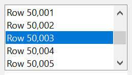

# VListBox class
{: .no_toc }

A **VListBox** is a list box that holds no items: the program tells it how many items there are, and supplies the text of an item in an event each time the control shows it.

{:width="172" height="98"}

```tb check_build check_run arch=win32,win64
VListBox1.ListCount = 100000
VListBox1.ListIndex = 99999
Debug.Print VListBox1.ListCount; VListBox1.ListIndex
' Output:
'  100000  99999
```

It is the [**ListBoxW**](ListBoxW) control without a list of its own, and most of its members are the same. VB6 has no such control.

Of the [common members](Common), the control has every member under [Name and place](Common#name-and-place), [Window handles](Common#window-handles), [Font and visual styles](Common#font-and-visual-styles), [Mouse](Common#mouse), [Keyboard and focus](Common#keyboard-and-focus), [Dragging the control](Common#dragging-the-control), [OLE drag and drop](Common#ole-drag-and-drop) and [Right-to-left](Common#right-to-left) but **RightToLeftLayout**. Its [**Click**](#click) has a meaning of its own, and its [mouse events](#mousedown-mousemove-mouseup) give the position in twips.

* TOC
{:toc}

## Items that the program supplies

The program sets [**ListCount**](#listcount) to the number of items. From then on the list scrolls and selects as any list box, and raises [**GetVirtualItem**](#getvirtualitem) whenever it needs the text of an item: to draw it, to return it from [**List**](#list) or [**Text**](#text), or to give it to a program that reads the list. The handler looks the text up where the program keeps its data, such as an array:

```tb check_build
Private Cities() As String          ' filled elsewhere, from index 0

Private Sub VListBox1_GetVirtualItem(ByVal Item As Long, Text As String)
    Text = Cities(Item)
End Sub
```

The handler is called often, for the items in view each time the list is drawn, so it must be quick and must not change the list.

<!-- test: VListBoxTests.List_RaisesGetVirtualItem, VListBoxTests.List_NoHandler_IsEmpty, VListBoxTests.ListCount_Assigned_RemovesTheSelection -->
The control keeps no text. Without a handler every item is empty. When the data changes, the program sets **ListCount** again if the number of items changed and calls [**Refresh**](Common#refresh). An assignment to **ListCount** leaves no item selected, and raises no event.
<!-- /test -->

## When to choose it

A [**ListBoxW**](ListBoxW) copies the text of every item when it is filled, which takes time and memory in proportion to the list. A **VListBox** takes the same short time for a hundred items and for a million, since it asks for the few items in view. Choose it for a list of many thousands of items, and for data that the program holds anyway, in an array, a collection or a recordset.

What it gives up follows from having no items: there is no **AddItem**, **RemoveItem** or **Clear**, no **ItemData**, no **Sorted**, and no check boxes. The order of the items is the order of the program's data, and searching is the program's work as well.

## Searching

The control cannot search texts that it does not have, so it raises an event for each search and the handler answers with an index.

<!-- test: VListBoxTests.FindItem_RaisesFindVirtualItem, VListBoxTests.Text_Assigned_RaisesFindVirtualItemAndSelects, VListBoxTests.SelectItem_SelectsWhatTheHandlerFound -->
[**FindVirtualItem**](#findvirtualitem) is raised by [**FindItem**](#finditem), by [**SelectItem**](#selectitem), by an assignment to [**Text**](#text), and when another program asks the list to find a text. The handler receives the text, the item after which to start, and whether the beginning of an item's text is enough.
<!-- /test -->

```tb check_build
Private Sub VListBox1_FindVirtualItem(ByVal StartIndex As Long, ByVal SearchText As String, ByVal Partial As Boolean, FoundIndex As Long)
    Dim Index As Long, Candidate As String
    For Index = StartIndex + 1 To VListBox1.ListCount - 1
        Candidate = VListBox1.List(Index)
        If Partial Then Candidate = Left$(Candidate, Len(SearchText))
        If StrComp(Candidate, SearchText, vbTextCompare) = 0 Then
            FoundIndex = Index
            Exit Sub
        End If
    Next
End Sub
```

<!-- test: VListBoxTests.TypedCharacter_RaisesIncrementalSearchAndSelects -->
[**IncrementalSearch**](#incrementalsearch) is raised when the user types a character in the list, to jump to an item. The control collects the characters typed in quick succession into one search string; the handler sets the item to select, and the control selects it and raises [**Click**](#click).
<!-- /test -->

## What is shared with ListBoxW

Selection, columns, scrolling, the insertion mark and drawing work as in **ListBoxW**, whose sections explain them: [Selecting one item](ListBoxW#selecting-one-item), [Selecting several items](ListBoxW#selecting-several-items), [Columns and scrolling](ListBoxW#columns-and-scrolling), [Dragging items](ListBoxW#dragging-items) and [Drawing the items](ListBoxW#drawing-the-items). The items of a **VListBox** all have one height.

Properties
----------

### AllowSelection
{: .no_toc }

Whether the list shows a selection. **Boolean**. Default: **True**. With **False** the user can look at the items and scroll, and a click selects nothing.

### AnchorIndex
{: .no_toc }

The item from which the user's next selection with the Shift key extends, in a list that selects several items. **Long**. A value less than -1, or one that is not an item, raises run-time error 380.

### BackColor
{: .no_toc }

The background color of the list. **OLE_COLOR**. A new control has **vbWindowBackground**.

### BorderStyle
{: .no_toc }

The border of the control. A member of [**CCBorderStyleConstants**](Common#ccborderstyleconstants). Default: **CCBorderStyleSunken**. Another value raises run-time error 380.

### DisableNoScroll
{: .no_toc }

Whether the list shows a disabled scroll bar when all its items fit. **Boolean**. Default: **False**, with which the list has a scroll bar only when it needs one.

### DrawMode
{: .no_toc }

Whether the control or the program draws the items. A member of [**VlbDrawModeConstants**](#vlbdrawmodeconstants). Default: **VlbDrawModeNormal**. With **VlbDrawModeOwnerDrawFixed** the control raises [**ItemDraw**](#itemdraw) for each item to show, and no **GetVirtualItem** to draw it.

<!-- test: VListBoxTests.DrawMode_AtRunTime_Raises382 -->
It is set at design time. At run time an assignment raises run-time error 382, and a value that is not a member raises 380.
<!-- /test -->

### ForeColor
{: .no_toc }

The color of the items' text. **OLE_COLOR**.

### HorizontalExtent
{: .no_toc }

The width over which a list in one column can be scrolled sideways, in the scale units of the control's container. **Single**. Default: 0. The list has a horizontal scroll bar while this is greater than its own width. A negative value raises run-time error 380.

### InsertMark
{: .no_toc }

The item at which the insertion mark is drawn, or -1 for no mark. **Long**. Default: -1. See [Dragging items](ListBoxW#dragging-items).

Syntax: *object*.**InsertMark**[( *After* )] [ = *value* ]

*After*
: *optional* A **Boolean** variable. In an assignment, **True** draws the mark below the item and **False**, the default, above it. When the property is read, the variable receives which of the two the mark is.

A value that is not an item raises run-time error 381.

### InsertMarkColor
{: .no_toc }

The color of the insertion mark. **OLE_COLOR**. Default: black.

### IntegralHeight
{: .no_toc }

Whether the list shows whole items only. **Boolean**. Default: **True**, with which the control makes itself a little lower so that its last item is not cut.

<!-- test: VListBoxTests.IntegralHeight_AtRunTime_Raises382 -->
It is set at design time: an assignment at run time raises run-time error 382.
<!-- /test -->

### ItemHeight
{: .no_toc }

The height of an item, in the scale units of the control's container. **Single**. All items have this height. A negative value raises run-time error 380.

### List
{: .no_toc }

The text of an item, as the handler of [**GetVirtualItem**](#getvirtualitem) supplies it. **String**, read-only.

Syntax: *object*.**List**( *Index* )

<!-- test: VListBoxTests.List_NoSuchItem_Raises5 -->
An *Index* that is not an item raises run-time error 5.
<!-- /test -->

### ListCount
{: .no_toc }

The number of items in the list. **Long**. Default: 0. The program sets it.

<!-- test: VListBoxTests.ListCount_Negative_Raises380 -->
A negative value raises run-time error 380.
<!-- /test -->

### ListIndex
{: .no_toc }

The index of the selected item, or -1 when no item is selected. **Long**. Default: -1. In a list that selects several items it is the index of the item with the focus rectangle.

<!-- test: VListBoxTests.ListIndex_Assigned_SelectsAndRaisesClick, VListBoxTests.ListIndex_NoSuchItem_Raises380 -->
An assignment selects the item, or moves the focus rectangle, and raises [**Click**](#click) unless the value is the one the property has. -1 removes the selection. A value that is not an item raises run-time error 380.
<!-- /test -->

<!-- test: VListBoxTests.ListIndex_MultiSelect_MinusOne_ChangesNothing -->
In a list that selects several items, -1 leaves the focus rectangle and the selection as they are, and raises **Click**.
<!-- /test -->

### MultiColumn
{: .no_toc }

Whether the items are laid out in columns and the list scrolls sideways. **Boolean**. Default: **False**. See [Columns and scrolling](ListBoxW#columns-and-scrolling).

### MultiSelect
{: .no_toc }

Whether the user can select several items, and how. A member of [**MultiSelectConstants**](../../VBRUN/Constants/MultiSelectConstants). Default: **vbMultiSelectNone**. See [Selecting several items](ListBoxW#selecting-several-items). Another value raises run-time error 380.

<!-- test: VListBoxTests.MultiSelect_AtRunTime_KeepsListCount, VListBoxTests.MultiSelect_AssignedToAnEmptyList_RaisesNoError -->
It can be assigned at run time, and the list keeps its **ListCount**. An empty list accepts it too.
<!-- /test -->

### OLEDragDropScroll
{: .no_toc }

Whether the list scrolls by itself while data is dragged over it near an edge. **Boolean**. Default: **True**. It has an effect while [**OLEDropMode**](Common#oledropmode) is **OLEDropModeManual**.

### OLEDragMode
{: .no_toc }

Whether the user can drag items out of the list. A member of [**OLEDragConstants**](../../VBRUN/Constants/OLEDragConstants). Default: **vbOLEDragManual**, with which only [**OLEDrag**](Common#oledrag) starts a drag. With **vbOLEDragAutomatic** a drag that begins on a selected item carries the texts of the selected items, one to a line, to copy. Another value raises run-time error 380.

### OLEDraggedItem
{: .no_toc }

The index of the item on which the drag that is going on began. **Long**, read-only. It is -1 while no drag is going on.

### Redraw
{: .no_toc }

Whether the control draws itself when its list changes. **Boolean**. Default: **True**. Setting it to **True** again draws the control.

### ScrollTrack
{: .no_toc }

Whether the list scrolls while the user drags the scroll box of a scroll bar. **Boolean**. Default: **True**. With **False** the list scrolls when the user releases the scroll box.

### SelCount
{: .no_toc }

The number of selected items. **Long**, read-only.

### Selected
{: .no_toc }

Whether an item is selected. **Boolean**.

Syntax: *object*.**Selected**( *Index* ) [ = *value* ]

<!-- test: VListBoxTests.Selected_NoSuchItem_Raises381 -->
An assignment selects the item or removes its selection, and raises [**Click**](#click) when that changes the selection. An *Index* that is not an item raises run-time error 381.
<!-- /test -->

### Text
{: .no_toc }

The text of the selected item, or an empty string when none is selected. **String**. It is the control's default property.

An assignment raises [**FindVirtualItem**](#findvirtualitem) for an item whose whole text is the value, and selects the item that the handler names. When the handler names none, the selection is removed; in a list that selects several items the assignment changes nothing.

### TopIndex
{: .no_toc }

The index of the first item shown. **Long**. An assignment scrolls the list. A negative value raises run-time error 380.

### UseTabStops
{: .no_toc }

Whether a tab character in an item's text moves the text after it to the next tab stop, which lines the items up in columns. **Boolean**. Default: **True**.

Methods
-------

### FindItem
{: .no_toc }

Raises [**FindVirtualItem**](#findvirtualitem) and returns the index that its handler found, or -1.

Syntax: *object*.**FindItem**( *Text* [, *Index* [, *Partial* ] ] )

*Text*
: *required* A **String**: the text to look for.

*Index*
: *optional* A **Long**: the item after which the search starts. The default, -1, searches from the top. A value that is not an item raises run-time error 381.

*Partial*
: *optional* A **Boolean**: **True** asks for an item that begins with *Text*, **False** (the default) for one whose whole text is *Text*.

### GetIdealHorizontalExtent
{: .no_toc }

Returns the [**HorizontalExtent**](#horizontalextent) with which the widest item can be scrolled into view, as a **Single** in the scale units of the control's container. It raises [**GetVirtualItem**](#getvirtualitem) for every item of the list, so it is slow on a long one.

Syntax: *object*.**GetIdealHorizontalExtent**

### HitTest
{: .no_toc }

Returns the index of the item at a position, or -1 when no item is there.

Syntax: *object*.**HitTest**( *X*, *Y* )

*X*, *Y*
: *required* The position as two **Single** values, measured from the list's top left corner in the scale units of the control's container, as the OLE drag-and-drop events give it.

<!-- test: VListBoxTests.HitTest_EmptyList_ReturnsMinus1 -->
> [!WARNING] 1.8.142.0
> In an empty list the method returns 0, not -1, for a position where the first item would be.

### HitTestInsertMark
{: .no_toc }

Returns the index of the item at a position, as [**HitTest**](#hittest) does, and says in which half of the item the position is.

Syntax: *object*.**HitTestInsertMark**( *X*, *Y* [, *After* ] )

*X*, *Y*
: *required* The position, as for **HitTest**.

*After*
: *optional* A **Boolean** variable that receives **True** when the position is in the lower half of the item, where an insertion mark belongs below it.

### ItemsPerColumn
{: .no_toc }

Returns the number of items that one column of a [**MultiColumn**](#multicolumn) list holds, as a **Long**.

Syntax: *object*.**ItemsPerColumn**

### SelectedIndices
{: .no_toc }

Returns a **Collection** of the indexes of the selected items, in rising order.

Syntax: *object*.**SelectedIndices**

### SelectItem
{: .no_toc }

Raises [**FindVirtualItem**](#findvirtualitem) for an item that begins with a text, selects the item that the handler found, and returns its index, or -1. It raises [**Click**](#click) when it selects another item than before.

Syntax: *object*.**SelectItem**( *Text* [, *Index* ] )

*Text*
: *required* A **String**: the beginning of the item's text.

*Index*
: *optional* A **Long**: the item after which the search starts, as in [**FindItem**](#finditem).

### SetColumnWidth
{: .no_toc }

Sets the width of the columns of a [**MultiColumn**](#multicolumn) list.

Syntax: *object*.**SetColumnWidth** *Value*

*Value*
: *required* A **Single**: the width in the scale units of the control's container. A value that is not greater than 0 raises run-time error 380.

### SetSelRange
{: .no_toc }

Selects a run of items, or removes their selection, in a list that selects several items.

Syntax: *object*.**SetSelRange** *StartIndex*, *EndIndex*

*StartIndex*, *EndIndex*
: *required* Two **Long** indexes. When *StartIndex* is less than *EndIndex*, the items from the one to the other are selected as well as those selected already. When it is not less, as when the two are the same, the selection is removed from those items.

The method raises [**Click**](#click) when the number of selected items changes. In a list that selects one item it selects *StartIndex*. An index that is not an item raises run-time error 381.

Events
------

### Click
{: .no_toc }

Raised when the user selects an item, with the mouse or the keyboard, and when [**ListIndex**](#listindex), [**Selected**](#selected), [**SelectItem**](#selectitem), [**SetSelRange**](#setselrange) or [**Text**](#text) changes the selection. A mouse click on the empty part of the list raises no **Click**.

Syntax: *object*\_**Click**( )

### ContextMenu
{: .no_toc }

Raised when the user asks for the control's shortcut menu, with the right mouse button or with Shift+F10.

Syntax: *object*\_**ContextMenu**( **ByVal** *X* **As Single**, **ByVal** *Y* **As Single** )

*X*, *Y*
: The position of the pointer, measured from the list's top left corner in the scale units of the control's container. Both are -1 when the user asked with the keyboard.

### FindVirtualItem
{: .no_toc }

Raised when an item is to be found by its text. See [Searching](#searching).

Syntax: *object*\_**FindVirtualItem**( **ByVal** *StartIndex* **As Long**, **ByVal** *SearchText* **As String**, **ByVal** *Partial* **As Boolean**, *FoundIndex* **As Long** )

*StartIndex*
: The item after which the search starts, or -1 to search from the top.

*SearchText*
: The text to look for.

*Partial*
: **True** when an item that begins with *SearchText* is asked for, **False** when the item's whole text must be *SearchText*.

*FoundIndex*
: -1 when the event is raised. The handler sets it to the index of the item found, and leaves it when there is none.

### GetVirtualItem
{: .no_toc }

Raised when the control needs the text of an item. See [Items that the program supplies](#items-that-the-program-supplies).

Syntax: *object*\_**GetVirtualItem**( **ByVal** *Item* **As Long**, *Text* **As String**)

*Item*
: The index of the item, from 0 to [**ListCount**](#listcount) - 1.

*Text*
: Empty when the event is raised. The handler sets it to the item's text.

### IncrementalSearch
{: .no_toc }

Raised when the user types a character while the list has the focus. See [Searching](#searching).

Syntax: *object*\_**IncrementalSearch**( **ByVal** *SearchString* **As String**, **ByVal** *StartIndex* **As Long**, *FoundIndex* **As Long** )

*SearchString*
: The characters typed. A character typed soon after the one before is added to the string; after a pause the string starts again.

*StartIndex*
: The value of [**ListIndex**](#listindex).

*FoundIndex*
: -1 when the event is raised. The handler sets it to the index of the item to select.

### ItemDraw
{: .no_toc }

Raised when an item is to be drawn, while [**DrawMode**](#drawmode) is **VlbDrawModeOwnerDrawFixed**. Its arguments are those of the [**ItemDraw**](ListBoxW#itemdraw) event of **ListBoxW**.

Syntax: *object*\_**ItemDraw**( **ByVal** *Item* **As Long**, **ByVal** *ItemAction* **As Long**, **ByVal** *ItemState* **As Long**, **ByVal** *hDC* **As Long**, **ByVal** *Left* **As Long**, **ByVal** *Top* **As Long**, **ByVal** *Right* **As Long**, **ByVal** *Bottom* **As Long** )

### MouseDown, MouseMove, MouseUp
{: .no_toc }

<!-- test: VListBoxTests.MouseMove_XAndY_AreInTwips -->
As the [common events](Common#mousedown-mousemove-mouseup) of these names, but *X* and *Y* are in twips, whatever the scale units of the control's container, and are measured from the top left corner of the list.
<!-- /test -->

### Scroll
{: .no_toc }

Raised when the list has scrolled, so that another item is the first one shown.

Syntax: *object*\_**Scroll**( )

## VlbDrawModeConstants
{: #vlbdrawmodeconstants }

The values of [**DrawMode**](#drawmode).

| Member | Value | Description |
|---|---|---|
| **VlbDrawModeNormal**{: #VlbDrawModeConstants_VlbDrawModeNormal } | 0 | The control draws the items, with the texts that [**GetVirtualItem**](#getvirtualitem) supplies. |
| **VlbDrawModeOwnerDrawFixed**{: #VlbDrawModeConstants_VlbDrawModeOwnerDrawFixed } | 1 | The program draws the items, which all have one height. |

## See Also

- [Common members](Common) -- the members this control shares with the package's other controls
- [ListBoxW](ListBoxW) -- the list box that holds its items
- [VirtualCombo](VirtualCombo) -- a combo box whose items the program supplies
