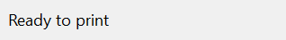

# WindowedLabel class
{: .no_toc }

A **WindowedLabel** is a text that the program shows on a form and the user cannot edit, in a window of its own. It is the [**LabelW**](LabelW) control with a window.

{:width="212" height="30"}

```tb check_build check_run arch=win32,win64
WindowedLabel1.AutoSize = False
WindowedLabel1.Width = 600
WindowedLabel1.SingleLine = True
WindowedLabel1.EllipsisFormat = WlbEllipsisFormatEnd
WindowedLabel1.Caption = "A caption that is much too long for a label this narrow"
Debug.Print Right$(WindowedLabel1.DisplayedCaption, 3)
' Output:
' ...
```

VB6 has no label with a window. The control has the members of **LabelW** with the same meanings, but [**Transparent**](#transparent) in place of **BackStyle**, and [**hWnd**](Common#hwnd) as well.

Of the [common members](Common), the control has those under [Name and place](Common#name-and-place) but **HelpContextID**, [**hWnd**](Common#hwnd), [**Font**](Common#font) and [**FontQuality**](Common#fontquality), [Mouse](Common#mouse), [Dragging the control](Common#dragging-the-control), [OLE drag and drop](Common#ole-drag-and-drop) and [Right-to-left](Common#right-to-left) but **RightToLeftLayout**. The control is one window, so it has no **hWndUserControl**: **hWnd** is the handle of the window on the form. It never takes the focus, so it has no keyboard events.

* TOC
{:toc}

## WindowedLabel or LabelW

A [**LabelW**](LabelW) has no window: its container draws it, behind every control of the container that has a window. A **WindowedLabel** is for the places where that does not do:

- The label can be in front of a control that has a window, in the order that [**ZOrder**](Common#zorder) sets.
- **hWnd** is a handle that a program can pass to an API function.
- The window answers a request for its text with [**Caption**](#caption), so a program that reads the text of windows, such as a screen reader or a test tool, finds the label.

<!-- test: WindowedLabelTests.WindowText_IsTheCaption, WindowedLabelTests.WindowText_Set_ChangesTheCaption -->
The text of the window, as the `GetWindowText` function of Windows returns it, is **Caption**, and setting it with `SetWindowText` sets **Caption** and raises [**Change**](#change).
<!-- /test -->

A window cannot let what is behind it show through as a **LabelW** with a transparent background does. [**Transparent**](#transparent) comes near it: the label copies what its container draws at its place and draws the caption over the copy.

## Lines, wrapping and size

The caption is drawn from the top left corner of the label, and a line break in it (**vbCrLf**) starts a new line. Three properties change that:

- [**WordWrap**](#wordwrap) also breaks a line between words where the label's width ends.
- [**SingleLine**](#singleline) draws the whole caption on one line, line breaks included.
- [**AutoSize**](#autosize) changes the label's size to fit the caption whenever the caption, the font or a property that changes the layout is set.

<!-- test: WindowedLabelTests.WordWrap_WhileSingleLine_Raises383, WindowedLabelTests.SingleLine_True_SetsWordWrapFalse -->
**WordWrap** and **SingleLine** exclude each other. Setting **SingleLine** to **True** sets **WordWrap** to **False**, and setting **WordWrap** to **True** while **SingleLine** is **True** raises run-time error 383.
<!-- /test -->

<!-- test: WindowedLabelTests.AutoSize_LongerCaption_WidensTheLabel -->
A label with **AutoSize** takes the width and the height of its caption. With **WordWrap** as well it keeps its width, unless one word is wider, and takes the height that the wrapped caption needs. The label grows away from the side that [**Alignment**](#alignment) and [**VerticalAlignment**](#verticalalignment) name: a right-aligned label keeps its right edge, and a centered one its middle.
<!-- /test -->

## A caption too long for the label

A label without **AutoSize** shows as much of its caption as fits. [**EllipsisFormat**](#ellipsisformat) makes it say that something is missing, by an ellipsis (`...`) at the end of the caption, in the middle of a file path, or at the end of a word.

<!-- test: WindowedLabelTests.DisplayedCaption_EndEllipsis_EndsInThreeDots, WindowedLabelTests.DisplayedCaption_PathEllipsis_KeepsTheFileName -->
[**DisplayedCaption**](#displayedcaption) returns the caption as the label draws it, with the ellipsis. The control draws itself again whenever a property changes, so the value is current at once.

```tb check_build check_run arch=win32,win64
WindowedLabel1.AutoSize = False
WindowedLabel1.Width = 600
WindowedLabel1.SingleLine = True
WindowedLabel1.EllipsisFormat = WlbEllipsisFormatPath
WindowedLabel1.Caption = "C:\Program Files\Some Vendor\Some Product\bin\program.exe"
Debug.Print InStr(WindowedLabel1.DisplayedCaption, "...") > 0
Debug.Print Right$(WindowedLabel1.DisplayedCaption, 11)
' Output:
' True
' program.exe
```
<!-- /test -->

Properties
----------

### Alignment
{: .no_toc }

Where each line of the caption stands in the label's width. A member of [**AlignmentConstants**](../../VBRUN/Constants/AlignmentConstants): **vbLeftJustify** (the default), **vbRightJustify** or **vbCenter**. Another value raises run-time error 380.

### Appearance
{: .no_toc }

The look of the label. A member of [**CCAppearanceConstants**](Common#ccappearanceconstants). Default: **CCAppearance3D**. Another value raises run-time error 380.

<!-- test: WindowedLabelTests.Appearance_Flat_MakesABorderASingleLine, WindowedLabelTests.Appearance_SetsForeColor -->
An assignment changes a border, if the label has one, to a single line for **CCAppearanceFlat** and to a sunken edge for **CCAppearance3D**, and sets [**ForeColor**](#forecolor) to **vbWindowText** or to **vbButtonText**. A program that wants another border or color sets it after **Appearance**.
<!-- /test -->

### AutoSize
{: .no_toc }

Whether the label changes its size to fit its caption. **Boolean**. Default: **False**. See [Lines, wrapping and size](#lines-wrapping-and-size). The size does not take [**EllipsisFormat**](#ellipsisformat) into account.

### BackColor
{: .no_toc }

The color behind the caption. **OLE_COLOR**. Default: **vbButtonFace**.

### BorderStyle
{: .no_toc }

The border of the label's window. A member of [**CCBorderStyleConstants**](Common#ccborderstyleconstants). Default: **CCBorderStyleNone**. Another value raises run-time error 380.

### Caption
{: .no_toc }

The text of the label. **String**. A control newly drawn on a form has its own name. It is the control's default property.

<!-- test: WindowedLabelTests.Caption_Assigned_RaisesChangeOnlyWhenItDiffers -->
An assignment of another text raises [**Change**](#change). Assigning the text the label already has does nothing.
<!-- /test -->

### DisplayedCaption
{: .no_toc }

The caption as the label draws it: the caption itself, or, with an [**EllipsisFormat**](#ellipsisformat) and a caption too long for the label, the caption with the ellipsis in place of what does not fit. **String**, read-only.

### EllipsisFormat
{: .no_toc }

Whether and where the label puts an ellipsis in a caption that is too long for it. A member of [**WlbEllipsisFormatConstants**](#wlbellipsisformatconstants). Default: **WlbEllipsisFormatNone**. Another value raises run-time error 380.

### ForeColor
{: .no_toc }

The color of the caption. **OLE_COLOR**. A control newly drawn on a form has black. An assignment to [**Appearance**](#appearance) sets it again. While **Enabled** is **False** the caption is drawn in the grey of disabled text.

### MimicTextBox
{: .no_toc }

Whether the label lays its caption out as a multi-line text box does: a word too long for a line is broken between characters, and a last line that would show only in part is not drawn. **Boolean**. Default: **False**. It has an effect while [**WordWrap**](#wordwrap) is **True**.

### SingleLine
{: .no_toc }

Whether the whole caption is drawn on one line. **Boolean**. Default: **False**. Setting it to **True** sets [**WordWrap**](#wordwrap) to **False**. On one line, [**VerticalAlignment**](#verticalalignment) places the line in the label's height.

### Transparent
{: .no_toc }

Whether the label draws, in place of [**BackColor**](#backcolor), a copy of what its container shows behind it. **Boolean**. Default: **False**. The copy is made when the label draws itself, so after the container has changed what it shows there, [**Refresh**](Common#refresh) brings the label up to date.

### UseMnemonic
{: .no_toc }

Whether an ampersand (`&`) in the caption makes the character after it the label's access key. **Boolean**. Default: **True**, with which that character is underlined, the ampersand is not drawn, and `&&` draws one ampersand. With **False** the caption is drawn as it is.

### VerticalAlignment
{: .no_toc }

Where the caption stands in the label's height. A member of [**CCVerticalAlignmentConstants**](Common#ccverticalalignmentconstants). Default: **CCVerticalAlignmentTop**. Another value raises run-time error 380.

### WordWrap
{: .no_toc }

Whether a line that is too long for the label's width is broken between words. **Boolean**. Default: **False**. Setting it to **True** while [**SingleLine**](#singleline) is **True** raises run-time error 383.

Events
------

### Change
{: .no_toc }

Raised when [**Caption**](#caption) has changed.

Syntax: *object*\_**Change**( )

## WlbEllipsisFormatConstants
{: #wlbellipsisformatconstants }

The values of [**EllipsisFormat**](#ellipsisformat).

| Member | Value | Description |
|---|---|---|
| **WlbEllipsisFormatNone**{: #WlbEllipsisFormatConstants_WlbEllipsisFormatNone } | 0 | No ellipsis: the caption is cut where the label ends. |
| **WlbEllipsisFormatEnd**{: #WlbEllipsisFormatConstants_WlbEllipsisFormatEnd } | 1 | An ellipsis in place of the end of the caption. |
| **WlbEllipsisFormatPath**{: #WlbEllipsisFormatConstants_WlbEllipsisFormatPath } | 2 | An ellipsis in the middle of the caption, so that as much as fits of what follows the last backslash still shows: for a file path. |
| **WlbEllipsisFormatWord**{: #WlbEllipsisFormatConstants_WlbEllipsisFormatWord } | 3 | An ellipsis in place of the end of a word that does not fit. |

## See Also

- [Common members](Common) -- the members this control shares with the package's other controls
- [LabelW](LabelW) -- the same label without a window
