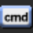
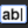
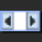
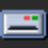
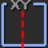
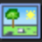
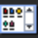
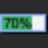
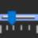
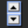

# Controls

The standard set of UI control classes that ship with twinBASIC lives in the **VB** built-in package --- see [VB Package](Packages/VB) for the package landing page. The classes below are grouped by purpose; each entry links to the per-class reference.

## Forms and host classes

These classes are *containers* rather than controls in the strict sense --- they host other controls and back the form/control designer in the IDE.

- [Form](Packages/VB/Form/) -- top-level window hosting controls, menus, and a drawing surface.
- [MDIForm](Packages/VB/MDIForm/) -- top-level MDI parent that hosts MDI-child [Form](Packages/VB/Form/) instances inside a recessed client area.
- [UserControl](Packages/VB/UserControl/) -- base class for designing a reusable ActiveX control in twinBASIC.
- [PropertyPage](Packages/VB/PropertyPage/) -- container backing a single tab of a COM property-page dialog (the **(Custom)** popup on an ActiveX control's property browser).
- [Report](Packages/VB/Report/) -- top-level window specialised for banded report layout, print preview, and printing.

## Buttons and toggles

- {:width="24" height="24"} [CommandButton](Packages/VB/CommandButton/) -- push-button used to trigger an action.
- {:width="24" height="24"} [CheckBox](Packages/VB/CheckBox/) -- two- or three-state check box with an optional text caption.
- {:width="24" height="24"} [CheckMark](Packages/VB/CheckMark/) -- windowless check glyph that scales to fill its rectangle; no caption, no focus.
- {:width="24" height="24"} [OptionButton](Packages/VB/OptionButton/) -- radio-button; option buttons sharing a container form a mutually-exclusive group.

## Text and value input

- {:width="24" height="24"} [TextBox](Packages/VB/TextBox/) -- single-line or multi-line edit control, with optional password masking and digit-only input.
- {:width="24" height="24"} [ComboBox](Packages/VB/ComboBox/) -- edit field combined with a drop-down list of items.
- {:width="24" height="24"} [ListBox](Packages/VB/ListBox/) -- vertically-scrolling list of items, optionally multi-column and multi-select.
- {:width="24" height="24"} [HScrollBar](Packages/VB/HScrollBar/) -- stand-alone horizontal scroll bar.
- {:width="24" height="24"} [VScrollBar](Packages/VB/VScrollBar/) -- stand-alone vertical scroll bar.

## File-system browsing

These three controls are normally connected together to build a complete file picker.

- {:width="24" height="24"} [DriveListBox](Packages/VB/DriveListBox/) -- drop-down list of the drives the operating system reports.
- {:width="24" height="24"} [DirListBox](Packages/VB/DirListBox/) -- directory-tree picker for a single path.
- {:width="24" height="24"} [FileListBox](Packages/VB/FileListBox/) -- file list for a single directory, filtered by wildcard and file-attribute toggles.

## Containers

- {:width="24" height="24"} [Frame](Packages/VB/Frame/) -- captioned container that groups related controls and scopes [OptionButton](Packages/VB/OptionButton/) groups.
- {:width="24" height="24"} [MultiFrame](Packages/VB/MultiFrame/) -- layout container that arranges a set of [Frame](Packages/VB/Frame/) controls in a horizontal or vertical strip.
- {:width="24" height="24"} [PictureBox](Packages/VB/PictureBox/) -- Win32 native control combining picture display, a drawing surface, and a child-control container.

## Display-only

- {:width="24" height="24"} [Label](Packages/VB/Label/) -- windowless lightweight read-only text display, used for captions, status text, and keyboard mnemonics.
- {:width="24" height="24"} [Image](Packages/VB/Image/) -- windowless lightweight picture display; the small, efficient alternative to [PictureBox](Packages/VB/PictureBox/).
- {:width="24" height="24"} [Line](Packages/VB/Line/) -- windowless single straight line between two endpoints.
- {:width="24" height="24"} [Shape](Packages/VB/Shape/) -- windowless geometric primitive (rectangle, oval, circle, star, arrow, …) with configurable border, fill, and rotation.
- {:width="24" height="24"} [QRCode](Packages/VB/QRCode/) -- windowless QR-code renderer populated from a text or byte-array payload.

## Menus

- [Menu](Packages/VB/Menu/) -- item in a Win32 native menu --- top-level entry on a [Form](Packages/VB/Form/)'s or [MDIForm](Packages/VB/MDIForm/)'s menu bar, a drop-down entry, or a separator.

## Data and external content

- {:width="24" height="24"} [Data](Packages/VB/Data/) -- Win32 native control that opens a DAO recordset and exposes record-navigation buttons for bound controls.
- {:width="24" height="24"} [OLE](Packages/VB/OLE/) -- OLE container hosting a linked or embedded OLE Automation object (Word document, Excel sheet, …).
- {:width="24" height="24"} [Timer](Packages/VB/Timer/) -- non-visual control that raises a periodic event at a programmable interval.

## Controls in other packages

The **VB** package is not the whole story, and a control you remember from VB6 may live
elsewhere:

- [WinNativeCommonCtls](Packages/WinNativeCommonCtls/) replaces Microsoft Common Controls
  6.0 (`MSCOMCTL.OCX`) with Win32-native equivalents, keeping the VB6 member names so most
  ported code compiles unchanged. This is where
  {:width="24" height="24"} [ListView](Packages/WinNativeCommonCtls/ListView/),
  {:width="24" height="24"} [TreeView](Packages/WinNativeCommonCtls/TreeView/),
  {:width="24" height="24"} [ImageList](Packages/WinNativeCommonCtls/ImageList/),
  {:width="24" height="24"} [DTPicker](Packages/WinNativeCommonCtls/DTPicker),
  {:width="24" height="24"} [MonthView](Packages/WinNativeCommonCtls/MonthView),
  {:width="24" height="24"} [ProgressBar](Packages/WinNativeCommonCtls/ProgressBar),
  {:width="24" height="24"} [Slider](Packages/WinNativeCommonCtls/Slider) and
  {:width="24" height="24"} [UpDown](Packages/WinNativeCommonCtls/UpDown) are.
- [CustomControls](Packages/CustomControls/) holds the owner-drawn **Waynes...** controls,
  which have no VB6 counterpart.
- [WebView2](Packages/WebView2/) and [CEF](Packages/CEF/) each host a browser engine.

Both of the first two ship with the IDE but are referenced on demand --- add them from
Project → References before the controls appear in the toolbox. See
[Built-In Packages](Packages/Built-In/).

## Controls in contributed packages

[Contributed packages](Packages/Contributed/) on the package server replace VB6 controls
that no package above has. These are by Krool:

- [VBFLXGRD18](Packages/Contributed/VBFLXGRD18/) holds the
  [VBFlexGrid](Packages/Contributed/VBFLXGRD18/VBFlexGrid/) control, a replacement for the
  Microsoft FlexGrid control of VB6 (`MSFLXGRD.OCX`).
- **VBCCR18** replaces the Microsoft common controls of VB6. It has controls that
  WinNativeCommonCtls lacks, among them **CoolBar**, **ImageCombo**, **RichTextBox**,
  **StatusBar**, **TabStrip** and **ToolBar**. This reference has no section for it yet; its
  sources are [on GitHub](https://github.com/Kr00l/VBCCR). The **Standard EXE (+VBCCR)**
  template of the [New Project](IDE/Starting/New-Project) dialog makes a project that
  references it already.

[Importing a package from TWINSERV](../Features/Packages/Importing-TWINSERV) describes how to
add one to a project.
